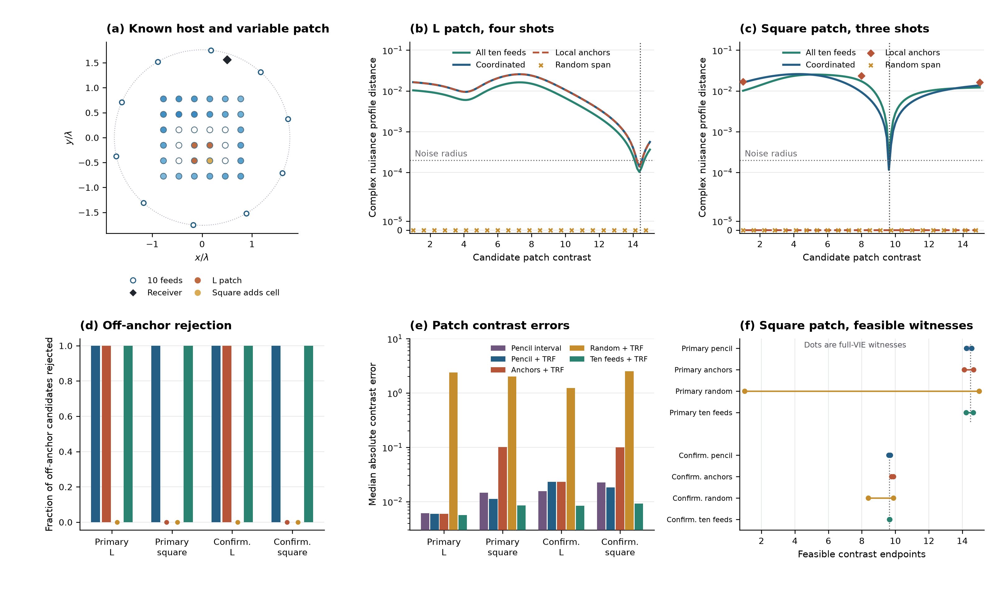

# R7 实验、原始数据与复现

本轮研究的问题是，一只外部接收器能否在其他材料未知时测准一个预先指定的材料量。每个数值比较都给算法同一组物理上可发出的照明、经宿主扣除的复读数及同一目标材料范围。改变照明时比较其获取的信息，固定照明时比较估计器。主表中的误差始终是共享材料参数的绝对误差。

## 四单元和三单元区域的主实验

两个不同的 36 状态二维 TM 宿主，各有 12 个活动脉冲单元、10 个可相干驱动的外部线源和一个复接收器；10 个源全部测完也无法合成任意 12 维宿主场。已知区域有四个共享材料的加载单元时，其余八个活动单元独立，合计九个实参数。三单元 L 形区域相应有十个独立实参数。区域形状是已知位置的离散加载组；实验的 36 个圆盘及间隙不代表连续实心方块的加密网格。

主几何间距 $0.31\lambda$。独立确认几何把间距改为 $0.34\lambda$，旋转、平移阵列内的对象，改变已知宿主、收发器位置和材料样本。每组几何和区域有 16 个新状态，共 64 个状态。校准设计用固定干扰材料 8，源子空间在计算目标数据前选定。对实际测量、投影剖面、TRF 与材料真值评分分别计算。确认组用于比较同一算法，没有按结果挑选几何或材料。几何、源权重、控制组和所有材料都可以从保存数组重建。[完整数据](results/pencil_observations.npz) · [逐行结果](results/pencil_individual.csv)

对照包括协调选源、在多个预测材料值分别把干扰灵敏度消到零并使目标增益最大、相同次数的随机源以及全部十个源模式。每组测量的总辐射能量均为 2，模型功率 Gram 为 $J_0(k|s_i-s_j|)$；最大单束馈电二范数 1.116。三类总误差半径为 $0,2\times10^{-5},2\times10^{-4}$，在所有源组相同，另有 $8\times10^{-13}$ 数值容差。两组发射子空间若仅差酉基变换，其观测噪声也按该变换配对。比较中全部十个源有较多次读数，固定的是总能量和联合噪声半径，没有将三次与十次解释为同一采集时间。实际仪器的切换时间与接收机噪声未测。

| 几何及区域 | 协调 shot | 区间包络宽度中位数 | 区间中点误差 | 同源 TRF | 各自局部消零＋TRF | 随机＋TRF | 十次＋TRF |
|---|---:|---:|---:|---:|---:|---:|---:|
| 主几何，4 单元方形 | 3 | 0.1394 | 0.0146 | 0.0112 | 0.1011 | 2.012 | 0.00849 |
| 确认几何，4 单元方形 | 3 | 0.2154 | 0.0225 | 0.0183 | 0.1004 | 2.505 | 0.00919 |
| 主几何，3 单元 L 形 | 4 | 0.1682 | 0.00611 | 0.00600 | 0.00600 | 2.371 | 0.00567 |
| 确认几何，3 单元 L 形 | 4 | 0.2530 | 0.0157 | 0.0231 | 0.0231 | 1.233 | 0.00838 |

上表使用最大总噪声半径 $2\times10^{-4}$，每个 TRF 以同样八个有界起点拟合全部实参数，以观测残差选解。方形组内，对独立局部消零的配对比较在两种几何均有 13/16 个对象从协调测量受益；分别有 5/16、8/16 个对象的协调测量误差小于十次测量。两种算法均获得相同的全非线性物理算子，所有起点包括达到调用上限的情况都留在原始记录。样本数支持同两种几何上的因果对照，不能给出其他几何的胜率。[逐起点记录](results/pencil_raw.json) · [比较图](figures/pencil_comparison.pdf)

**机制与可检验的反例。** 四单元区域的两个一般聚焦方向对应两条一次模板链。将同一条链的三个系数分别编为实际波形，能在整个材料区间合成所需的干扰消零方向。逐点独立优化的三个锚点没有维持这一关系，两个几何的最大子空间夹角是 $29.8^\circ,34.2^\circ$。在复干扰放宽的精确线性剖面中，三束局部设计在非锚点网格上不能排除任何候选。协调设计的中位排除比例为 1；统计排除了距真值 0.25 以内的点，并非全域唯一性证明。L 形的聚焦核通常只有一维，四个不同锚点自动张成同一空间，含噪读数经基变换相差至多 $1.88\times10^{-16}$。真实非线性与宿主 Born 响应的相对差中位数为 1.448。全波含多次散射。[理论第 3–6、8 节](THEORY_DERIVATIONS.md) · [奇异值、剖面及费用](results/RESULTS_PENCIL.md)

**具体材料歧义。**

- 主几何方形样本 3 的真值为 12.71329。局部锚点源组容许材料 12.10151 和 13.15373，完整 36 状态正演残差分别为 $4.44\times10^{-14}$ 和 $1.30\times10^{-15}$。确认几何方形样本 3 的真值为 12.95317，见证分别为 11.69361 和 13.73812。32 个方形样本中有 16 个在数值容差下找到不同的真实有界材料解释。完整干扰材料向量、可逆性指标与残差一起保存，未提升为严格零噪声根证书。[完整材料对](results/pencil_feasible_followup.json)
- 主几何的一个 L 形样本真值为 1.63588。协调四束测量的解集外包是 $[1.44452,1.85122]\cup[6.57532,6.73438]$。对同一份带噪数据，完整正演分别在 1.64787 与 6.65485 给出 $4.45\times10^{-5}$ 与 $2.35\times10^{-5}$ 的残差，二者均低于 $2\times10^{-4}$。两段都含真正可行的物理材料。只发一个最小残差解或只报中点都会漏掉这一事实。[两段区间与全波见证](figures/pencil_disconnected.pdf)

64 个材料各用三档误差，192 个名义模型的外包集合都包含真值；同一目标在三档重复，不能当成 192 个独立样本。低噪声 $2\times10^{-5}$ 时，两种方形几何的包络宽度中位数为 0.0141 和 0.0209。零噪声的 64 个测量多项式在实验容差内都没有第二个合法实根。这只描述抽到的情形。最小次数的秩论断以有余量的数值奇异值作几何实例证据，通用代数命题另有证明。[数据汇总](results/pencil_summary.json)

## 导致主方法改变的实验

1. **指定一个单元。** 49 状态、9 个独立活动材料、一个外部接收器，24 个材料配置在四种布局中配对。两束直接读取中间的一个单元。在每 shot 噪声参数 $\sigma=10^{-4}$、总半径 $\sqrt{s}\sigma$ 时，两种紧密布局的区间宽度中位数都是全 box 的 29.5，完整 box 分别出现 21/24、18/24 次；等总能量九束 TRF 误差中位数仅 0.061、0.126。间距扩大后，全环和弧阵的两束宽度变成 0.588、1.728。全环宽间距样本 0 的真值为 3.95117，两束区间 $[3.89465,4.03062]$，而等能随机两束的物理见证从 1.35047 延伸至 30。这说明外部场空间的秩还不足以判断可测性。[实验设计及各案](results/RESULTS_PHYSICAL.md) · [论文图](figures/physical_comparison.pdf)
2. **固定值的局部对照。** 在已有 H12 几何上新改变干扰材料并比较波形，复 Jacobian 消零与固定位点合成的馈电相对差至多 $1.51\times10^{-15}$。全环内固定目标值时读数最大漂移约 $1.22\times10^{-16}$；只对宿主聚焦的漂移达 0.097。把全环收窄至 $120^\circ$ 后，目标增量 2 对应的中位读数变化由 0.00502 降至 0.000512。原接收器的一个专门搜索到的暗材料状态允许首坐标从 0.5 改到 30，八个原始源差异维持数值零；换到对面接收器，最大差为 0.05012。该暗点是构造的数值见证，不能估计自然发生率。[原始结果](results/geometry_controls.json) · [对照图](figures/geometry_controls.pdf)
3. **能否用同一内部模板读一个高秩区域。** 独立的 17 状态几何含 12 个活动坐标、10 个实际发射器和 5 个已知宿主坐标。把目标从一个活动坐标增大至七个，单一试探材料能用的模式维数为 0、0、1、2、3、4、5；适用整个区间的常数模板维数为 0、0、0、0、1、2、3。六单元组在标称 12 附近，两束真数据要求目标改到 13 时的最小读数改变量至少 0.00212323，受约束全波拟合达到了此界。改动一个外部干扰坐标 4 却可维持读数到 $3.31\times10^{-15}$。区域实际不均匀时，读数给出依赖复场的加权值；人为施加零均值、峰值 1 的不均匀性，六单元的实读数偏离算术均值中位数为 0.279，2/128 次甚至越过该区域实际材料的取值范围。[逐配置数据](results/geometry_patch.json) · [区域维数和误差图](figures/geometry_patch.pdf)
4. **在连续面积上计算干扰。** 半径 $0.24\lambda$ 均匀目标与 $0.32$–$0.84\lambda$ 开环形干扰区不重叠。12 个外部二维线源和一个单接收器。相同目标导数下，八点消零的最大点残留为 $1.62\times10^{-13}$，但区域内最坏实 $L^2$ 干扰导数达 117.26，最小复面积干扰束仅 2.775。后者的辐射通量为 287.8，八点束为 $5.04\times10^5$，目标单位增益归一化与其他实验的固定总能量不可混比。正负扰动的非线性差分随步长减半，导数误差约缩小四倍。[连续实验](results/RESULTS_CONTINUUM.md) · [灵敏度实空间图](figures/continuum_leakage.pdf)
5. **补上非线性而非只看导数。** 给固定目标施加 +0.10 的均匀材料变化，在不相交环内加入平滑实补偿。数值 bump 在环的两边界以无穷阶趋零，非零点都在开环内；严格定理的测试函数还可取为紧支撑于任意更小的开子域。2、4、12 个相干独立线源的设计网格共用单接收器，最后一次拟合在 960 点完成；原样把补偿材料放到另两套积分网格。2,640 点结果的残差占未补偿目标信号的 $2.32\times10^{-5},2.28\times10^{-4},6.84\times10^{-4}$，全部 12 束时干扰材料从 −0.16145 到 +0.13643。取得相同设计网格的机器精度与取得跨网格小残差是两件不同的事。严格连续结论是均匀参考附近的局部存在性，其幅度半径未量化。[补偿材料图](figures/continuum_mimic.pdf) · [各网格和读数](results/continuum_mimic.json)

## 带宿主误差的一次修正及其代价

沿用两种方形几何和已经评分的 32 个材料，固定额外误差为全部已知宿主坐标增加 1%。这是从实际失败出发的配对复查，独立确认的证据仍来自前面的两种标称几何。原三束、原总噪声和标称传播不变时，覆盖由 32/32 降到 14/32，九个集合为空。即使扣除准确的空宿主信号，内部传递仍有误差，覆盖为 8/32，17 个集合为空。这里空集诊断的是假设与数据不相容，仿真对象确实存在。[失配原始材料行](results/geometry_mismatch.json)

随后每种固定的宿主及收发器布局增加一次单位能量的空载照明。用模拟的空载读数和 $2\times10^{-4}$ 的标定噪声半径，拟合已知宿主各单元材料的共同倍数。主几何估计为 1.009606，确认几何为 1.011349。每种布局将同一次标定结果用于其 16 个样本。波形设计和反演都使用估计倍数，加载观测则用设定倍数 1.01 生成。每个样本使用三束重新设计的波形，总能量为 2。两组各有 16/16 个目标区间包含真值，区间中点的最大绝对误差为 0.172。五例实际总误差超出最初的名义噪声半径。[标定读数和 32 行结果](results/geometry_calibrated.json)

最后只用该空载读数计算尺度外包，再用被动实载荷散射算子界传播到整个目标材料 box。主和确认组的尺度最大偏差分别为 0.0007061 和 0.0014246；第 10 节公式的扰动乘积分别为 0.0889 和 0.1110，均小于 1。外包在两组里各有 16/16 覆盖。对应的目标区间宽度中位数由名义噪声的 0.1399、0.2146 增至 1.0638、2.8096，32 例均未退化到整个 box。数据中观测到的投影系统误差最高占其上界的 1.20% 与 2.97%。新增计算为 1,024 次 24 维空载标定小系统，无新增全加载正演。这说明保证成立与保证有足够精度之间仍有可量化差距。[逐对象验证、最小辐射特征值与花费](results/host_error_bound.json) · [误差界实现](src/host_error_bound.py) · [逐目标宽度和空集图](figures/host_calibration.pdf)

## 计算费用及科学检查

主区域比较在 CPU 上运行约 59 秒 CPU 时间（768 个观测/算法行）。每个宿主复用一次 36 维 LU 和 22 个复 RHS。最大噪声时读区间用时中位数 0.30–0.36 ms，八起点同源 TRF 用 73–78 ms、591–654 次约化分解。二者输出分别为单参数集合与完整参数拟合，时间比不能推广到同质量全图恢复。单点比较约 167 秒 CPU 时间（2,400 个观测/算法行），固定值及常数模板实验分别约 1.93、1.78 秒 CPU 时间。费用不将模拟一束所需的计算时间冒充仪器采集时间。有限截面与矩阵铅笔在 CPU 上已达上述量级，没有部署 CUDA。各成本以脚本记录的边界为准；未把浏览论文、撰写和各独立探索折算成统一总算力。

完整与约化正演的最大差分别为 $2.36\times10^{-16}$（单点）和 $1.02\times10^{-16}$（多项式区域）；区域 TRF 的解析 Jacobian 与中心差分相对差最大 $1.11\times10^{-9}$。在秩一的消零补空间，直接的复干扰剖面距离与多项式残差除以馈电范数相差至多 $7.03\times10^{-17}$。实数区间曾在孤立的无理切点漏解，修正为在切触或零噪声时对**输入系数**作实一元根隔离，八个特定例子通过。修正后所有 192 个已保存样本的区间端点保持一致；不存在将不确定连续物理系数升级为严格证书的步骤。[检查结果](results/pencil_summary.json)

## 复现入口

从本目录运行，使用同一仓库的 `research/research_z_alg_r2/src/physics.py`。H12 对照还读取仓库 R5 的 `amendment_codex/results/H12_contract.json`。Apple M4、arm64；本地可用的复现环境为 Python 3.13.13、NumPy 2.5.3、SciPy 1.18.1、Matplotlib 3.11.1 与 SymPy 1.14。各实验自行生成数据，无须 R6 私人附件，也无须 GT 选择源。几何、核参数、种子、能量和独立变量索引均在源文件中。

~~~~bash
python src/physical_experiment.py
python src/plot_physical.py
python src/geometry_controls.py
python src/geometry_patch.py
python src/pencil_experiment.py
python src/pencil_followup.py
python src/plot_pencil.py
python src/geometry_mismatch.py
python src/geometry_calibrated.py
python src/host_error_bound.py
python src/plot_host_calibration.py
python src/continuum_leakage.py
python src/continuum_mimic.py
~~~~

[核心反演代码](src/patch_pencil.py) · [实验配置](src/pencil_experiment.py) · [理论](THEORY_DERIVATIONS.md) · [中文研究报告](RESEARCH_REPORT_ZH.md)
