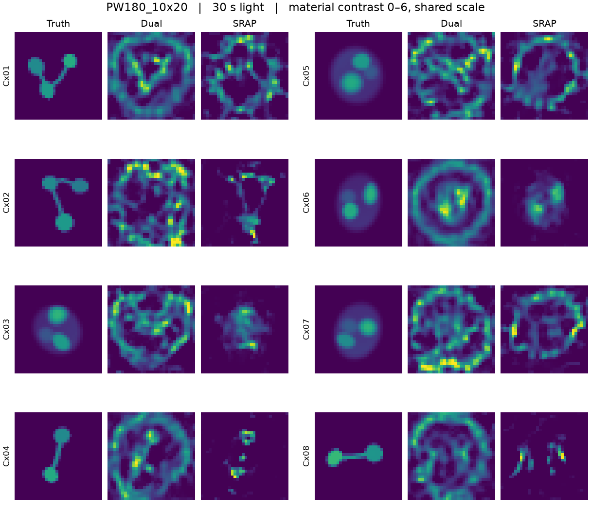
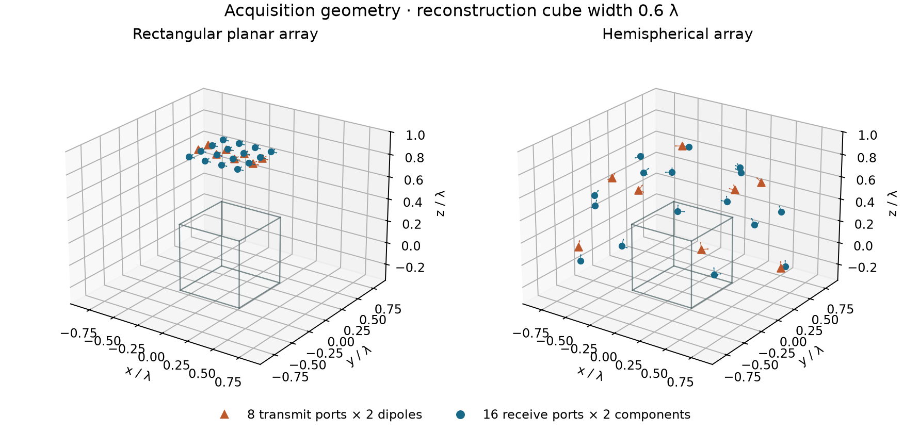

# SRAP-CIE 在什么阵列上能恢复更多材料？

**SRAP-CIE 在二维半环能显著减轻背景伪影，也确实能救回部分物体；三维收益集中在预算较宽的半球阵。现有证据支持有限视角机制研究，通用高对比成像及实测全面优于 Dual-CIE 的强 TAP/TGRS 主张应降级。** 在 24 个新二维材料的标准 180° 布局，30 秒 raw 降低材料误差 21/24、中位降幅 39.1%，轻校正后为 22/24、31.9%。raw 的 21 次改善中有 18 次目标内部误差反而增加。另一个独立的 8 材料组在同一布局的确出现了可辨的结构增益，其中 Cx06 的两处高对比中心和较弱的宿主分布都在正确位置。但在 120° 的原设定，缩小接收子空间之前，多数入选材料接近空气；真实 Fresnel 和三维结果也分别界定了这个机制的适用范围。

上图每个小组依次为真值、Dual-CIE 和 SRAP-CIE。相同原物理校正、30 秒、同一 0–6 材料对比度色标。Cx06 的两个中心正确，Cx04 的两个端点可辨但中间细桥仍断，Cx05 仍画出伪环。三类结果在逐例表中都保留。[视觉判读与全部图册](VISUAL_REVIEW_ZH.md)

## 1. 这一次真正改变了哪一步

保留成熟 Dual-CIE 的逐源 PR 电流更新、Fourier/DPCS 合法表示、共享实材料读出和原物理校正。每 16 步或阶段末，仅对接收弱、内部 Green 传播强的方向作一次联合场—电流交替投影，之后回注合法表示、重置 PR。删除原 U11 稠密材料分母和 DR 反射。二维的传播图投影改为矩阵自由 FFT-CG；60² 的端口延迟准备版本在首次真正碰到噪声球边界时建立并缓存端口因子。二维标量 LS 读出仍包含原 smooth 和 TV 的共同优化（权重各 10⁻⁴）。三维把每体素的三分量和所有照明联合读成一个实对比度。

固定公共预测规则为截至计时点最低的已审计原 Maxwell 目标。另给共同物理校正最多20步，费用来自同一预算的后20%。以空气和真值及两种算法的全图并排解释，初始空气的材料相对 L2 等于 1。收敛到空气也可压低一张伪影很重的图的误差。没有事后改阈值。二维 15/30 秒，三维 60/180 秒，合成均 10% 复噪声和细网生成、粗网反演。[公式与条件](THEORY.md) · [冻结合同](FROZEN_DESIGN.md) · [全部预算与区间](PAIRED_TABLES_ZH.md)

## 2. 相同材料、同通道数、不同阵列

二维主组为 24 个独立对象，其中六类各四件。每个物体复用到七种 10 发 × 20 收阵列，在同一阵列上对照两法。32² 反演保留 1,024 个材料未知量。每个物体两臂在同机运行。表中正降幅表示材料 L2 下降，先算每个物体降幅，再取中位；IoU 在离线真值半峰阈值下统计。区间对独立材料重采样，未校正多阵列比较。

| 阵列 | raw 胜/平/负 | raw 配对中位降幅（95%） | 轻校正胜/平/负 | 轻校正配对中位降幅 | 轻校正 IoU 中位，Dual / SRAP |
|---|---:|---:|---:|---:|---:|
|标准 180° 平面波|21/1/2|+39.1% [+27.2, +47.3]|22/0/2|+31.9%|0.136 / 0.084|
|翻转接收弧 180°|23/0/1|+14.9% [+8.3, +26.0]|23/0/1|+15.5%|0.087 / 0.022|
|120° 平面波|1/22/1|+0.0% [+0.0, +0.0]|8/13/3|+0.0%|0.023 / 0.019|
|稀疏满环|12/0/12|+0.1% [-58.4, +40.9]|14/0/10|+11.0%|0.394 / 0.657|
|有限源、同侧直线|0/24/0|+0.0% [+0.0, +0.0]|7/15/2|+0.0%|0.000 / 0.000|
|有限源、对侧直线|5/12/7|+0.0% [+0.0, +0.0]|5/8/11|+0.0%|0.003 / 0.000|
|有限源、同角弧接收|0/24/0|+0.0% [+0.0, +0.0]|6/15/3|+0.0%|0.000 / 0.000|

标准半环的 raw 背景误差中位从 1.768 降到 0.523，但只有 3/24 例同时改善目标内外。21 个 L2 胜例中，19 个的高对比 IoU 没有提升。相对照，轻校正后 003 的三体 IoU 0.116→0.798、010 的双环 0.105→0.619、013 的三体 0.131→0.793、018 的偏心核壳 0.160→0.790；这些是图上有明确材料增量的对象。007 和 011 在两臂完全相同的第1步就触到材料上界。SRAP 在30秒内未能用更低的付费物理目标替换这两个早期饱和材料；007 换成满环反而得到本批最大的 raw 相对降幅。此处既是计时下的可达性问题，也暴露了依靠训练目标选择材料的局限。[007 七种布局](figures/confirmation_atlas_30s/s2d_007.png) · [主集逐对象浏览](figures/confirmation_atlas_30s/index.html)

再对共同校正做一次同种子比较。标准半环 30 秒的 24 个 SRAP 种子都降低了原物理 Φ，但材料 L2 只有 11 个下降、13 个上升；半峰 IoU 有 17 个上升、7 个持平。Dual 的 24 个种子也都降低 Φ，材料 L2 有 5 个下降、19 个上升。这里比较的是各自 24 秒内选中的材料与其实际校正输出。[校正前后逐物体记录](results/corrector_seed_changes.csv)

另外 8 个独立物体用于把平滑高低混合和有实体窄桥的材料纳入研究。标准半环的 raw / 轻校正分别 **8/8、8/8** 胜，中位材料 L2 下降 **51.7% / 55.2%**；raw 的 95% 配对区间为 **24.0%–66.9%**。raw 前景背景分解表明，8例中5例在目标内、外同时改善，另外3例目标内部变差但总误差仍下降。三例的 SRAP 原始半峰 IoU 为零。仅把发射方向翻转、保持接收 S 和所有通道数相同时，raw 仍 8/8 胜，中位降幅降到 **13.3%**。两个源设置具有独立噪声，图像的变化包含该影响。把 120° 角窗移到与 180° 相同的中轴，原秩下两个方法 8/8 raw 都选空气。实际孔径和采样方位都值得记录。[补集全部 32 个布局结果](figures/followup_materials_30s.pdf) · [收到的通道与阵列坐标](DATA2D_FOLLOWUP_ZH.md)

## 3. 有限孔径为何会卡在空气

确定性电流由接收 S 的截断伪逆给出，并在后继 PR 更新中被锁住。固定保留 15 维时，相同定义的均方噪声放大在满环为 0.96、半环 8.05、120° 为 380、两种直线为 9,179；同视线的有限源弧接收更高，约 11,728。以训练 S 的 0.1σ₁ 为下限，两种直线和同角弧都剩 7 维，噪声放大均降至约 1.52。变化可仅凭公开的阵列算子计算。它指向一个可修复的误差来源；截断同时丢失信号，材料结果需要实测。

两种算法共用上述截断后，对侧直线的 30 秒 raw 材料 L2 中位从原秩的 4.222 / 6.155（Dual / SRAP）降至 **1.739 / 1.021**；截断臂之间 SRAP 为 15胜9负，中位降幅 14.8%，95% 区间 [−5.8%, +48.9%]。同侧直线和同角弧的原秩 raw 两臂均 24/24 选空气；截断后两种几何的 SRAP 对截断 Dual 均为 6胜18负，且二者在两种几何的半峰 IoU 中位仍为零。恢复振幅及拓扑需要比减少不稳定锁定方向更多的信息。[固定三个对象的截断前后原图](figures/line_cap_examples_30s_light.png)

同一门槛在新八例中让原本接近全空气的 120° 解重新出现结构，也会伤害个别材料。采用截断时，标准 120° 的 Dual / SRAP raw 中位 IoU 为 0.319 / 0.170；把窗居中后为 0.181 / 0.178。两种对比的相对材料误差降幅区间都跨零且很宽。这是对共同表示的修正，收益要与也采用截断的 Dual 配对。[接收谱和噪声](results/geometry_noise.csv) · [每个对象的误差在目标和背景的分布](results/spatial_balance_objects.csv)

## 4. 哪一步改变了成像轨迹

在完全相同的第16步公共状态分叉，包括已用电流、材料、场、PR 历史和系数。传播图给出的改变量为 (d,Bd)，分别投影后出现精确的临时传播缺口 (ΠB−BΠ)d。保留相同电流、按 BΠd 重建场的干预可以单独移除这项。120° Austria 刚执行 SRAP 时训练残差 1.308，高于继续 Dual 的 1.029；再走八步则 SRAP 为 1.055、Dual 为 1.103，全空间 AP 为 0.989。Twin 8 GHz 的同类次序相反。一次辅助投影能改变后续路径，训练残差的即时升降不足以决定哪种材料最好。

在四个已存状态中，合法 Fourier 回注丢弃了期望电流改变量平方能量的 27.55%–60.21%。其中 54.64%–66.75% 丢在 DPCS 锁定空间，其余落在当前 Fourier 模式表示不了的正交补。Fresnel 的第一次子空间动作几乎避开锁定方向，经共享材料读出后却有 18.39% 的电流变化重新进入锁定方向。这个中间旋转直接可测，也解释了为何只按 S/G 谱给材料分支分类会漏掉重要一步。新主集预先指定“首周期回注损失越大、最终收益越小”的方向预测。30秒 raw 的 Spearman 相关在满环为 −0.357，在标准半环和翻转接收时分别为 +0.277、+0.230；其余两种 raw 全空气几何无法定义相关。这一指标未给出可跨阵列采用的选路规则。[同状态干预](engine_dev/REPORT_ZH.md) · [12个分支的正交分解](engine_dev/INJECTION_LOSS.md) · [首周期与最终材料恢复](results/first_cycle_associations.csv)

## 5. 真实 Fresnel 2005 半环测量

本轮有三件独立实物、八种频率和收发掩码设置。使用空场校准、真实通道缺失掩码、60² 全图、空气起点、box [0,20]，并在训练之外的完整复场上评分。Twin 8 GHz 的额外掩码都含 733 条观测，共同留出含 1,205 条未见源通道和 390 条互补接收通道。连续/交错对照同时改变收发覆盖。无逐像素材料真值，以下只报告真实测量预测和可直接看见的空间特征。

| Twin 8 GHz，Mac 同机 30 秒轻校正 | 留出发射，Dual / SRAP / 延迟 SRAP | 留出接收，Dual / SRAP / 延迟 SRAP |
|---|---|---|
| 连续单侧收发 | 1.001 / 1.026 / 1.025 | 0.982 / 0.999 / 0.998 |
| 等通道交错收发 | **0.257** / 0.823 / 0.798 | **0.172** / 0.631 / 0.598 |

低对比统一色标下，连续单侧的三种方法均画出波纹；在交错观测下，Dual 显示两个位置明确的亮团，SRAP 两臂仍是零散像素。同一 Twin 换到 6 GHz、仅限制发射时，延迟 SRAP 和 Dual 的轻校正均分出两团，未见源误差分别为 **0.141、0.162**。实测支持这一具体改进，也明确给出在另一频率失效的反例。

60² 首个开发状态的图投影本已在球内（距离/半径 0.465）。延迟构造端口 Schur 因子将**准备加投影从 17.49 秒降到 1.45 秒**，返回场相同。对已激活约束的测试，如果改成逐次按需迭代端口系统，则单次要 42.99 秒；预建后的批量解要 0.069 秒，另付一次预建。因此正式修正采用首次需要时建立并缓存。完整实测八个设置全部纳入，Twin 8 GHz 半发射下延迟版在30秒的 PR 步从78增到177，留出发射的轻校正误差从0.786降到0.497，仍高于 Dual 的0.273。[实测三臂原图](figures/fresnel_lazy_materials_30s_low.png) · [同机完整实测表](results/fresnel_lazy_metrics.csv) · [XINAN 两个匹配掩码](results/measured_extra_metrics.csv)

## 6. 三维平面阵和半球阵

12个新三维物体各用两种阵列观测。180 秒半球阵中，SRAP 的 raw 材料 L2 **11/12** 较低，轻校正后 **9/12** 较低。轻校正的配对 L2 绝对改善中位 **0.0113**（对象 bootstrap 95% 区间 **0.0024–0.0243**）；体积 IoU 中位由 0.430 升至 0.488。缩短到60秒，轻校正配对改善变为 **−0.0147**，区间跨零。矩形面阵在180秒轻校正时 L2 仅改善 **0.0025**，区间 [−0.0044, +0.0041]，两臂的体积 IoU 中位均为零。

从切片看，半球 02 的壳内凹陷增强，03 的开缝两法都能辨，00 的真实闭腔在两臂中都被填实，三个分离体对象都未达到真值半峰。平面阵上相同目标多数变成一个弱的宽峰。整个正式组中，Dual 和 SRAP 的 raw 实际耗时中位为 **6.81 秒和 39.96 秒**。两者均可在上限内完成，但这项小幅半球增益付出了显著额外的实际费用。[半球全部切片](vector/REPORT_ZH.md) · [平面阵代表切片](vector/figures/slices_plane_grid.png)

每组 8 个发射位置各 2 个偶极、16 个接收位置各 2 个分量，共 512 个复通道；最近端口至中心均为 0.9λ。单侧平面阵为真正的 2×4 发射和 4×4 接收矩形网格。两阵的距离分布和角覆盖仍不同。使用 24³ 生成、12³ 反演的全矢量 Maxwell 模型，独立球 Mie 复远场误差从 7.95% 降到 6.15%。预定偏心壳的 24³ 与独立 36³ 复端口差为矩形面阵 1.92%、半球阵 1.71%。 稀疏观测、12³ 空间分辨率和 0.6λ 电尺寸限制了向其他三维问题的外推。三维图投影使用 FFT-CG，路由基保留三千余方向，实际求谱使用 5,184 维稠密 Hermitian 分解。

[三维完整数值与固定切片](vector/REPORT_ZH.md) · [三维逐对象表](vector/objects.csv)

## 7. 解释旧的 9/11，并给出论文判断

重新核对后，旧 Mac 三阶段、DPCS 上限15的 U11+routed AP 对历史两基线较低误差为 9胜2平，raw/轻校正中位降幅 30.25%/28.92%。旧 XINAN 文件其实用四阶段、上限5，raw 为2胜9负。此次使用相同公开日程和数据在两机重放，轻量版 SRAP 与单独 Dual 对照的 11 个历史设置，在 Mac 为9胜2平、降幅26.0%，XINAN 为6胜2平3负、降幅1.8%。两机当时的单线程物理审计和 FFT 工作量耗时相差 2.18–2.39 倍，未控制单一硬件因素。Mac 的 εr=5 核壳中，U11 的内核亮区仍在，SRAP 只留下薄环，中空伪影与本来的核壳有本质区别。新的半环结果须说明日程、预算、采集和具体恢复结构。[跨主机核壳、弯环与偏心壳图](figures/legacy_cross_host_30s_light.png) · [历史配置审计](engine_dev/HARDWARE.md)

**论文定位。** 当前足以形成一篇有完整反例和开放数据的计算成像机制稿。标准 180° 的相对 L2 收益在分给两台机器的材料子集都存在，但受益位置以背景为主；额外八例显示某些内部峰也能可靠找回。三维半球在较长预算有小幅收益，矩形面阵缺乏可辨结构，实测需按频率与掩码分别判断。仅凭这些结果仍不支持以“普遍高对比材料恢复且更省时”为主张的强 TAP/TGRS 论文。 本研究能支持的公式结果是有限离散状态中临时传播缺口与合法回注的两项损失。它们可以精确定位局部步骤丢失的信息，尚未给出连续 Maxwell 逆问题的稳定性界，亦不足以单凭一个谱量预测该接受哪次干预。下一步最有区分力的问题是，能否由共享材料投影后的可回注电流和多视角重复测量，提前识别会损伤拓扑的路由。对比应固定真实物体和采样方位、单独更换独立噪声实现，并把锁定噪声与抛掉的真实信号分别估计。

[英文论文初稿](PAPER_DRAFT.md) · [计算费用](COST_LEDGER.md) · [复现方式](REPRODUCE.md) · [下一轮交接](CHAT_HANDOFF.md)
