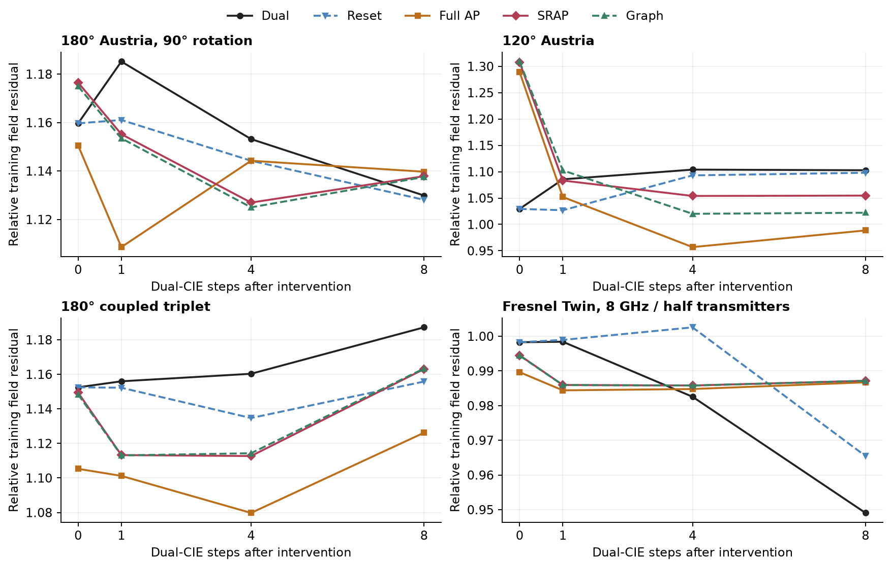

# 同状态干预、投影误差与端口准备费用

四个开发问题从 Dual-CIE 的同一个第 16 步状态分叉。8 步后，路由 AP 在两个合成问题比继续 Dual 的训练场残差低，在另一个合成问题和一个实测问题更高。四个问题中，最佳动作分别是仅重启、全 AP、全 AP、继续 Dual。路由压低了训练端口上的电流扰动，但这种局部性质不能单独预测后续训练残差。样本与主要确认实验分开记录。

## 1. 从完全相同的场、电流和材料开始

按冻结日程从空气重放，分叉前逐位核对 J、Q、m、傅里叶系数、PR 梯度与方向及两份 AP 记忆。五个分支取同一训练输入。每个分支按第 0、1、4、8 个后续 CIE 步重新正演审计材料。第 0 点是施加本次干预后，第 1 点才包含下一次 CIE 更新。所有曲线使用原始观测归一化复场误差。这里衡量早期因果反应，等墙钟全程选择以及留出数据评分见主报告。

| 开发问题 | Dual | 仅重启 | 全 AP | SRAP | 传播相容路由 |
| --- | --- | --- | --- | --- | --- |
| 180° Austria 旋转90° | 1.1299 | 1.1281 | 1.1397 | 1.1379 | 1.1375 |
| 120° Austria | 1.1028 | 1.0980 | 0.9886 | 1.0547 | 1.0221 |
| 180°三体 | 1.1872 | 1.1558 | 1.1262 | 1.1630 | 1.1634 |
| Fresnel Twin 8 GHz 半发射 | 0.9491 | 0.9655 | 0.9867 | 0.9872 | 0.9871 |

120° Austria 在刚完成干预时的 SRAP 残差为 1.308，继续 Dual 为 1.029；到第 8 步，SRAP 为 1.055，继续 Dual 为 1.103。Fresnel 同状态的方向正好相反，SRAP 第 0 步降到 0.9945，到第 8 步却高于 Dual 的 0.9491。

## 2. 路由和传播能否交换

令 X=J/6，B=6G，Π 表示接收较弱而内部传播较强的正交子空间。AP 的原始输出在传播图上，输入 CIE 的 (X,Q) 也在图上，因此 ΔQ=BΔX。独立路由产生 (ΠΔX,ΠΔQ)，二者之间的传播缺口为 (ΠB−BΠ)ΔX。传播相容分支把第二项替换成 BΠΔX。在下面四个不同状态，交换缺口占原场变化范数 0.761–1.255；回注时重建合法 Fourier/DPCS 电流，又会舍弃确实可测的一部分修改。

| 开发问题 | 保留电流比例 | 保留场比例 | 交换缺口 / ‖ΔQ‖ | 训练端口扰动 / ‖Y‖ | 回注遗失 / 目标电流改变量 |
| --- | --- | --- | --- | --- | --- |
| 180° Austria 旋转90° | 0.133 | 0.468 | 1.242 | 0.00104 | 0.529 |
| 120° Austria | 0.078 | 0.598 | 0.761 | 0.01084 | 0.776 |
| 180°三体 | 0.133 | 0.481 | 1.255 | 0.00111 | 0.527 |
| Fresnel Twin 8 GHz 半发射 | 0.110 | 0.454 | 1.072 | 0.00006 | 0.525 |

保留比例用 Frobenius 范数。训练端口扰动为 ‖6SΠΔX‖/‖Y‖。回注遗失为 ‖J回注−6X材料投影‖/‖6X材料投影−J旧‖。传播相容分支在回注前的交换缺口按构造等于零。每个材料图在下一次正演中重新求场。两套路由的实际材料方向与全空间干预的余弦及幅度差收录于 [材料方向](material_directions.json)。

下表在另一轮本机单线程重放中测量达到下一个投影周期的时间，包含开始时的空气审计、间隔约一秒的常规审计和每个列出周期的物理审计。在小表内，斜杠前为审计完成墙钟，后为 CIE 总步数。所有列出状态仍处于第 0 阶段。此处计时受同机负载影响，主实验的预算判定以各自实际运行记录为准。

| 开发问题 | 干预方法 | 首个周期 | 下一周期 |
| --- | --- | --- | --- |
| 180° Austria 旋转90° | srap | 1.32 s / 16 | 1.60 s / 32 |
| 180° Austria 旋转90° | graph | 1.06 s / 16 | 1.39 s / 32 |
| 120° Austria | srap | 0.91 s / 16 | 1.25 s / 32 |
| 120° Austria | graph | 0.94 s / 16 | 1.27 s / 32 |
| 180°三体 | srap | 1.11 s / 16 | 1.58 s / 32 |
| 180°三体 | graph | 1.06 s / 16 | 1.42 s / 32 |
| Fresnel Twin 8 GHz 半发射 | srap | 20.86 s / 16 | 23.08 s / 32 |
| Fresnel Twin 8 GHz 半发射 | graph | 22.47 s / 16 | 25.82 s / 32 |
| Fresnel Twin 8 GHz 半发射 | srap_lazy | 6.51 s / 16 | 9.16 s / 32 |

## 3. 32² 对稠密投影的直接核对

180° Austria 零旋转的首周期，FFT-PCG 投影与历史 Cholesky 解之间，X、Q 的相对差为 8.68e-09、8.86e-10，投影材料相对差 2.20e-10，合法回注后电流相对差 3.26e-10。该次约束不活跃。另以空气输入激活约束，全源共享乘子相对差 3.61e-12，测得残差/半径 1.000000000000000。小网格首轮投影稠密法耗时 0.0028 s，FFT-PCG 耗时 0.0896 s。测量数据见 [32² 数值核对](dense_comparison.json)。

## 4. 60² 端口准备为什么贵

真实 Fresnel Twin 8 GHz 半发射的第一个 SRAP 周期，完整端口准备 16.14 s，其中内部 H=I+B*B 的右端求解占 15.23 s；独立核算的共同路由谱为 3.22 s。360 个不同接收端口经带列主元 QR 压缩为 89 个右端，仍须处理 9 组不同的接收掩码。实际该次投影的无约束残差只占球半径 0.465 倍，直接计算图投影已满足数据要求。延后端口准备使该次准备加投影由 17.49 s 降到 1.45 s，两份返回的 X、Q 逐位相同。相同训练数据下的实际收益取决于何时第一次碰到球面。

作为数值对照，空气输入需要活跃端口约束。用端口 Krylov 按需计算，所需维数 28，耗 42.99 s；已经完成准备的批 Schur 法仅耗 0.069 s。共享乘子相对差 7.41e-12，两个电流解相对差 2.45e-07、场解相对差 1.52e-08；两法实际残差/半径都在 1 的 5e−15 内。因此补充反演使用简单的延迟准备与缓存，首次约束活跃时执行原批 Schur。冻结主算法始终保留原始准备策略。[逐项费用及方程残差](lazy_ports.json) · [延迟准备实现](lazy_srap.py)

## 5. 重放与证据

[32² 核对与五分支脚本](check_interventions.py) · [下一周期审计脚本](check_next_checkpoint.py) · [60² 按需与批端口对照](lazy_ports.py) · [检查点和场数组](checkpoints/) · [下一周期逐行记录](next_checkpoint.json)

四个开发状态的完整轨迹及计数分别保存于 [la180_austria_rot90_eps3p5.json](la180_austria_rot90_eps3p5.json) · [la120_austria_eps3p5.json](la120_austria_eps3p5.json) · [la180_coupled_triplet_eps4p5.json](la180_coupled_triplet_eps4p5.json) · [fresnel_twin_8GHz_half180_tx.json](fresnel_twin_8GHz_half180_tx.json)。各分支使用公开训练场，离线脚本没有读取材料真值或留出场。
