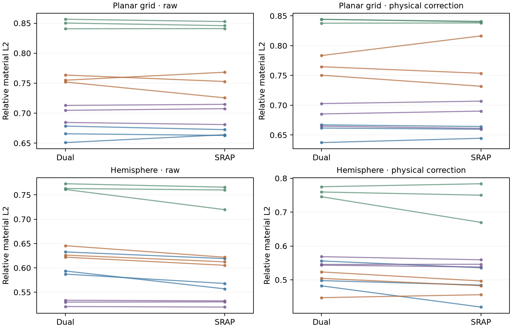
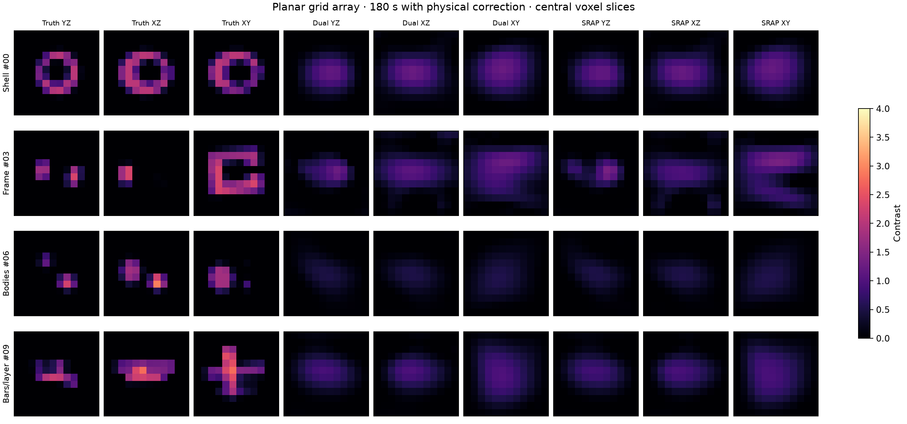
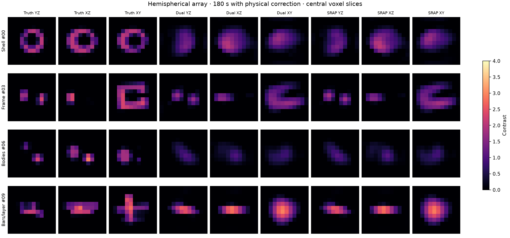
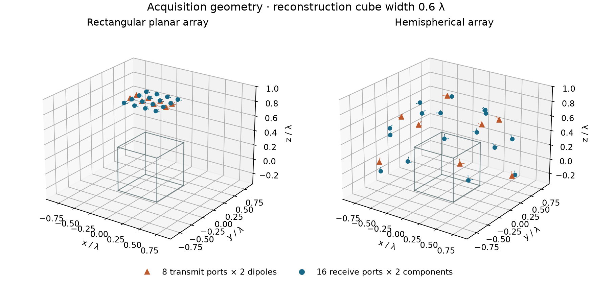

# 三维双极化有限阵列确认实验

12个独立材料分别由两个阵列测量。180秒预算下，SRAP 相对逐源 Dual 的材料相对 L2 配对收益为 +0.0067 [+0.0025, +0.0132]，共同物理校正后为 +0.0048 [-0.0001, +0.0138]。正值表示 SRAP 误差较低。两阵列先在同一物体内取平均，再对12个物体计数，原始胜/平/负 10/0/2，校正后 9/0/3。原始区间支持 SRAP 的材料恢复优势，校正后的区间没有辨明该优势。

## 阵列与预算

各行以12个物体为单位。误差和 IoU 分栏均列 Dual / SRAP 中位数。收益列是配对材料 L2 差的中位数及物体簇自助抽样95%区间（1万次）。

|阵列|预算|读出|材料相对 L2|体积 IoU|配对收益及95%区间|胜/平/负|
|---|---:|---|---:|---:|---:|---:|
|矩形面阵|60s|原始|0.732 / 0.720|0.000 / 0.000|+0.0032 [-0.0023, +0.0051]|7/0/5|
|矩形面阵|60s|物理校正|0.727 / 0.719|0.000 / 0.000|+0.0025 [-0.0044, +0.0041]|7/0/5|
|矩形面阵|180s|原始|0.732 / 0.720|0.000 / 0.000|+0.0032 [-0.0023, +0.0051]|7/0/5|
|矩形面阵|180s|物理校正|0.727 / 0.719|0.000 / 0.000|+0.0025 [-0.0044, +0.0041]|7/0/5|
|半球阵|60s|原始|0.624 / 0.615|0.130 / 0.081|+0.0069 [-0.0103, +0.0170]|9/0/3|
|半球阵|60s|物理校正|0.544 / 0.574|0.430 / 0.314|-0.0147 [-0.0447, +0.0125]|5/0/7|
|半球阵|180s|原始|0.624 / 0.609|0.130 / 0.146|+0.0137 [+0.0022, +0.0215]|11/0/1|
|半球阵|180s|物理校正|0.544 / 0.537|0.430 / 0.488|+0.0113 [+0.0024, +0.0243]|9/0/3|

180秒下同物体的面阵收益减半球收益为 原始 -0.0067 [-0.0252, -0.0011]，校正 -0.0106 [-0.0389, -0.0029]。正差表示路由在面阵的相对改善更大。阵列同时改变视角与场分量采样，几何效应限于这两种具体布置。

## 空间与场

体素支撑阈值为真值峰值的一半，两臂共用。内部和背景误差的分母均为完整材料真值的 L2 范数。数据残差为预测复场与实测复场的 Frobenius 相对误差。下表均为180秒物理校正读出。

|阵列|内部 L2，Dual/SRAP|背景 L2|目标平均幅值比|峰值对比度|数据残差|
|---|---:|---:|---:|---:|---:|
|矩形面阵|0.617 / 0.612|0.307 / 0.312|0.414 / 0.403|1.249 / 1.296|0.100 / 0.100|
|半球阵|0.517 / 0.506|0.179 / 0.176|0.614 / 0.660|2.553 / 2.652|0.105 / 0.104|

四类物体各取预定的第一个编号。每组三列为 YZ、XZ、XY 中央体素切片，切面坐标 +0.025λ，显示范围统一为 χ∈[0,4]。

在180秒校正切片中，偏心壳00在两阵列的两臂均呈实心团块；其粗网真值有一个闭合空腔，四个恢复体均为零。开缝框03在半球XY面可辨开口，在矩形面阵中的响应幅值较弱。三个多体对象的粗网真值各有三个分离支撑，两个阵列、两臂的整幅恢复体均无体素达到固定半峰阈值。交叉棒09在半球阵找到了主要响应位置，细杆端部和薄层仍有缺失。面阵有8/12个Dual、7/12个SRAP的体积IoU为零。其物理场残差均接近10%，数据拟合可以与轮廓丢失并存。

### 全部12个物体的切片图册

每页四个物体；每行从左到右依次为真值、Dual、SRAP，各给三个方向的中央体素切片。完整支撑的三维交并比、六邻接连通分量和闭合空腔计数见逐物体表。

- 矩形面阵 [00–03](figures/atlas_01_plane_grid.png) · [04–07](figures/atlas_02_plane_grid.png) · [08–11](figures/atlas_03_plane_grid.png)
- 半球阵 [00–03](figures/atlas_01_hemi.png) · [04–07](figures/atlas_02_hemi.png) · [08–11](figures/atlas_03_hemi.png)

## 物理与算法边界

立方域宽0.6λ。8个物理发射位置各有两个正交单位偶极，16个物理接收位置各读两个正交分量，共512个复测量。两种布局最近端口到域中心均为0.9λ，矩形面阵外侧端口距中心略大；完整坐标与至立方体边界距离见 acquisition.json。矩形面阵含 2×4 发射、4×4 接收，左右错开，单位偶极沿全局 x、y。半球阵按等面积纬度和黄金角方位分布。方位布局与两个横向极化分别定义在代码中。各阵列使用同一物体和配对标准噪声方向，各物体间独立。噪声幅值为每个干净数据矩阵范数的10%。

正演为三维自由空间完整 dyadic Green、体元体积和 Clausius–Mossotti 加辐射反作用自项。24³细网以每体素64点体积分数生成观测，反演用12³，评分比较细网在同一粗体素内的均值。Mie 半径0.12λ，球 εr=3，比较平面波激励下181角度的绝对复矢量远场。相对误差随12³至24³由7.946%降至6.152%。偏心壳不同网格的完整复端口差见下表。进一步独立使用36³作参考，24³生成数据与36³参考的差见下列资源记录。

成熟逐源 Dual 从统一 χ=0.25 起步。接收 DPCS 截断为最大奇异值的0.1，三级傅里叶 mf=2,3,4，电流 β=6,4,3，材料 β=6,3,1。逐源 PR+ 用二次精确步长，跨三个分量和全部源拟合一个实标量 χ∈[0,4]。20步后检验源系数相对 RMS<0.001，每级上限500，沿用三维 R0（无额外材料先验）。两臂每16步或阶段末都用原方程重算场并审计，其间的材料不参与选择。

SRAP 同期在 X=J/6、Q 空间上依次做材料投影、仿射图与数据球投影，再将两个增量投到接收弱且传播强的全谱子空间，重新拟合合法投影傅里叶系数并重启 PR。两组矢量均用相同路由。数据球半径为 0.1‖Y‖/√1.01，单乘子约束所有端口。独立于目标的接收谱阈值为0.1，传播能量阈值为0.01 λmax(G*G)。每臂现场重建；完整5184维稠密 Hermitian 分解仅用于路由。图投影的 H=I+36G*G 使用零填充 FFT-CG，32维接收 Schur 系统求共享乘子；物理前向和伴随为 FFT-BiCGSTAB。底层复数为 complex64，接收基、合法回注的小矩阵使用 complex128。

原始预算读取同一冷轨迹的60秒/180秒前缀。light 从48秒/144秒边界前公开原物理目标最小值出发，分别在独立12秒/36秒窗口完成最多20个 L-BFGS-B 接受步，按完成时刻选择。Phi 为逐源相对复数据平方误差均值。跨过截止的审计和线搜索试探无法入选。两种预算共享相同前缀，程序与CUDA上下文启动耗时在臂外，采集算子、观测初始化、正式路由构建、投影和正反演计入臂内。评分在48个预测包均验证并封存后单独进行。

## 实际资源

- 矩形面阵端口距中心范围（发射/接收）0.900 / 0.935λ 和 0.900 / 0.955λ，距实际立方体边界范围 0.593 / 0.593λ 和 0.593 / 0.593λ。两布局最近端口距包围球均为0.3804λ。
- 半球阵端口距中心范围（发射/接收）0.900 / 0.900λ 和 0.900 / 0.900λ，距实际立方体边界范围 0.395 / 0.589λ 和 0.389 / 0.578λ。两布局最近端口距包围球均为0.3804λ。
- 开发圆环支路有 4 个已封存臂，累计墙钟 123.72 秒，没有打开其材料真值评分。V1 生成圆环/半球24个观测与Mie合计 8.76 秒，包含在V1内的保留半球工作只计一次。V1控制器停止前主计算进程耗时 304.15 秒，含已完成半球和圆环、启动与中断在途的半球；此项与分臂账目重叠。V1平面圆环单独路由预检额外耗时3.09秒。
- 矩形面阵偏心壳 12³→24³ / 24³→36³ 的复端口差分别为 5.262% / 1.916%。三网校核单独开销为两阵合计 13.89 秒。
- 半球阵偏心壳 12³→24³ / 24³→36³ 的复端口差分别为 4.158% / 1.712%。三网校核单独开销为两阵合计 13.89 秒。
- Dual 共24臂，原始轨迹中位 6.81 秒，范围 3.52–12.32 秒，跨60/180秒的轨迹分别为 0/0。含两个独立校正的实付墙钟 337.5 秒，进程 CPU 331.0 秒。
- SRAP 共24臂，原始轨迹中位 39.96 秒，范围 15.41–98.24 秒，跨60/180秒的轨迹分别为 9/0。含两个独立校正的实付墙钟 1342.4 秒，进程 CPU 1304.8 秒。
- Dual 总计 6572 个逐源PR更新，物理正演/伴随 RHS 24144 / 16352，G及G*的单源作用数 369424 / 271968，图CG迭代 0。稠密路由谱与主特征值的稠密乘法另计，不归入FFT作用数。
- SRAP 总计 22198 个逐源PR更新，物理正演/伴随 RHS 39504 / 16256，G及G*的单源作用数 1530528 / 1256448，图CG迭代 42252。稠密路由谱与主特征值的稠密乘法另计，不归入FFT作用数。
- 矩形面阵接收强秩 6，路由秩 3449/5184，完整路由及图预计算费用范围 2.21–2.78 秒/臂。
- 半球阵接收强秩 20，路由秩 3439/5184，完整路由及图预计算费用范围 2.25–2.60 秒/臂。
- 设备为单张 RTX 4060 Laptop 8 GB。PyTorch统计的CUDA张量分配峰值为 0.84 GiB（V2各臂重置；继承的半球V1记录为进程累计高水位，不含驱动分配）。投影调用 1429 次，图CG最大相对残差 3.00e-05，投影后最大数据残差/噪声球半径 1.00000。96条校正分支中 0 条触及墙钟截止，接受步范围 20–20。
- 新面阵12组数据生成的增量墙钟 2.61 秒，CPU 2.56 秒。正式评分墙钟 26.94 秒，CPU 20.45 秒。各审计的FFT作用、物理正/伴随 RHS、BiCGSTAB 与图CG迭代及校正尝试均保存在逐臂封存记录。

## 逐物体表

完整192行含两种预算、两类读出、峰值、目标/背景误差、连通分量、封闭空腔、实际计费与数据残差。 [下载 CSV](objects.csv)

|物体|阵列|180秒 L2 原始 Dual/SRAP|180秒 L2 校正|180秒 IoU 校正|180秒数据残差校正|
|---|---|---:|---:|---:|---:|
|00 偏心壳|矩形面阵|0.666 / 0.663|0.662 / 0.660|0.040 / 0.048|0.099 / 0.099|
|00 偏心壳|半球阵|0.633 / 0.619|0.556 / 0.536|0.344 / 0.341|0.104 / 0.104|
|01 偏心壳|矩形面阵|0.678 / 0.673|0.667 / 0.664|0.024 / 0.024|0.100 / 0.100|
|01 偏心壳|半球阵|0.587 / 0.568|0.498 / 0.484|0.414 / 0.417|0.109 / 0.109|
|02 偏心壳|矩形面阵|0.651 / 0.664|0.637 / 0.645|0.150 / 0.156|0.102 / 0.101|
|02 偏心壳|半球阵|0.594 / 0.557|0.482 / 0.420|0.463 / 0.621|0.112 / 0.108|
|03 开缝框|矩形面阵|0.755 / 0.768|0.783 / 0.816|0.000 / 0.086|0.101 / 0.099|
|03 开缝框|半球阵|0.646 / 0.622|0.523 / 0.497|0.433 / 0.456|0.110 / 0.107|
|04 开缝框|矩形面阵|0.764 / 0.753|0.765 / 0.754|0.000 / 0.000|0.100 / 0.100|
|04 开缝框|半球阵|0.622 / 0.605|0.504 / 0.483|0.427 / 0.520|0.107 / 0.105|
|05 开缝框|矩形面阵|0.752 / 0.726|0.750 / 0.732|0.014 / 0.057|0.101 / 0.101|
|05 开缝框|半球阵|0.626 / 0.612|0.447 / 0.456|0.627 / 0.616|0.102 / 0.103|
|06 分离多体|矩形面阵|0.857 / 0.853|0.844 / 0.841|0.000 / 0.000|0.099 / 0.099|
|06 分离多体|半球阵|0.763 / 0.760|0.775 / 0.784|0.000 / 0.000|0.107 / 0.107|
|07 分离多体|矩形面阵|0.841 / 0.841|0.838 / 0.838|0.000 / 0.000|0.100 / 0.100|
|07 分离多体|半球阵|0.773 / 0.766|0.759 / 0.750|0.000 / 0.000|0.104 / 0.103|
|08 分离多体|矩形面阵|0.850 / 0.846|0.844 / 0.840|0.000 / 0.000|0.098 / 0.098|
|08 分离多体|半球阵|0.761 / 0.720|0.745 / 0.670|0.000 / 0.000|0.106 / 0.103|
|09 交叉棒薄层|矩形面阵|0.713 / 0.715|0.703 / 0.707|0.000 / 0.000|0.100 / 0.100|
|09 交叉棒薄层|半球阵|0.533 / 0.532|0.568 / 0.559|0.540 / 0.540|0.100 / 0.100|
|10 交叉棒薄层|矩形面阵|0.705 / 0.707|0.685 / 0.690|0.000 / 0.000|0.100 / 0.100|
|10 交叉棒薄层|半球阵|0.521 / 0.519|0.545 / 0.546|0.528 / 0.528|0.099 / 0.099|
|11 交叉棒薄层|矩形面阵|0.685 / 0.681|0.665 / 0.661|0.000 / 0.000|0.100 / 0.100|
|11 交叉棒薄层|半球阵|0.530 / 0.530|0.543 / 0.538|0.492 / 0.525|0.100 / 0.100|

## 来源与复现

成熟逐源更新可对照既有项目的 research_max_struct_r9/src/vector_original_cuda.py 第298–342行。三级双β、起点、系数停止和 R0 对照 research_max_struct_r11/configs/vector_confirmation_gpu_recovery_attempt1_execution.json 第63–100行。早期配置的对比度上界为8，本实验按题设改为4。
在安装 PyTorch CUDA、NumPy 与 SciPy 的显卡环境执行 generate.py、invert.py、score.py。report.py 另需 Matplotlib。三个独立进程分别生成、反演及评分。所有输入和选定材料已保存，可从评分或作图阶段单独开始。生成脚本内有私有物体设计，反演脚本只导入 physics.py 和 projection.py。
