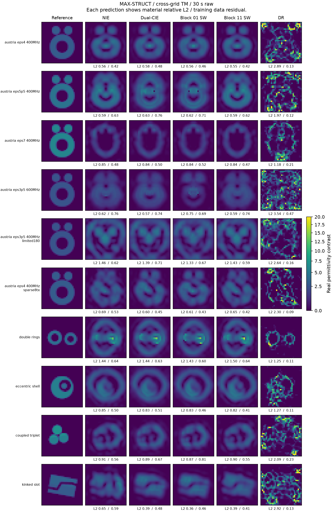
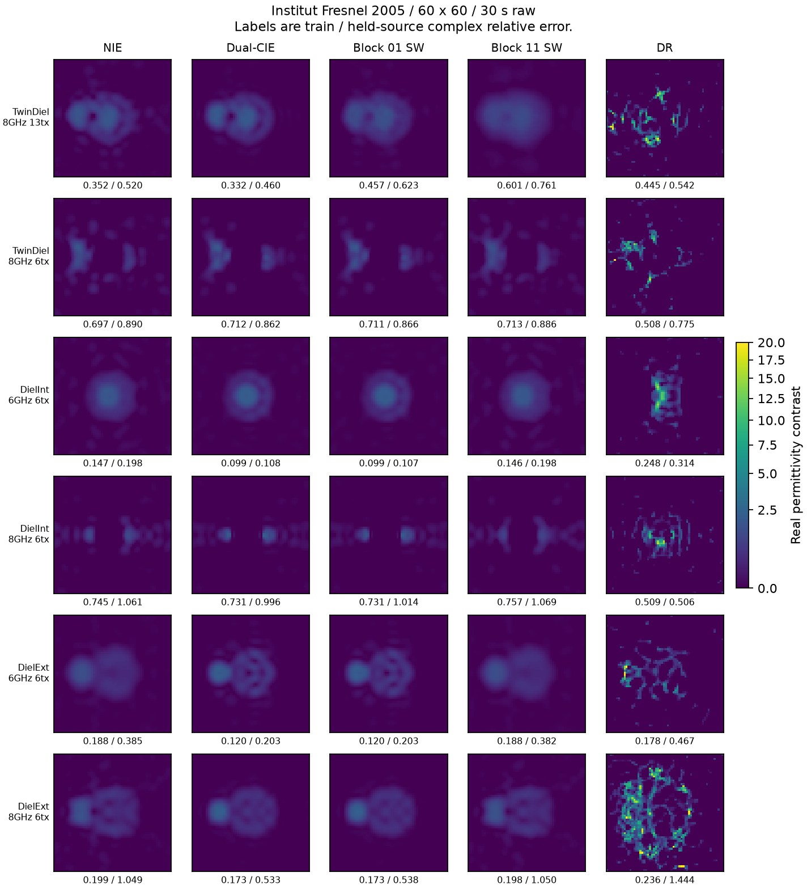
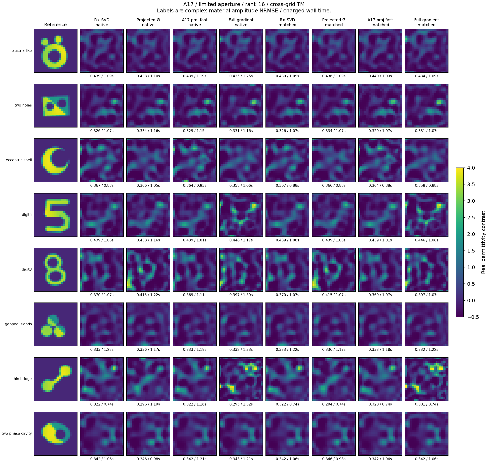
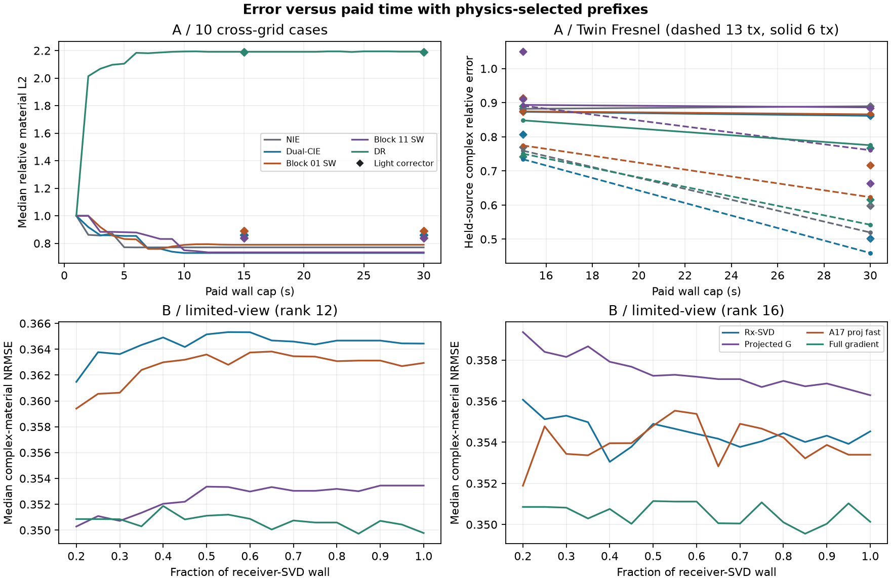

# MAX-STRUCT 与 A17 顶刊裁决实验

| 战役 | 裁决 | 决定性结果 |
|---|---|---|
| MAX-STRUCT | **KILL · NO-GO for TAP/TGRS** | 30 s 内 Block 01 在 raw 上赢两条基线的 6/10 题，配对中位降幅仅 0.40%。轻校正后赢 4/10，中位误差反增 0.40%。DR 只在双环上同时赢两条基线，在 Fresnel Twin 六源上有留出预测收益。 |
| A17 | **`A17_IMAGING_VERDICT = KILL`** | 限视角秩 12/16 的总耗时是 receiver-SVD 的 1.07/1.09 倍。最终复材料误差同时胜过两条低秩基线的只有 1/8、3/8，配对中位增益为 −3.49%、−0.01%。按约定取消 Suite 2B。 |

两个裁决针对本轮方法、观测和预算。Block 01 在折线槽上改善结构，DR 改变了双环的物理解，A17 的交换开销达到了目标范围。 [逐行指标](metrics.csv) · [原始数组](predictions.npz) · [复现脚本](run_killtest.py)

## 战役一 · 高对比、跨网格及实测

### 10 题跨网格比较

| 方法 | 15 s raw L2 | 15 s 轻校正 L2 | 30 s raw L2 | 30 s 轻校正 L2 | 30 s raw / 轻校正胜数 | 两口径均胜 | 配对中位降幅 raw / 轻校正 |
|---|---:|---:|---:|---:|---:|---:|---:|
| NIE | .771 | .862 | .771 | .862 | — | — | — |
| 双 β CIE | .730 | .859 | .730 | .859 | — | — | — |
| Block 01 SW | .789 | .892 | .789 | .890 | 6 / 4 | 4 | +0.40% / −0.40% |
| Block 11 SW | .734 | .840 | .734 | .840 | 3 / 4 | 1 | −1.11% / −0.54% |
| DR | 2.191 | 2.189 | 2.192 | 2.189 | 1 / 1 | 1 | −184.47% / −143.67% |

L2 列为逐题相对材料 L2 的中位数。每题用相同预算、相同输出口径下 NIE 与双 β CIE 的较低误差计算胜负及百分比变化。GO 要求至少 6 题在两口径均胜，配对中位降幅各达 20%，并满足实测条件。单独以双 β CIE 为参照，Block 01 的 raw / 轻校正胜数为 8/10、6/10，配对中位降幅为 1.22%、0.37%。六个 Austria 条件共用一个几何，十题按难度条件计数，不能作为十个独立几何样本做显著性推断。

- **折线槽保留了 Block 01 的增量。** 双 β CIE 的 raw / 轻校正 L2 为 .392/.289，Block 01 为 .358/.253，轻校正后一半对比度 IoU 从 .849 升至 .883。相同材料读出接到非局部 current 度量得到 Block 11，其 L2 为 .394/.259。证据显示这一题的主要收益已经出现在材料读出。
- **DR 的双环改善伴随定量偏差。** raw L2 为 1.246，优于最佳基线的 1.441。一半对比度 IoU 为 .450，最佳基线为 .247。轻校正后 DR L2 为 1.223，最佳基线为 1.523。环的重合度改善与幅度和伪影问题同时存在。
- **DR 经常找到高对比伪影。** 30 s raw 的中位数据残差为 .134，双 β CIE 为 .568，但相应材料 L2 是 2.192 和 .730。Austria εᵣ=4 的 DR 残差 .133，L2 为 2.886，约 78% 的平方材料误差落在参考材料为零的单元；600 MHz Austria 的相应比例约 88%。两题均碰到材料盒上限 20。较灵活的完整电流和反射能快速扩大数据拟合范围，显式材料选择仍有困难。
- **轻校正通常减少数据目标，也经常损伤材料。** 与各自实际进入校正的候选相比，30 s 分支中五臂的 50 个物理目标全部下降。NIE / 双 β / 01 / 11 有 10/9/9/9 题材料 L2 变差，DR 有 4 题变差。每个结果均按公开的物理目标选择。此处未使用材料误差重选候选。
- **离散失配足以影响路径。** 将已知连续材料做面积平均放到 32² 网格，仅在离线计算所得的相对数据残差为 .145–.694。细网格加入的是 10% 复噪声，因此粗网格 reference 不能直接当成噪声球内的解。该残差也不能充当粗模型最小残差的下界。εᵣ=7 Austria 在 raw 的四个 CIE 类对照中半对比度 IoU 都为零。这组结果同时反映强散射和粗离散误差。



[15 s raw](figures/max_struct_15_raw.png) · [15 s 轻校正](figures/max_struct_15_light.png) · [30 s 轻校正](figures/max_struct_30_light.png)

### Fresnel 留出照明

每格为 30 s raw / 轻校正的留出复场相对误差。Twin 常规组 13 训 / 5 留，稀疏组 6 训 / 12 留。Int 和 Ext 各只有 8 个实测源，6 训 / 2 留。每个源均保留 241 条真实接收通道。

| 设置 | NIE | 双 β CIE | Block 01 SW | Block 11 SW | DR |
|---|---:|---:|---:|---:|---:|
| Twin 8 GHz，13 源 | .520/.599 | **.460/.501** | .623/.717 | .761/.664 | .542/.616 |
| Twin 8 GHz，6 源 | .890/.890 | .862/.862 | .866/.866 | .886/.884 | **.775/.767** |
| Int 6 GHz，6 源 | .198/.118 | .108/.106 | .107/.106 | .198/.106 | .314/.405 |
| Int 8 GHz，6 源 | 1.061/1.049 | .996/.958 | 1.014/.890 | 1.069/1.079 | **.506/.649** |
| Ext 6 GHz，6 源 | .385/.231 | .203/.180 | .203/.163 | .382/.216 | .467/.550 |
| Ext 8 GHz，6 源 | 1.049/.891 | .533/.368 | .538/.370 | 1.050/.902 | 1.444/1.567 |

DR 的稀疏 Twin 改善为约 10%–11%，常规 Twin 则落后于双 β CIE。Int 8 GHz 也有留出收益，但 DR 图中出现高对比亮点和轮廓碎片。在 Twin 的两组轻校正中 DR 峰值对比度均接近 20。已知样品只用于事后读图，没有使用材料模板、已知介电常数、支持或逐像素评分。留出收益有独立价值，目前无法确认它对应可靠的全图材料恢复。 [Fresnel 2005 原始测量合同](https://doi.org/10.1088/0266-5611/21/6/S09)

接收使用真实缺失掩码，照明用测量空场拟合的 R8 多极子继续到 ROI。空场留出误差中位约 11.0%–11.5%，发射场与接收号角响应无法由这次校准分别识别。每组以 .15 倍训练信号范数作 DR 模型容差。六组的固定传播—观测投影都能到达数据球，60² 反演中 DR 返回的物理材料训练残差仍为 .178–.509（raw）。有限时间下的共享材料相容性、物理模型失配和材料分支选择仍限制结果。



[15 s raw](figures/fresnel_15_raw.png) · [15 s 轻校正](figures/fresnel_15_light.png) · [30 s 轻校正](figures/fresnel_30_light.png)

### A 的实现和计费

所有二维反演使用独立 cell、同一观测、材料盒和原物理验收。Austria 为 150²→32²，四个新材料为 96²→32²，统一加 10% 复高斯方向的定范数噪声。实测为 .2 m 正方形内的 60² 实材料、`air0`、对比度 [0,20]，每个频率独立重建。时间约定 `exp(−iωt)`。R8 的 NIE 公开方程、分阶段 β、DPCS 与 Fourier APCS 由本仓库独立实现，32² 和墙钟合同与原论文的实验设置有别。双 β 与 01 使用普通 current 度量，01 修改材料读出。11 两块都使用 R14 互不重叠四单元 Green 块的一阶传播；块 CIE 的 current 采用每源 PR 与精确二次步长。 [NIE 2016](https://doi.org/10.1109/TAP.2016.2535492) · [CIE-I 2019](https://doi.org/10.3390/jimaging5020027)

独立 DR 复用 R14/R12 的投影，使用状态 `(J/6,Q)`、松弛 1、最多 3000 步。用 FFT 做 Green 作用，固定分解 `H=I+36 G*G`，分组解实际接收端口，再投影共享盒内实材料。32² 投影与历史稠密实现的相对差约 `1.2e−13`。60² Twin 快速诊断中，背景设置约 1.39 s，首次投影约 .027 s，首次全波审计约 .55 s。正式并行实验中，Fresnel DR 设置中位约 2.98 s，六组均用尽 raw 预算。

| 32²，30 s raw 中位数 | 墙钟 s | CPU s | LU | 二维 FFT/IFFT | 背景三角 RHS |
|---|---:|---:|---:|---:|---:|
| NIE | 4.42 | 4.35 | 6.5 | 109,022 | 0 |
| 双 β CIE | 7.19 | 7.09 | 9.0 | 97,342 | 0 |
| Block 01 SW | 10.61 | 10.46 | 12.0 | 92,102 | 0 |
| Block 11 SW | 12.19 | 12.03 | 14.0 | 108,982 | 0 |
| DR | 26.25 | 25.88 | 25.0 | 241,002 | 60,040 |

raw 每约一秒及阶段末做同物理审计，以已完成的最小 `Φ=0.5 ||F(m)−Y||²/||Y||²+R(m)` 候选出图。轻校正从 12/24 s 前缀选候选，收取整段前缀实际开销，余下预算至多做 20 个 L-BFGS-B 步。R 为共同弱平滑加平滑 TV，权重各 `1e−4`。完整 LU、梯度、FFT、固定分解与背景 RHS 均计费。113 条 A 预算记录有算子跨截止时刻，最大超额 1.90 s。候选须在预算内完成审计，表中墙钟包含已付超时。留出评分只在封存后运行。

在本机以 CPU 和单线程 BLAS 执行。A、B 各批通常至多四个并行案例进程，部分批次时间重叠。NIE 和三种 CIE 在合成组均完成设定阶段。A 最初一轮发现轻校正候选计费不足，停掉后重跑，有约 235 CPU 秒弃用计算。B 最初的 18 步全梯度对照共用 16.48 CPU 秒、1,114 次 LU。正式等时曲线采用后续按实测墙钟延长的全梯度轨迹。

## 战役二 · A17 投影感知复核

| 观测与秩 | 同秩自然终点中位 NRMSE（Rx / 内部 / A17） | A17 双赢 | 中位配对降幅 | A17 / Rx 总墙钟 | 等时中位 NRMSE（Rx / 内部 / A17 / 全梯度） |
|---|---|---:|---:|---:|---|
| 全环 12 | .3483/.3468/.3461 | 2/8 | −1.23% | 1.09× | .3483/.3469/.3454/.3475 |
| 全环 16 | .3578/.3524/.3586 | 2/8 | −0.65% | .97× | .3578/.3527/.3586/.3464 |
| **限视角 12** | .3644/.3533/.3632 | **1/8** | **−3.49%** | **1.07×** | .3644/.3534/.3629/.3498 |
| **限视角 16** | .3545/.3564/.3533 | **3/8** | **−0.01%** | **1.09×** | .3545/.3563/.3534/.3501 |

双赢用同对象的较强低秩基线。限视角全梯度在等时下分别赢 A17 **7/8、5/8**，配对中位降幅为 1.39%、0.24%。秩 16 的多数差异很小。A17 的致命结果是同秩恢复收益未达 6/8 和 15%，其开销已通过 1.5× 要求。比如限视角的细桥，秩 12 的 A17 误差 .328，投影内部基 .314，等时全梯度 .295。秩 16 的数字 8 则保有两条基线以外的局部收益：A17 .369、Rx .370、投影内部 .415、等时全梯度 .397。该题 A17 的较低材料误差仍伴随高于全梯度的物理残差。

### 投影损失、秩限制和全波路径

1. **盒投影实质改变了步长。** 限视角 64 个交换时点，廉价筛选后均只做 Top-1 全波切向核验。秩 12/16 的候选单位步被盒投影削去的相对范数中位数为 76.8%/75.3%。未投影的低秩收益有 12 次在投影后变成非正，随后还有 6 次低秩正收益被精确切向核验否决。两秩分别接受 13/32、10/32 个正 `Q_proj` 的换基。
2. **低秩的条件传播误差只得到少量修复。** 10 个接收器只有 10 个非零接收奇异方向，Rx 的秩 12/16 分别补 2/6 个确定性 Fourier 零空间方向。用精确切线作为分母，换基前端口作用误差中位约 46.5%/45.4%，换基候选约 47.4%/45.5%。只要 `S=SP_U`，正交电流投影在端口上是精确的；Galerkin 实际把 `L=I−D_mG` 限制在 `U` 中求逆，遗漏的 `U*L(I−P_U)` 仍可影响观察量。将秩从 12 提到 16 仍留有明显的条件响应误差。固定投影内部基在秩 12 已赢 Rx 6/8，逐次交换没有把这一收益继续扩大。
3. **正收益比较了两个可行方向，不能保证单位步下降。** 23 次接受换基中，16 次保留了新基，却因方向检查回退到投影梯度。剩余 7 次按落盘材料差和回溯系数复算原单位步。6 次在完整切向二次模型中已经会使目标上升；1 次偏心壳由预测 `ΔΦ=−.00672` 翻转为全波 `+.00377`。秩 12/16 的单位步全波数据相对线性预报余项中位为 .915/.877。7 次实际接受的步长均回缩（两秩中位约 .0078/.0469）。这组数据区分了过大的低秩步与真正的全波路径弯曲。`Q_proj` 在同一个起点有可解释性，对有限轨迹的恢复能力仍不足。

48² 方单元求积正演→24² 粗 collocation，1 m ROI，约 600 MHz，8 个外部照明。全环 32 接收与单侧 120° 10 接收分别加定范数 2% 复噪声。八个独立新材料共享盲求解设置。复对比度盒为实部 [−.5,4]、虚部 [0,.5]，同一初值与阻尼。固定秩方法共用 18 步上限。A17 每四步至多一次交换，最多四次。全梯度用原物理的精确空间全维阻尼步，使用各题实测 Rx 墙钟截断。NRMSE 为复材料 RMSE 除以参考材料最大模值。两种 IoU 均使用实部，半对比度阈值由离线参考定义。三维实验按用户约定未启动。



[限视角秩 12](figures/a17_limited_k12.png) · [全环秩 12](figures/a17_full_k12.png) · [全环秩 16](figures/a17_full_k16.png)

## 时间与误差



点和曲线使用该时刻已完成物理审计的最小目标候选，纵轴材料指标来自封存后的评分。计费覆盖设置、被拒试探和跨截止操作。A 的 raw 全轨迹（合成、Fresnel）总计约 1,278 CPU 秒。两档轻校正共额外消耗约 514 秒各进程墙钟之和。B 的 112 条正式轨迹约 129 CPU 秒，共 8,336 次 LU、89,866 个复 RHS。B 单位步复算仅用于分析，另计 14 次 LU、168 个复 RHS。数据准备和 Fresnel 留出评分分别消耗约 36 和 170 秒各进程墙钟之和。

## 复现

在 Inv_SLAM 工作区的本研究目录执行下列命令。本次使用 Python 3.13、NumPy 2.5.3、SciPy 1.18.1、Matplotlib 3.11.1。

```sh
../../Gaussian/.venv_nn/bin/python -B run_killtest.py all --workers 4
```

脚本也可在公开仓库克隆中运行。需要该仓库的 R2/R4–R8/R12/R15 代码、A24 的 `src/a24` 和 `vendor/a2`，以及原始 Fresnel `FoamTwinDielTM.exp`、`FoamDielIntTM.exp`、`FoamDielExtTM.exp`。可用 `MAXWELL_KILLTEST_A24` 指向 A24 克隆，用 `FRESNEL_2005_DIR` 指向原始测量目录。先 `prepare`，再 `solve`，最后 `score` 也等价。`score` 检查全 24 个设置预测齐备后才开始材料和留出评分。精确墙钟前缀会随机器与并行负载变化。 [A24 物理源代码](https://github.com/migodam/a24-source-anchored-om-feedback) · [Fresnel 原档下载页](https://iopscience.iop.org/article/10.1088/0266-5611/21/6/S09/data)

`predictions.npz` 各键以 `case__` 开头，包含材料、物理预测、raw 审计前缀、A17 交换诊断和评分参考。实测只提供预测和掩码。`metrics.csv` 保存完整 576 行及停止状态、预算、实际时钟、运算计数、L2、幅度 NRMSE、OtsuIoU、半对比度 IoU 和数据残差。所有终点均可评分。
