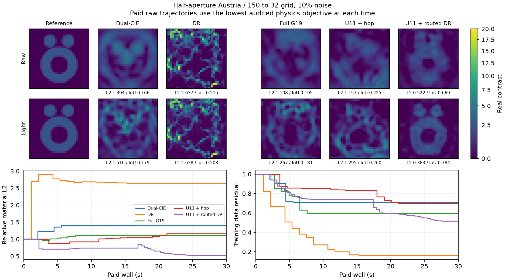
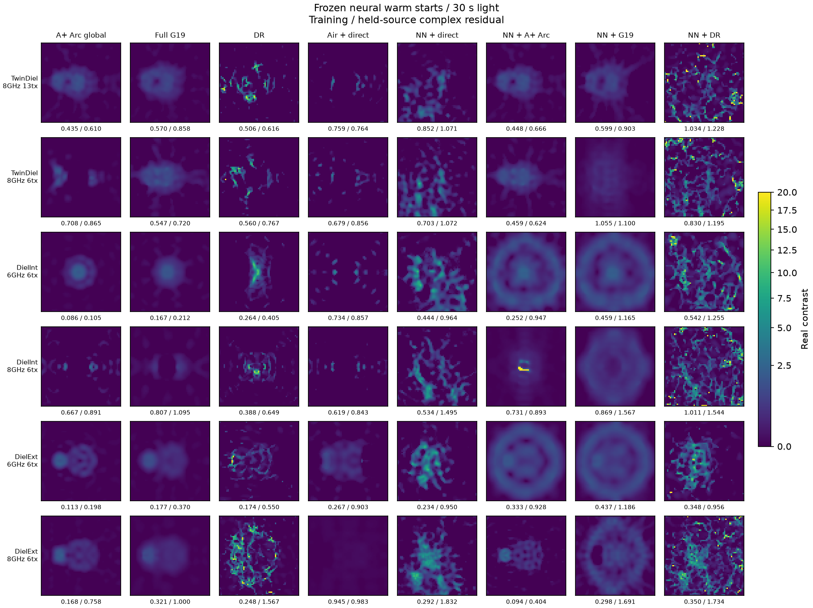
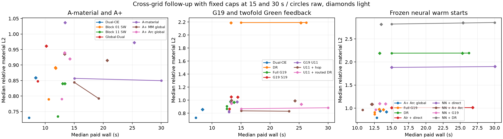

# MAX-STRUCT 已有算法同场补充比较

**补齐 A-material、A+、G19、双子空间以及 NN 组合后，半环 Austria 出现了一项明确的结构恢复增量。** 30 s 内，U11＋路由 DR 的材料相对 L2 为 .522，轻校正后为 .383，半对比度 IoU 为 .784。相同观测下，双 β CIE 的 L2 为 1.394/1.510，独立 DR 为 2.637/2.638。**扩展后仍未满足原任务的通用成像 GO 条件。** 这项正例支持在半环照明上继续评价路由设计，原冻结的五臂与 A17 仍保有各自裁决。 [主裁决报告](../VERDICT_REPORT_ZH.md)

## 同预算结果

以下为十个合成设置的材料相对 L2 中位数。对每题分别取 NIE 与双 β CIE 的较低误差计算胜负。原门槛要求至少 6/10 题在 raw 与轻校正都胜出，且两个口径的配对中位降幅各达 20%，再检查 Fresnel 条件。

| 方法 | 15 s raw / 轻校正 | 30 s raw / 轻校正 | 30 s 两口径均胜 | 30 s 配对中位降幅 raw / 轻校正 |
|---|---:|---:|---:|---:|
| NIE | .771/.862 | .771/.862 | — | — |
| 双 β CIE | .730/.859 | .730/.859 | — | — |
| Block 01 SW | .789/.892 | .789/.890 | 4 | +0.40%/−0.40% |
| Block 11 SW | .734/.840 | .734/.840 | 1 | −1.11%/−0.54% |
| 独立 DR | 2.191/2.189 | 2.192/2.189 | 1 | −184.47%/−143.67% |
| Global-Dual | .847/.961 | .847/.961 | 0 | −5.77%/−5.97% |
| A-material | .857/1.037 | .850/.972 | 0 | −8.07%/−7.95% |
| A+-MM global | .844/.935 | .792/.915 | 1 | −1.76%/−4.05% |
| A+-Arc global | .790/.940 | .790/.920 | 2 | −1.64%/−3.34% |
| Full G19 | .908/.976 | .869/.968 | 2 | −7.76%/−7.50% |
| G19-S19 | .865/1.050 | .868/1.048 | 2 | −23.09%/−19.97% |
| G19-U11 | .819/.989 | .830/.974 | 3 | −1.09%/−6.25% |
| U11＋一次邻域 | .837/.997 | .831/.991 | 2 | −12.55%/−18.23% |
| **U11＋路由 DR** | .869/.952 | .884/.937 | 3 | −22.46%/−6.98% |
| 空气初值→direct | 1.011/1.011 | 1.011/1.011 | 2 | −45.56%/−21.60% |
| NN→direct | 1.882/1.882 | 1.901/1.901 | 0 | −125.61%/−93.58% |
| NN→A+-Arc | .959/1.085 | .959/1.085 | 2 | −10.95%/−7.91% |
| NN→Full G19 | .967/1.096 | .967/1.095 | 2 | −5.78%/−9.77% |
| NN→DR | 2.822/2.815 | 2.855/2.850 | 0 | −173.70%/−134.09% |

### 半环 Austria 的恢复结构

| 方法 | 15 s raw / 轻校正 L2 | 30 s raw / 轻校正 L2 | 30 s 轻校正 IoU | 30 s 轻校正数据残差 |
|---|---:|---:|---:|---:|
| 双 β CIE | 1.394/1.510 | 1.394/1.510 | .179 | .212 |
| 独立 DR | 2.655/2.661 | 2.637/2.638 | .208 | .103 |
| Full G19 | 1.108/1.267 | 1.108/1.267 | .181 | .208 |
| U11＋一次邻域 | 1.044/1.270 | 1.157/1.295 | .260 | .195 |
| **U11＋路由 DR** | **.737/.848** | **.522/.383** | **.784** | .104 |

两个上方圆盘和下方环体及其空腔在路由版本中都能辨认。独立 DR 的数据拟合相近，图中仍有强伪影。路由版本在 15 s raw 已有恢复增量，约 19–28 s 又进入更好的材料区域，30 s 共同校正进一步改善。轻校正的优劣不能解释 raw 的差距。这组证据支持**带受限 current 表示的周期介入确实改变了搜索路径**。介入同时改变了反射记忆、shadow 注入和 PR 重启，本组实验无法单独归因于其中一项。相反，在全环稀疏 8 源 Austria 上，同一介入使相对于邻域版本的 raw L2 由 .835 上升到 1.031。



### A 系列、G19 和初值各自的得失

- **A+-Arc 降低了材料读出费用。** 30 s raw 相对同为 global PR 的 Global-Dual 赢 8/10，配对中位下降 3.52%。Arc 与 MM 的 30 s raw 中位 L2 接近（.790/.792），Arc 的实际墙钟中位少约 33%。折线槽上仍是 sourcewise Block 01 恢复最好，raw/轻校正 L2 为 .358/.253，轻校正 IoU .883。global A+-Arc 同题为 .716/.993。材料度量与 current 更新共同影响收益。
- **固定 S19 仍有条件。** 对 Full G19，固定 S19 的 30 s raw 和轻校正各赢 3/10。U11 对 S19 两口径各赢 8/10，在 600 MHz Austria 的 raw L2 从 .765 到 .518，轻校正从 .930 到 .667。U11 的秩也变了，因此这组数据支持整个条件子空间构造的收益。600 MHz 上加入一次邻域又使 .518/.667 退到 .709/.920。
- **初值收益集中在特定接口和对象。** 600 MHz Austria 上，NN→G19 将自身的 .614/.758 改善为 .472/.597，raw IoU .736。εᵣ=7 Austria 上，NN→A+-Arc 由冷启动 .838/.903 改到 .724/.797。总体上 R8 网络初始材料的 L2 中位为 1.935，空气初值为 1.000。NN→direct 后中位数据残差从空气初值 direct 的 .622 降到 .119，材料误差的中位却由 1.011 升到 1.901。投影到 A+/G19 的仿射 current 族，合成和实测的相对 current 改变量中位分别为 .988/.941，说明初值移交确有显著状态改写。这两种读出仍能在个别对象上利用初值。
- **双环保留独立 DR 的结构正例。** 空气初值 direct 的 L2 更小（1.172），半对比 IoU 只有 .064。独立 DR 轻校正的 L2 为 1.223、IoU .442，左右两环更清楚，峰值对比度仍过高。NN→DR 的数据残差进一步降低到 .096，L2 却升到 2.713。保留三项指标才能看见各自的失败。

### Fresnel 留出复场

| 同一设置 | 30 s raw 最低留出误差 | 30 s 轻校正最低留出误差 | 双 β CIE raw / 轻校正 |
|---|---|---|---:|
| Twin 8 GHz，13 源 | 双 β CIE .460 | 双 β CIE .501 | .460/.501 |
| Twin 8 GHz，6 源 | NN→A+-Arc .644 | NN→A+-Arc .624 | .862/.862 |
| Int 6 GHz，6 源 | Global-Dual .107 | A+-Arc .105 | .108/.106 |
| Int 8 GHz，6 源 | G19-U11 .480 | G19-U11 .570 | .996/.958 |
| Ext 6 GHz，6 源 | Global-Dual .202 | Block 01 SW .163 | .203/.180 |
| Ext 8 GHz，6 源 | 双 β CIE .533 | 双 β CIE .368 | .533/.368 |

Twin 六源的 Full G19 也从双 β CIE 的 .862 降到 .726/.720，独立 DR 得到 .775/.767。NN→A+-Arc 的对应改善为 25%/28%。图上有连贯介质主体，两个嵌入／外侧局部的材料结构仍不够清楚。Int 8 GHz 的 U11 结果能预测更多留出散射，15 s 下增量尚未出现。同一方法在其他 Fresnel 设置有明显退化，13 源 Twin 仍由双 β CIE 领先。实测评价限于留出复场、幅值范围和图像结构。



### 全部并排图

| 家族 | 10 个合成设置 | 6 个 Fresnel 设置 |
|---|---|---|
| A-material / A+ / 逐源块 | [raw](figures/a_family_synthetic_raw.png) · [轻校正](figures/a_family_synthetic_light.png) | [raw](figures/a_family_fresnel_raw.png) · [轻校正](figures/a_family_fresnel_light.png) |
| G19 / U11 / 路由 | [raw](figures/green_family_synthetic_raw.png) · [轻校正](figures/green_family_synthetic_light.png) | [raw](figures/green_family_fresnel_raw.png) · [轻校正](figures/green_family_fresnel_light.png) |
| NN 与直接全波 | [raw](figures/warm_starts_synthetic_raw.png) · [轻校正](figures/warm_starts_synthetic_light.png) | [raw](figures/warm_starts_fresnel_raw.png) · [轻校正](figures/warm_starts_fresnel_light.png) |



## 比较范围

同一批 10 个跨网格 10% 噪声合成设置和 6 个 Fresnel 实测设置，同一独立材料网格、观测、先验、材料盒和物理选根。补充 12 个项目方法与配置，另加 Global-Dual 和均匀初值直接全波两个对照。原五臂完整保留。补充实验复用已曝光对象，在新增预测全部落盘后统一计算材料及留出误差。初始五臂与 A17 的裁决见主报告。

| 组 | 已有方法 | 本轮保留的机制 |
|---|---|---|
| A 系列 | A-material、A+-MM、A+-Arc | 都保留普通 global PR current。A-material 在四单元 Green 一阶度量下做原 L-BFGS-B 材料读出。MM 用条件五次驻点与完整先验代理，Arc 用 Möbius 弧驻点候选与同一 MM 接受。Global-Dual 只替换回普通材料读出。 |
| 原五臂的局部块 | Block 01 SW、Block 11 SW | 两者用 A+-Arc 材料读出与 sourcewise PR。01 的 current 保持普通度量，11 的 current 也用一阶空间传播。 |
| G19 系列 | Full G19、G19-S19、G19-U11、U11＋一次邻域、U11＋路由 DR | 原 Green 分母与完整材料导数。按原内部传播右 19 维、接收右 19 维、条件共同强空间选择基底。后两臂在共同强分母外保留一次局部残差传播。路由版本每 16 步及阶段末把反射增量投到弱接收／强传播空间。 |
| 初值 | NN→direct、NN→A+-Arc、NN→G19、NN→DR | 使用 R8 主物理特征 CNN 原权重。NN→A+/G19 从物理 current 投影到原 DPCS/Fourier 仿射族，NN→DR 保留完整物理双场，NN→direct 在同预算内直接优化完整 Maxwell。 |

### G19 与两种 Green 子空间

设 `e=J-D_mQ`，`K=PGP`，`A=I+βD_m-D_m K`。Full G19 保留 `A^-1e` 对材料的完整导数，19 维是分母里的 current 子空间。反演材料仍是 32² 或 60² 个独立实数。Fresnel 接收按实测掩码形成 \(\bar S^\ast\bar S=\sum_s S_s^\ast S_s/n_s\)。共同强空间先取 \(\bar S\) 右奇异值达到其最大值十分之一的子空间，再在该空间压缩 \(G^\ast G\)，保留能量不低于 \(0.01\|G\|^2\) 的方向。路由空间对接收弱补空间使用同一能量阈值。一次邻域形式为 `A^-1e+A^-1 D_m(N-PNP)A^-1e`，`N` 是原互不重叠四单元的非对角 Green 作用。

路由 DR 保持原比例 6 和松弛 1。反射增量只更新该路由空间中的法向记忆，材料投影仍然使用全场。再注入 DPCS/Fourier，并重启 PR。方法需要付费的物理审计与投影，且每轮只保留物理选根可用的候选。 [R11 Full G19 定义](https://github.com/migodam/b1-probabilistic-maxwell-imaging/blob/main/research/research_max_struct_r11/METHODS_AND_ABLATIONS.md) · [R15 双子空间与路由原实现](https://github.com/migodam/b1-probabilistic-maxwell-imaging/blob/main/research/research_max_struct_r15/CHAT_HANDOFF.md)

### 初值、计时与评分

NN 的训练、验证与权重完全沿用 R8。本轮高噪声、更大物理域和实测超出一部分训练条件。多源掩码的 Born 反投影、DPCS 特征和场能量按同一原公式计算。特征计算、冷加载、推理、初始全波求解及 current 投影均进入预算。训练与训练／验证数据生成的原累计费用为 402.56 Mac CPU 秒。本轮未再训练。 [R8 原网络及消融](https://github.com/migodam/b1-probabilistic-maxwell-imaging/blob/main/research/research_max_struct_r8/NEURAL_WARM_STARTS.md)

统一 15/30 s 墙钟和原 12/24 s 轻校正起点上限。直接全波的两种初值路径全程使用原物理目标，表中的 raw 与轻校正为同一付费结果。材料结果一律按已完成物理审计的最小 \(\Phi\) 选取，GT 和留出散射数据仅用于最终评分。运行负载、计费及离散范围与历史 120 CPU 秒、576 未知量实验分别记账。

### 本轮实际成本

新增 224 条正式轨迹、896 个预算输出，全部有预算内入选候选。117 条 30 s raw 轨迹达到墙钟上限。低层运算跨过截止时刻的 482 个前缀都保留实际支出，最大跨时 3.03 s。入选候选均在截止前完成物理审计。正式 raw 合计约 5,067 CPU 秒，轻校正另用约 1,026 秒的分进程墙钟和。单 BLAS 线程，在和主实验相同的 Mac 上以四进程运行。净差接近零的个案需考虑调度变化。

合成 30 s raw 的实际墙钟中位数为 A-material 30.02 s、A+-MM 19.20 s、A+-Arc 12.85 s、Full G19 12.54 s、S19 13.00 s、U11＋邻域 23.28 s、U11＋路由 DR 30.02 s。路由 DR 的有用子空间设置中位为合成 0.43 s、Fresnel 12.47 s，分别完成中位约 48 和 2 次投影周期。因此 60² 受计时限制尤其明显。

扩展导入首轮缺 R10 路径，停机时进程累计 200.64 CPU 秒。第二次队列因路由子空间的迭代谱计算超时而中断，进程累计 964.00 CPU 秒，其中包含复用的有效结果。弃用的前三个路由设置各约 53 秒并且零步。修复使用同一 \((I-P_S)G^\ast G(I-P_S)\) 的 Hermitian 截断，保留原阈值。先前有效的非路由预测继续使用。两次历史进程数额与正式轨迹存在重叠，账面独立列出。

## 和历史结果的对应

| 历史证据 | 已成立的范围 |
|---|---|
| R6 原 A-material | 两个公开困难弯条 7b8d/b20d 的 NRMSE 为 .04686/.04128，FFT 版保留恢复。 |
| R13 A+ 同 48 | CIE 30/48、Dual 32/48、A+-MM/Arc 各 36/48、G19 30/48、DR 29/48。Arc 与 MM 最终误差接近，Arc 平均 CPU 约少 5.1%。 |
| R11 G19 | 两种网格条件的八对象配对中 G19 6/8，CIE/Dual 均 4/8。只冻结非局部变换可修复桥与梳状体上的退化。 |
| R14 01/11 | 独立 24 对象中 01 为 12，DR 为 14，G19 为 11，11 为 11。独立 0021 只有 11 找到好的闭环材料区域。 |
| R15 观测分母／路由 | 24 个已公开对象中 G19 11、S19/U11/一次邻域/路由各 12、独立 DR 13。路由救回 0020，同时损失 0021。 |
| R8 与 R13 NN | R8 直接全波获益最明显。R13 冻结 16 对象上 G19 加 NN 的平均 NRMSE 从 .15008 到 .12656，DR 从 .12313 到 .11936，A+ 很接近。 |
| R13 有限事件 | 正确预测材料分支变化。原阈值的恢复增量在同范数扰动、倍增或无事件等对照中没有建立，因此从机制历史入口查看。 |

[R6 原图](https://github.com/migodam/b1-probabilistic-maxwell-imaging/blob/main/research/research_max_struct_r6/CHAT_HANDOFF.md) · [R11 配对网格图](https://github.com/migodam/b1-probabilistic-maxwell-imaging/blob/main/research/research_max_struct_r11/CROSSGRID8_REPORT_ZH.md) · [R13 同 48 与 NN](https://github.com/migodam/b1-probabilistic-maxwell-imaging/blob/main/research/research_max_struct_r13/supplement_aplus48/CHAT_HANDOFF.md) · [R14 反例及方法](https://github.com/migodam/b1-probabilistic-maxwell-imaging/blob/main/research/research_max_struct_r14/CHAT_HANDOFF.md) · [R13 有限事件](https://github.com/migodam/b1-probabilistic-maxwell-imaging/blob/main/research/research_max_struct_r13/CHAT_HANDOFF.md)

## 复现与原始证据

在裁决目录运行下列扩展命令。它使用原实验的 `.runs/public` 与已完成的原始评分。首次复现时先按主报告运行 `all`。

```sh
../../Gaussian/.venv_nn/bin/python -B run_killtest.py expand --workers 4
```

`expand-solve` 可单独生成预测，`expand-score` 在全部预测完成后画图和评分。NN 臂还使用 PyTorch 与 R8 原始权重文件。测量文件和 A24 物理依赖见主报告。 [原始指标](metrics.csv) · [预测和物理审计数组](predictions.npz)
