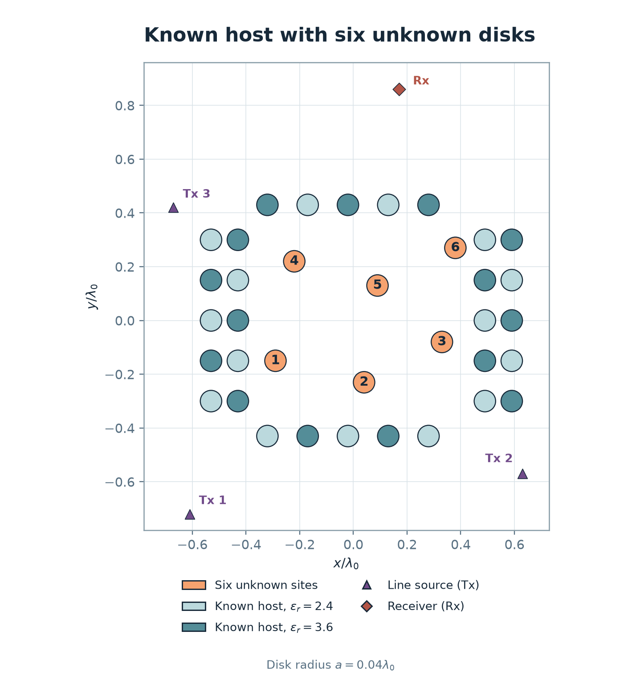
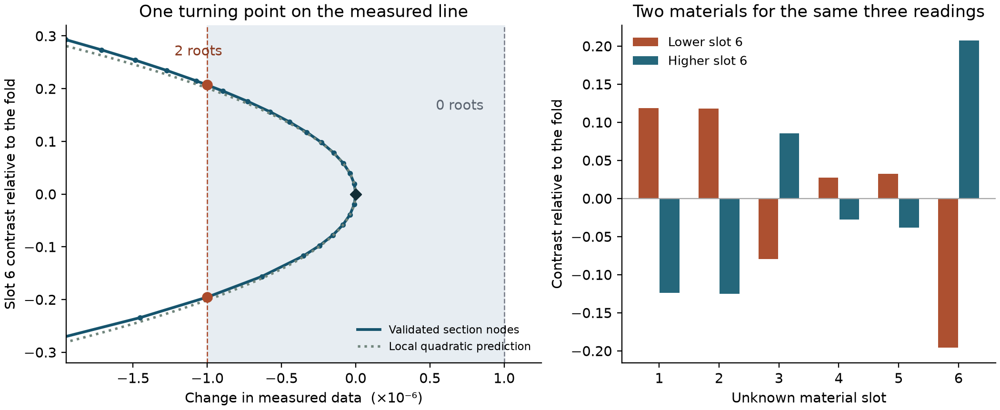
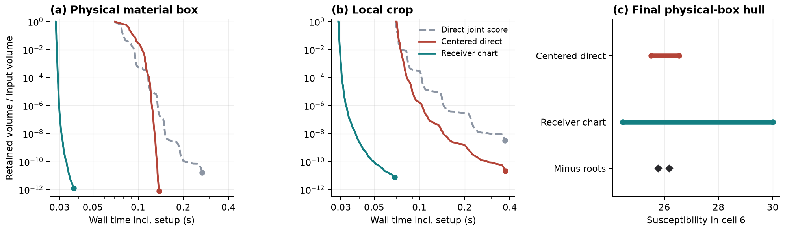

# 正演稳定时，六个材料为什么会有两个解

**同一组精确电磁读数对应两份不同的合法材料。** 沿一个指定方向把读数移动约 \(2\times10^{-6}\)，整个材料盒里的解数只经历一次变化，从两个合为一个，再变成零个。这个结论覆盖线段上的每一份读数。与此同时，所有符合本次噪声范围的材料，完整 36 状态正演矩阵的最小奇异值都大于 **0.25260**。求不出唯一材料的原因可以定位到材料与测量之间的映射发生折叠。

**论文判断。** 我建议按 *Inverse Problems* 的理论与计算论文投稿。主结果是这条经过全材料域认证的分支变化，以及它对带噪材料精度的限制。余子式有可度量的局部计算收益，成熟同伦也找齐两端的全部候选。这个实验支持对六参数标定可辨识性的主张。一般图像恢复、连续介质成像和未知支撑仍需要各自的证据。[英文稿](manuscript.pdf) · [命题级先例表](PRECEDENTS.md) · [复现入口](REPRODUCE.md)

## 实验问的是什么

设想已知排布的一组介质圆柱，在二维横截面上用 36 个圆盘电流单元表示。外围 30 个位置的相对介电常数为 2.4 或 3.6。中间六个位置的材料对比度 \(z_i=\epsilon_{r,i}-1\) 可各自在 \([0.5,30]\) 变化。三个外部线源依次发射，一个外部接收器各记一个复散射场。三份幅度与相位给出六个实读数。一次完整正演同时解出 36 个复电流，包含已知材料与未知材料之间的反复散射。[几何与发射位置](src/host_model.py) · [宿主数据](results/host_model.json)

这是为寻找反例所设计的单个仿真实验。我们沿用 R6 的六个槽位和收发位置，加入外围介质，再从历史折点附近搜索本宿主的临界材料。把外围 30 个介质去掉、保持六个材料完全相同，三份复读数的总变化为 **0.07813**。这个宿主对测量有实质影响。整个实验所认证的是脉冲离散方程；包含从圆盘积分得到的 Hankel 系数、已知宿主消元和数值舍入误差。真实圆柱内部电流随位置的变化、制造公差和仪器误差没有纳入这些证书。[误差从哪里开始计算](src/certify_fold.py)

## 两个解、一处转折、零个解

用 \(p\) 表示沿指定方向的读数变化。精确输入是文件中存下的两组三个复数，直线定义为两组数的中点加上 \(p\) 乘以它们的差方向。取 \(p=-10^{-6}\) 时，下面两组材料产生相同读数。表中仅为便于阅读而四舍五入，证明使用材料区间。[原始观测](results/host_operators.npz) · [两端全部复根与分类](results/point_fibers.json)

| 材料解释 | 槽 1 | 槽 2 | 槽 3 | 槽 4 | 槽 5 | 槽 6 |
|---|---:|---:|---:|---:|---:|---:|
| 槽 6 较低 | 19.12056 | 7.73765 | 4.18712 | 2.58417 | 19.33020 | 25.77097 |
| 槽 6 较高 | 18.87820 | 7.49460 | 4.35267 | 2.52954 | 19.25972 | 26.17357 |

这两个解相距 **0.22922 RMS**，即六个材料对比度差的均方根。两边各自都有另外两个实解超出材料范围，一个要求槽 2 取负值，另一个要求槽 6 大于 30。把所有实数解都当成物理解，会把两端的合法解数算成另一组数字。负侧总共是 16 个非共轭复解、2 个超界、2 个合法；正侧是 18 个非共轭、2 个超界、0 个合法。[根的材料区间](results/point_fibers.json)

仅仅算出两端的根数，还可能遗漏中间多次转折。我们用第六个材料的变化量 \(u\) 作横向坐标。给定 \(u\)，联立另外五个材料和读数变化 \(p\)，在 55 段上接出同一条曲线 \(p=g(u)\)。验证结果给出整段 \(g''(u)<0\)，两端导数异号，曲线只有一个最高点。再把全物理盒中可能符合读数误差的 222 个材料小盒逐一和这条曲线比较。对于同一个槽 6 数值，剩下五份独立数据组合只允许曲线上的那份材料。全部 1,306 处相交都通过验证。因此 **在整个六维材料盒、整条指定观测线段上**，过最高点前有两个合法解，最高点上有一个，越过之后没有。最高点的 \(p\) 压在 \([-2.057,-2.056]\times10^{-18}\)，接近零来自实验刻意把线段放在临界读数附近。[曲线与全域核查](results/normal_section.json)

折叠处只有一个材料方向丢失一阶灵敏度，沿它的二阶变化仍然存在。在相邻的材料临界点，单位左右零方向的二阶系数约为 \(-2.54532\times10^{-5}\)。用它预测，读数移动 \(10^{-6}\) 会产生约 **0.28031** 的材料方向位移。实际两根的投影为 **−0.27254、+0.28894**。普通折叠在每一支上的材料位移按 \(\sqrt{\epsilon}\) 缩放。线性稳定时的 \(O(\epsilon)\) 误差律在这里失效。[二阶系数](results/fold_certificate.json) · [位移核查](results/branch_summary.json)

## 折叠的物理来源

对等半径互不相交的圆盘，出射 Green 矩阵的 Hermitian 虚部满足
\[
(\operatorname{Im}_H G)_{ij}=\gamma J_0(k_0|x_i-x_j|),\qquad \gamma=\tfrac{\pi k_0a}{2}J_1(k_0a)>0 .
\]
这个矩阵的二次型等于若干点源合成后的全角远场辐射功率乘一个正常数。若功率为零，Rellich 引理迫使外部场为零，每个独立点源的对数奇性又迫使各源系数都为零。因此虚部严格正定。已知实材料宿主消元后，它仍满足 \(\operatorname{Im}_H H=U^*(\operatorname{Im}_H G)U\succ0\)。由此可证，该模型类任意有限实对角材料都有唯一正演解，包括某些对比度为零的情形。此推论是经典辐射唯一性和矩阵恒等式在该离散模型中的应用。[证明](manuscript.pdf) · [宿主消元后的功率恒等式](results/branch_summary.json)

唯一正演解仍可能病态，因此我们另外计算了有数值意义的下界。在指定观测线的折点，完整 36 状态矩阵满足 \(\sigma_{\min}>0.26124\)，六个接收响应因子的模都大于 0.00462。对同一个带噪观测的全域外包，222/222 个材料小盒分别取得 \(\sigma_{\min}>0.25260\) 的保证。这个值针对文中写出的电流方程及其归一化；没有给连续介质的传输特征值下结论。[整片材料的正演余量](results/host_noise_margin.json)

我们保留相同发射、接收和宿主场，逐步去掉材料相互作用。只取已知宿主上的 Born 线性响应，材料 Jacobian 的最小奇异值全域大于 \(2.2610\times10^{-4}\)，六个材料都可辨。保留每个槽位自身的非线性反馈、关闭不同槽位之间的传播，材料 Jacobian 在所证临界材料段恢复满秩，最小奇异值大于 \(4.9586\times10^{-4}\)。打开全部传播，秩降到 5。这个对照把该处转折定位到完整多次散射和有限观测共同作用的结果。它没有给出其他几何发生折叠的概率。[三种传播模型的对照](results/host_mechanism.json)

## 为什么用接收对偶方程

令 \(v=R(I-D_zH)^{-1}\)、\(w=vD_z\)。观测给出 \(wB=y-y_0\)，所以全部相容的接收响应可写成 \(w=w_0+cN\)，其中 \(NB=0\)。槽位共用实材料意味着 \(w_i=z_i(R+wH)_i\)。在接收因子非零处，只需检查 \(C_i=\operatorname{Im}[w_i\overline{(R+wH)_i}]=0\)，再回读材料并检查范围。 \(w,v\) 对图表坐标都是仿射的，所以这个二次系统具有常 Hessian，而原材料正演仍保留全部散射阶次。

在一个复接收、\(s\) 个独立复照明、\(2s\) 个实材料的平衡采集下，R6 已推导未缩放二次式的桥梁公式
\[
\det D_cC=(-1)^s\frac{|\det(I-D_zH)|^2}{|\det B_I|^2}\det D_zF .
\]
这里用可逆的枢轴子块 \(B_I\)，观测与自由坐标都按“实部在前、虚部在后”排列。在合法、非节点、正演正则且能唯一回读材料的图表内，物理孤立折点对应商中的二重根。若某个接收因子为零，材料坐标可能出现连续不可见族；若消元子块退化，须先排除图表失败。仅凭某个行列式为零无法区分这些事件。在新宿主上的两个非临界根处，桥梁公式左右取相反定向，逐根相对误差小于 \(7\times10^{-14}\)。[证明与适用条件](manuscript.pdf) · [直接数值核对](results/branch_summary.json)

本例 \(s=3\)，两端观测各自得到 20 个不同复解并逐一分类。成熟多齐次同伦在相同中点系数上也各跟完 20 条路径，失败数均为零，候选通过同一个含宿主误差的证明。Julia 热运行每份观测约 0.0104 秒；计入首次编译、两份数据和重复热运行，整个进程 21.15 秒。Q20 路径每端约 0.041–0.043 秒，含最高次块和所有根的区间验证，宿主预处理共用。点解的运行时间不能换算为覆盖整个噪声球的时间。[同伦运行](results/hc_times.tsv) · [独立候选的同一证书](results/point_homotopy_certificate.json)

## 给读数留出误差之后

取三份复读数的联合欧氏球，半径 \(5\,2^{-22}=1.19209\times10^{-6}\)。两端读数和临界读数都在球内。两份精确材料根各自能通过八段材料折线连到同一临界材料邻域，沿途用完整非线性正演的有界多项式证明始终留在误差球内。所以两个精确点根属于**同一个带噪可行分量**。任何算法对这条带噪记录只报一份材料，两种真实解释里至少一种的误差达到 **0.11461 RMS**。这是确定性最坏误差下界，其他可行材料还可能把它升高。若改把无根的正侧读数作为中心，取同一半径，临界材料仍然相容。这给出了中央根名单为空、带噪材料集合仍然非空的具体例子。[路径和可行小盒](results/noisy_diagnostics.json) · [两材料下界](results/branch_summary.json)

在同一划分规则、相同联合误差球上，对照直接材料 SIVIA 与接收对偶余子式。直接法在六维材料上使用完整残差和联合投影；对偶法复用所有 15 种四槽位关系。表中是同一台 Apple M4 上三次交替运行的中位时间，区分判据准备与共用物理准备。[完整实验说明](NOISY_METHODS.md)

| 比较口径 | 强化直接材料法 | 对偶余子式 |
|---|---:|---:|
| 留下同样的原盒体积分数 \(9.984\times10^{-7}\) 所访问的小盒 | 19,102 | 1,874 |
| 达到上述相同体积，含判据准备 | 0.1237 秒 | 0.0298 秒 |
| 再计入共用物理准备与上游认证 | 0.2073 秒 | 0.1134 秒 |
| 同样细分到第 48 层，剩余全域小盒 | 222 | 345 |
| 这些盒占原材料域的体积分数 | \(7.887\times10^{-13}\) | \(1.226\times10^{-12}\) |
| 第 48 层后，槽 6 的全域外包 | [25.506, 26.543] | [24.469, 30.000] |

余子式在匹配体积时节省约 4.15 倍测试时间，计入共用准备后约 1.83 倍。相同深度下直接法留下的全局范围更紧，槽 6 的上界尤其明显。我们还找到一个有正体积的错误材料盒，全部 15 项逐项检验的归一化分数都低于 0.734，使用同一份噪声解释三个完整读数时，分数却处处大于 1.1676，许可上限为 1。原因是每个单独关系都可以借用一个对自己最有利的误差方向。一台接收器的一次读数只容许一份共同误差。R10 的 190 种两项检查反例和 39–48 倍局部速度数字来自其他观测，本例另行计量。对当前可行集的内外包和两根连通性都有证明；六维噪声球内所有分量的数目仍然未知。[本次反例与盒](results/noisy_diagnostics.json) · [R10 原证据](../research_z_alg_r10/RESEARCH_REPORT_ZH.md)

## 哪些可以写进论文

Everett 已对离散 Helmholtz 反问题使用多项式同伦，Vasco 已讨论材料与场的二次系统、有限商、退化和分支；Levinson–Markel 的传递矩阵公式直接导出本项目的材料反馈式。Chai 等已有局部总场除法和遮蔽条件，Kuo–Novikov 已给出节点导致的不可见点散射体。一般 fold 的平方根律、集合反演和区间认证都有先例。可主张的是把这些关系落到一个真实出射核的标定问题，给出**一整条观测线上、整个声明材料域内**的根数转折，并同时证明整片噪声可行材料都远离正演奇异。一例尚不足以主张通用求解器加速或高维成像优势。[逐命题对照表及原文定位](PRECEDENTS.md)

R7 的连续体结果与这一例互补。在均匀二维全空间、有限个独立外部馈电、一个接收器和允许双侧小扰动的干扰开集上，Hankel 场的实解析性、Rellich 引理与隐函数定理可给出局部精确抵消。R14 的另一份六材料例，在三个有限功率发射端口、单接收和连续 ±2% 频带上认证了条件最坏材料误差下界。那一例对带内所有允许的选频生效；此处的 36 单元新宿主只使用一个频率。这三项结果分别刻画连续干扰、带限测量和指定几何上的折叠。[R7 连续模型命题](../research_z_alg_r7/THEORY_DERIVATIONS.md) · [R14 频带、材料与能量](../research_z_alg_r14/results/continuous_band/fresh6-16_known_coherent.json)

**投稿取舍。** 英文稿以有物理余量的全域根数转折作主定理，用带噪连通路径和反演误差下界说明它影响什么。单几何中的计算加速放在对照实验中。一个足够小、保持正则性的 \(C^1\) 正演扰动会保留两端的合法根数，普通折点也在小 \(C^2\) 扰动下局部持续；目前没有把这些定性结论换算成实际制造公差或连续 Maxwell 离散误差。现有证据足以形成一篇明确可审的 *Inverse Problems* 初稿，尚不足以支撑以通用成像性能为中心的 SIAM JIS 或以实验装置性能为中心的 IEEE TAP 主张。[英文论文稿](manuscript.pdf) · [下一轮理论审稿交接](NEXT_PRO_HANDOFF.md)
