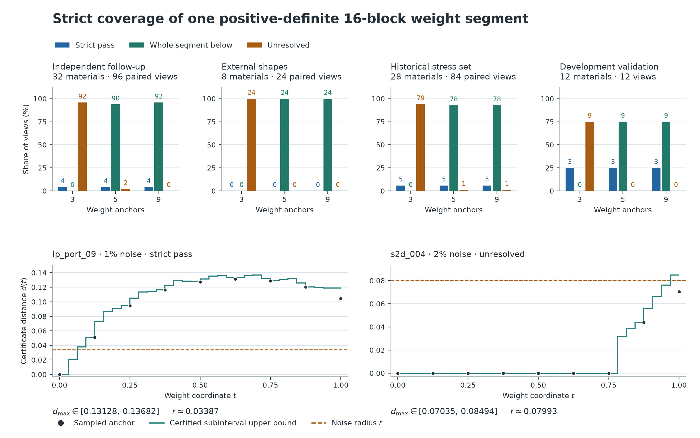
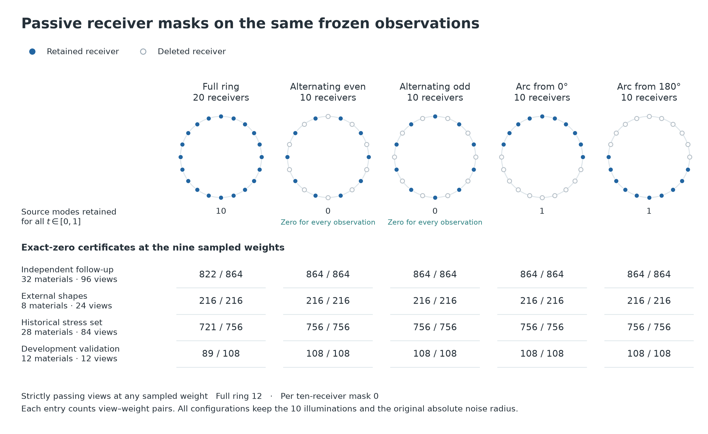
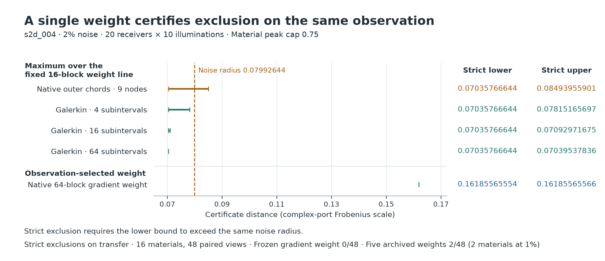

# 哪些权重一定证不出，换接收位置又会怎样？

一组权重算不出材料的峰值下界，可能只是这次权重选得不好。我们把两组成功过的十六区权重连成一条线，检验中间**所有可能的混合比例**。在新生成的 32 件材料上，96 份含噪读数中有 4 份证明峰值超过 0.75，端点本身就能做到。其余 92 份经严格计算，整条线上最好的证书也达不到误差半径。随后用档案中 4 件连续介质和 4 件细桥物体重新采集全环读数，其 24 份读数在整条线上的证书都恰为零。材料有 9,216 个独立单元，只有被研究的权重家族是一维的。[冻结的物体与观测条件](followup/DESIGN_ZH.md) · [逐物体数据](followup/results/fresh_segment_cover.json)

这个结果可以帮助解释一次失败。在同一历史物体和同一份数据上，我们既能证明整条权重线都不可能成功，又找到线外的合法权重，证明物体确实超过设定峰值。这样就能把责任具体定位到**被搜索的权重范围**。[该物体的严格上界](followup/results/galerkin_historical_focus.json) · [全部单案结果](results/cases.csv)

## 从接收端究竟能看见多少电流变化

选择门槛 \(u=0.75\)，在 400 MHz、20 收 10 发的全环阵列上，取论文一曾经严格证明其状态算子正定的两组权重。把两组权重混合后，两个二次式需要共享同一电流。相对于端点证书的简单插值，要求电流一致给出一个非负的修正。用端点的公共传播矩阵，可以从接收端看到这项修正的一部分。

在 32 件新物体上，仅靠接收端投影获得了真实中点修正量的中位 49.4%（用修正矩阵的对角线之和衡量）。每份观测在线求这个修正的中位墙钟约 2.1 毫秒。没有一个视图靠它超过最佳端点。换用完整的中间权重后，有些数值变大了。例如带孔介质 \(\texttt{ip\_port\_09}\) 在 1% 噪声下，两端最佳距离为 0.10442，\(t=0.625\) 的下端为 0.13129，增加约 26%。两者都已通过同一个门槛。修正迹的比例只量化这项矩阵修正的大小。[精确公式及投影反例](followup/THEORY_ZH.md) · [逐读数中点对照](followup/results/fresh_jensen.json)

## 怎样覆盖节点之间所有未取样的权重

在这条正定线段上，消去电流得到的十阶源矩阵 \(H(t)\) 是矩阵凹函数。对两个已验证节点作区间外的割线外推，可以给 \(H(t)\) 作上界。对每个小区间取正特征值之和，再向外舍入，得到这整个小区间能够达到的最大证书距离上界。与同样计算过全部节点再选最佳节点相比，新增的是对节点之间的保证。

| 材料与读数 | 三节点，严格通过／整段低于半径／未定 | 五节点 | 九节点 |
|---|---:|---:|---:|
| 12 件训练外验证材料，12 份 | 3／0／9 | 3／9／0 | 3／9／0 |
| 32 件新材料，96 份配对 | 4／0／92 | 4／90／2 | 4／92／0 |
| 历史 28 件，84 份配对 | 5／0／79 | 5／78／1 | 5／78／1 |
| 档案细桥及连续介质 8 件，24 份配对 | 0／0／24 | 0／24／0 | 0／24／0 |

32 件材料在检验最初的端口修正时首次使用，在改用更多节点时已有暴露。追加的 8 件旧形态从未用于选节点或调参，原研究公开过它们在其他孔径的结果。这次用原生成器恢复相同材料，八件面积平均到原网格后均与档案逐格一致，然后重新计算 400 MHz 全环的含噪读数。1%、2%、10% 对应同一材料上的三份读数。32 件中包含 8 件峰值本来就在 0.75 以内的负对照，所有负对照都被正确保留。[完整区间证明与成本](followup/NESTED_SEGMENT_COVER.md) · [追加材料的正演和误差范围](followup/external8_generation.json)

上排每组柱按读数计数。同一份读数只要有一个已证节点超过半径，就归为通过。下排的点是严格核验过的节点，青色小台阶给出两点之间可达到的上界。右下方九节点仍不能判定的历史读数，提供了下一步改法的直接检验。

## 只用端点电流，可以判清九个节点仍未判清的例子

Neon 在命令行里读了最初三节点外推的失败记录，指出可以换一个被估计的量。给定一组试探电流 \(J\)，消去电流前的物理二次式关于 \(t\) 是直线，而且处处包住真实最小值。我们用两个端点的 60 列原生电流作共同子空间，把线段分成四段。每段只在中点的小矩阵里求一个试探电流，再在该段两端用严格区间核定上界。试探电流的求解误差会使上界变宽，无法凭空产生过强证书。[公式与证明](followup/THEORY_ZH.md) · [冻结条件和逐案对照](followup/GALERKIN_COVER_ZH.md)

历史材料 \(\texttt{s2d\_004}\) 的 2% 读数，实际误差半径为 **0.07992644**。九个原生权重仍只把连续最优值夹在 \([0.07035766,0.08493956]\)。四段电流上界给出 \([0.07035766,0.07815166]\)，已能判定全段低于半径。细分成 16 段和 64 段，上端又降到 0.07092972 和 0.07039538。同一数据上，64 块的五秒普通梯度给出的另一组权重经原生核验，下界达到约 **0.162**，严格排除了“全体材料都不超过 0.75”。这里没有加入照明、改动数据或用真值挑选方案。[该条线的区间回执](followup/results/galerkin_historical_focus.json) · [所有在线提案与独立证据](results/cases.csv)

在 32 件新物体和另 8 件外部物体上，四段电流上界就判清了全部读数，与九节点覆盖结论一致。节点外推法准备九个原生状态的 270 列右端，耗时 197.53 秒墙钟、141.87 秒 CPU。电流法本次从只保留端口矩阵的档案出发，先计入两端证书的 60 列和 18.45 秒，再支付 60 列来恢复试探电流，并计算受限空间的原生积分。为取得四段判定，新增准备耗时 38.43 秒墙钟、28.67 秒 CPU，连同端点下界共计 56.88 秒墙钟、48.29 秒 CPU 和 120 列右端。继续把 16、64 段一并准备，新增总费用才达到 40.63 秒墙钟、30.43 秒 CPU。两种方法都复用论文一对这两个相同端点的正谱证明。若从未准备过该阵列，两种方法均需加回这两个端点历史合计 69.16 秒墙钟的状态证明。两个端点共处的阵列和频率是这项摊销的条件。几何或阈值改变，原来的准备费用不能自动沿用。[维护两端响应的实际费用](followup/results/port_enclosures.json) · [完整检验与数据](followup/results/galerkin_fresh.json)

对完整 216 份配对观测，两端电流四段法得到 12 份严格过线、204 份整段低于半径、0 份未定；9 节点得到 12、203、1。四段法的 195 份整段严格为零，16 段把这一数字提高到 198，9 节点也是 198。包括形成观测端矩阵和两端下界在内，四段法每份观测中位 10.37 毫秒墙钟、9.51 毫秒 CPU；九节点法分别为 163.26 和 70.54 毫秒。两者同机不同批次，CPU 比值约 7.4。这里加速的是**判清整段乘子是否有用**这一任务。12 份过线全部由单独检查两个端点得到，没有新增任何材料峰值证明。[同视图、同半径、同任务对照](followup/results/galerkin_paired_summary.json)

## 同是十个接收天线，角位置能改变证书失效的原因

保持原十个照明、频率、发射能量和全环的绝对误差半径。从同一圈 20 个每隔 \(18^\circ\) 放置的接收天线中挑十个。第一种隔一个取一个，有两种起点。第二种连续取十个，两个起点相差 \(180^\circ\)。两类布局都只用保留下来的读数。

- **交错接收。** 通过一个十阶接收矩阵就能证明，这两个布局在所有混合权重下恰好各有 10 个状态负方向。源矩阵也只有 10 个方向，全部被扣除。对**任何可能的观测值**，这条线上每一组权重的证书都严格为零。这一结论完全由阵列、Green 算子和所选权重决定。
- **连续接收弧。** 两段弧均在整条权重线上恰有 9 个状态负方向，保留了一个源方向。因此几何本身还不足以判零。在实际的 216 份读数和九个权重节点上，两条弧各自 1,944 个结果都严格为零。我们又把带边矩阵直接压缩到二十阶。198 份读数的零结论可由全环整段证明继承，剩余 18 份逐条验证后，两条弧对这 216 份读数在**整个连续区间**上全部严格为零。补齐两弧的 36 份证明共用 3.56 秒墙钟、3.78 秒 CPU，无需新增原生求解。这个结论针对已列出的观测值，交错布局才有任意观测的证明。[逐区间余量](followup/MASKED_SEGMENT.md)
- **全部被动接收组合。** 在这套模型中，若 \(C^*C\preceq I\)，把接收端替成 \(CS\)、同一数据替成 \(CY\)，证书的正惯性计数逐阈值单调不增。原全环证书严格为零的情形可以一次传递给全部 \(2^{20}\) 种删行方案。对非零上界，需要和新观测的绝对误差半径重新比较。

上述几何检查重新使用 9,216 维的已证公共响应，计算四种新布局无需再解原生系统。为检查行顺序、单位及不定惯性，另外支付 30 个原生右端，在预先指定的三个布局与同一对象上直接解状态方程，所得惯性 0、10、9 均与端口计算一致。这个实验允许被动丢弃接收信息，未考察新增传感器、更改发射任务或在保留通道里重新分配总能量。[接收角和区间证据](followup/MASKED_PORTS_REPLAY.md) · [独立原生对照](followup/results/masked_direct_checks.json)

## 一件物体上成功的 64 块权重，能带给下一件物体吗？

旧权重线在历史材料 `s2d_004` 的 2% 读数上已严格判负，但普通梯度在这件材料上找到的 64 块权重为不定状态，恰有五个负方向；在同一半径上其严格下界达到 0.16186。我们把这**唯一的一组权重**固定下来，并把完整五组历史光学权重一起作为强对照。之后新生成 16 件物体，12 件实际峰值高于 0.75，另 4 件峰值低于 0.75。每件产生三份独立于方法选择的配对噪声条件。对这 48 份数据，新增的这组权重全都严格为零。全部 4 件真实低峰物体的 12 份读数均未发生错误排除。其在线成本中位为 1.20 毫秒墙钟，若把原物体搜索、单案证明及跨物体准备算入，首次成本为 89.61 秒墙钟、59.11 秒 CPU。原五种固定方法中的四象限光学权重对 `transfer16_04` 的 1% 数据证明通过（0.04559 对 0.03451），全局光学权重对 `transfer16_14` 的 1% 数据证明通过（0.03522 对 0.03148）。所有 48 份读数均由独立原生正演核验真值在误差球内。

在已暴露的历史 84 份读数上，完整旧组合从 7 份增加到 8 份，唯一新增就是挑出该权重的原数据。在先前 32 件的新队列里，额外权重在 1 份读数确实通过，但旧组合已覆盖该例。在额外 8 件细桥和连续材料里也没有新增。这里检验的是一组已知有用的不定权重能否跨目标复用；按物体重新进行梯度优化仍是不同方法。[权重、全部区间和费用](followup/TRANSFERRED_WEIGHT_ZH.md) · [新物体含噪场的真值入球证明](followup/transfer16_generation.json)

## 如果根据每件物体自己的读数调整权重

在上述 16 件材料上，用原有 64 区一秒梯度从均匀权重开始搜索，并把结果交给同一个原生求证器。1% 噪声时它在 6 件上证明峰值超过 0.75，固定五组权重在 2 件上做到。2% 时为 4 件对 0 件。10% 时两者均为零。现场优化保留了固定权重全部两次成功，另外严格通过八份读数，按材料去重增加四件。全部 48 次比较均已作出严格判断。这项方法复验是在固定迁移结果已知后选定的，梯度参数沿用早先的档案试验。[两种方法的逐件区间](followup/ONLINE_TRANSFER_ZH.md)

代价随数据变化很大。48 份读数的在线时间逐份相加，梯度加原生证明为 555.37 秒，已有五组权重的在线计算为 0.332 秒，五组端口响应的共同准备另用 54.54 秒。仅看十份成功证明，梯度加物理核查的中位墙钟为 41.01 秒。对照两者在同一份读数上的计时，可以估算先用固定权重、只在它不能证明时才付费搜索的成本。跳过两次重复成功后是 464.89 秒，仍能给出十份证明。这是以实付逐项时间作的重算，独立部署的整批墙钟尚未测量。[逐次时间和原生证明](followup/results/online_transfer_paired.json)

## 值得写进论文的判断

矩阵分式凹性、Galerkin 上界、惯性加法和有限秩逆更新都有成熟先例。本轮的具体进展是，在原 9,216 维散射证书的收发端口上，算清**某条权重线对一份带噪仿真读数所能证明的最强结果**，并且能由阵列几何证明某些失败对所有可能读数成立。它回答了应把算力花在继续调权重、换权重家族，还是改接收几何。对未知材料给定门槛的验证仍依靠向下的排除证书。上界用于说明验证方法的能力，不能据此推断材料本身可行、不可恢复或已唯一确定。

这组实验固定了一个频率、一对正定端点、同一离散无损介质与误差定义。新的角度结论强于单个物体的经验观察，独立实测阵列和更高维权重区域仍是实质缺口。将其作为学术上的数值诊断和一个明确反例有依据；单独宣称通用的学习型成像或认证定理仍缺少证据。[来自独立顾问的创意及本轮回应](ADVISOR_ZH.md)
