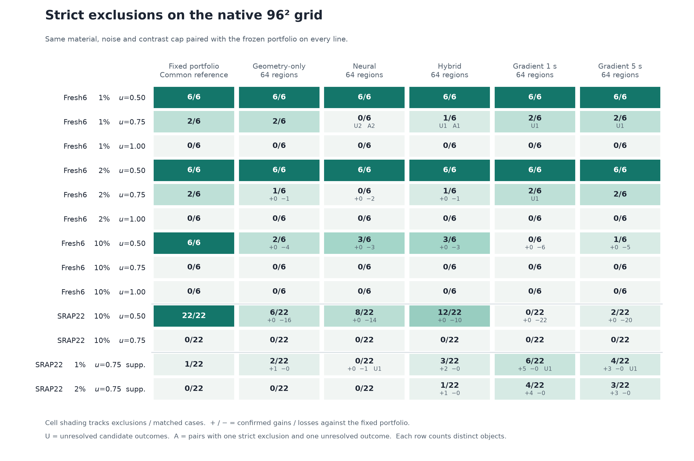
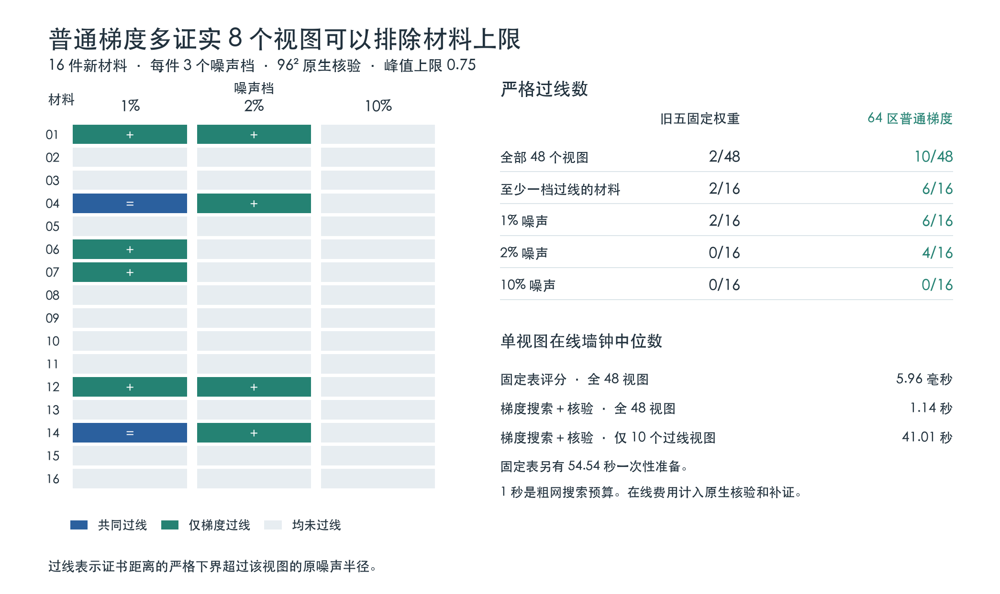
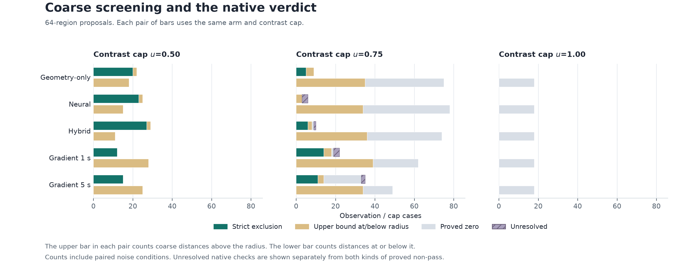
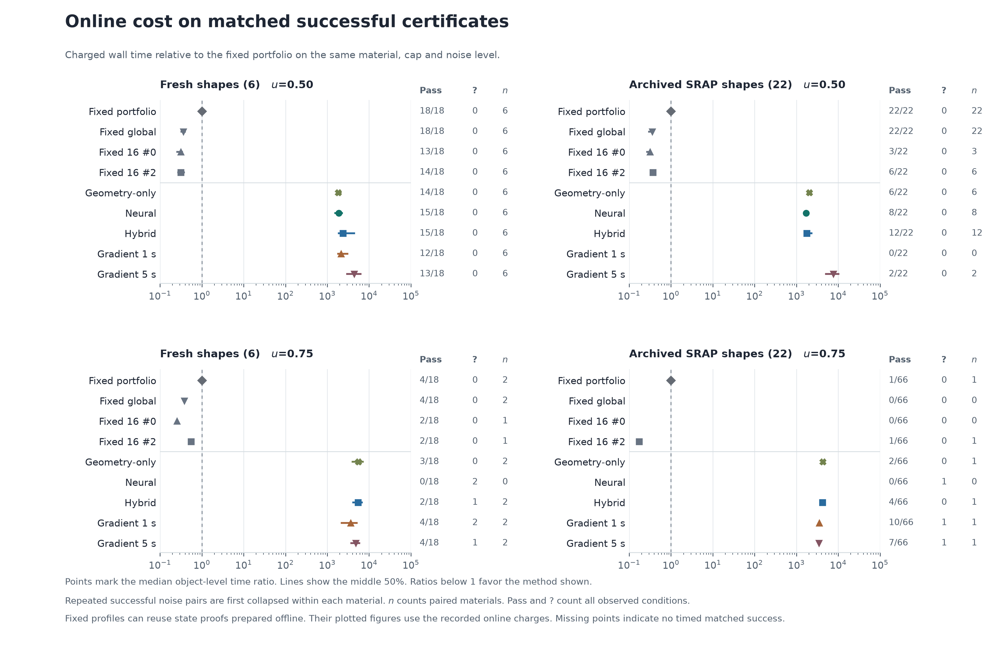

# 看一眼散射数据，能更快证明材料峰值吗？

**本次神经双乘子 Pilot 的裁决是 NO-GO。** 网络在不到 1 毫秒内给出空间权重。把完整的物理证明也计入，在同一台机器、同一份数据、同一门槛且两种方法均通过的冷启动对照中，直接用网络相对普通谱梯度的中位提速为 **1.02 倍**，网络再做三步优化为 **0.97 倍**。六件原生物体的峰值门槛 1.00，以及另外 22 件在 10% 噪声下的 0.75，所有冻结方法均未突破。

**继续往下研究，找到了一个可以把失败原因算清楚的办法。** 把两组既有物理权重之间的所有混合比例都考虑进去，用两个端点的电流给整段作上界。在 216 份配对读数上，12 份由固定端点就能证明峰值超过 0.75，其余 204 份严格证明整条权重线都不可能过线。每份读数的中位 CPU 时间从九节点方法的 70.54 毫秒降到 9.51 毫秒。这个约 7.4 倍的改进用于判断**一整族权重的能力**。它与前面的神经网络提速判据是两个不同任务。[连续权重、接收角度与逐项证据](FOLLOWUP_RESULTS_ZH.md)

**新物体上有用的是根据它自己的读数调整权重。** 在 16 件独立材料的 48 份读数上，沿用一组曾在别处成功的 64 区权重，48 份证明的下界全为零。原论文的五组固定权重能在 2 件上证明峰值超过 0.75。同一读数交给普通梯度调整 64 区权重，严格通过的材料增加到 6 件，覆盖了原有的两件。按 1%、2%、10% 噪声分开，固定方法通过 2、0、0 件，逐件优化通过 6、4、0 件。取得一次成功证明的在线耗时中位为 41.01 秒。[48 份读数的配对结果和时间](followup/ONLINE_TRANSFER_ZH.md) · [固定权重跨材料的独立检验](followup/TRANSFERRED_WEIGHT_ZH.md)

## 我们实际检验了什么

一台 400 MHz 环形阵列记录十个独立平面波照明下的散射复数，原始全环有二十个接收位置。我们问的是，**这些读数及其允许误差，能否排除所有峰值介电对比度不超过 \(u\) 的材料**。材料保持无损、非负，物理模型包含全部多次散射。每个网格单元的材料都可独立变化。连续模型误差和实测增益漂移未纳入这轮合成试验。

给每个区域分配两个实权重，一个用实部材料不等式，一个用无损介质的光学功率等式。对任意合法权重，物理定理都给出假设 \(m\le u\) 下最小残差的一个下界 \(d\)。只在原生 96² 网格用区间运算核定 \(d_{\mathrm{lo}}>r\) 时，才可断定至少一格超过 \(u\)，其中 \(r\) 是此次观测允许的绝对误差。算法输出是一个材料判断。它没有估计峰值位置或重建图像。[物理定理与谱梯度](MATHEMATICAL_NOTES_ZH.md)

训练端只读带噪复数数据、阵列和门槛。分别生成 60 件训练物体、12 件验证物体，模型权重在打开测试读数前已固定。所有方法在 32² 上提出权重，再交给同一个 96² 原生物理算子。16 块与 64 块分别是两类空间权重的分辨率。按电流密度和单元面积把两类权重同时除九后，原生物理仍有 9,216 个材料自由度。数据特征网络与同容量固定特征对照都选到第 4 个训练轮次。训练分别用了 127.21、112.32 秒墙钟，124.12、109.41 秒 CPU。72 件材料的 720 个正演右端另耗 8.30 秒墙钟、25.05 秒合计工作进程 CPU。[数据、架构与训练成本](METHODS_TRAINING_ZH.md) · [冻结比较口径](PILOT_DESIGN.md)

留出试验的 28 件材料在此前物理研究中已发表，对本轮训练和选参均未见。六件原生材料使用原来 1%、2%、10% 的读数。另 22 件先用档案的 10% 读数，再按原噪声方向补齐 1%、2%，另行冻结并核对真实物理数据在指定球内。共 84 份读数，142 个“读数、峰值上限”组合。每个组合运行 16、64 两种分块下的一秒及五秒普通梯度、神经直接提议、固定特征网络、神经加三步梯度，共 **1,420** 份提议。普通梯度的两档时间是同一条轨迹的两个截点。另算了 426 个固定权重对照及它们逐观测的最佳严格证书。每个物体计作一个独立样本，各档噪声、门槛和方法都是同一物体的配对条件。[补充读数与误差核查](SUPPLEMENT_DESIGN.md) · [按材料和方法分列的完整表](EXPERIMENTAL_RESULTS.md)

## 与什么方法比，差别出在哪里

| 材料 | 噪声 | 峰值门槛 | 固定三组 | 普通梯度 1 秒，16／64 块 | 普通梯度 5 秒，16／64 块 | 网络直接，16／64 块 | 网络加三步，16／64 块 |
|---|---:|---:|---:|---:|---:|---:|---:|
| 原生 6 件 | 1% | 0.50 | 6 | 6／6 | 6／6 | 6／6 | 6／6 |
| 原生 6 件 | 2% | 0.50 | 6 | 6／6 | 6／6 | 6／6 | 6／6 |
| 原生 6 件 | 10% | 0.50 | 6 | 0／0 | 1／1 | 3／3 | 3／3 |
| 原生 6 件 | 1% | 0.75 | 2 | 3／2 | 3／2 | 2／0 | 1／1 |
| 原生 6 件 | 2% | 0.75 | 2 | 2／2 | 2／2 | 1／0 | 0／1 |
| 原生 6 件 | 10% | 0.75 | 0 | 0／0 | 0／0 | 0／0 | 0／0 |
| 原生 6 件 | 1% | 1.00 | 0 | 0／0 | 0／0 | 0／0 | 0／0 |
| 原生 6 件 | 2% | 1.00 | 0 | 0／0 | 0／0 | 0／0 | 0／0 |
| 原生 6 件 | 10% | 1.00 | 0 | 0／0 | 0／0 | 0／0 | 0／0 |
| 档案 22 件 | 10% | 0.50 | 22 | 0／0 | 4／2 | 10／8 | 11／12 |
| 档案 22 件 | 1% | 0.75 | 1 | 5／6 | 1／4 | 2／0 | 3／3 |
| 档案 22 件 | 2% | 0.75 | 0 | 3／4 | 1／3 | 0／0 | 1／1 |
| 档案 22 件 | 10% | 0.75 | 0 | 0／0 | 0／0 | 0／0 | 0／0 |

表中数字为严格排除的材料数。每个方法始终用相同观测与绝对半径。主表固定组合包括全局实部和原论文两套十六区权重。另在 0.75 上补入全局光学和四象限光学两个已存权重，形成五种完整固定对照；原六件各噪声档的通过数为 3、2、0，档案二十二件为 2、0、0。完整表另列未定例数，保留 16／64 块、1 秒／5 秒、联合校正前后的全部结果。六件物体 \(u=1.00\) 的 180 份动态提案全都严格为零。22 件 10% 噪声、\(u=0.75\) 的 220 份动态提案中，22 份严格为零，198 份有不超过半径的严格上界；没有待定例。这两项负结果均得到原生证据。[逐项区间与状态](results/cases.csv)

在较易的 \(u=0.50\) 上，固定全局权重对主比较的全部 40 份读数都有严格证明。一份固定权重跨多个物体使用时，几何求解可以提前做一次。固定 0.50 权重的准备约 17.7 秒，每个新数据只需约 2 毫秒的源空间计算。历史论文中的 91.93–158.22 秒是针对两件物体的一次十六区单源搜索与求证。比较时若把这整笔费用算给每一次新观测，就会严重高估神经网络的优势。[固定权重复用的逐案费用](results/fixed_baselines.json)

低噪声时，普通梯度确实找到固定权重漏掉的材料。例如档案 \(\texttt{s2d\_021}\) 的 1% 读数，普通梯度可排除 0.75，论文一同门槛的五种已存权重都未通过。另一个容易误判的例子是 \(\texttt{optfresh\_04}\) 的 1% 读数。16 块普通梯度优于主表冻结的三组对照，加回论文一其余两个光学权重后，固定方法也通过。在历史 \(\texttt{s2d\_004}\) 的 2% 读数上，64 块五秒梯度的原生距离区间约为 \([0.16185565554,0.16185565566]\)，半径仅 0.07992644。神经提议加三步梯度也证明通过，距离约 0.1012。同一例原有两个正定权重之间**最好的任意混合**则严格低于半径。这个实例说明，同时需要区分物理数据有无信息、给定权重能否把信息提出来，以及求证器是否把结果算清。[旧权重连续范围](followup/results/galerkin_historical_focus.json) · [全部梯度和网络数据](results/cases.csv)

在 22 件档案材料上，64 区普通梯度各花一秒选权重。在 1%、2%、10% 噪声下，它分别在 **6、4、0** 件材料上证明峰值超过 0.75（1% 另有 1 件未定），完整五种固定权重对应 **2、0、0** 件。2% 通过的四件是 `s2d_004`、`s2d_012`、`s2d_014`、`s2d_021`。[历史方法逐项记录](EXPERIMENTAL_RESULTS.md)

随后把同一参数用于另外 16 件材料，得到相同的分档计数。48 份读数全部由 96² 物理算子判定。在 1% 噪声下新增通过的是 01、06、07、12；在 2% 下通过的是 01、04、12、14。材料本身峰值低于 0.75 的四件，在所有噪声档都没有误判。最初选这 16 件是为了检验固定权重迁移。我们在看到固定方法的结果后才补做梯度比较，原梯度算法与参数早于这批材料生成。两批数据得到相同趋势，仍只覆盖单频全环的合成读数。[逐件比较与严格区间](followup/ONLINE_TRANSFER_ZH.md)

## 原生求证的失败能解释到哪一步

1,420 份提案中，273 份严格过线，567 份证书严格为零，另有 566 份取得了不超过噪声半径的上界，14 份仍未定。单是 32² 看似能过线的就有 364 份，其中 273 份经原生确认为通过，77 份证实过不了线，14 份在原生精度下仍未决定。单看直接网络，16 块为 35 份粗网过线，其中 30 份细网通过、5 份证实未过线、0 份仍未定；64 块为 31 份粗网过线，其中 23 份细网通过、5 份证实未过线、3 份仍未定。未定表示本轮谱界或驻点误差证明不够紧。把它们都算作假阳性会夸大粗细网差距。

独立的几何证明进一步追问，峰值门槛 1.00 的失败能否完全归因于隐藏电流。由固定参考算子生成 24 个原生向量，不用物体真值。在六件材料的 180 份权重中，有 **68 份**能严格证明状态至少有十个负方向，足以耗尽十个照明方向。其中一秒梯度 36/36，五秒梯度 32/36。对神经直接提议，36 份均只证明了至少九个；对固定特征对照只能证明至少八个。180 份证书为零的结论完整，给其中 112 份指定这一同一物理原因的证据仍然不足。[负方向数与原生谱余量](GEOMETRY_INERTIA_ZH.md)

在未经训练的 12 件验证物体上，我们把网络输入换成另一件等能量材料的散射读数，或只打乱相位，物理评分端始终使用正确读数。对 0.75 门槛，三种输入的平均粗网归一化分数分别为 0.000169、0.000181、0.000212。正确输入没有持续改善。这个对照支持网络主要在利用共同阵列的解释，但仍不足以证明任何读取数据的模型都没有价值。[验证集的 432 次输入对照](results/validation_swaps.json)

## 时间花在哪里

64 块的独立冷启动对照覆盖六个预先指定的材料—噪声组合，每支方法从空的物理缓存开始。网络直接给权重快速，端到端包括细网求证后，中位墙钟为 17.91 秒，六份中五份严格通过 0.50；神经加三步梯度为 17.81 秒，六份全部通过。一秒和五秒普通梯度各通过三份，中位墙钟分别为 14.55、23.01 秒。逐个物体只在双方通过时比较，三份能配对，直接网络和混合的中位提速分别为 1.015 和 0.970 倍，均为 0/3 达到五倍。普通固定权重已经覆盖全部六份。独立计时与批处理中共享历史证明的计时分开记账。[24 次冷启动和全部配对](results/cold_latency.json)

按全部留出提案计算，直接网络一次前向的中位墙钟为 0.78 毫秒（16 块）和 0.92 毫秒（64 块）。去掉两档梯度的共同前缀和神经热启复用，实付的提议阶段合计约 1,508.0 条目墙钟秒、1,352.7 进程 CPU 秒。逐项原生核验合计 12,033.6 条目墙钟秒、9,668.9 进程 CPU 秒，其中 378 份初次未决提案的补证占 5,394.0 墙钟秒、4,339.1 CPU 秒。不同队列并行，条目时间之和不等于从开始到结束的钟表时间。训练、公共几何准备、粗网诊断及固定基线另列。进程中断前尚未写出回执的部分耗时无法还原，因此这些合计是已记录费用。详表给出同一证明复用的实际开销，以及每臂独立计费的比较。[费用和逐案证据](EXPERIMENTAL_RESULTS.md)

## 论文判断

神经方案能给出合法提议，原生核验保证每个通过项都服从相同的离散物理合同。工程目标还要求更高的可证门槛，或在相同可靠性下稳定达到五倍端到端提速。当前两者都未达到。该结论适用于本轮训练规模、输入、优化预算和阵列。增加到 256 块或转入三维缺少这轮数据支持。

自监督地预测乘子，再用原方程计算有效下界，已有直接的算法先例。Bessa 等人在背包与排班问题中比较了普通次梯度、网络给权重以及网络再接次梯度，并同时计入通过数、时间和最优性间隙。Sambharya 等人则研究了参数化优化的学习型热启动。对应到本题，需独立展示的量是原生传播、区间求证、不定惯性带来的有效峰值排除，以及实际时间。单独引入神经乘子或三步微调的概念不构成足够原创性。[Bessa 等，AAAI 2025，原文及对照表](https://ojs.aaai.org/index.php/AAAI/article/download/33208/35363) · [Sambharya 等，JMLR 2024](https://www.jmlr.org/papers/v25/23-1174.html)

可独立保留两项数学结果。第一，利用两端共同电流，以低成本严格包住整条权重线，在实际数据上能判定“继续调也证不出”。第二，删去一个物理接收子集后，状态负惯性可以用删去端口数阶的矩阵直接计算。在两种交错十接收布局下，整条权重线对任意观测的证书严格为零；两条连续接收弧保留一个源方向，对实际 216 份读数也逐条证得整段为零。它们分别给出几何本身的限制和特定材料数据上的限制。原理依赖经典变分和惯性定理；本轮没有证明全体可能乘子的能力上限，也没有用这种方法改善材料重建误差。[数学推导与先例](followup/THEORY_ZH.md) · [单独的中文研究交接](NEXT_PRO_HANDOFF.md)

论文一已先行定稿。匿名英文稿有 25 页、34 篇逐条核对的文献。迁移和实测图在第 19、20 页，附录保留失败计算的费用。[英文定稿与投稿材料](https://migodam.github.io/b1-probabilistic-maxwell-imaging/research/z_alg_optical_inertia/ip_final/) · [本次试验复现入口](REPRODUCE.md)
