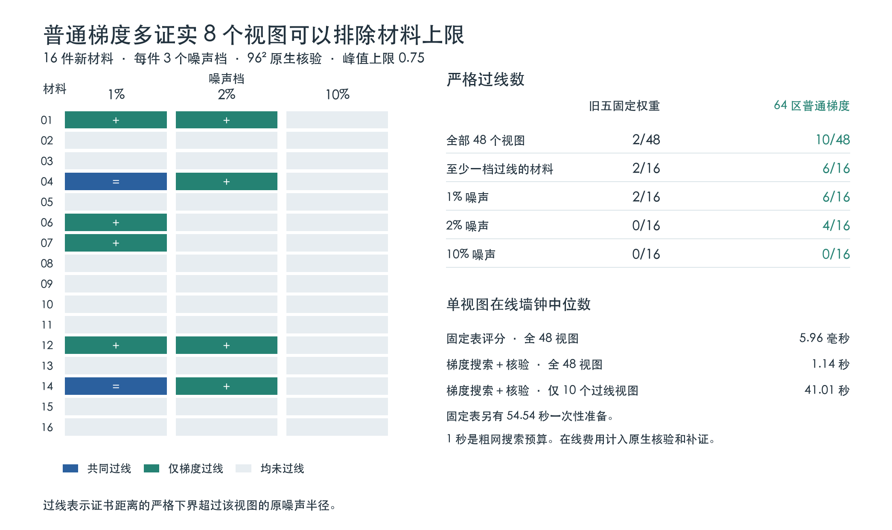

# 64 区一秒梯度的配对复验

在已有 22 件仿真材料上，根据每一份散射读数调整 64 个区域的权重，低噪声下能排除更多低峰值解释。我们将同一方法用到另外 16 件材料上，检验这项收益能否重复。本试验在已有固定权重结果后选择了对比方法，属于回顾性的方法选择。16 件材料由独立种子生成，原一秒梯度算法在这些材料生成之前已经存在。本次冻结后沿用其参数，保留所有 1%、2%、10% 的 48 个配对视图。[冻结比较](results/online_transfer_frozen.json) · [16 件材料的生成设计](TRANSFER16_DESIGN.json)

同一档位、同一半径下，**一秒梯度严格过线 10/48，对应 6/16 件材料。旧五组固定权重过线 2/48，对应 2/16 件。** 梯度保留了旧固定表的两次排除，新增八次严格排除，涉及四件原来任何噪声视图都未过线的材料。所有 48 个视图均已严格判定，没有未定。新增发生在 1% 和 2%，10% 两种方法均无排除。[完整配对回执](results/online_transfer_paired.json)

## 共同输入、搜索与验证

输入是相同 400 MHz 全环、20 收 10 发的公开带噪端口及各自绝对半径。两方均取材料上限 0.75。梯度沿用 `Coarse.optimize` 的均匀初值、步长和硬目标。每次现场搜索在 1 秒后停止发起新评估，计入最后一次完成的实际墙钟和 CPU。候选只从 1 秒内已完成的评估中选出。优化、筛选及原生核验全程以不透明编号读取带噪场和半径，材料峰值用于全部评分完成后的对照审核。

把 32² 网格的实部与光学两种权重各除以九，补偿 96² 网格的单元面积变化。先用 256 维试探空间给出上界，需进一步判断时用原生 Fourier 算子与区间运算。首轮未确定的读数沿用主试验的补证规则。只有距离下端严格高于半径算过线，已证上端不高于半径与仍未定的视图分开记录。粗网距离和惯性只是诊断。五组旧权重对同一个原半径已有严格回执，本轮直接配对使用。[原五组严格回执](results/transferred_weight_transfer16.json)

搜索分四个单线程工作进程，原生和补证分六个单线程工作进程。搜索先全部结束，避免原生验证与一秒搜索同时争用处理器。完整初值、粗网各次试探、选中权重、超支、原生与补证证据分别落盘。[搜索入口](online_transfer_propose.py) · [核验与配对汇总入口](online_transfer_score.py)

## 怎样配对判读

| 噪声 | 一秒梯度过线／已证不高于半径／未定 | 固定五组同口径 | 新增过线 | 丢失 |
| --- | ---: | ---: | ---: | ---: |
| 1% | 6／10／0 | 2／14／0 | 4 | 0 |
| 2% | 4／12／0 | 0／16／0 | 4 | 0 |
| 10% | 0／16／0 | 0／16／0 | 0 | 0 |
| 合计 | 10／38／0 | 2／46／0 | 8 | 0 |

| 新增读数 | 半径（近似） | 梯度严格下界（向下取整） | 固定五组严格上界（向上取整） |
| --- | ---: | ---: | ---: |
| transfer16_01，1% | 0.04702 | 0.09709 | 0 |
| transfer16_01，2% | 0.09404 | 0.09799 | 0 |
| transfer16_04，2% | 0.06902 | 0.09766 | 0.04575 |
| transfer16_06，1% | 0.04625 | 0.11004 | 0 |
| transfer16_07，1% | 0.04173 | 0.07525 | 0.02984 |
| transfer16_12，1% | 0.04344 | 0.07914 | 0 |
| transfer16_12，2% | 0.08688 | 0.09123 | 0 |
| transfer16_14，2% | 0.06296 | 0.09275 | 0.03712 |

旧表已经过线的两个视图是 `transfer16_04` 和 `transfer16_14` 的 1%。48 个视图来自 16 件独立材料，不能当作 48 件独立样本。16 件中 12 件材料峰值高于 0.75，梯度在其中 6 件至少有一个视图过线，旧固定表为 2 件。四件已核验真材料落在误差球内的低峰对照共 12 个视图，梯度证书距离全部严格为零，固定表也无错误排除。[真材料在球内的独立核对](results/transferred_weight_offline_audit.json)

首轮原生严格证书直接通过 5 次、未定 10 次。原统一补证在这 10 个视图上新增 5 次通过，证明 4 次严格零和 1 次低于半径。这批独立材料保留了历史 SRAP 观察到的低噪声优势。历史 22 件的结果分别是 1% 过线 6 另有 1 未定、2% 过线 4、10% 过线 0。这里的结论限于原普通梯度、该全环合同及本次低噪声批次。[历史逐案数据](../results/cases.csv) · [配对原生和补证回执](results/online_transfer_paired.json)

## 实际费用

| 费用范围 | 墙钟 | 进程 CPU |
| --- | ---: | ---: |
| 一秒粗网搜索，单视图中位 | 1.037 秒 | 1.013 秒 |
| 梯度加 96² 严格核验，全 48 视图中位 | 1.142 秒 | 1.112 秒 |
| 梯度加严格核验，仅 10 个确实过线视图中位 | 41.014 秒 | 39.903 秒 |
| 已付费旧固定五组，48 视图评分中位 | 5.958 毫秒 | 5.920 毫秒 |

全部 48 个搜索各有一次在 1 秒后完成的已付评估，均排除在选权重范围外。每次有 12–14 次合格评估。共付粗网搜索 49.73 秒墙钟、48.61 秒 CPU，第一次 96² 严格核验 240.53 秒墙钟、232.86 秒 CPU，10 次补证另付 265.11 秒墙钟、259.82 秒 CPU。三项逐视图相加为 555.37 秒墙钟、541.29 秒 CPU。并行运行时，最慢搜索工作进程用时 12.57 秒，最慢原生及补证工作进程用时 130.31 秒。旧固定表的共同响应准备曾付 150 个原生右端、54.54 秒墙钟和 53.87 秒 CPU，本轮复用已有逐视图结果。这里的「一秒」是候选搜索预算，完整严格排除的费用以上表为准。[逐阶段时间](results/online_transfer_paired.json)

复现从本目录运行以下命令，各分片可以并行。已有封存提案会直接复用。原始四个压缩分片保存完整初值和轨迹，可用于重放当时选中的权重。在独立副本从零开始时，由于停止条件按墙钟，其他机器可能完成不同数目的评估。

~~~bash
for rank in 0 1 2 3; do
  PYTHONDONTWRITEBYTECODE=1 python -B online_transfer_propose.py --shard "$rank/4" &
done
wait
for rank in 0 1 2 3 4 5; do
  PYTHONDONTWRITEBYTECODE=1 python -B online_transfer_score.py --shard "$rank/6" &
done
wait
PYTHONDONTWRITEBYTECODE=1 python -B online_transfer_score.py --assemble 6
~~~
