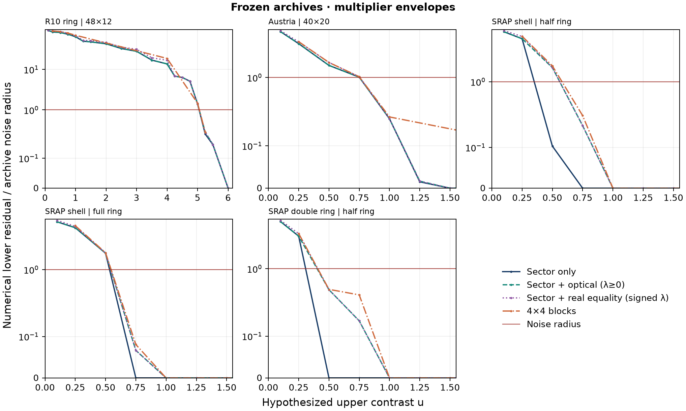
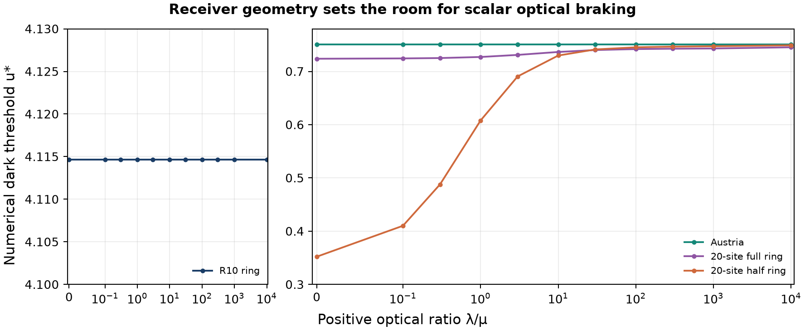
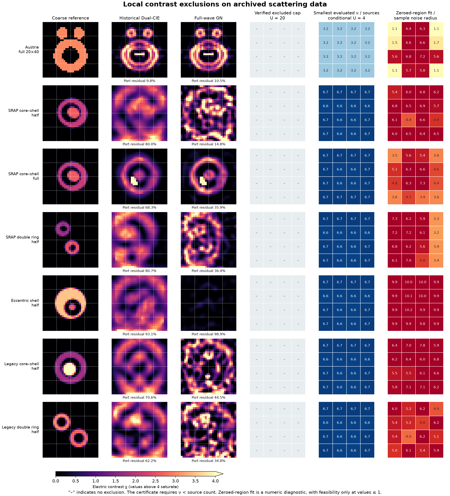
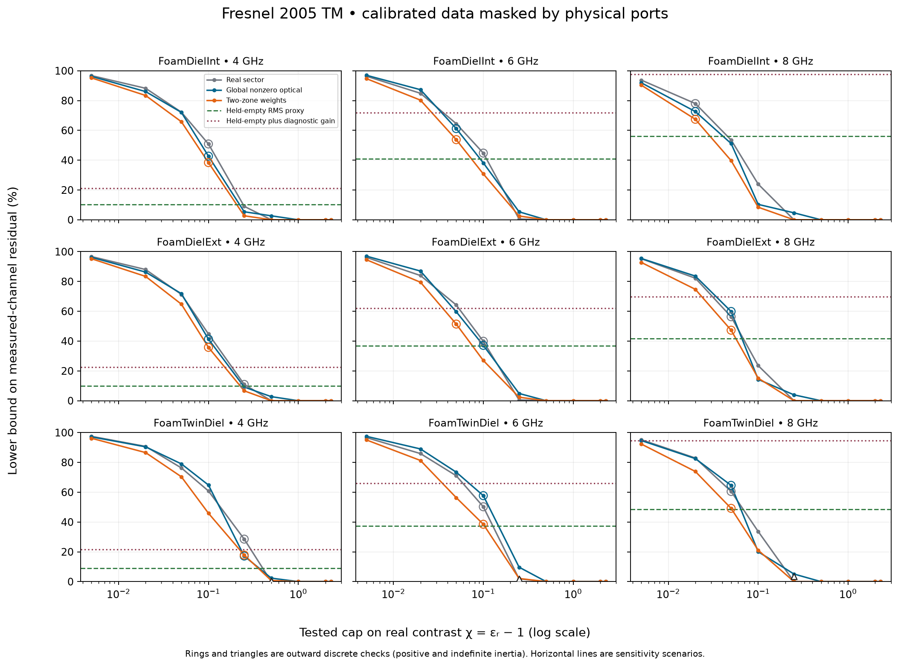

# 从五份存档到九组暗室测量

我们用同一套读数比较三种材料界。第一种只用材料对比度的实部约束。第二种再用无损光学定理，对全图统一加权。第三种允许按空间分块加权。每种牵涉的材料、源功率、阵列和误差球都相同。每个检验量的单位都是测得复场的联合 Frobenius 范数。记录中的 $u$ 是被排除的材料上限；$d$ 是在该上限下能达到的残差的严格下界；$d>\delta_{\rm eff}$ 才证明材料峰值大于 $u$。本文统一用 $\chi=\epsilon_r-1$。

## 1. 历史物体：光学定理改变了什么

| 完整离散观测 | 独立材料数 | 实部约束可严格排除的最大测试上限 | 加全局光学后 | 再允许分块后 |
|---|---:|---:|---:|---:|
| R10 环 | 576 | 5 | 5 | 5 |
| Austria，全环 | 1,024 | 0.75 | 0.75 | 0.75 |
| 核壳，半环 | 1,024 | 0.25 | **0.5** | 0.5 |
| 同一核壳，全环 | 1,024 | 0.5 | 0.5 | 0.5 |
| 双环，半环 | 1,024 | 0.25 | 0.25 | 0.25 |

表中使用历史冻结的观测球；Austria 还列有原 R8 较小的球，详细数值分别归档。阶段之间保留已成立的基线证书。这里的“最大”是在扫描的阈值中取得。Austria 的 0.75 在实部权重的较细网格里就已通过，不能把上一轮的 0.5 到 0.75 归给光学定理。核壳半环在 $u=0.5$ 的联合 $d\ge1.05506$，半径 0.58703；同乘子一个相干源也能给出 0.82487。R10 在 $u=5$ 的共享矩阵在四个负方向后仍留下正谱，标准实部约束已严格足够。[逐物逐约束的区间结果](results/core/summary.json)

对原实验的 180 个参数点在 $\lambda=0$ 精确对齐，惯性计数逐条一致。对其中 98 个 $\nu\ge s$ 的点固定原 $u,\mu$，对照 11 个正的 $\lambda/\mu$。以下是每个原参数获救的数量；同一参数只计一次。

| 观测 | 原 $\nu\ge s$ | 加光学后至少一次 $\nu<s$ | 至少一次 $d>0$ | 超旧球 |
|---|---:|---:|---:|---:|
| R10 环 | 0 | 0 | 0 | 0 |
| Austria | 20 | 2 | 0 | 0 |
| 核壳半环 / 全环 | 26 / 26 | 2 / 2 | 0 / 0 | 0 / 0 |
| 双环半环 | 26 | 2 | 0 | 0 |

这八点分别在 $\mu=1,10$。Austria 的 $\nu$ 从 21 降至 12；两种半环与一组全环的 SRAP 参数从 13 或 15 降至 0。保留谱仍无正值。在新调出的 $\mu\approx0.03162$ 上，半环核壳的 $u=0.5$ 才越过旧半径。这是对历史失效机制的直接检查。[180 点对照与 98 点明细](results/core/legacy98.json)

阈值曲线来自数值广义特征值。严格的物理结论另查具体核向量。R10 和 Austria 的隐藏辐射算子范数有很小的区间上界；20 接收的稀疏全环与半环的上界为 0.659 和 10.0，几何不同，不能从“全环”两字推断辐射约束已饱和。主标量扫描共 46,860 次评估，34,815 点因负方向过多而失去残差界。在可配对的 23,430 次正光学比较中，计算到的负方向数无一增加。后者是数值现象；精确正定性要求核的具体表示满足相应假设。[核的有界性及负 Rayleigh 商反例](results/theory/hidden_radiation.json)

## 2. 六件新物体：把粗网发现送回细网验证

六个形状在第一次求峰值前确定。400 MHz，二维方形成像区边长 2 m，接收半径 3.75 m，每种阵列均有 10 个单位入射平面波、20 个接收位置。用 96² 网格独立产生旧观测，32² 粗网只访问算子和带噪读数。同一组粗网端口中，六件物体的一阶 Born 场与完整多次散射场的差，分别为完整场范数的 6.86、6.01、5.81、5.96、6.24、4.06 倍。全、半环与两种噪声是配对条件，样本数始终为六件。下面各格写“严格残差下界 / 容许误差”，均在 96² 生成算子上独立验算。破折号表示没有获得越过误差的证书。[固定形状、随机种子与能量](synthetic/FREEZE.md)

| 物体与离线真峰值 | 半环，2%，检验 0.5 | 半环，10%，检验 0.5 | 全环，2%，检验 0.75 |
|---|---:|---:|---:|
| 01 开槽块，3.632 | 0.36887 / 0.10133 | — | **0.16833 / 0.09097** |
| 02 四叶交叠，3.384 | 0.35428 / 0.12690 | — | — |
| 03 双折带，3.416 | 0.47943 / 0.11882 | **0.62278 / 0.59405**（分块） | — |
| 04 月牙与板，3.437 | 0.83965 / 0.11602 | 0.89054 / 0.58009 | — |
| 05 错列沟槽，3.408 | 0.67528 / 0.09937 | 0.68753 / 0.49681 | **0.11061 / 0.08803** |
| 06 梯度风车，3.346 | 0.52353 / 0.12360 | — | — |

全环在 $u=0.5$ 时，两档噪声的六件材料都能用实部约束通过；提升到 0.75 后，10% 噪声下 0/6 通过。半环在 0.5 时，细网已扫描的纯实部权没有一个通过，统一正光学权在 2% 和 10% 下分别通过 6/6 与 2/6。表中的双折带是细网分块增加的一件。对于高噪声其余三件，严谨结论是未获该下界。[完整细网扫描](results/theory/fine_scan.json) · [全局严格结果](results/theory/fine_verified.json) · [双折带严格结果](results/theory/fine_spatial_verified.json)

**证书对应的材料集合确实非空。** 一次离线验证以严格全波解重新检查了所有真材料。原模拟用迭代容差生成精确长度的噪声，直接用这个半径时有 16/24 份真材料越界，最大为 $1.87\times10^{-11}$ 个场单位。按统一的 $\delta+10^{-6}\|Y\|_F$ 加入求解余量，24/24 份真材料均被严格包含。本节采用这个球。35 条全局区间证书（22 个不重复的观测×阈值组合）与额外 1 条空间证书都通过；全局证书中的最小严格余量为 0.02258。[真材料可行性与逐条余量](synthetic/FINE_FEASIBILITY_ZH.md)

**全源优势的强对照。** 在 01 和 05 的全环 2% 读数上固定 $u=0.75$。对 $t=\lambda/\mu\le10^4$，同一个严格属于 $\ker S$ 的电流使二次型为负；对 $t\ge10^4$，对两案分别找到使所有单位相干源都通过该松弛的拟合电流。后者的端口残差分别低于 $7.61\times10^{-14}$ 和 $8.56\times10^{-14}$。两个连续区间覆盖了所有实数，排除了“再多试几个标量乘子也许能复制结果”的解释。仅限声明的单源松弛。第一版仅用粗块电流搜索负向量在 $t=10^4$ 得到上界 +0.01256，未能做出证明；在细网原生电流中去掉主要辐射模式后找到上界 −0.02088。[失败提议与完整单源证明](results/theory/fine_all_scalar.json) · [严格核向量](results/theory/fine_long_ratio.json)

**分块与算量。** 32² 下，双折带半环 10% 的分块下界为 0.65287，标量局部对照加密后为 0.59256，半径 0.59404。另一件月牙与板全环 2% 在 0.75 得到 0.10340，标量约 0.08590，半径 0.09573。两案各自的粗网面积平均材料代理误差加入半径后均不通过。因此我们对两案都回到细网检验，分别取得 **0.62278 对 0.59405**、**0.05604 对 0.09573**。粗网搜索给出候选；细网正证书覆盖该离散模型所有 9,216 个材料自由度。求乘子、区间复核、额外细网工作都计入费用，未建立分块比标量更快的结论。[空间权选取、标量加密与费用](core/README_ZH.md) · [细网细节](fine/SPATIAL_PROOF_ZH.md)

## 3. 能指出材料在哪一块吗？

对每个 4×4 区域先精确剔除该区电流，直接问整个区域能否为空；再试 0.1、0.5、1、2 的局部上限。背景保持完整变化，分别用原盒 20 和另加假设的 4。六件不同历史材料共七份视图，**两种背景上限都为 0/112**。对受检背景乘子，任意改变区内权重都无法消除已严格证明存在于区外的过多负方向。图中灰色或横杠表示当前约束无法回答，读者可以与同数据的材料重建和参考形状直接比对。[完整 1,120 条记录和假设范围](roi/REPORT_ZH.md)

## 4. 三件实物和双频对照

Fresnel 实验从原始总场和空场计算实际散射。三个目标在 4、6、8 GHz 均会因发射位置不同而缺失部分接收角。每次发射有 241 个接收位置，Int/Ext 有 8 次发射，Twin 有 18 次。计算按源分组取真正测到的交集。在 0.5 上，9 份均未过空场误差。Twin 的三个严格不定计算在所选测试上限处依次给出 0.454%、1.922%、3.409% 的下界，各自比分频空场误差小 8.43、35.32、45.07 个百分点。4 GHz、0.25 上限下，仅实部约束达到 28.515%，带入实测误差标尺仍给未知失配留出 6.98 个百分点。未将留出 RMS 假设为全域确定上界。[端口掩码与频率逐例](fresnel/REPORT_ZH.md) · [全部误差账](results/fresnel/TABLES_ZH.md)

另对六件新物体实施了 400 与 500 MHz 同一半环的比较。频率各自重新生成 Green 和入射场，两臂都使用相同的完整两频数据。0.5 上限、2% 噪声时，分别求界再平方相加严格通过 3/6，跨频混合权重 0/6；10% 时两臂都为 0/6。加入各物体实测得的粗网代理场差后，两臂同为 0/6。独立判据可在每频各自扣除负方向，堆成一个大矩阵则可能丢弃本应保留的源方向。[双频的同预算配置、证明与失败记录](multifrequency/REPORT_ZH.md)

## 5. 成本与可重复的范围

| 工作 | 本次实测成本 | 成本所覆盖的事 |
|---|---:|---|
| 32² 等主标量扫描 / 两个空间臂 | 133 s / 20 + 157 s 墙钟 | 五份存档和 24 个新视图；另两次标量加密各 24、79 s，较细比较另记 |
| 32² 严格证书 | 主批次 376 s 墙钟，较高阈值批次另 66 s | 共 67 个独立复核条目通过；各条的运算数与 CPU 在账本中 |
| 96² 全局界 | 搜索 64.4 s，严格复核 81.0 s 墙钟 | 2,832 条数值行，8 个共享谱剖面，35 条被选证书。状态维数 9,216，最大严格小系统 645 阶 |
| 96² 分块及真材料验证 | 分块区间 15.45 s，离线六件真材料共 34.47 s 墙钟 | 分块在全网格复核，矩阵 902 阶；真材料验证峰值约 830 MiB |
| 区域检验 | 两盒扫描 12.6 + 162.8 s，两组区间验证 51.7 + 152.2 s 墙钟 | 另有 20.7 s 对照复算，涉及 218 次正演及 27 个完整材料 Jacobian |
| Fresnel 三频 | 已完整计时的正式扫描及两种复核合计约 1,071 CPU s | 162 次 3,600 阶状态分解，18 次名义正演分解。早期失败与中断前缀另列 |
| 400/500 MHz 配对 | 生成 7.53 s、数值 17.05 s、严格 40.95 s 墙钟 | 使用共享频率算子、两臂同一读数，3 个跨过纯采样球的正例单独复核 |

各阶段有共享及并行计算，上表列阶段时间。Fresnel 的中断前缀未完整计时，不能从表中倒推出整个研究总墙钟。合成粗网与细网对同一已知材料的场差，半环为 12.4%–28.4%，全环为 14.2%–35.4%；这些实测差值说明跨网格消耗了多少余量，不能充当任一未知物体的误差上界。独立细网区间证书只使用公开算子、端口与读数，离线可行性另行读取真材料。所有未越过噪声球的结果与对应的搜索范围均保留。[复现与费用入口](REPRODUCE.md) · [逐案计算账](results/core/summary.json)
