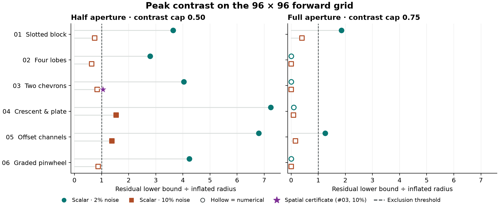

# 十次照明能给材料峰值作证吗？

[英文投稿稿与定稿报告](submission/index.html) · [本次复现入口](submission/reproduce.html)

**可以。** 在开槽块和错列沟槽两件不同的无损介质上，10 次照明的联合读数都证明，9,216 个可独立变化的材料格点中，至少一格的介电对比度超过 **0.75**。如果将照明逐一处理，甚至允许挑选任意一个相干照明组合，并把两条物理约束的标量权重优化到任意值，这一类单源方法在两件物体上都无法得出同一结论。两件真材料都严格处于所用 2% 噪声球内。这里的对比度为 $\chi=\epsilon_r-1$，因此 0.75 表示相对介电常数超过 1.75。[能力差的证明](MATHEMATICAL_THEORY.md) · [两份单源反例](results/theory/fine_all_scalar.json)

只在半环布置天线时，光学定理能补上一部分接收不到的信息。对六件预先确定的物体，2% 噪声下六件都证明峰值超过 **0.5**；10% 噪声下，统一的光学权重证明两件，允许不同区域取不同权重后多证明一件，共 **3/6**。这些数都在产生数据的 96² 全波离散模型上严格成立。六件材料的实际峰值为 3.35–3.63，仍高出这些下界很多。[逐件结果](EXPERIMENTAL_RESULTS.md) · [细网可行性](synthetic/FINE_FEASIBILITY_ZH.md)

| 科研问题 | 这轮数据给出的答案 |
|---|---|
| 整件物体是否必有高于指定上限的介质？ | 两种阵列都有正例；全环的两例还证明全部全局标量单源乘子无能为力。 |
| 能指出具体位置吗？ | Austria、核壳、双环等 7 份视图各切 16 块，**0/112** 块得到可认证的位置。 |
| 对真实暗室测量也成立吗？ | 3 件 Fresnel 实物、4/6/8 GHz 共 9 份读数，在 $\chi=0.5$ 都未越过空场误差。4 GHz 双介质柱在 $\chi=0.25$ 得到一个可检验的模型误差条件。 |
| 值得怎样写论文？ | **CONDITIONAL GO，面向 Inverse Problems。** 可以写有限孔径、多照明与误差下的材料峰值理论。支持严格多源优势的两个试件来自同一离散采集体系，定位和实物的无条件峰值仍待证明。 |

## 两条物理规律怎样约束峰值

天线只记录了散射电流投影到接收端的部分。对一束照明，数值上可以给内部电流叠加一种天线完全看不到的分量，保持同一份读数。这种电流未必来自某份真实材料。我们利用无损介质必须满足的两条规律来排除它。第一条来自有限材料对比度，第二条来自入射波做功和辐射功率之间的平衡，即光学定理。同一物体经历十束照明时，同一个实数材料要同时解释十组电流，以及这些照明之间的交叉项。

实际算法只读入射场、接收几何、Green 算子、复数读数和误差半径。对于“所有像素都不超过 $u$”的假设，计算任何合法电流都无法低于的残差 $d$。一旦 $d$ 超过误差半径，便证明至少一格超过 $u$。负特征值计数 $\nu$ 表示在这次二次估计中，隐藏电流至多能抵消多少个源方向。若还剩下正的源方向，可以把剩余特征值累加起来与整份数据的噪声作比较。该过程无须材料初值或恢复图像。[公式、证明、带损耗条件](MATHEMATICAL_THEORY.md)

图中横轴为残差下界除以误差半径。大于 1 才能排除给定的材料上限。左图检验半环的 0.5，右图检验全环的 0.75。空心标记保留了没有通过的案例。[论文用 PDF](figures/fine_peaks.pdf)

## 负方向减少之后，数据还剩下多少判别力？

在旧半环阵列中，把光学权与实部权之比从 0 增至 10，接收不到的电流首次破坏正定性的对比度从 **0.3521 增到 0.7298**；该权比取一万时为 **0.7490**。全环 R10 与 Austria 几乎没有这种收益。对这两个阵列，接收不到的电流能够辐射的功率有严格上界，分别小于 $7.56\times10^{-15}$ 与 $3.03\times10^{-10}$（本文算子单位）。几何决定了增加同一个光学权重到底能限制哪些电流。[阈值曲线与物理算子](core/README_ZH.md)

用原实验的同一材料上限和实部权重逐点复查了过去失效的 **98** 组参数。加入正光学权后，有 **8** 组把负方向数降到照明数以下，但这 8 组的残差下界仍为零。半环核壳在另一实部权重上从排除 0.25 升至 0.5；该点用一个合适的相干照明已经足够。半环的改善单独支持“补回遗漏的辐射信息”。全环开槽块、错列沟槽才支持更强的“必须利用不同照明的共同材料”主张。[98 组逐一对照](results/core/legacy98.json) · [负方向随光学权的变化](figures/core_inertia_curves.png)

## 为什么保留空间分块

分区使用光学定理有两个不同的用途。其一是改进**全图峰值**。当两个区域给出的局部功率失配符号相反，相加可能掩盖两边的问题。按区赋权可以单独利用它们。对双折带，32² 粗网选出的权重转到 96² 细网后，在 10% 噪声下得到严格下界 **0.62278**，数据半径为 **0.59405**。全局权采用相同实部权重时，细网上只得到数值界 **0.54472**。另一件月牙与板在粗网中也获益，但转入细网后，0.75 上限的下界跌到约 **0.0560**，低于 **0.09573** 的误差。这一对成功与失败共同说明了直接在细网验证的重要性。[空间分块细网证明](fine/SPATIAL_PROOF_ZH.md)

其二是问**哪一块**必须有高对比度材料。此时必须允许区外材料继续变化。逐块审查时，剩下的 960 个背景像素已产生太多能够抵消源信息的方向。即使额外把背景上限从 20 收紧到 4，在检验的整段背景乘子内，20 源的 Austria 仍有至少 24 个负方向，10 源的案例至少有 14 个。每块都只能回答“目前的观测和这组约束无法确定”。对核壳半环，GN 将端口残差由历史 Dual-CIE 的 80.0% 降至 14.8%，材料相对误差却由 1.916 上升到 2.415。本方法也未能独立指定哪一块遗漏了高对比介质。[同色标参考图、GN 与区域结果](roi/REPORT_ZH.md)

## 实测给出了多大的误差余量？

FoamDielInt、FoamDielExt、FoamTwinDiel 的收发掩码随源而变。我们按每组照明真实共有的接收位置计算，只累计互不重复的数据。FoamTwinDiel 在 4 GHz、$\chi\le0.5$ 下产生了真正的不定证书，每组 6 个源有 5 个负方向，仍剩下一个源方向可用。严格残差下界为数据范数的 **0.454%**，该频率空场留出误差折算为 **8.884%**，相差 **8.43 个百分点**。这是真实测量中联合约束留下的信号，也是它离材料声明还有多远的直接量化。[九份实测结果](fresnel/REPORT_ZH.md)

同一实物改检 $\chi\le0.25$，仅实部约束就给出 **28.515%** 的严格离散残差下界。若空场折算误差确实不超过 8.884%，且复增益偏差不超过 10.41%，还可容纳约 **6.98 个百分点**的目标到模型误差。仪器留出和名义几何差异提供了误差尺度，现有数据没有给出覆盖所有合法实物的硬上限。因此报告给出验收所需精度，不宣称暗室对象已有无条件下界。[逐频逐物误差账](results/fresnel/TABLES_ZH.md)

## 论文判断

共用实部和虚部功率约束、在空间分区加权，以及共享结构产生不同照明间的相关约束，都已有光子设计文献。矩阵二次式的最小惯性可以追溯到 Tian。这里值得写进主定理的是，在明确的有限端口逆问题里，把可见与不可见的辐射分开，给出在不定区仍然可计算的**带噪材料下界**，并用两组数值严格的证据证明全体标量单源方法和共享多源方法之间存在能力差。另一个有价值的结论是背景负惯性给区域定位设下的障碍。[命题级文献对照](PRIOR_ART.md) · [英文论文草稿](PAPER_DRAFT.md)

目前最关键的缺口是把矩阵界推进到独立模型或实物上。96² 证明消除了把粗网代理差当统一误差的漏洞。它没有给出真实天线、连续介质和三维散射对这套二维模型的统一偏差。六个中低噪声正例共用一个频率和两个阵列，峰值下界也远低于真峰值。凭这些证据可提交一篇范围清楚的逆问题理论与计算稿；定位、成像精度或实测高对比度认证需要各自的证据。[下一轮理论交接](NEXT_PRO_HANDOFF.md) · [复现入口](REPRODUCE.md)
