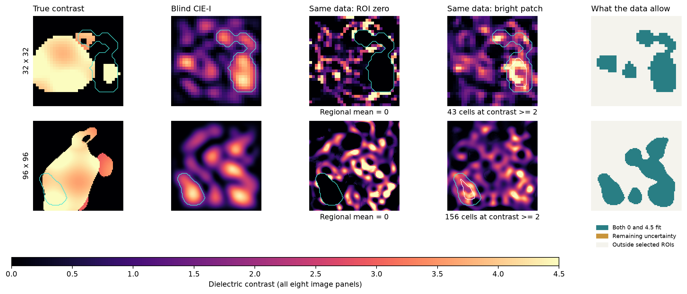
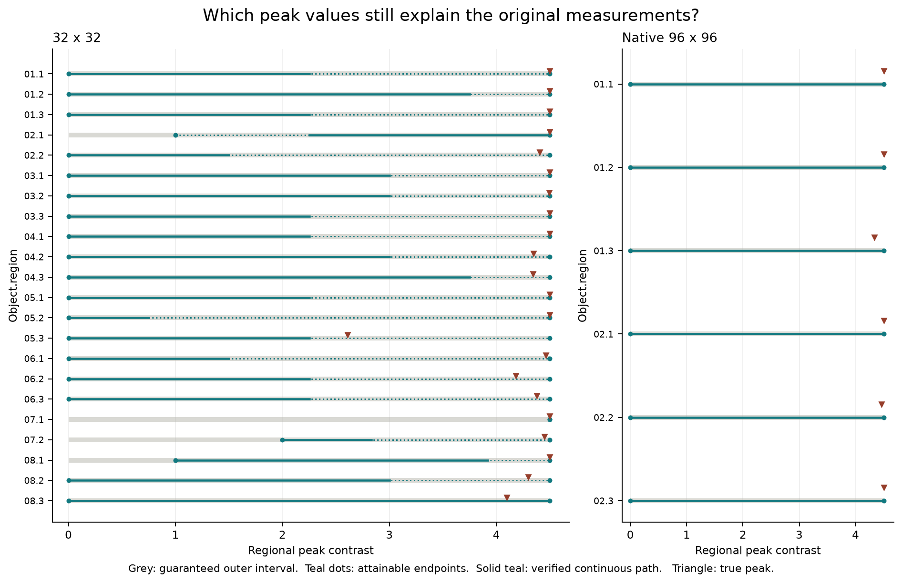
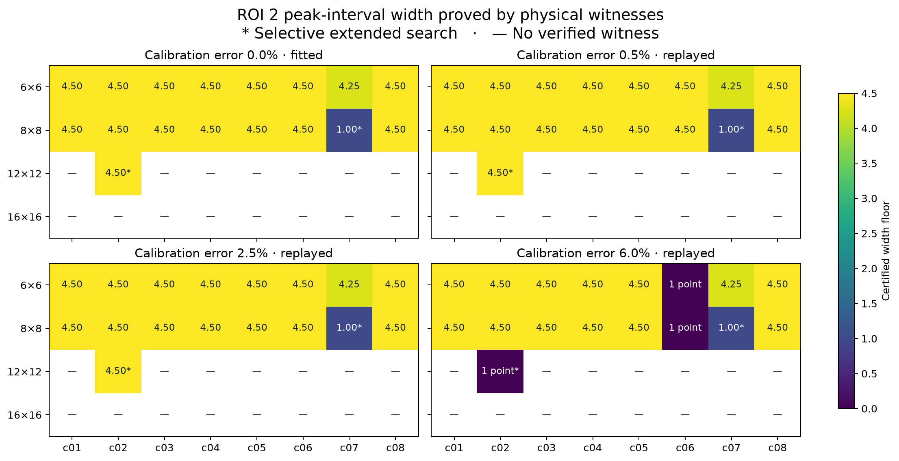
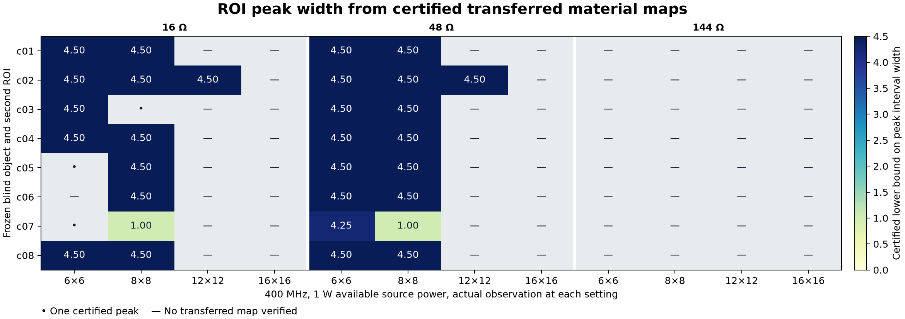
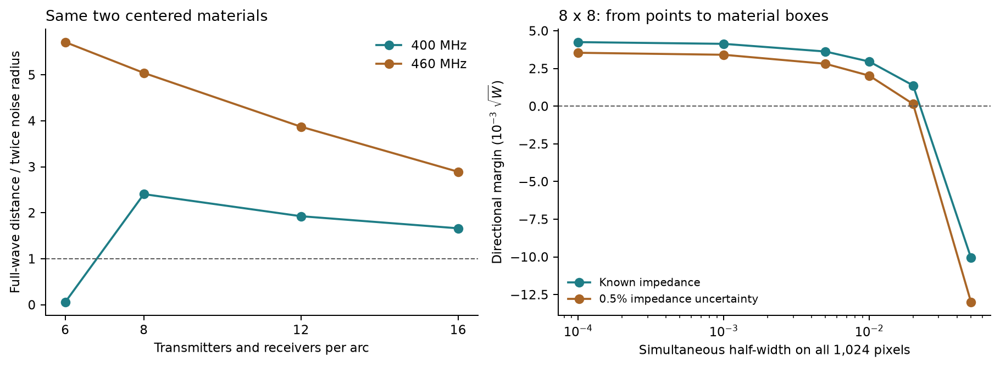
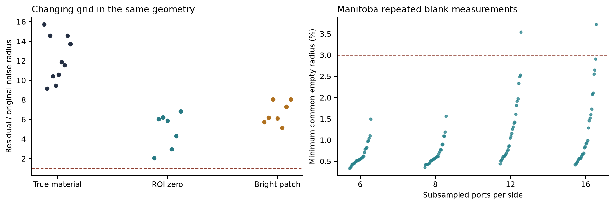

# 一张微波重建图上的亮斑，究竟能信多少？

**让材料在整个视野内自由变化后，同一份带噪读数允许一个亮区完全是空气，也允许它含有强散射体。** 我们从十张充分迭代的盲重建图自动选了 28 个亮区。对其中多数亮区，两种解释都通过了原始全波方程和接收误差的独立复算。把这样的亮区直接从图上删掉，会删掉真材料。

<!-- LIVE-COUNTS -->
在主 8 发、8 收读数下，**24/28 个区域最窄的保证区间恰为 [0, 4.5]**。32² 是 18/22，原生 96² 是 6/6。其中 7 个区域还证明了从 0 到 4.5 的每一个峰值都实际可取。解封真值后发现，24 个可以归零的亮区里本来都有材料。因此，一张归零后仍能解释测量的图可以作为替代解释，不能作为实际样品内该处为空气的判据。
<!-- END-LIVE-COUNTS -->

**改变测量有用，最有效的一次改变甚至没有增加天线。** 在七件材料上，保持相同的 8 次发射、64 个复数读数和总功率，只让左右两条天线弧交错发射和接收，就能区分全部七对旧材料。允许其余像素重新调整后，仍有区域可以归零。这给工程师两个分别可检验的问题：现有的两幅解释能否分开，还有没有第三幅解释也符合新读数。

## 用什么数据回答

十个数值散射体由本轮独立生成。八个用 32×32 网格，另外两个直接在 96×96 上生成，包含多个连通体、环孔、凹口和内部渐变。没有按结果替换对象。十件的全场真峰值最后都碰到生成器设置的 4.5 上限，统计只代表这一类强散射目标。主算例为 2 m 见方、400 MHz、边长约 2.67 个波长的二维 TM 全波问题。对同一材料，单次散射近似相对全波读数的误差为 1046.7%–1480.8%。主数据的复噪声范数为清洁信号的 2%，对重建公开的允许误差半径为 3%。读数另外留出八个接收位置，用于事后检验。

每个像素的真实介电对比度独立允许在 0 至 4.5 之间。没有给求解器目标轮廓、背景掩码、缺陷数量、质量或光滑性上限。CIE 先给出盲图，再按同一平滑、阈值与四连通规则保留至多三个主要亮区。分割只决定**问哪里**，不限制区域外的任何像素。已知中心的阻抗试验、公开实测与这十个对象分别计数。收发阵列、频率、校准条件和多个初值均按同一对象的重复观测计数。[观测登记与完整编号](OBSERVATIONS.md) · [材料与端口设置](ports/DESIGN.md) · [成像与停机规则](imaging/README_ZH.md)

我们检验的量是亮区中**介电对比度最高的一格**。所谓保证区间，覆盖同一份复数读数及给定误差球允许的所有材料。若证实有一份合法材料在整块取零、另一份在该块达到 4.5，任何保证覆盖的闭区间都必须宽 4.5。两端间每个值是否实际存在还要另证。所有区间都包含用于生成观测的真实峰值，但先验本身也能做到这一点。采用 512 次局部高斯扰动的参照在本组覆盖 16/28 个真实峰值。它依赖一个物理残差仍较大的局部解及预设协方差，这个覆盖率不能外推到其他统计模型。[逐亮区的外界、已达端点、实际峰值与局部高斯结果](results/region_intervals.csv)

## 如何从读数得到能复核的区间

第一步使用定理 1。若电流矩阵对应的负特征方向有 \(\nu\) 个，放松本构后它们至多抵消 \(\nu\) 个照明谱方向。保留下来的正尾和给出整类材料对读数的残差下界，超过误差半径就可排除整类。第二步回到完整方程。指定一个区域归零，或要求一片连通区域的每格都超过给定值，重新求解其他像素；随后对原始算子的逆、状态残差和接收读数做有向误差核对。前一步只能排除，后一步可以证明某个材料确实存在。[理论、四类工具与适用条件](THEORY_REFINEMENT.md)

- **全局能量。** 加入电流能量上限可把状态谱向正方向移动，但距离下界要扣回这笔能量。八个 32² 首要亮区的实算中，所需能量帽均低于同一接收数据本身要求的最小电流能量。把成像结果的电流能量当作所有材料的上限会误删合法解释。
- **区域乘子。** 对每个首要亮区，都严格找到了至少 8 个位于接收零空间的负方向，足以耗尽 8 列照明。这条结论覆盖区内任意合法逐格乘子、外区正的统一扇区权重及光学比值 \([0,256]\)，也允许任意半正定接收权重。外区逐格优化另做数值检验，尚无覆盖全部外区变权的障碍定理。十件均可严格断言全场峰值大于 0.25，其中一件大于 0.3125。盲区扩展至所测视野的约 91%–97% 才出现整片不能归零的正例。两件 96² 中，各有一个 8,940 格并集可证明峰值大于 0.03612。
- **多照明与多频。** 单频矩阵的照明数是列数，例如 8×8 对应八列。共用材料不能让两次真实频率的内部总场相同。满相关、统一扇区权重的一种跨频构造会付出由两个 Green 之差的秩控制的负惯性。32²、96² 均在 80 格子阵上严格验证了满秩，在四档阵列下相应负惯性至少为 68、64、56、48。这些数均足以消掉对应的 12、16、24、32 列。下文的物理反例同时表明频率变化本身能分开一些材料。
- **局部全波替代。** 固定一个可行材料、仅改变某一格时，完整多次散射响应沿这一步是分式函数。清分母后，落入误差球成为实二次不等式。我们在整条线段上同时核查分母和残差。对单格仍不够的情况，再让其余材料迭代补偿。两份独立落球的端点就能给出不可缩窄的宽度；需要声称整条连续路径时，另核查中间所有值。[负方向与峰值下界原始结果](bounds/RESULTS_ZH.md) · [原生 96² 第二种算法独立复核整条路径](ports/results/native_c01_roi_path_independent_arb.json)

图中“可归零”表示能够构造另一份符合这次测量的材料。对十件中的九件，我们还找到比单格尖峰更强的反例：在归零图的同一亮区内，另一份解释可让连通面积至少占该区四分之一的格点全部达到 2。两件 96² 的连通区分别为 156、218 格，约 677、946 平方厘米，所属区域在两份强斑块解释中的平均对比度分别为 2.46、1.82。它们对原训练读数的严格残差上界分别为 0.378、0.603 倍允许半径。对第一份斑块，另用 9,140 格显式系统独立复算，将训练残差夹在 0.37370–0.37537 个半径；同一份材料预测留出的端口却偏离 20.60 个半径。[独立原生复核](ports/results/native_c01_extended_independent_arb.json)这九件的比较说明，即使关心一整片材料，部分歧义也会保留下来。[首个原生对象](results/extended/n96_c01.json) · [第二个原生对象](results/extended/n96_c02.json)

单格峰值对网格尺度敏感。我们在相同的 101 项已验证材料或路径端点上，改算**区域平均对比度**。等面积像素逐项精确求和，交付的宽度只向下舍入。28 个区域均有两份相容材料给出不同均值，其中 **25/28 的均值差至少为 2**，两个原生对象全部六个区域均值差都超过 2.35。28 个已证宽度下界的中位数为 2.524。这些是平均值能有多大歧义的下界；保证外界目前仍为 [0,4.5]。这一结果可以排除“上述反例只是单格尖峰”对大部分亮区的解释。[逐区平均值、两张原图及严格接收残差](results/region_means.csv)

十件对象的完整图集逐件并排展示真值、据训练读数得到的盲图、每一块已经由物理材料实现的宽度。每个编号区域的保证外界都是 [0, 4.5]。即使某一块已经找到的宽度较小，其最窄区间仍可能更宽。[完整两页图集（PDF）](figures/roi_atlas.pdf) · [前五件](figures/roi_atlas_1.png) · [后五件，含两个原生 96²](figures/roi_atlas_2.png)

<!-- LIVE-OBJECTS -->
| 对象 | 盲选区域数 | 两端均可达 | 整段均可达 | CIE 更新次数 | 原全波残差 / 半径 | 全场峰值严格大于 |
|---|---:|---:|---:|---:|---:|---:|
| n32_c01 | 3 | 3 | 0 | 2,688 | 7.23 | 0.25 |
| n32_c02 | 2 | 1 | 0 | 7,664 | 7.33 | 0.25 |
| n32_c03 | 3 | 3 | 0 | 5,504 | 8.27 | 0.3125 |
| n32_c04 | 3 | 3 | 0 | 8,624 | 9.37 | 0.25 |
| n32_c05 | 3 | 3 | 0 | 3,776 | 7.58 | 0.25 |
| n32_c06 | 3 | 3 | 0 | 3,264 | 12.15 | 0.25 |
| n32_c07 | 2 | 0 | 0 | 2,688 | 10.52 | 0.25 |
| n32_c08 | 3 | 2 | 1 | 12,448 | 11.25 | 0.25 |
| n96_c01 | 3 | 3 | 3 | 4,096 | 8.70 | 0.25 |
| n96_c02 | 3 | 3 | 3 | 3,072 | 8.78 | 0.25 |
<!-- END-LIVE-OBJECTS -->

其余四区的保证外界也是 [0, 4.5]。32² 的 c02、c08 首要亮区分别至少已达到 1.0 与 4.5 两端，c07 第二区域至少达到 2.0 与 4.5，c07 首要区只找到 4.5；尚不能断言它们的最窄下端点。为避免将起点困难当成物理障碍，对 c07 单独付费做了 900 次全波更新，再做区域限幅。两个原生对象则从“首要区未决”继续到整区归零，允许外区补偿后，两个归零材料经伴随误差核验分别小于 0.813r、0.668r；验证整条路径时，用另一套误差预算得到其起点分别小于 0.823r、0.678r。[归零材料一](results/native_replay/n96_c01/path_profiles_roi_01.json) · [归零材料二](results/native_replay/n96_c02/path_profiles_roi_01.json)每个首要区的原生续算额外用时 759 和 876 秒。整个原生六区均有逐点连续可行的 [0,4.5]。[困难 32² 对象的重试](results/gap_profiles/n32_c07/unrestricted.json) · [原生首要区路径一](results/path_profiles/n96_c01/roi_01_inner.json) · [原生首要区路径二](results/path_profiles/n96_c02/roi_01_inner.json)

## 把暗电流与区域检验接进 CIE，会得到更好的图吗？

原三阶段 Dual-CIE 虽通过系数停机门，将门槛减半后，同一对象的图仍变化 8.5%–33.5%。我们补做了单一收缩参数的 CIE-I，按同一个目标同时更新电流和共享实材料。每 64 次更新检查一次图像变化、目标变化和缩放投影梯度，连续三个窗口达标才算停止。十件全部达标，用了 2,688–12,448 次更新。此时原全波训练残差仍是 7.23–12.15 倍允许半径。在这些图的基础上，同墙钟普通全波拟合可把 9/10 件送入误差球，剩下一件在另计的长预算中也找到相容材料。这把 CIE 表示中的局部收敛、正演拟合和恢复真实材料三件事区分开了。

| 对同一稳定 CIE 图做的修改 | 训练端口 | 材料、背景与留出端口 | 结论 |
|---|---|---|---|
| 主要亮区逐一归零，允许其余格补偿，按冻结规则选择并精修 | 在固定成像预算内 2/10 件找到归零解释 | 两处都含真实材料。第一处 6 格有 5 格是真目标，全图相对误差从 0.835 升至 0.862。第二处由 0.960 升至 0.962 | 能输出可行的替代成像；自动删除没有可靠依据 |
| 在电流更新中惩罚接收零空间的 8 个负模，和同预算继续迭代、等秩随机方向、普通电流脊罚比较 | 10/10 的被罚能量下降；9/10 训练残差略改善，中位只有 0.00573 个半径 | 全图误差仅 5/10 改善，中位变化约 −0.0000071；背景 RMS 仅 1/10 改善；假阳性连通块数未减少 | 目前没有独立成像增益 |
| 直接使用原全波、有界材料与较长预算找端点 | 能发现短预算遗漏的相容解释，亦保留费用与失败端点 | 原生归零与强斑块对在未参与拟合的接收端仍可错十余个误差半径 | 量化原观测的歧义，不把替代图交付为恢复真值 |

旧 Dual-CIE 分割还给出一个反方向的对照：一个 36 格亮斑实际全为空气。归零后训练误差合格，全图相对误差却从 0.793 升至 0.822。只看局部图变干净，同样不足以证明整体精度提高。[含目标内部、背景、假阳性及留出预测的全部配对结果](imaging/RESULTS_ZH.md) · [逐项指标与同机费用](imaging/results/material_scores.csv)

## 6、8、12、16 发收分别可以买到什么信息？

端口模型采用二维辐射线端口、互易被动阻抗矩阵和 50 Ω 终端。其余端口在每次发射时保持匹配。消元同时改变入射场、接收映射和散射体的内部反馈 Green。复阻抗误差作用在同一仪器的空场与加载态。三档辐射互阻抗尺度是 16、48、144 Ω；改变此参数也改变匹配。每组发射的可用总功率固定为 1 W，读数为负载波幅，单位为 √W。孔径和半径固定，多布端口会改变间距。实验采用人为指定的被动网络，未声称它就是某款未测量的天线。[端口推导与绝对误差界](ports/PORTS_ZH.md)

**先看普通盲对象。** 各对象在最初 8×8 图上冻结同一个第二区域，再分别用 6、8、12、16 的实际复读数拟合它。这里各阵列有独立的冻结噪声方向，包括 8×8 的一次重复测量，与上文 28 区主读数分开统计。下表是 32² 的八件对象。每次拟合以对应阵列原算子复算，并在 0.5%、2.5%、6% 标定偏移下配对重放。拟合失败时只能保留已证明的外界。

| 阵列 | 400 MHz、48 Ω、名义标定的第二区域 | 解释 |
|---|---|---|
| 6×6 | 7/8 严格同时达到 0 与 4.5；另一件宽度至少 4.25 | 很多显眼的材料变化对该读数不可分 |
| 8×8 | 7/8 同时达到两端；另一件已实现 3.5 与 4.5 | 增至八发八收尚未解决这些区域的歧义 |
| 12×12 | 延长搜索后，一件严格同时达到两端，并在 0.5% 与 2.5% 扰动配对中保持 | 足以反驳“升至十二发十二收即可普遍压窄区间” |
| 16×16 | 已给预算内未找到通过复核的第二区域见证，外界仍为 [0, 4.5] | 实际最窄区间未决 |

0.5% 的标定偏移在 50 Ω 参考下对应 0.25 Ω。对单个扰动实现重新检验物理见证，和对**所有**允许扰动都保证排除，量词不同。后一种更难。在 400 MHz 和 48 Ω 下，全场峰值 ≤0.25 的数值排除从名义的 7/8、8/8、8/8、8/8 降为 0/8、0/8、1/8、4/8。两件原生 96² 的同档结果为 0/2、0/2、1/2、1/2；第一件的 12、16 两档经区间算术确认。两个尺度共做了 768 和 192 个单频配对条件，单列标记经严格复核的格子。[含各标定档和附加搜索费用的宽度表](bounds/roi_mimo_RESULTS_ZH.md) · [原生阵列扫描](bounds/results/mimo_96_stationary.json)

**把名义互耦强度也变动，而不改动每个候选材料。** 对同一批八个盲选第二区域，复用 35 份只从带噪读数得到的不同材料。在每个原样品的 6、8、12、16 档分别重算三个阻抗档的全波读数，以该次带噪测量自己的半径判断。下表给出八件中有多少件仍能严格同时达到 0 与 4.5。括号内为至少有两种不同峰值可实现的对象数。

| 辐射互阻抗尺度 | 6×6 | 8×8 | 12×12 | 16×16 |
|---|---:|---:|---:|---:|
| 16 Ω | 5（5） | 6（7） | 1（1） | 0（0） |
| 48 Ω | 7（8） | 7（8） | 1（1） | 0（0） |
| 144 Ω | 0（0） | 0（0） | 0（0） | 0（0） |

在 96 个“材料 × 阵列 × 互阻抗”条件中，27 个已严格证到全宽，30 个证到正宽度。144 Ω 下旧见证都不能解释对应的新读数。35 份材料均来自 48 Ω，其中 6、8、12、16 档各贡献 16、17、2、0 份不同材料。固定物体与端口数时，三种辐射尺度用同一绝对噪声地板，所以改变辐射强度同时改变了互耦、匹配与相对信噪比。因此最后一行只能说明这些具体材料不再适用，在没有额外搜索的格子，物理宽度仍未决。裸介质只做 35 次分解、2,520 个右端，即可对不同端口电路复用，共验证 420 次全波预测。对近边界的三个结果收紧区间余量后重算，最后一轮 11.40 秒墙钟、19.95 秒 CPU，之前较宽误差包围的首轮 16.95 秒另计。[各原始读数、两套阻抗表示及费用](ports/ROI_COUPLING_ZH.md)

**若真按 144 Ω 的读数重新成像，结论会怎样？** 取此前在 48 Ω 多次出现歧义的 c02 第二区域，固定 8×8，只用 144 Ω 的带噪数据再解两次完整材料问题。一次把区域六格全部置零，严格残差上界为 0.536r；另一次把其中一格固定为 4.5，严格上界为 0.123r。两者都符合**同一份** 144 Ω 读数。额外支付 3.05 秒、76 次拟合时的分解及两次独立原网络复算。由此可直接确认：即使原 35 份候选全数失配，至少这个对象的保证区间在强互耦档仍然是 [0,4.5]。表中的冻结回放与这次针对性重求解分别计数。[新材料、噪声合同与原算子复核](ports/results/roi_coupling_refit.json)

**再看一个能严格区分“阵列不足”和“阵列够用”的受控问题。** 在独立于盲队列的 32² 算例，第一份材料的 15 格区域均值为 0.75，第二份为零，允许外围补偿。我们专门在 6×6 下寻找这对材料，因此它提供的是存在性反例。在 400 MHz 的 6×6 下，可以给出一份两者都能解释的读数。两份完整响应的间距除以两倍半径为 0.057；在 8×8、12×12、16×16 下为 2.405、1.925、1.662。6×6 平分同一总功率加测 460 MHz 后也升至 2.855。超过 1 就足以保证这两份固定材料的误差球分开。

然后让两份图的**全部 1,024 格都能独立变化**。8×8 时，两类分别围绕各自中心允许每格半宽 0.02，再让仪器有 0.25 Ω 标定不确定性，仍有严格为正的分离裕量 0.00014813 √W。半宽增至 0.05，有两份材料在同一个被动阻抗扰动下解释同一读数，最高残差小于 0.991 个半径。因此对这组中心与硬件条件，可保证分开的临界半宽被夹在 0.02 与 0.05 之间。这个试验使用了已给定的两份材料中心，不能代替盲队列的结论。[同合同的分离证明与相交材料](ports/CLASS_CERTIFICATE_ZH.md)

## 同样的端口和功率，改变收发角色

原布局 A 从左侧发、右侧收。布局 B 在两弧交错发收，既有穿透也看得到同侧反射。七个对象均取上文已严格核查过的归零与强斑块材料对。同为 8 次发射、64 个复读数和总可用功率 1 W，固定材料对的间距中位数从 **0.377 倍两球半径升至 8.024 倍**，七对的计算间隔均超过两倍噪声半径；代表对象独立有向复核为 8.022–8.026 倍。新增模拟读数拒绝了全部 14 张旧图。单独用 B 重新拟合外区，找回了 3/7 个强斑块解释，它们再拿回 A 上均不合格。[相同通道、相同功率的七个逐例结果](results/aperture_control/REPORT_ZH.md)

我们把 A、B 两份带噪模拟读数都交给同一原全波优化器，每次用各自半径判定。此时预算是两次采集，不能与单次等价计费。在固定双初值和迭代预算下，1/7 件找到了整区归零，3/7 件找到了连通强斑块，3/7 件找到了不限制亮区的材料。三类各有一份按两个半径分别严格复核。其中 c02 受归零约束的合法解通过，较大的无约束问题反而因优化未到达而失败。这一例明确说明“没有搜到”不能写成“数据排除”。七件中均尚未同时找回同一对象的两类联合可行解；全类能否区分仍未决。[联合拟合矩阵与三个严格见证](results/aperture_joint/REPORT_ZH.md)

## 网格和真实仪器划出的边界

对八件粗网格材料，把每格在细网格上原样铺成九格，物理分布保持相同；对两件原生细网格材料，另做九格均值的粗表示。仅此变化就让十件真材料的读数改变了原允许半径的 **9.10–15.69 倍**。14 张在原粗网格合格的归零或强斑块解释，换到细网格后全部超出同一原始误差球，达 2.07–8.08 倍。这是十件对象上的模型差，不能当作覆盖全材料族的连续误差上界。全部严格结论均注明其原生离散算子。[跨网格逐材料与见证核算](results/grid_transfer.csv)

另读取 University of Manitoba 公布的四个微波暗室实物、七个频率（3–6 GHz），共 28 个实物–频率组合。原始互易通道的交换差为 12.52%–25.98%，中位 19.59%。发表的数据说明：发收切换经过不同长度的连线，网络分析仪标定到自身的两个端口。采用作者发布的电场量后，交换差降至 0.62%–10.33%。两次空室重复测量的偏差为 0.40%–5.12%，5/28 超过 3%。这是系统误差的实测证据。另从固定 24 端口实测阵列抽取四档子阵，能同时包含两次空场读数的最小半径，占样品信号的中位数分别为 0.561%、0.587%、1.069%、0.883%。[四档实测子阵表](results/manitoba_empty_repeat.csv) 这些数字不足以辨认某个互阻抗偏差，也没有给出加载样品后的全类误差界。本轮没有把合成阵列的严格区间贴到实际样品上。[实测复算与频点表](ports/results/manitoba_chamber_reciprocity.csv) · [原作者的测量系统说明](https://home.cc.umanitoba.ca/~lovetrij/Research/PDFs/Journals/JP50.pdf#page=4)

## 计算费用与研究判断

| 计费项目 | 实际开销与范围 |
|---|---|
| 一次性生成加载端口及两频测量 | 八个 32² 对象 9.42 秒；两个独立原生 96² 对象 687.14 秒。生成器与盲成像分开计费 |
| 每对象局部稳定 CIE | 10.92–166.06 秒墙钟；10.57–103.78 秒 CPU。继续迭代、盲区搜索与严格复核另计 |
| 同一集合的 8 次有符号低秩变化 | 两个 32² 例分别为准备 1.79 / 2.39 秒、更新总计 0.38 / 0.27 秒；逐点直接分解为 16.39 / 26.48 秒。八个端点的零尾结论均一致，加速未改善该区间 |
| 8×8 给定中心的严格分离、较宽盒相交反例 | 41.43 秒；另 48.23 秒，含 206 次 LU、1,648 个正演右端及 1,632 个伴随右端 |
| 七件对象的 A+B 双读数重新拟合 | 21 个端点按同一预算处理，逐对象墙钟之和 486.45 秒、CPU 之和 442.81 秒；三份额外严格复核合计 1.22 秒 |
| 一条原生峰值路径的独立显式复算 | 5,653 个活动格，43.07 秒墙钟、161.25 秒累计 CPU。分母平方下界 0.8604，整个 [0,4.5] 区间内满足球约束 |

逐条费用包含准备、试探失败、正演、伴随、预条件和原生核验。对象并行时，各项墙钟之和大于用户等待时间。双布局、变频和不同校准档的采集成本分开报告。局部高斯参照用于比较区间解释；没有把它当作 CIE 的等精度保证。首次联合拟合在载入仿真档时也把清洁读数键读入内存，拟合的初值、目标与梯度均只使用带噪读数和已冻结的候选；复现入口已改为显式选择允许的键。[端口费用](ports/results/array_grid_n96_cost.json) · [成像费用与中断记录](imaging/RESULTS_ZH.md) · [独立审查与改动](reviews/RESPONSE_ZH.md)

**论文判断。** 这一轮最有分量的结果是给一张盲图上具体区域的“不可收窄”提供实际材料证明，同时在已说明先验的比较中给出可分与不可分的阵列界线。它解释了哪些歧义属于物理数据、哪些属于定理放松或优化器。没有证据支持“自动去伪影提高了 CIE 精度”或“一般到十二发十二收就足以盲定位”。要成为强 Inverse Problems 论文，还需要给一个跨网格稳定的有面积材料任务，在可验证的加载误差下跑通真正实测的分离与重合。作为普适成像算法或实机阵列选型规则，目前证据不足。[下一篇论文的主线与缺口](NEXT_PAPER_BLUEPRINT.md) · [代码、原始复数矩阵与复算说明](REPRODUCE.md)
