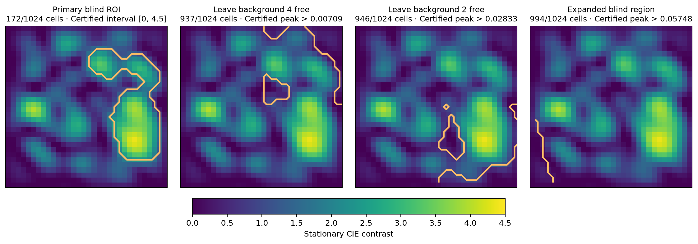
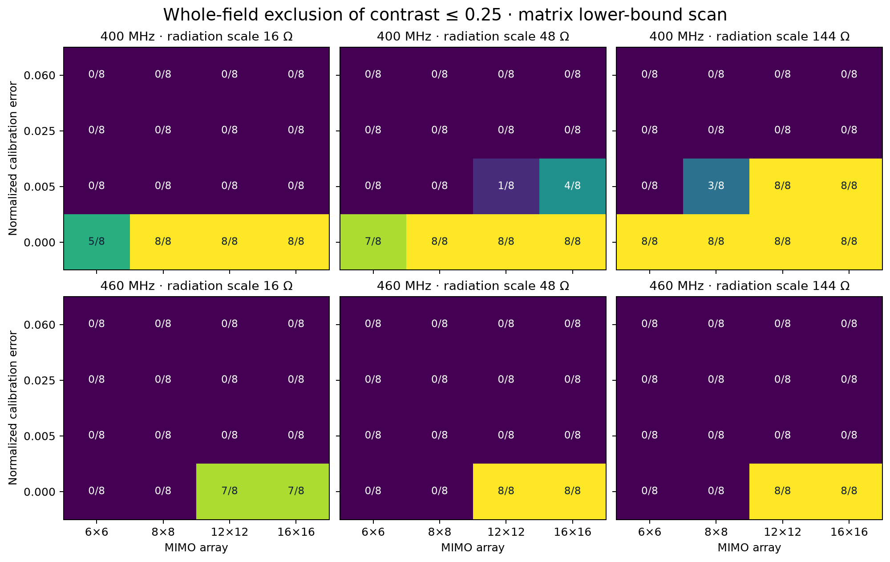

# 盲区域对比度与负惯性

对比度是离散 TM 模型中每格的实数 \(\chi_i\)。全场每格独立允许 \([0,4.5]\)，区域外同样如此。区域读数是峰值 \(p_R=\max_{i\in R}\chi_i\)。这里的区间覆盖所有与训练端口同一个硬噪声球相容的材料。不得把可行的单点图、矩阵松弛未排除的区间、逐像素同时覆盖这三件事混用。区域的划分只读冻结 CIE 图，格点真值、留出端口和物体标签不进入测试。只要该次观测的硬噪声球有效，同一假设下的覆盖对从该观测选出的区域也成立。

## 32² 的盲分割结果

8 个 32² 和 2 个原生 96² 稳态单 β CIE 对象都排除了全场 \(\chi\le0.25\)。补扫中 n32_c03 的全场下界通过 0.3125，其他对象仍是 0.25。全场 0.5 候选的 Fourier 下包矩阵最小数值负惯性仍为 12，超过 8 列照明。点上 Born 近似的相对端口误差为 1046.7%–1480.8%，此误差与峰值下界使用不同量纲。该队列的 32² 首要亮区真峰粗格逐对象评分在 4.4617–4.5。独立评分在盲预测封存后完成。

同一批对象的首要亮区仍保留峰值先验区间 \([0,4.5]\)。在接收零空间中，32² 最小数值压缩计数为 38–49，照明列数为 8。每个首要亮区的 8 维负子空间均独立用 112 位 Arb 复核。证明适用于如下连续族：区域内任意合法逐格扇区及光学乘子，区域外任意正的统一扇区缩放，外区光学与扇区比 \(t\in[0,256]\)，任意半正定接收权重。这个范围同时包括把 ROI 峰值降至零或任意非负值的反事实。逐格外区也做过有限预算的数值优化，优化后试探压缩仍有足够负方向。连续族的证明没有覆盖任意外区逐格权重。

| 稳态对象 | 首要 ROI 格数 | 最小数值压缩负方向 | 首要 ROI 连续族严格下限 | 最小零假设已排除的测试区域格数 |
|---|---:|---:|---:|---:|
| n32_c01 | 172 | 44 | 8 | 937 |
| n32_c02 | 380 | 38 | 8 | 950 |
| n32_c03 | 150 | 45 | 8 | 970 |
| n32_c04 | 188 | 44 | 8 | 946 |
| n32_c05 | 101 | 48 | 8 | 928 |
| n32_c06 | 116 | 46 | 8 | 960 |
| n32_c07 | 96 | 49 | 8 | 994 |
| n32_c08 | 350 | 39 | 8 | 943 |

原生 n96_c01 和 n96_c02 的稳态首要亮区分别为 1920 和 1844 格。相同压缩扫描的最小负方向数分别为 44 和 43，连续外区比值族同样有严格的 8 维接收零空间负子空间。原生结果直接复核各自的 9216 格算子。最小被严格排除的归零区域分别为 8589 和 8467 格。

“最小区域”只在已测试的盲图连通块、背景分块、并集、补集、四个半平面和固定比例扩张中比较。区域达到 90.6%–97.1% 视野后，可以认证联合命题“该并集内有某一格存在材料”。这条命题不定位是哪一格，也不自动转成其中任一连通块的结论。[逐对象数值与严格结果](results/summary.json) · [最终分割逐格复核](results/mask_epoch_audit.json)

## 从零假设到正峰值下界

将区域 \(R\) 的假设放宽到 \([0,c]\)。其余格点 \(E\) 仍各自在 \([0,4.5]\)。区域上加入扇区权重 \(\beta\)，其光学乘子取零。当前状态的 \(RR\) 块满足

\[
K_{RR}=S_R^*S_R+\beta I-\beta c\operatorname{Herm}(G_{RR})\succeq \gamma I,
\qquad \gamma=\beta(1-c\bar g)>0.
\]

这里 \(\bar g\) 是实际加载 Green 算子 Hermitian 部的上界。设 \(A_{E,Z}\) 是 \(R\) 电流严格归零时在外区电流及照明坐标上组装的边矩阵。令 \(Z_{ER}\) 为 \(R\) 电流耦合到这些坐标的完整块，包含外区传播、接收及每列入射场。消去正定的 \(K_{RR}\) 后，

\[
 A_{E,Z}-Z_{ER}K_{RR}^{-1}Z_{ER}^*
 \succeq A_{E,Z}-Z_{ER}Z_{ER}^*/\gamma .
\]

对右侧边矩阵应用 Theorem 1。有正尾时复算原端点，逐个尾特征值向下包围。这个较小的问题提供了全尺寸材料假设的一侧测试。\(R\) 中的所有电流和材料自由度都仍在假设内。该构造不要求外区扇区正定，也不要求外区已知均匀背景。旧单纯标量范数修正把整个矩阵损失替成一个谱范数乘单位阵，只能证明约 \(10^{-12}\) 至 \(10^{-8}\) 的正下界。保留矩阵本身显著改善了同一材料假设下的结果。

| 观测与掩码 | 全格点中的区域大小 | 严格峰值下界 | 距离下界 | 噪声上界 |
|---|---:|---:|---:|---:|
| n32_c01 稳态，留出第 4 背景块 | 937/1024 | 0.0070908 | 0.00352910 | 0.00147433 |
| n32_c01 稳态，留出第 2 背景块 | 946/1024 | 0.0283359 | 0.00162992 | 0.00147433 |
| n32_c01 稳态，扩张约 97% | 994/1024 | 0.0574898 | 0.01433736 | 0.00147433 |
| n96_c01 原停止准则，扩张约 97% | 8940/9216 | 0.0361268 | 0.03521025 | 0.00161524 |
| n96_c01 稳态，扩张约 97% | 8940/9216 | 0.0361268 | 0.03040805 | 0.00161524 |
| n96_c02 稳态，扩张约 97% | 8940/9216 | 0.0361268 | 0.02873006 | 0.00159762 |

表中选用同一个区域上已复核的较强结果。32² 行分别用原全 Green 范数和改进 Hermitian 谱底。96² 各行的复核在原生 9216 格上分块组装矩形 Green 条带，保持外区与拟检区域相互作用，未存储 9216² 稠密矩阵。[32² 首次复核](results/n32_c01_stationary_refined_cap.json) · [32² 收紧谱底](results/n32_c01_stationary_refined_cap_v2.json) · [全部原坐标的直接对照](results/n32_c01_stationary_direct_parity.json) · [96² 原停止准则](results/n96_c01_main_refined_cap_v2.json) · [稳态 c01](results/n96_c01_stationary_refined_cap_v2.json) · [稳态 c02](results/n96_c02_stationary_refined_cap_v2.json)

首要 ROI 的宽度仍为 4.5。两个原生约 97% 并集的峰值区间宽度为 4.464。32² 最强示例的并集宽度为 4.443。



## 负方向为什么不能用接收加权抹去

从大实部 Fourier 频率提出电流帧，在区域外限制支撑。用实际 \(S_E\) 的右逆做合法修正 \(X\leftarrow X-S_E^*(S_ES_E^*)^{-1}S_EX\)。这个构造在精确实数意义上令 \(SX=0\)，右逆求解用区间算术验证。用全部原生 Fourier 系数和加载修正重算 \(GX\)。同一电流帧在 \(t=0,256\) 两端压缩严格负定，就在两个端点之间都严格负定。扇区缩放不改变符号。接受标准固定为 \(\|SJ-Y\|_F\le r\) 时，\(0\preceq W\preceq I\) 的接收重加权也不会强于原 \(W=I\) 的边矩阵。\(S_E X=0\) 的这组负方向不受任何半正定接收加权影响。

当可用独立物理条件确实给出 \(\|J\|_F^2\le E\)，将 \(\alpha I\) 加到状态块，源 Schur 补记为 \(H_\alpha\)。因为留在图上的量现在是 \(R_J^*R_J+\alpha J^*J\)，其中 \(R_J=SJ-Y\)，迹界是

\[
 \|R_J\|_F^2 \ge \mathcal T_{n_-(K+\alpha I)}(H_\alpha)-\alpha E.
\]

这只扣一次总电流能量。谱移动严格归零许多数值负方向。冻结主轮的八个 32² 亮区，扫到最好的能量上界要求都低于同一接收数据允许的最小电流能量。临界值为外区入射 Frobenius 能量的 0.00321–0.02246 倍，接收数据本身的最小值为 0.02249–0.07951 倍，逐个对象比较均低于。即使有该量的物理上限，这组选定的谱移动也未加出超越接收数据加限流本身的新排除。主无损合同没有引用臆定的材料质量或拟合电流当先验。[能量消融与接收最小范数](results/energy_controls.json)

## MIMO、双频与标定

32² 的 8 个相同材料独立计数。768 条矩阵对应每个材料改频率、阵列尺寸、互耦与标定的配对重放。单频同时 6、8、12、16 列。两频分别计算状态，两份噪声平方半径和两份距离下界的平方相加。双频有 384 个配对条件。使用绝对标定包络后，全场低峰值假设数值排除 104 组。首要 ROI 的拟检动作为局部归零，所有相关有限扫描的幸存尾列数仍为零。未将 \(q\times q\) 的矩阵元素数充当照明数。

以 48 Ω 加载设置为例，400 MHz 标定准确时，6、8、12、16 阵列的全场 0.25 扫描分别排除 7/8、8/8、8/8、8/8。把 0.5% 标定误差按全类绝对包络并入半径，分别为 0/8、0/8、1/8、4/8。460 MHz 标定准确时分别为 0/8、0/8、8/8、8/8。图显示矩阵下界的数值扫描比例，只有带有 Arb 标记的结果以严格排除引用。第一对象 48 Ω、400 MHz 四个阵列均有严格全场排除，460 MHz 在 12 和 16 阵列排除。该相图衡量全场命题，普通连通亮区不因此获得紧区间。原生 96² 的 2 个材料有 192 条单频配对观测及 96 组双频条件，24 组双频数值排除全场假设。在 48 Ω、400 MHz、0.5% 标定误差下，四档阵列的全场数值排除分别为 0/2、0/2、1/2、1/2。首对象 12 和 16 阵列的该项排除经 Arb 核准。首对象稳态亮区在两个频率、48 Ω 的所有四档阵列上都有严格的至少 \(q\) 个接收零空间负方向。

更强的共享材料跨频 Gram 构造与物理见证在本轮其他章节。[32² 最终稳态分割的逐阵列记录](results/mimo_32_stationary.json) · [96² 原生逐阵列记录](results/mimo_96_stationary.json)



## 有符号更新的实际开销

32² 两个冻结掩码各跑 8 个嵌套端点。第一个更新维数 454，第二个 310，16 项数值惯性对照全部一致，尾均为零。首次准备 1.79 秒和 2.39 秒，8 次更新 0.38 秒和 0.27 秒，逐端点直接因子化 16.39 秒和 26.48 秒。这里的收益是对同一个无信息判定复用因子，未观察到局部区间变窄。状态消元与复核费用在各自的收据。此处 454 和 310 来自实对比度上端点变化的逐格双符号更新，更新是全状态等价变换。[准备与在线费用](results/summary.json)

[全场对比度补扫](results/stretch_global.json) · [封存后的 32² 真值评分](../imaging/results/material_scores32.json)

### 复现

在研究根目录使用 NumPy、SciPy、Matplotlib、threadpoolctl、python-flint 0.9.0。生成数组和盲图由同轮 `ports/` 与 `imaging/` 提供。所有证书使用实际存下的双精度离散符号、端口加载及读数作为区间算术输入。半径复核还加 \(10^{-8}\|Y\|_F\)。连续模型、跨网格和真实天线误差需由各自合同处理。

```sh
B=research/z_alg_optical_inertia/blind_uq_mimo_theory/bounds
PYTHONDONTWRITEBYTECODE=1 python "$B/run.py" --with-images --optimize --matrix --suffix main
PYTHONDONTWRITEBYTECODE=1 python "$B/run.py" --with-images --optimize --image-version stationary --suffix stationary
PYTHONDONTWRITEBYTECODE=1 python "$B/verify.py" --case n32_c01 --suffix stationary --dark --dark-key roi_01 --ratio-family --support --global-cap
PYTHONDONTWRITEBYTECODE=1 python "$B/refined_cap.py" --case n32_c01 --suffix stationary --region all_except_background_02 --region all_except_background_04 --region expanded_97
PYTHONDONTWRITEBYTECODE=1 python "$B/refined_cap.py" --case n32_c01 --suffix stationary --region all_except_background_04 --pilot-norm
PYTHONDONTWRITEBYTECODE=1 python "$B/refined_cap.py" --case n96_c01 --suffix main --region expanded_97
PYTHONDONTWRITEBYTECODE=1 python "$B/refined_cap.py" --case n96_c01 --suffix stationary --region expanded_97
PYTHONDONTWRITEBYTECODE=1 python "$B/refined_cap.py" --case n96_c02 --suffix stationary --region expanded_97
PYTHONDONTWRITEBYTECODE=1 python "$B/mimo.py" --side 32 --strict --stationary-mask
PYTHONDONTWRITEBYTECODE=1 python "$B/mimo.py" --side 96 --strict --stationary-mask
PYTHONDONTWRITEBYTECODE=1 python "$B/energy_compare.py"
PYTHONDONTWRITEBYTECODE=1 python "$B/stretch_global.py"
PYTHONDONTWRITEBYTECODE=1 python "$B/summarize.py"
```
