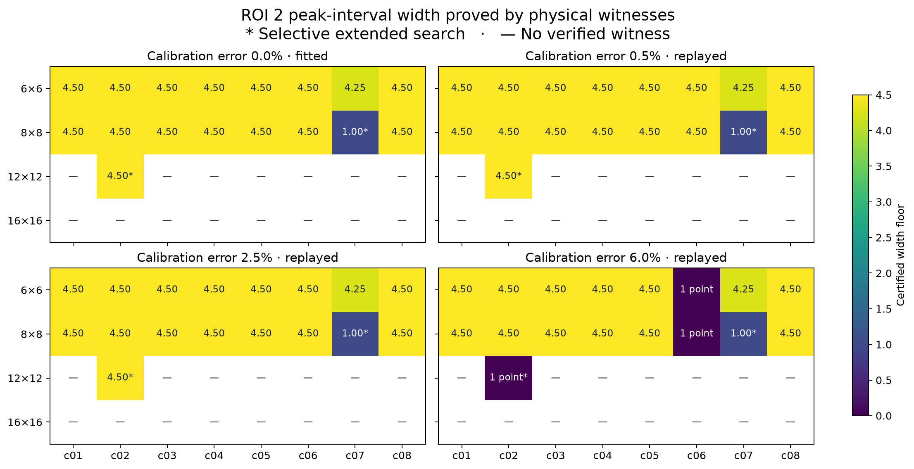

# 同一个盲区域在实际 6、8、12、16 端口读数下的峰值区间

同一批 8 个物体分别用 400 MHz、48 Ω 加载、6×6、8×8、12×12、16×16 的新测量进行全波拟合。对每个物体固定最终 8×8 稳态 CIE 图产生的第二个连通区。求解没有读取真值或留出端口，每个阵列使用它自己的训练测量和冻结 Frobenius 噪声半径。材料全场各格在 \([0,4.5]\) 中独立可变。

若找到同一噪声球中的两幅物理可行材料，区域峰值为 \(p_1\) 与 \(p_2\)，则任何覆盖这两种材料的峰值区间至少宽 \(|p_1-p_2|\)。外区间来自全场先验，为 \([0,4.5]\)。当 0 和 4.5 都有证书时，最窄闭覆盖区间就等于先验。单侧端点和优化未通过都不能用于收窄外区间。

## 配对结果

| 阵列 | 准确标定 · 宽度 4.5 / 正宽度 | 0.5% 匹配回放 | 2.5% 匹配回放 | 6% 匹配回放 |
|---|---:|---:|---:|---:|
| 6×6 | 7/8 · 8/8 | 7/8 · 8/8 | 7/8 · 8/8 | 6/8 · 7/8 |
| 8×8 | 7/8 · 7/8 | 7/8 · 7/8 | 7/8 · 7/8 | 6/8 · 6/8 |
| 12×12 | 0/8 · 0/8 | 0/8 · 0/8 | 0/8 · 0/8 | 0/8 · 0/8 |
| 16×16 | 0/8 · 0/8 | 0/8 · 0/8 | 0/8 · 0/8 | 0/8 · 0/8 |

每格先给宽度 4.5 的材料数，然后给已证严格正宽度的材料数。6×6 的 c07 在标定准确时有两个可行峰值 0.25 和 4.5，故至少宽 4.25。8×8 的 c07 在准确标定时通过了 4.5 的全波见证，另一端尚未得到可行解。6% 回放的 c06 在两档小阵列中都未保住成对证书。

在本表的统一基础搜索中，12×12 与 16×16 没找到噪声球内的任一候选。图中这些行是未知宽度，仍只有外区间 \([0,4.5]\)。相较 6×6 与 8×8，更多读数给优化带来新的约束。当前数据不能据此声称这些阵列已进一步收窄物理可行集合。在较大的阵列中，c02 的高端拟合最近，12×12 和 16×16 分别约为 1.93 倍和 1.65 倍噪声半径。选择性扩充预算后得到以下证据。图中的星号标出这些新增结论，表仍保留原配对搜索的结果。图中的“1 point”代表只证得一个峰值。

- **12×12 的 c02** 先找到峰值 4.5 的材料，再从这幅材料逐级限制 ROI 上端点，最终另一幅材料在该区峰值为 0。两幅材料的复核残差上界分别为 0.97839 和 0.98725 倍声明半径。因此该次测量的峰值闭覆盖区间恰为 \([0,4.5]\)。0.5% 和 2.5% 的已知扰动回放保留全宽，6% 保留峰值 4.5 的单幅见证。[逐级复核](roi_mimo_fits/extended_budget/n32_q12/n32_c02_continuation.json)
- **8×8 的 c07** 补算得到两个可行峰值 3.5 和 4.5。四档标定条件的宽度都至少为 1.0。[逐级复核](roi_mimo_fits/extended_budget/n32_q08/n32_c07_continuation.json)
- **16×16 的 c02** 延长搜索后的最好数值残差约为 1.0858 倍声明半径。另外用两个已经通过 12×12 复核的材料作初值，在实际 16×16 读数上分别重拟合。最好高、低端仍超过半径。16×16 的覆盖区间据此仍未判定。[本阵列延长搜索](roi_mimo_fits/extended_budget/n32_q16/n32_c02.json) · [12×12 初值迁移](roi_mimo_fits/extended_budget/n32_q16/n32_c02_warmfrom_q12.json)



## 搜索与物理复核

低端以 0、0.25、0.75、1.5、2.75 逐档约束整个 ROI。高端使用盲拟合局部灵敏度选取最多三个格点，每次只把一个格点固定到 4.5。每个候选都通过原读数下的投影阻尼 Gauss–Newton 重拟合。初值来自已有合法盲图和公开数据拟合，或本阵列训练数据的限时拟合。所有约束只参与见证搜索。未探索到的盒中材料仍属于外区间。

32² 的 12 与 16 口配对输入未保存稠密 Green 矩阵。最初的全 FFT 物理复算在每档花了约 208 CPU 秒，保存了 12×12 第一个对象的失败记录，16×16 在写出首个结果前终止。后续按同一物理算子重建稠密分解建议，精确消去对比度为零的电流坐标，并用未截断的原 FFT 算子逐次审计状态残差。12 与 16 口搜索也加入同阵列各级共 120 次有限预算的辅助电流更新，作为额外初值。这个安排用于比较可行见证，并非等算力重建排名。

所有实际引用的端点均通过独立的 `VerifiedWave`。若 \(\widetilde J\) 是候选较精确的电流，校正上界结合了 \(I-XG\) 的逆残差证明、全 Green 作用的数值误差和接收端误差。在每组配对数据上用原声明半径验收。选出的两幅名义材料随后直接回放至三个公开的扰动读数，采用与生成一致的已知合成互耦算子，仍用原噪声半径。回放没有重拟合材料，且没有给半径加标定误差包络。对标定未知的实物，需要相应可允许模型族的额外论证。

台账的训练照明可用功率总计均为 1 W，各档单源为 \(1/q\) W。幅度随端口数做一致归一化。实际接受功率随已加载网络变化。这里报告的是可用功率约定，不把功率折算成未定义测量时长的能量。

| 阵列 | 初始化 CPU 秒 | 8 项名义搜索 CPU 秒 | 24 项回放 CPU 秒 |
|---|---:|---:|---:|
| 6×6 | 0.23 | 38.18 | 10.18 |
| 8×8 | 0.23 | 39.49 | 10.31 |
| 12×12 | 0.22 | 67.35 | 0.06 |
| 16×16 | 0.27 | 88.52 | 0.06 |

高端或低端通过的算例记录边际、状态缺陷、逆界、实际物理右端项、缓存和全部优化历史。没有名义候选的回放只写观测与未决状态，没有虚构求解工作量。本补充仅纳入 8 个 32² 材料。原生 96² 的其它证书按原研究中的原生数组引用，不并入这 32 项搜索。

[逐对象证书汇总](roi_mimo_summary.json) · [分割与声明半径对齐](roi_mimo_audit.json) · [搜索与复核代码](roi_mimo.py)

## 复现

```sh
B=research/z_alg_optical_inertia/blind_uq_mimo_theory/bounds
PYTHONDONTWRITEBYTECODE=1 python "$B/roi_mimo.py" --q 6 --q 8 --limit 28 --released-solve-path
PYTHONDONTWRITEBYTECODE=1 python "$B/roi_mimo.py" --q 12 --q 16 --limit 22 --matched-warm
PYTHONDONTWRITEBYTECODE=1 python "$B/roi_mimo.py" --q 12 --q 16 --case n32_c02 --limit 96 --matched-warm --followup
PYTHONDONTWRITEBYTECODE=1 python "$B/roi_mimo.py" --q 8 --case n32_c07 --limit 88 --matched-warm --followup
PYTHONDONTWRITEBYTECODE=1 python "$B/roi_mimo_continue.py" --case n32_c02 --q 12
PYTHONDONTWRITEBYTECODE=1 python "$B/roi_mimo_continue.py" --case n32_c07 --q 8
PYTHONDONTWRITEBYTECODE=1 python "$B/roi_mimo_continue.py" --case n32_c02 --q 16 --from-q 12
PYTHONDONTWRITEBYTECODE=1 python "$B/roi_mimo_summary.py"
```
