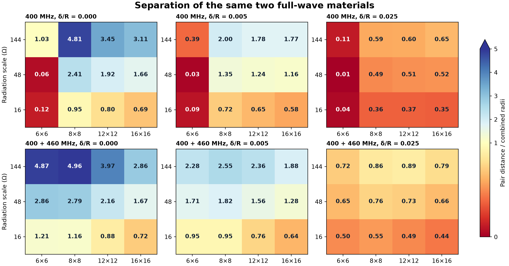

# 固定孔径阵列、互耦校准与全波歧义

32² 的独立机制例给出 15 格区域均值为 0.75 和恰为 0 的两份合法全波材料。400 MHz、6×6 阵列下，两者可解释同一个复数读数，距共同读数仅为允许半径的 5.70%。同孔径的 8×8、12×12、16×16 均排除这对材料共享任何同半径读数，间距与两倍半径之比分别为 2.405、1.925、1.662。128 位区间运算复核了读数距离。这个实验给出 6×6 下 ROI 区间宽至少 0.75 的一个物理下界。较大阵列只拆开这一对解释，整个容许材料类仍需额外的全类排除证据。 [机制材料与原读数](results/mechanism_witness.npz) · [高精度复核](results/mechanism_witness_arb.json)

用同一 1 W 可用功率测 400+460 MHz、各 0.5 W，6×6 在同一每通道仪器噪声地板下的分离度为 2.855。升频重新构造 \(k\)、内部 Green、辐射阻抗与失谐项，并重算全波。加入真实合成偏差 \(\|\Delta Z\|_2/50=0.025\) 后，实际 400 MHz、8×8 的点对分离度仍为 2.403。用全端口范数膨胀出的名义允许半径会把可证明分离比降到 0.488。全端口范数是针对两个机制点另行合成的辅助信息。主盲成像只有矩形通道，缺少这项辅助数据时采用独立的统一上界。 [全频点数据](results/mechanism_witness.csv) · [双频同功率数据](results/dual_band_grid.csv)

## 模型与功率

\(\Phi(r)=iH^{(1)}_0(kr)/4\) 是出射二维点 Green。盘片正权重 \(q=2\pi ka J_1(ka)\)，内域传播 \(G_0\) 使用 R8 的等面积盘片积分与自项。对角元的虚部与 \(q\,\mathrm{Im}\Phi(0)=q/4\) 一致。端口的自项保留辐射电阻，并以独立反应性阻抗描述自调谐。设 \(D=\operatorname{diag}(\sqrt{\rho_a})\)，其中 \(\rho_a\) 以 Ω 计，\(R=50\,\Omega\)。\(E_p=\Phi_{\mathrm{cell,port}}D\) 把 RMS 端口电流变成场，\(S_p=qD\Phi_{\mathrm{port,cell}}\) 把盘片电流读成端口电压。网络采用

\[
Z_{AA}=-i D\Phi_{\rm pp}D+\operatorname{diag}(R_{\rm Ohm}+iX),\qquad
M=Z_{AA}+R I .
\]

已知发射列 \(H\) 与物料电流 \(J\) 通过 \(M I_{\rm port}=H+iS_pJ\) 相联。消去包括留出接收口在内的全部端口，得到

\[
G=G_0+iE_pM^{-1}S_p,\quad B=E_pM^{-1}H,\quad
Y=-i\sqrt R (M^{-1} S_p)_{\rm receive} J,\quad
J=\operatorname{diag}(\chi)(B+GJ).
\]

空场和加载场的 RMS 接收负载波分别为 \(-\sqrt R I_{\rm empty}\) 和 \(-\sqrt R I_{\rm loaded}\)。保存数据 \(Y\) 按加载减空场，以 \(\sqrt{\mathrm W}\) 为单位。拟合和留出接收来自独立坐标，使用各自的噪声方向。所消去的反馈严格纳入固定的低秩加项，这使目标同时改变各端口电流，并保持材料只出现在局部关系中。主数据另经裸 VIE 加目标加载阻抗路线复算。 [算子](model.py) · [数据合同](DESIGN.md)

辐射电阻来自 \(\mathrm{Im}\Phi(r)=J_0(kr)/4\)，它是平面方向连续采样的 Gram 矩阵。将盘片电流乘 \(q\) 后，盘片和端口在同一个辐射 Gram 内。无损材料的局部复功率 \(\bar J_i E_i\) 虚部为零，天线各端口的净输入有功等于外辐射加正欧姆耗散。端口负载也吸收非负功率。每列的源可用功率为 \(|H_j|^2/(4R)\)，接受功率为驱动端的 \(\operatorname{Re}(\bar I_j V_j)\)。驱动的反射功率逐列从 1 W 总可用功率中扣除。未驱动口的 50 Ω 损耗与天线总损耗另记。主合同的 32² 受电为 0.8095–0.8180 W，原生 96² 为 0.8113–0.8117 W。磁盘上的逐列功率记录为 private/ 下的 mimo_power.json 文件。 [32² 压测总表](results/array_grid_n32.csv)

## 尺度、校准和接收秩

6、8、12、16 端口布局具有同孔径、同端点。中间采样点按各自端口数均匀排布，布局并非嵌套。每次增加端口分摊等总可用功率，固定独立每读数仪器噪声地板则增加总误差球。8×8 后分离度下降时，采样位置、每发射任一路电平和终端互耦都有改变。在固定孔径和 48 Ω 尺度下，400 MHz 的空场非对角互阻抗 2-范数依次为 14.89、19.97、20.43、27.81 Ω。加载总阻抗的样本中位条件数为 1.30、1.43、1.44、1.50，算子奇异值超过最大值 10% 的照明和接收模态分别均为 6、8、12、13。数值秩仍为 6、8、12、16，源数只是 Theorem 1 可用尾长的上限。跨两个频率时，两个场分别服从各自 Green，材料变量在频率间共享。 [逐组结果](results/mimo_summary.json)

从 16、48、144 Ω 提升线端口辐射尺度，同时提升辐射互耦和匹配。该相图反映二者的合效应。实际校准偏差为确定的带距离衰减的对称纯虚非对角矩阵，加到同一构型下的空场和加载阻抗上。该变化代表窄带被动寄生反应性串扰。标定上界 0、0.25、1.25、3.0 Ω 经实际扰动的 2-范数核对。逐对象登记从真、名义及带噪矩形端口之间的差距，并保存完整终端的独立合成校准例。普通盲输入只给拟合子块。 [独立全端口诊断](public/calibration_example.npz)

另用无耗、互易的外加反应性网络，只改变空场互阻抗的非对角虚部。固定阵列坐标、自阻抗、辐射电阻和场耦合因子。400 MHz 下把该虚部放大四倍，16×16 的加载条件数从 1.49 增到 2.01，机制点对分离比从 1.662 降到 1.550。8×8 的比值从 2.405 变为 2.420。这个直接控制显示阵列反应随材料和布局变化。 [同自阻抗控制](results/coupling_control.csv)

## 数据与独立复核

八个 32² 与另两个原生 96² 为独立数值材料，真实读数分别含 2% Frobenius 噪声，允许半径为清洁幅值的 3%。主条件的 Born 相对误差以全波端口读数为分母，32² 为 1047–1481%，96² 为 1216–1230%。32² 的裸 VIE 加网络直接复算与固定 Green 相对差异低于 \(8.54\times10^{-15}\)，96² 低于 \(9.60\times10^{-11}\)。两次原生独立区间核查都使用保存的 9216 格 FFT Green 与天线修正，把二进制 FFT 谱通过 Arb 外包，还对显式右逆做了矩阵乘积余量验收。两份生成真材料的拟合距离上界为 0.6666918 和 0.6666935 个半径，留出上界为 0.6666937 和 0.6666953 个半径。真材料精确为零的格可从真值正演检查里消元，在盲反演中全部 9216 格仍是合法未知量。 [96² 区间核查](results/native_forward_arb.json) · [完整观测 ID](results/cohort_manifest.json)

两个网格完成 768 和 192 个阵列、频率、标定偏差组合。这些是同一批 8 和 2 个独立材料的配对条件。32² 使用 16 次 LU、1,152 个裸物理右端项，端到端墙时 9.42 秒。96² 使用 288 个裸物理右端项和原生 FFT-GMRES，端到端墙时 687.14 秒。两网格最大真实状态相对残差分别为 \(6.88\times10^{-15}\) 和 \(1.00\times10^{-11}\)。全部组合的最小加载电阻特征值不低于 8.2178 Ω，最大逐列功率守恒误差为 \(2.85\times10^{-16}\) W。在偏差 1.25 Ω 时，32² 的名义与实际读数相对差中位数为 1.23%，独立全端口信息给出的膨胀上界为 11.24%。96² 对应为 1.27% 与 11.20%。 [32² 费用](results/array_grid_n32_cost.json) · [96² 费用](results/array_grid_n96_cost.json) · [96² 配对数据](results/array_grid_n96.csv)

盲数据另有两对按 8×8 读数产生的区域见证。原始数据下非零和归零方案同时拟合，ROI 平均差为 1.685 与 1.774，归零方案的残差是 0.9634 与 0.9450 个半径。两个方案的原留出接收残差却都在 17.4–18.3 个半径附近。将它们放进其他阵列或第二频率后，多个条件拆开这对候选，但多数情况下各候选都离新的实测合成读数很远。留出反例限制的是利用当前拟合数据的物理证据范围。 [盲例重放](results/blind_pair_array_replay.csv)

## 已知像素容差下的 6×6 和 8×8 整类比较

围绕机制点对分别建立两类合法材料。每类的 1,024 个像素可独立改变 ±\(w\)，并截在 [0,4.5]。6×6 允许两类的中心材料解释同一读数。8×8、400 MHz、1 W、噪声半径为 \(0.00151717\sqrt{\mathrm W}\) 时，验证通过的最大预定宽度格点是 \(w=0.02\)。零校准偏差的两类含噪投影分离裕量下界为 \(0.00137752\sqrt{\mathrm W}\)。允许每个假设的未知加性互阻抗误差分别落入 0.25 Ω 谱范数球后，分离裕量仍大于 \(0.000148132\sqrt{\mathrm W}\)。签名导数的实方向、二阶项和三阶尾分别外包，再计校准和噪声两边。独立全端口有限误差诊断用于验证替代半径公式，整类 0.02 证书只需物理模型和已知材料盒。 [定理与校准推导](CLASS_CERTIFICATE_ZH.md) · [六个宽度的原算子复核](results/mechanism_class_separation.json)

这里使用已知中心和小的逐格公差。无轮廓盲域仍为原来的全 [0,4.5] 盒。另在 \(w=0.05\) 的两类内找到一对点。对两点施加同一份被动、互易、纯反应性阻抗扰动，谱范数小于 0.25 Ω。原算子的区间复核证明，两点能解释同一个矩形读数，距离上界分别为 0.990322、0.990328 个允许半径。因两个材料盒随 \(w\) 扩大而嵌套，这给出了未知校准条件下整类可分离临界宽度在 0.02 与 0.05 之间的物理夹逼。精确校准下，这一对新点离共同中点略超一个半径，0.05 的全类问题仍未决。 [0.05 双全波反例](results/mechanism_class_collision.json)

方向选择使用固定盒和该盒中心的合法名义物理结果，完全不访问盲材料真值。

## 盲成像连通反例的跨阵列重放

七个完整的 32² 扩展见证中，每对在原 8×8 训练球内都保留两种解释。一份在整个候选 ROI 内为零，另一份在包含 2–47 格的四连通斑块上逐格至少为 2。各连通斑块的均值差为 2.000–3.516，整 ROI 均值差为 2.177–2.602。第八个对象尚无完整扩展回执。门槛以独立对象计。配对采集的 672 行使用 28 次裸 VIE LU、2,016 个裸右端项，另有 14 次参考阵列物理 LU、112 个参考右端项。重放端到端为 14.61 秒墙时。 [逐例方法和费用](results/extended_array_replay_cost.json)

在 400 MHz、48 Ω 辐射尺度、校准精确时，四个阵列的候选点对分离度中位数依次为 11.96、0.38、8.58 和 7.43 个两倍半径。6、12、16 阵列对所有七个点对的距离均超过两倍半径，且两种候选都没有进入新采集数据的允许球。在 8×8 下把辐射尺度升至 144 Ω，真实校准读数的点对中位分离度从 0.38 上升至 3.63。以 0.25 Ω 校准预算推导额外半径后，中位可证分离比为 1.37。预算增到 1.25 Ω 后，中位可证分离比降至 0.39，实际点对仍相隔约 3.64 个两倍半径。这里的校准半径使用另有全端口信息的诊断口径。 [逐条件拟合与留出残差](results/extended_array_replay.csv)

第一个完成的盲例 n32_c01 有 43 格连通斑块，斑块平均材料差为 3.516。重新核查两份候选对原 8×8 数据的残差上界分别为 0.554836 和 0.444523 个半径。用固定新 6×6 或 12×12 后，两候选都被实际新增数据排除。作为局部的整类陈述，6×6 和 12×12 还能分别在 \(w=0.02\)、0.25 Ω 未知误差下区分这对候选的邻域，分离裕量分别为 \(0.016529\) 和 \(0.027916\sqrt{\mathrm W}\)。这两个分离依据是另一个盲数据产生的材料点对，对主机制例的 6×6 下界没有改动。 [6×6 原算子区间](results/extended_c01_q06_class_separation.json) · [8×8 原数据区间](results/extended_c01_q08_class_separation.json) · [12×12 原算子区间](results/extended_c01_q12_class_separation.json)

两个原生 96² 盲例的连通斑块分别为 156 与 218 格，斑块均值差为 2.951 与 2.506。原 8×8 的拟合残差对应为 (0.375, 0.102) 与 (0.599, 0.524) 个半径；原留出残差都在 16.58–20.60 个半径。新 6×6、12×12 的点对间距分别达到 11.86–12.51、7.83–8.36 个两倍半径；两种候选预测都离新增 400 MHz 读数至少 14.91 个半径。460 MHz 的新 8×8 点对间距为 11.94 和 12.68 个两倍半径，两种候选预测离新增读数均超过 24 个半径。正演复算付出 136 个矩阵自由的物理右端项，两个并行频段任务墙时分别为 60.03 和 42.01 秒，最大状态相对残差小于 \(1.0\times10^{-11}\)。 [400 MHz 原生重放](results/native_extended_replay_f400.json) · [460 MHz 原生重放](results/native_extended_replay_f460.json)

## 原生 ROI 的独立全段区间复核

对 n96_c01 的第二个 624 格 ROI，在固定盲拟合材料上只改变零基索引 596 的一个像素。先对其余 5,653 个非零对比度格复算八个原物理右端项，再用同一分解求该像素的 Schur 补列。原 9216 格 FFT 传播和低秩端口反馈仍用于取精确子矩阵。精确零对比度只用于这个候选的正演消元。

在 \(0\le t\le4.5\) 的整个路径上，原训练数据误差以 Schur 分母乘开后为一个关于 \(t\) 的实二次函数。128 位区间运算给出的分母模平方下界为 0.86043318，归一化二次函数上界为 −0.80653185。\(t=0,2.25,4.5\) 的接收残差上界分别为 0.102373、0.155993、0.250229 个半径。因此该 ROI 的峰值在训练数据的允许球内能取全先验区间。独立核查使用一次活动子块 LU、5,653 个逆列和 9 个正演右端项，用时 43.07 秒墙时。另有一次因脚本缺少二次式辅助函数而中止的准备前缀，持续至少 18 秒。 [独立原算子区间回执](results/native_c01_roi_path_independent_arb.json)

同一个 ROI 的 156 格四连通斑块也独立通过正演复核。以原零斑块材料为对照，另一个全波材料在这 156 格的对比度都至少为 2，区域均值为 2.46252。此材料的训练残差区间为 [0.373705, 0.375363] 个半径，留出接收残差为 [20.60336, 20.60504] 个半径。证明用 9,140 个活动格的一次 LU 和分块复核全部逆列，另解八个物理右端项，耗时 166.49 秒墙时。 [连通斑块独立区间回执](results/native_c01_extended_independent_arb.json)

## Manitoba 实测的开关相位与互易敏感性

Manitoba 2010 的 24 根 Vivaldi 天线用两口 VNA 和 2×24 交叉开关依次采集。原作者说明，VNA 校准到自身端口，两个反向测量经开关的路径长度不同，主要影响复相位。原始散射参数由总读数逐通道减空场而得，仍带该路径。作者另提供的校准文件是通过金属参照散射和二维线源模型换算的 \(E_z\) 等效场。档案中没有共同天线参考面的 50 Ω 复端口校准，故用作数值处理敏感性及空场变化诊断。 [采集论文，第 3.2–4 节](https://home.cc.umanitoba.ca/~lovetrij/Research/PDFs/Journals/JP50.pdf#page=4)

对每个实际双向测到的端口对 \(a,b\)，字面复对称矩阵的最小平方拟合误差是 \(|Y_{ab}-Y_{ba}|^2/2\)。128 位区间运算只使用真实记录的 552 个非对角方向和 276 个成对比较。四个实物、七频的 28 个完整阵列条件中，以前后两次空场平均为背景的原始散射读数，最小复对称偏差为散射范数的 12.52%–25.98%，28/28 大于 3%。如允许每一对自由补偿相位而保留幅度，差值降到 0.76%–4.54%，仅 2/28 大于 3%。作者提供的等效场得到 0.62%–10.33%，6/28 大于 3%。这三个数字分别描述不同的数据约定。没有将其转换成真实失配阻抗 \(\Delta Z\)。 [逐案区间与同端口子集](results/manitoba_chamber_reciprocity.csv)

前后为空场各做一次，而同一个负载实物没有重复采集。在同一个已存载物读数上分别减前或后空场，两个方案之差正好是空场变化。任何共同的确定性误差球要同时容纳这两个方案，半径至少为该差的一半。24 端口下，该下限是散射范数的 0.40%–5.12%，有 5/28 大于 3%。它提供换背景处理的半径尺度。未知的实际载物漂移和误差上限不能由这一对空场确定。6、8、12、16 口结果均为对同一台 24 口数据按相同收发端口下标做子采样，保留所有已测双向传输。 [汇总与原始档案条目](results/manitoba_chamber_reciprocity.json)

## 复现

在工作区的新轮目录 ports/ 中运行。Python 需要 NumPy、SciPy、matplotlib，并为区间复核安装 python-flint。原生点复核的显式后向误差乘法另用 Clang，浮点合同是 IEEE 二进制64、禁止重排和乘加融合。生成和真值检验依赖封存脚本及材料，盲反演只读取 public/cases/ 下输入和 public/operators/ 下算子，封存后才解封 private/ 作评分。多配置算子可以按物理代码重装，无需把全部同源派生数组重复上传。

~~~sh
export PYTHONDONTWRITEBYTECODE=1
export VECLIB_MAXIMUM_THREADS=1 OPENBLAS_NUM_THREADS=1 OMP_NUM_THREADS=1
python private/generate.py --side 32 --items 1 2 3 4 5 6 7 8
python private/generate.py --side 96 --items 1 2
python sweep.py --side 32 --items 1 2 3 4 5 6 7 8
python sweep.py --side 96 --items 1 2
python witness.py
python verify_witness.py
python calibration_example.py
python calibration_example.py --eta .005 --tag _e005
python class_separation.py
python class_collision.py
python coupling_control.py
python extended_array_replay.py
python native_extended_replay.py --band 400 --counts 6 8 12
python native_extended_replay.py --band 460 --counts 8
python native_verify.py --items 1 2
python native_roi_path_verify.py
python native_roi_path_verify.py --extended --threads 6
python figures.py
python chamber_reciprocity.py --archive /path/to/Tomographic_Dataset_1.zip
~~~
