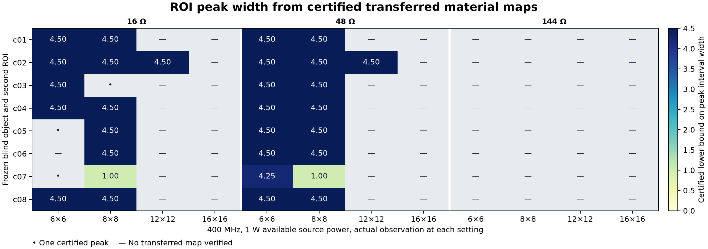

# 同一个盲区域在三档互耦下的全波峰值见证

8 个 32² 盲测对象各自固定最终稳态成像的第二个 ROI。用同一组已保存的材料见证，在 6×6、8×8、12×12、16×16 阵列和 16、48、144 Ω 三档端口辐射尺度下，分别代入实际保存的同条件带噪合成读数。频率固定为 400 MHz，合计可用源功率为 1 W。35 份去重候选均来自既有 48 Ω 物理拟合，包含对 c02 的 12×12 补算。候选选取未读取新增观测、留出端口或材料真值。没有重做优化。

**c02 的 12×12 峰值在 16 Ω 和 48 Ω 两档均从 0 到 4.5 有严格见证。** 144 Ω 下，全部 35 份候选在各自对象和任一阵列的复算中均不再适配，最小训练残差下界也为 2.512 个半径。要判断强互耦条件下物理允许的峰宽，还需要用该条件的读数重新找全波材料，或给出完整材料类的一侧排除。 [逐对象和条件](results/roi_coupling_cells.csv) · [420 项端点区间](results/roi_coupling_endpoints.csv)

| 辐射尺度 | 6×6 | 8×8 | 12×12 | 16×16 |
|---|---:|---:|---:|---:|
| 16 Ω | 5/5 | 6/7 | 1/1 | 0/0 |
| 48 Ω | 7/8 | 7/8 | 1/1 | 0/0 |
| 144 Ω | 0/0 | 0/0 | 0/0 | 0/0 |

每格有 8 个对象。斜杠前是零峰和 4.5 峰均有证书的对象数，斜杠后是严格正宽度的对象数。总共 96 格条件中，30 格有正宽度，其中 27 格达到全先验宽度。另有 3 格只有单个峰值见证，63 格未找到能复用的候选。数字宽度是同一个数据球内已验证峰值最远距离的下界。两个极端都有证书时，任何闭区间覆盖都必须包括 [0,4.5]。仅有单点或没有见证时，仍使用全场先验给出的外区间。训练通过的候选中没有一项同时通过留出接收。 [完整区间与费用](results/roi_coupling.json)

## 12×12 的同一读数交叉复核

48 Ω 下，c02 使用原配对档案 n32_c02_mimo.npz 中的 f400_a12_c048_e000_Y，形状为 12×12，声明半径为 \(0.002326855650810344\sqrt{\mathrm W}\)。此前的定阵拟合与本次回放都用这个复数矩阵和同一半径。零端和 4.5 端是同一个 continuation.npz 的 low 和 high。直接加载 VIE 的原证书上界分别为 0.987249 和 0.978385 个半径。 [原定阵证书](../bounds/roi_mimo_fits/extended_budget/n32_q12/n32_c02_continuation.json)

从裸盘片 VIE 传到加载电路的第一次严格传播，因裸全端口的误差球较保守，零峰上界为 1.035400。对同一个候选，用 128 位 Arb 直接计算原裸状态残差后，上界降到 0.945665，4.5 端的独立上界为 0.983220。材料、模型和误差球完全相同。16 Ω 时，同两份材料在该档的独立测量上分别低于 0.678306 和 0.628844 个半径。144 Ω 时，两者分别严格超过 2.81 和 2.51 个半径。机器可读汇总给出观测键、半径和原定阵交叉校验。端点 CSV 保留初版与精算区间。 [匹配及精算回执](results/roi_coupling.json)

## 物理范围及复现

沿用生成数据的 2 米方域等面积盘片 TM 算子。每幅材料只对四个阵列的 72 个不同物理端口做一次裸正演，再换入各档空场阻抗和同样的材料加载。先以明确舍入上界验证裸系统右逆。将裸场响应外包后，按对应端口抽取对称阻抗增量，并用区间运算解 20 至 40 端口的空场及加载电路。16、48、144 Ω 同时改变辐射互耦和匹配，所以这里的强度比较包含两种共同效应。各档都使用生成时的已知合成参数。未知校准误差以及另外设计的材料对反例见独立相图。 [端口定义及相图](PORTS_ZH.md)

最终重放 420 个候选与测量组合，付出 35 次裸 LU、25,407 个已验证逆列、2,520 个物理右端项。对三个首次区间跨过一个允许半径的组合进行原状态残差精算。最终回放耗时 11.40 秒墙时、19.95 秒 CPU，之前的宽区间初跑另用 16.95 秒墙时。代码固定所有输入路径并直接读取原第二 ROI、候选和公开读数。需要 NumPy、SciPy、python-flint、matplotlib 和 Clang。

~~~sh
PYTHONDONTWRITEBYTECODE=1 VECLIB_MAXIMUM_THREADS=1 OPENBLAS_NUM_THREADS=1 OMP_NUM_THREADS=1 python roi_coupling.py
~~~

## 144 Ω 的同条件重新拟合

在冻结迁移的 420 项对照之后，单独选择 c02 的固定 6 格第二 ROI，在 8×8、400 MHz、144 Ω 条件下作一次探索性补算。旧候选对这一读数的最小残差下界已达 6.569 个半径。重新拟合使用 f400_a08_c144_e000_Y 及原半径 \(0.0015512371005402294\sqrt{\mathrm W}\)。其余材料格继续在 [0,4.5] 自由调整。用旧全波端点、稳态盲图、原公开自由拟合及一次仅用该条件读数计算的 Born 初值筛选合法起点。零峰从旧零峰候选出发，初始残差为 6.609 个半径。随后把新零峰拟合也纳入高峰初值，对六个可能固定格分别筛选初值。选中零基格 180，将其固定为 4.5，初始残差为 4.999 个半径。两个端点各执行一次有界 Gauss–Newton，均经过两次更新后达到预定的 0.65 半径阈值。 [运行轨迹及来源](results/roi_coupling_refit.json)

| 拟合目标 | 原训练残差数值 / 半径 | 原端口独立区间 / 半径 | 留出接收区间 / 半径 |
|---|---:|---:|---:|
| 六格全为 0 | 0.501324 | [0.465106, 0.535096] | [31.815610, 31.888627] |
| 固定一格为 4.5 | 0.084126 | [0, 0.122341] | [31.698800, 31.775217] |

新材料在本条件的训练误差球内分别实现峰值 0 和 4.5。因此 c02 的最窄峰值闭覆盖区间仍为 [0,4.5]，强互耦档的空白源于已有候选的迁移失败。两份解都被留出接收排除。这个后续结果适用于一个对象的一个条件，420 项冻结比较的计数、候选和图表保持原样。补算与复核合计 3.05 秒墙时，筛选和拟合共 76 次活动系统 LU、608 个正演右端项和 32 个伴随右端项。独立核查另用 2 次裸 VIE LU、1,823 个验证逆列和 144 个裸物理右端项，再以 128 位区间运算解对应实际加载的端口电路。 [材料与预测](results/roi_coupling_refit.npz) · [复现脚本](roi_coupling_refit.py)
