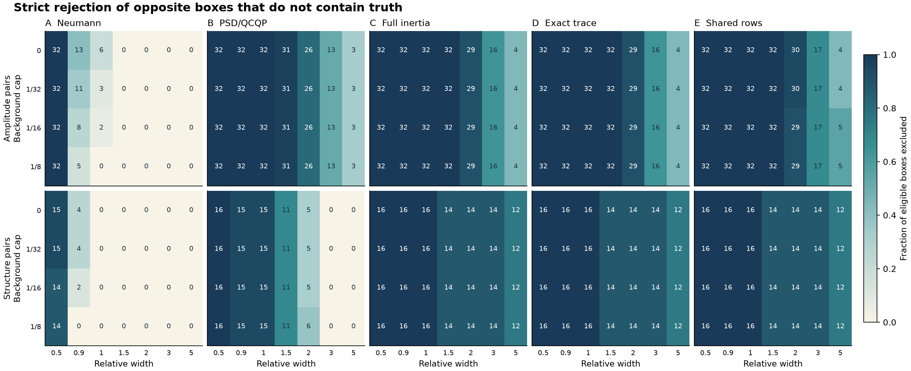
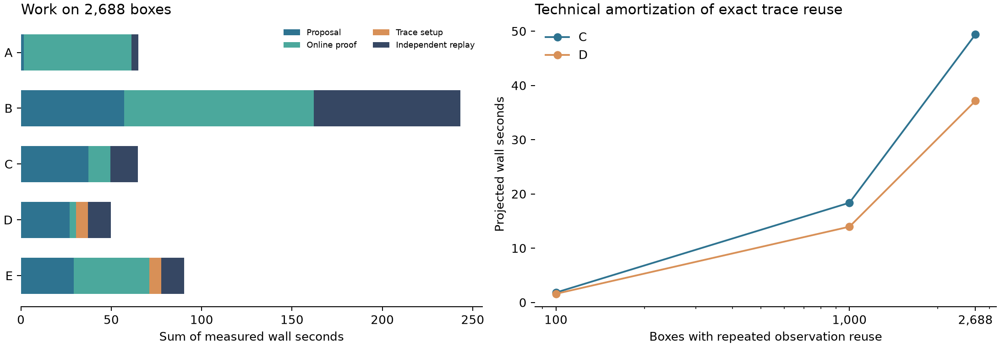
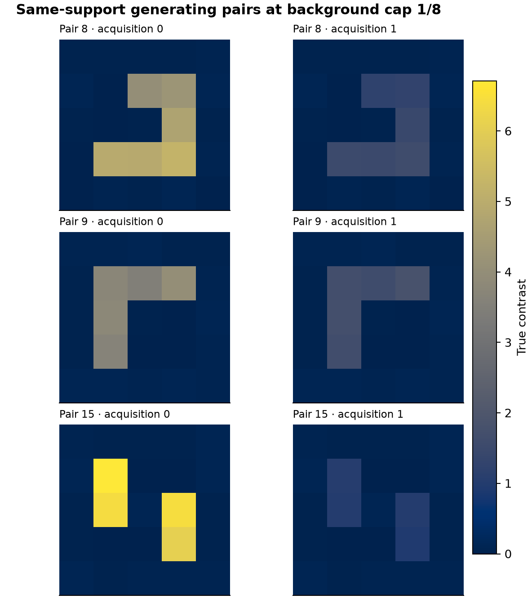

# 实验 A · 同支撑材料幅度相图

在 5×5 固定标量 TM 网格上，24 对前瞻盲化样本、两种采集方向、四种背景、七种预定宽度和两个候选盒共得到 2,688 次判定。原带边惯性 C 和精确固定迹 D 的判定逐盒一致。E 登记的八项新增排除均只使用候选盒内已知的真空格。直接消去这些真空格后，普通惯性在同一批数据上复现全部八项，另排除 20 个盒。本组实验未证实少数**未知**共享本构行带来新的幅度辨识能力。

## 盲测合约

- 16 对以同像素纹理乘不同幅度，实际非零支撑在每个配对背景下完全相同。8 对使用相同允许活动区及不同实际支撑或结构。每对独立生成，两幅材料分别生成读数。同对不同噪声、背景和宽度条件保留为重复测量条件。
- 5×5 网格覆盖 0.7 波长见方。8 个本地像素所在候选活动区固定。12 个接收器在半径 2 波长的半环上，8 个间隔 45° 的单位平面波，白化为恒等。使用含等面积圆盘积分和解析自项的离散标量 TM，严格性限于保存的二进制算子。
- 外部背景逐格为 `[0,b]`，其中 `b=0,1/32,1/16,1/8`。同一对材料在给定 `b` 下共用同一背景。预定宽度比 `0.5,0.9,1,1.5,2,3,5` 乘候选模板处无背景的名义 2 范数 Neumann 尺度，实际端点按原生对比度上下限裁剪。该尺度是扫描坐标，真正的收缩或发散单独验证。
- 每个目标每种背景使用相同的一份噪声读数贯穿七个宽度。Frobenius 半径为该块干净响应范数的 1.5001%，秘密复扰动幅度 1.5%。两方候选盒均接收同一块观测和半径。生成材料、产生方向和随机种子在冻结算法判定与独立重放前隔离。首次盲跑暴露 D 要求整个公共块正定的实现缺陷。在真值未打开时纠正为只验证公共迹零空间上的正性，沿用同一材料和算法预算。首跑失败在本地诊断目录保留。

## 五个同合同方法

|方法|实际搜索和认证|
|---|---|
|A · 方向性 Neumann|中心、秩一残差及弱接收方向三种投影。分别搜索加权绝对算子和谱范数收缩，保留 1/2/4/8 次项以及严格几何余项。另对合法盒上端点验证发散矩；119 个互异候选条件确认谱半径大于 1。|
|B · PSD/QCQP|空间非负逐格扇区权重，局部可正可负的逐格光学等式乘子。基座乘子 72 组并对局部像素单独试权重与符号。按原源方向和精确 Hadamard 源方向分别组合每个源模式最优对偶，后者可以产生非对角源乘子。验证实际 K 正定和对偶下界。|
|C · 原全维惯性|保留 25 个电流状态。允许不定 K。按冻结尺度搜索 72 组乘子，单阈值及阶梯尾谱均通过严格正子空间验证。|
|D · 精确固定迹|保留 16 个联合迹坐标 `j_R,(GJ)_R`。选取精确可逆迹坐标，在 `ker(T)` 上直接验证九个公共正方向，然后缓存其带边 Schur 更新。K 有负方向的情形一样可处理。|
|E · 少数共享行|D 已排除或已有严格见证时停止。否则依次尝试 1/2/4/8 行。每行一个实标量给全部源共享，直接用迹坐标解出电流，枢轴为恒等。闭区间每层最多 16 叶、深度不超过 4。验证同一正 frame 在整个子盒的正性，并要求全部闭叶覆盖。|

各方法共用最多 45 次物理目标评估的见证提议，候选材料在原方程上用 Arb 重新检查可逆和端口噪声界。各算法的每节点墙钟上限为 10 秒，另有上述固定候选和叶预算。B 分别比较了可实现的乘子搜索失败和实际严格对偶，没有用搜索失败排除整个 PSD 乘子类。

## 证据与代价

|方法|排除|有严格物理见证|未决|提议秒|在线严格证明秒|独立重放秒|
|---|---:|---:|---:|---:|---:|---:|
|A|244|1,488|956|1.65|59.50|3.70|
|B|925|1,488|275|57.17|105.00|81.04|
|C|1,116|1,488|84|37.28|12.16|15.35|
|D|1,116|1,488|84|26.87|3.61|12.56|
|E|1,124|1,488|76|29.16|41.81|12.64|

表中是各分进程墙钟之和，进程内使用一条 BLAS 线程。B 提议费用含重用的全维提议，E 含 D 前置费用。D/E 共用一份约 0.20 秒的迹核及本轮 192 份观测约 6.50 秒的低维基座构造。共同见证提议 8.81 秒，原物理严格审计 8.19 秒，独立重放 4.72 秒。独立重放总计 118.73 秒，包含公共复核准备、合法发散矩抽样及额外惯性审计。时间曲线以实际节点均值、观测平均重用 14 个盒、一次迹核建立投影。100 盒的 C/D 为 1.84/1.61 秒，1,000 盒为 18.39/13.98 秒。投影保留在线严格证明与 D 构造费用，独立重放另列。

对 1,224 个不包含生成真值的对方盒，C/D 排除 1,116 个，E 排除 1,124 个。32 个对方盒有严格可行的不同材料见证。全部 192 份生成材料通过独立原正演审计，最大残差上端低于 0.999934 倍合同半径。1,344 条各自的生成盒路径及含交叠对方盒的全部 1,464 个真值包含盒均保留。

E 新增排除来自三个幅度对。8、9、15 号配对分别贡献 4、2、2 个重复条件。实施的 633 次局部图尝试中，388 次包含正宽度材料行，均未形成严格整盒排除。八次通过的图仅用一叶，全部选中已知真空格。诊断对照 C 在每个候选盒直接应用相同合法的真空条件，严格排除 1,144 盒，较 C 多 28 盒，含 E 的全部八项。该诊断在首次冻结判定后登记，机器费用为约 20.47 秒提议和 7.34 秒严格验证与重放。

对 32 份严格可行的对方盒见证做原方程重放后，5、10、14 号幅度对有 12 项局部实际支撑相同、峰值略低的解释。20、22、23 号结构对有 20 项局部实际支撑不同的解释。10 号幅度对的真空条件中，整幅实际支撑相同的见证将峰值从 3.87949 降至 3.84141，原端口残差上端 0.0582335936654，半径 0.0593016770486。弱背景为 1/8 时，同局部支撑见证峰值 3.83695，原端口残差上端 0.0562863844830，半径 0.0602678482240。[32 份见证与误差界](results/alternate_witness_audit.json) · [真空例原始数组](results/alternate_whole_support_example.npz)

96² 历史低峰盘和强环独立重放维持各自的严格排除及生成见证。保存数组显示二者实际非零格数是 416 和 768，历史候选实心盒允许区为 1,153 格。这些是同允许区的补充证据，前瞻的 16 对才检验逐像素实际非零支撑相同。精度合同为离散二进制输入，连续 Maxwell 与仪器误差尚未进入本实验。

## 复现和证据文件

- [冻结合同](PREREGISTRATION.json)、[合同冻结记录](PREREGISTRATION_RECEIPT.json)、[采集冻结记录](results/ACQUISITION_SEAL.json)、[判定冻结记录](results/DECISION_SEAL.json)。
- [汇总与相图数据](results/summary.json)、[逐盒结果](results/all_nodes.csv)、[峰值可行外包](results/peak_hulls.json)、[精确惯性和计时](results/diagnostics_and_costs.json)、[真空消元诊断](results/known_zero_control.json)。
- [相图矢量原稿](results/phase_diagram.pdf)、[计时图矢量原稿](results/amortization.pdf)、[材料图 PDF](results/material_pairs.pdf)。
- [盲化采集](generate.py)、[盲判](run.py)、[192 位独立重放](replay.py)、[解封评分](score.py)、[真空消元诊断](known_zero_control.py)、[绘图](render.py)。

在同目录用具备 NumPy、SciPy、python-flint、threadpoolctl 和 Matplotlib 的 Python 调用 `run.py --begin 1 --end 24`。冻结证据以 `results/raw/pair_XX.json` 和其同名数组存档为主，独立重放操作是 `replay.py --begin 1 --end 24`，重放额外的严格正负计数时加 `--audit-inertia`。新前瞻重复用 `generate.py` 生成新的保密种子，要求 P0 证明已完成且输出目录为空。盲判与重放均不读取密封真值。对新冻结采集先运行 `score.py seal`，再运行 `score.py score` 计算包含率。
