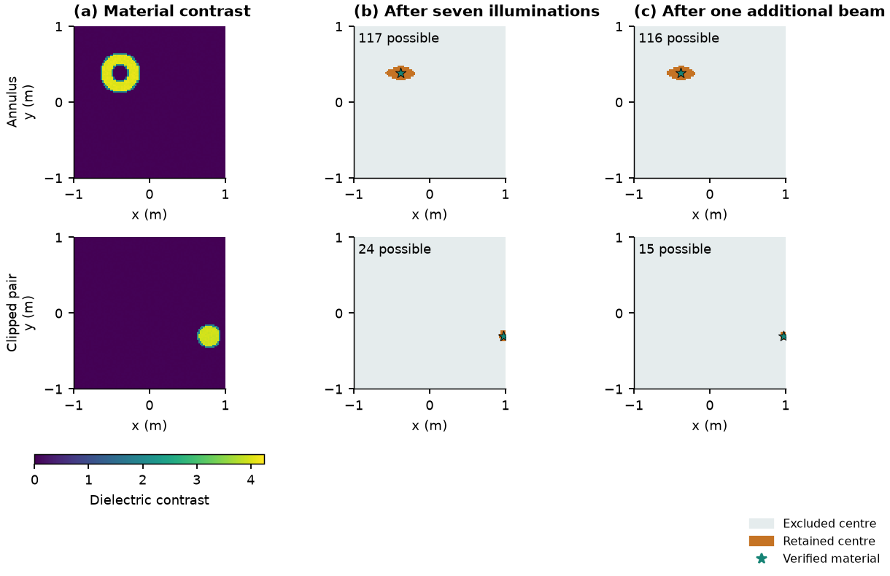
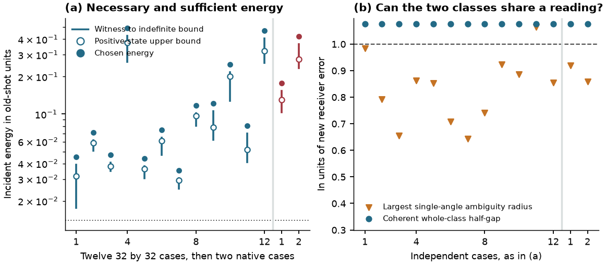

# 有限孔径下，能把介电缺陷定位到哪里，下一束波该怎样发？

**本轮最强的结果，是能在发射前回答一个硬件问题。** 在两个原生 96×96 的强散射算例上，我们先给出了两份都能解释旧读数的材料，再检查全部 15 个允许的单独发射方向。在相同总入射能量下，每个方向都有一份两种材料能共同解释的新读数。同时控制几个方向的相位和幅度，就可以使两个材料类在整个噪声球上分开。其中一个算例严格需要且只需两个方向，另一个的最少方向数在两个和三个之间。实验随后才打开生成材料、计算新读数，并检查实际结果。

**定位也形成了完整输出。** 允许背景的每个像素独立变化到 \(1/32\)。在 16 件 32×32 物体上，七次旧照明排除了 16,384 个候选中心中的 16,313 个。对每件物体，算法还找到了一份符合全部旧读数的完整材料。原生 96×96 的环形缺陷可以落在包括边缘在内的 9,216 个中心。允许整个边缘层的对比度独立取 0 到 5 后，仍能排除 8,243 个，1 个中心有全波材料见证，972 个未决。使用较紧的制造公差，环只剩 117 个中心，另一个延伸到视野外的双夹杂只剩 24 个。

**论文判断**　这组证据足以支撑一篇面向 *Inverse Problems* 的投稿。贡献集中在给定材料规格和有界测量误差时，怎样排除整类解释、保留相容材料，以及怎样事前判定需要几路相干发射。通用微波成像精度、任意形状定位和仪器实测中的确定性保证仍缺少证据。允许拟合背景和核心幅度的普通全波模板也找对了全部 18 个中心。经典两材料相干波束是很强的对手。我们给它同样的读数判别方法和同样能量，它在实际抽取的新读数上也取得了全数正确。

[英文论文](manuscript_ip.pdf) · [下一轮研究交接](handoff.html) · [复现说明](REPRODUCE.md) · [逐案结果与图](maps/index.html)

## 1. 输入、输出和可用场景

设想检验一件介电部件。图纸或检验要求给出可能的夹杂形态、内部材料取值和边界公差，夹杂的位置未知。仪器只能从一侧收发。我们输入原始复读数、收发几何、场强归一化、误差半径和上述材料规格。每个假设内部允许有大量不同的像素值。这里的位置指形状的参考中心，排除某中心不能解释为该像素必定是空气。

算法给出三种可区分的答案。若原始全波模型下每一份合法材料都不能解释读数，该中心标为排除。若能写出一份完整材料并证明其残差上界落在噪声球内，则报告这份材料。其余中心保留为未决。对两个仍存活的材料类，还可以在采集前预测下一次读数能否将它们分开，用接下来的实测或模拟读数更新结果。

空间实验用 400 MHz 的二维 TM 模型，计算区域为 2 m × 2 m，边长约 2.67 个自由空间波长。32² 与 96² 的网格间距分别为 62.5 和 20.8 mm。七束旧波跨 135°，九个接收方向跨 146.25°。一阶 Born 场误差在 16 件小网格物体上为 176%–361%，在两件原生物体上为 214%–304%。二类波束实验另用 168.75° 阵列。新旧实验不混计材料数。

## 2. 固定传播算子怎样限制多种材料

记总场为 \(E=B+GJ\)，电流为 \(J=XE\)，接收场为 \(SJ\)。材料是实无损的。第 \(i\) 格必须在不同照明下使用同一个 \(\chi_i\)。若 \(\ell_i\le\chi_i\le u_i\)，则 \((\chi_i-\ell_i)(\chi_i-u_i)e_i^*e_i\preceq0\)。这是从原本构律导出的多照明矩阵条件，可以和接收残差放进同一个 Hermitian 二次型。暗电流能抵消某些观测方向；状态矩阵有 \(\nu\) 个负方向时，最多丢掉相应数量的正源谱方向。其余谱仍能给整个材料类的距离下界。

移动或改变材料假设只改变少量局部的电流和总场行。预先处理公共状态后，新的带符号更新可以在小矩阵上重算惯性。若公共主元存在真正的零方向，就将它连同与它耦合的源行保留。统一推导同时容纳正、负和零方向。普通 Schur 消元、惯性相加和低秩更新本身都有成熟先例。

第二个结果将一类材料在旧数据下可能产生的新读数写成关于发射命令 \(a\) 与干净读数 \(y\) 的二次不等式。当旧观测用尽该松弛允许的负惯性例外时，该式对整类材料成立。两类各有一个二次式。用两个非负权重同时消去未知的新读数，即可预估两类干净响应的最小距离。该距离若大于 \(2r\)，半径 \(r\) 的两种未来读数就不会重合。在严格可行和强制有界的条件下，对两个**二次外包**的距离这一公式是精确的。实际计算只需要一组验证有效的权重。定理的精确性没有被扩大到全部物理材料正好填满外包。

还有一个反向检验。若两份合法材料在同一个方向的读数相差不超过 \(2r\)，便可以构造它们共同解释的一份观测。如果同一对材料对全部单发方向都能如此构造，则在总能量固定、整段新增读数共用一个误差球时，按历史读数逐次挑角也可以得到完全相同的观测历史。上界和下界结合，才可能判断一台设备至少要同时控制几个发射端口。该结论的噪声约定不包含可随独立重复测量不断平均掉的高斯噪声。

[定理及精确性条件](theory/paired.md) · [英文原稿的数学部分](theory.tex) · [计算与误差界](technical.tex)

## 3. 位置、面积和材料幅度

| 真实有弱背景，3% 噪声 | 总中心数 | 严格排除 | 找到材料的中心 | 未决 |
|---|---:|---:|---:|---:|
| 32²，16 件，给定边缘公差 | 16,384 | 16,313 | 16 | 55 |
| 96² 环，给定边缘公差 | 9,216 | 9,099 | 1 | 116 |
| 96² 跨边缘双夹杂，给定边缘公差 | 9,216 | 9,192 | 1 | 23 |
| 32² 四个环，开放整个边缘层 | 4,096 | 2,381 | 4 | 1,711 |
| 96² 环，开放整个边缘层 | 9,216 | 8,243 | 1 | 972 |

这里统计中心个数。相邻中心是相关位置，分母 16,384 不能解释成 16,384 件独立材料。四类形状各有四份独立纹理和姿态。另用匿名编号重跑形状库，去掉观测文件名中的轮廓提示。程序写入全部判断后才揭示对象名称。在四种轮廓都未知的 32² 对照里，16 个目标各有 3 个错误轮廓，共 48 个，每个错误轮廓的 1,024 个位置均被排除。对正确轮廓逐姿态列出余下的中心数如下。

| 四个独立姿态 | 姿态一 | 姿态二 | 姿态三 | 姿态四 |
|---|---:|---:|---:|---:|
| 圆盘 | 7 | 4 | 3 | 4 |
| 空心环 | 12 | 6 | 1 | 7 |
| 双夹杂 | 5 | 4 | 1 | 5 |
| 带附加小圆的环 | 4 | 3 | 4 | 1 |

传统反传播相关成像给出明亮的候选位置。在同样的数据上，最亮处与生成中心重合的为 3/16，前五处含生成中心的为 5/16。它输出位置排序，阈值没有全材料类的保证。方向性 Neumann 扰动界在精确真空下可排除 16,301 个中心，联合检验排除 16,349 个；放开全域弱背景后，该方向性界一个也排不掉。这一比较适用于实际实施的扰动界。

更宽松的环形规格揭示了用不定状态的实质意义。四个 32² 环分别排除 555、568、616、642 个中心，成功的状态矩阵含 2–5 个负方向。每件各找到了一个原始接收器完全看不见的电流。它在缺陷区域和背景区域的扇区能量**同时严格为负**，所以在这些位置任意组合两组非负实部权重都无法使状态正定，多源不定检验却能排除。另一位置有反例，连续优化正定权重确实能排除，距离下界超过噪声半径至少 0.59270。原生宽环的 8,243 次排除都用到了负方向，但尚未据此证明在 96² 上任意连续正定权重都会失败。更细分、带额外光学乘子的比较也不受这四个位置的障碍约束。

可以单独询问局部峰值。在已找到可行材料的原生环中心，独立材料值的内核峰值一定超过 3.0；跨边缘双夹杂一定超过 2.5。两者可保守保留的上界仍为先验 6.0，各有峰值 4.25 的可行材料。单靠现有数据尚未得到同等有力的上界。

[所有空间回执](maps/index.html) · [连续正定对照与暗电流](reduction/psd_maps/README.md)

**把相同轮廓给普通全波扫描。** 固定核心中值、外围取真空，在每个候选中心计算一份完整材料的非线性散射场。按残差排序，16 件 32² 和原生环形体的真实中心都排第一。原生双夹杂排第二，与第一名相差一格。但是即使最小的点残差也有 3.61–6.81 个噪声半径，18 件上都没有一份这种模板能直接解释测量。再让普通方法在残差最小的五个中心上同时拟合核心幅度和均匀背景，**18/18 个真实中心全部找对**。这次小网格的残差范围为 0.9854–1.0798 倍噪声半径，原生两件为 1.0043 和 1.0094 倍。18 份材料有 1 份经全波核验落在误差球内；允许材料逐格变化后，18 个位置都找到了相容材料。简单拟合实际调用 3,151 次正演，已有模板全图之外另花 68.69 秒拟合和 0.52 秒复核。由此不能主张本法能把中心定得更准，也不能把拟合材料数量的改进单独归因于惯性。新增能力是同时给出物理解释和其余整类位置的排除。[固定模板逐案结果](maps/results/nominal_template_control.json) · [拟合后逐案结果与计时](maps/template_control/per_object.csv)

## 4. 加一束波，究竟换来了什么

对于空间定位，16 件中 3 件只剩一个中心，算法直接停测。另 13 件共有 68 个中心尚未排除。在相同能量与新增噪声半径下，均匀角保留 68 个，随机角 66 个，从旧候选里选出的最佳单角 57 个，相干发射 58 个。原生双夹杂从 24 个缩到 15 个，最优单角和相干都能做到。原生环从 117 个缩到 115 个或 116 个。所有方法都保留了生成中心。15 个实际加测的物体各有四种配对发射，全部 60 次都在算法返回的位置找到了同时满足新、旧误差球的完整材料。其中 49 次可以沿用旧材料，11 次需要在同一中心重新拟合。两次误差上界最高分别为旧半径的 0.988 和新半径的 0.979。不同发射策略拟合的见证可以不同。

当问题缩为辨别两个材料类时，可以得到更强的**发射前**结论。初始共用能量取旧照明的 0.014 倍时，12 件 32² 和 2 件 96² 都有两个实际合法材料，使整个可用发射字典中的最优相干波束也达不到所需间隔。我们随后从旧读数和材料盒计算足够能量，在这个能量上公平比较所有发射规则。12 件小网格物体所需的实际选定能量为 0.0352–0.491，两个原生案例分别为 0.1778 与 0.4200，旧照明能量记为一。取回新读数前，两类不定二次型均已饱和，\(\nu=k=1\)，所选相干命令的严格干净响应距离达 \(2.15r\)。这 14 次新读数全部排除错类，也均有真类的全波见证。

| 二类实验 | 事前能否做到 | 取得一份新读数后的结果 |
|---|---|---|
| 每次仅允许一个普通方向 | 32² 有 11/12、96² 有 2/2 对全部 15 个方向都存在共同读数；另一件覆盖 13/15 | Fisher 单角在 12+2 件全部判对。均匀、随机在小网格各 11/12，原生各 2/2 |
| 同能量相干照明 | 12+2 件的不定条件式全部给出超过 \(2r\) 的全类下界。正定外包和经典中心差相干波束也可给出足够保证 | 条件式选出的波束和经典相干对照均 12+2 全部判对 |

两个原生物体按物理反例与不定全类下界算出的入射能量必要/充分界为 \([0.1034,0.1539]\)、\([0.2344,0.3636]\)，端点向外取整。正定二次型进一步给出约 0.130 和 0.276 的充分能量。因此可发表的主张是介质类的保证、能量界和硬件数量，实验不支持宣称本方法发明了更好的通用相干发射波形。

## 5. 至少要同时控制几个发射方向

| 算例 | 已证明不够的硬件 | 已证明足够 | 最小同时发射数 |
|---|---|---|---|
| 32² 第三件二类检验 | 全部 455 组三端口都存在共同读数 | 一组四端口的距离下界为 \(2.0200r\) | **4** |
| 96² 第一件 | 全部 15 个单角，另有 100/105 组双端口 | 三端口，\(2.1026r\) | **2–3** |
| 96² 第二件 | 全部 15 个单角，另有 97/105 组双端口 | 67.5° 和 90° 双端口，扣除两边噪声后仍余 \(0.0921r\) | **2** |

三端口的充分界来自正定条件二次型。第二件双端口用材料值为实数这一信息，在接收方向上逐格保留相位相消，并外包全波高阶余项。第一件最好的双端口提议在实际新读数上判对，但其事前余量仍约为 \(-0.0261r\)，所以最小端口数保持在 2–3。端口指可独立定相的入射字典方向，约束的是域内入射场积分能量。把这个结论解释为具体天线馈口数和发射机瓦数，需要实测端口至入射场的映射。

[逐束波形与真实读回](beams/README_ZH.md) · [补测后材料回代](adaptive/updated_witnesses/README_ZH.md)

## 6. 收益要扣除准备和验证的费用

两个经过公开读数选定的近阈值测试，各对 1,000 个不互相包含的材料盒改变三处局部约束。32² 的公共状态有七个负方向；原生 96² 有九个，外部精确真空使允许的非零电流维数为 1,153。两批逐盒的完整与约化惯性一致，另有八个原坐标独立区间复算。验证的零模控制保留了和源有耦合的奇异状态。

| 1,000 个新材料盒，墙钟 | 完整矩阵浮点计数 | 小矩阵在线区间计数 | 计入冷启动和四次完整区间复核 | 严格排除 |
|---|---:|---:|---:|---:|
| 32² | 870.6 秒 | 0.955 秒 | 382.0 秒 | 757 |
| 96² | 1,157.2 秒 | 5.561 秒 | 341.6 秒 | 472 |

只做一百个盒时，计入准备与独立复核后仍要 234.4/238.4 秒，超过完整浮点的 52.4/83.0 秒。表中前三项的精度与费用范围不同。真实完整付费后，千盒批次的墙钟比约为 2.3 和 3.4；把预处理删掉才有几百倍的在线比。另用四件 32² 与两件原生物体比较先查大区域再细分，与逐个检查中心。四个小网格中有 1,740/4,096 个中心被上层检查直接排除，两个原生物体是 9,359/18,432。其余中心全部从带噪读数重新计算，两条路线在每一格给出相同答案。3,361 个成功的上层检查都用到了不定状态。单中心核验减少了 41% 和 50%，但分组本身有成本，在线总墙钟分别由 3.71 增到 8.45 秒、从 29.04 增到 78.92 秒。实际固定阵列要低延迟，宜用已准备好的逐中心计算。空间地图又有不同成本。原生环跨视野边界有 625 种裁剪几何，主规格从头到尾约 381 秒墙钟。宽松环复用内部区域后总计约 385 秒。32² 加测的位置设计与更新可在秒级完成，最难的 96² 首次全图计算仍按分钟计。在同机并行工作时，机器账本同时保留墙钟与 CPU。

[原始时间与计费口径](reduction/README.md) · [从原始读数重新比较分层和逐中心计算](adaptive/multiscale/README_ZH.md)

另有两个固定位置的原生参照。低峰盘的峰值为 0.625，空心环为 3.50，后者的一阶 Born 误差为 376%。两者允许活动的圆区同为 1,153 格，实际占据的像素不同。对同一个峰值中心为 4 的实心材料规格，仍能排除的盒半宽分别约为 Neumann 范数阈值的 5.14 倍与 3.09 倍。两个参照不计入这轮全视野定位的独立物体数。

## 7. 改成细网或换成暗室，结论还剩多少

把两份原生 96² 样品分别以每 3×3 格面积平均降到 32²，再在同一物理阵列上从头求场。发射角、接收角和积分归一化一致。环的散射场变化达干净读数的 15.82%，双夹杂为 6.77%，相当于原 3% 接收半径的 5.27 和 2.26 倍。在这两个样本中，把原噪声和模型差相加，按三角不等式，采用足够保守的半径时可扩大到约 6.28 和 3.26 倍。它们只说明这两份材料的尺度，不构成整个材料类的误差上界。

我们另取已有的七件微波暗室实物，用一半接收弧选择相干激励或最佳普通方向，换到另一半看真实复响应差。Fresnel 三件目标、4/6/8 GHz，有 17/18 个配对条件改善，中位比值 1.088。Manitoba 四件目标、3–6 GHz，用大金属参考时为 45/84，中位 1.021；改用小金属参考降到 32/84，中位 0.877。频率、两两组合和接收划分均为重复条件。没有在暗室里按本算法重新发射。过去 3 GHz 尼龙柱排除对比度不超过 1 的模型，只留下 4.018% 的加载误差余量；它说明装上目标后模型必须准到什么程度。本文不把这个条件余量换算成实物的无条件材料下界。

[跨网格原始结果](maps/model_transfer/transfer.json) · [暗室逐项留出读数比较](lab/held_ports.csv)

## 8. 原创性与稿件定位

成熟工具包括单个已知材料对的相干最优照明、Hermitian 惯性交错、少约束复二次优化的秩一精确性、一般静态消元与局部电磁功率守恒。本文把它们落实到有旧带噪全波数据约束的**未知材料类**，以同一物理样本给出发射能量或硬件数量的必要和充分界，再通过新读数、材料可行实例与原算子复核闭合检验。四个能分开正定与不定方法的暗电流，以及两路、四路的精确最少硬件实例，是比泛泛的“最优照明”更能经得住反问的结论。

我建议以这条主线投 *Inverse Problems*。两件原生确认样品足以给出明确的存在性例子，却不足以估计一个行业中的平均成功率。空间侧还有一大块误差来自规格与模型，成像求解器的普适恢复优势没有成立。若论文定位改为 *IEEE TAP* 的系统性能或临床筛查结论，就缺少真实相控发射、加载标定和独立实物上的闭环验证。

[研究边界](METHOD_LIMITS.md) · [独立审查与修改](reviews/RESPONSE_ZH.md) · [投稿源码](IP_Anonymous_LaTeX.zip)
