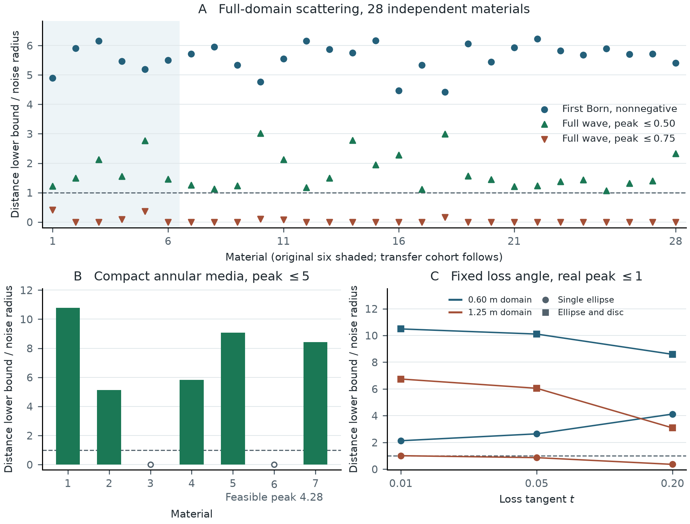
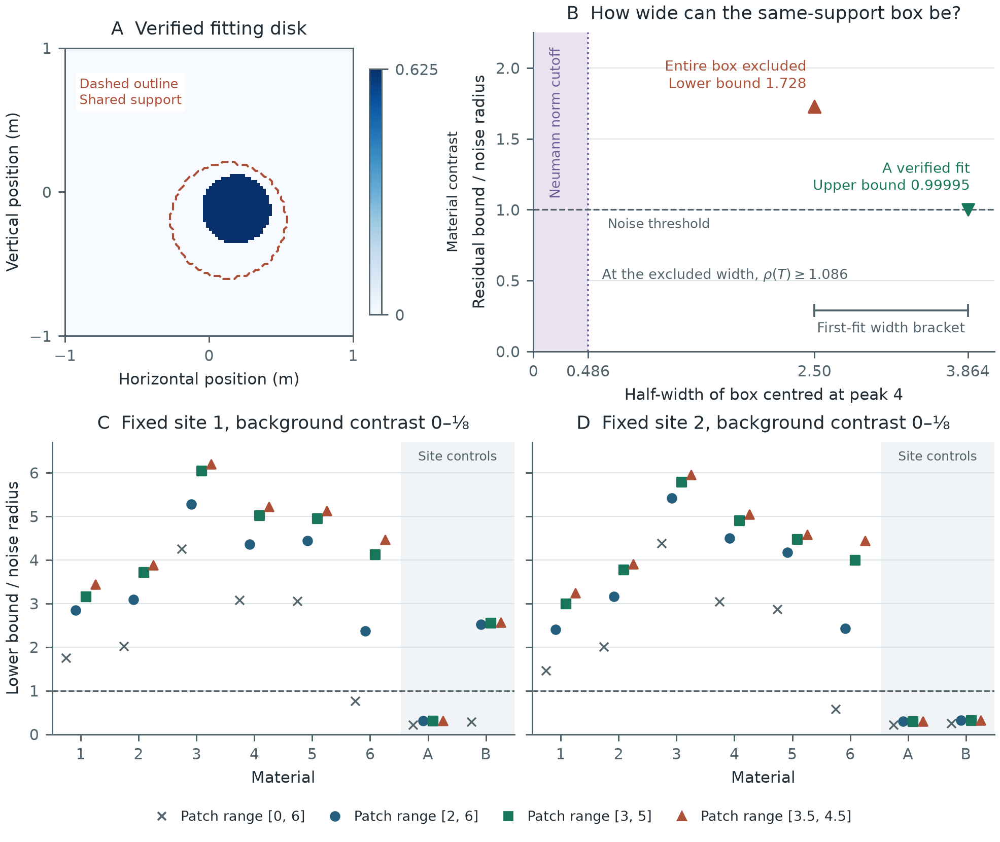
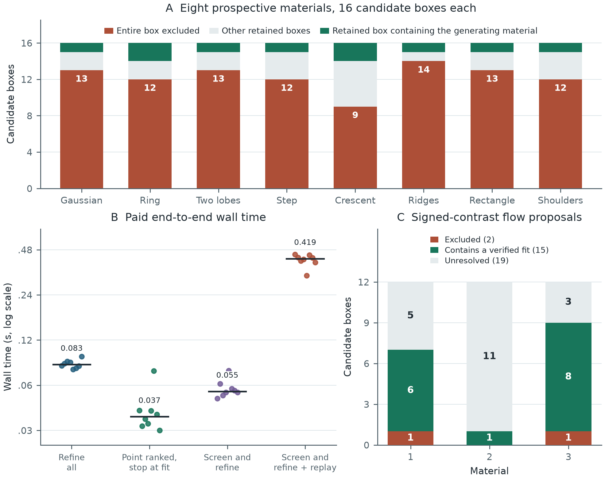
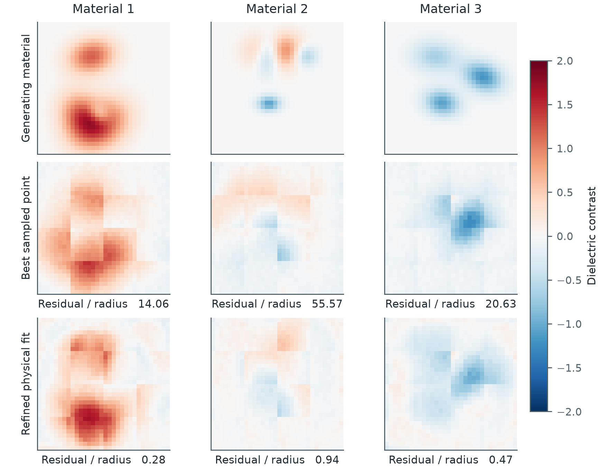
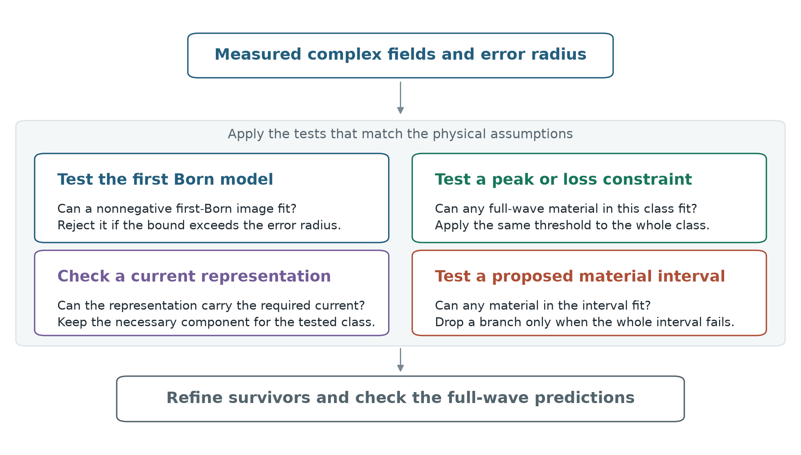

# 同一份微波读数，能排除哪些材料分布？

**一张图算错了，并不代表改动附近几个像素也救不回来。这次能证明，在一项原生 96×96 全波实验里，一整个高对比度材料范围都救不回来。** 在相同位置，峰值 0.625 的材料能解释同一份读数。把假设换成一块中心峰值为 4、每格允许上下浮动 2.5 且下限截在零 的材料，任何取值的残差都至少是噪声半径的 **1.728 倍**。能排除的半宽至少达到标准 Neumann 收缩限的 **5.14 倍**。[英文论文](manuscript_ip.pdf) · [ChatGPT 研究交接](handoff.html) · [复现与数据](REPRODUCE.md)

**物理判断有了进展，找图的效率则取决于要什么结果。** 八件事先留出的强散射物体，每件 64 个候选样本、16 个候选盒。新方法严格排除了 128 盒中的 **98 盒**，实际包含生成材料的 **10 盒全部保留**。若只求任意一张与读数相容的图，逐点全波排序后按需精修更快，中位耗时 **37.1 ms**。整盒判断并精修是 **54.6 ms**，全盒都精修是 **82.5 ms**。三个方法都成功 7/8。两边都在首个可行解停止的补测中，预筛仍使八件材料的中位时间合计增加 15%。多做一遍独立区间复算后，整盒流程中位是 **419 ms**。[逐物计时](threshold/confirmation/online.json) · [真值和独立复核](threshold/confirmation/offline.json)

**投稿定位。** 值得投 *Inverse Problems* 的贡献是从有限孔径数据判断一类材料假设何时不可能，尤其是超出扰动收敛区的同支撑实证、可跨奇异点的直接判据，以及嵌套材料区间怎样继承已有计算。现有实验还不足以支持“比成熟 CIE 或全波排序更快、更准地成像”的 *IEEE TAP* 主张。

## 先把被测对象说清楚

一份观测包含多束照明下的多个复接收读数。这里的噪声半径 $r$ 指整个复矩阵允许的误差。把距离下界除以 $r$，大于 1 就足以排除整类材料。反过来，拿出该类中的一份具体材料，把它的完整非线性响应算到误差球内，就证明该类有可行解。两者都做不到的例子记为未定。

| 独立材料或实物 | 件数 | 用来回答什么 |
|---|---:|---|
| 400 MHz、2 米见方、96×96 无损材料 | 6＋22 | 全部 28 件比较 Born、全波优化和 CIE；其中六件另有 32 发 32 收精细实验 |
| 小电尺寸高对比环形材料 | 7 | 同一峰值上限 5 能排除几件 |
| 已知损耗角的不同材料形状 | 4 | 同一材料、同一损耗合同下，耗散信息值多少 |
| 弱至中等散射对照 | 2＋4 | Born 会不会误导后续初始化 |
| Fresnel 和 Manitoba 实物 | 3＋4 | 独立接收/发射留出、实际校准和未建模误差 |
| 已知局部支撑的强散射材料 | 4＋8 | 四件开发，再按冻结规则生成八件独立对象 |
| 原几何上的真实 Flow Matching 测试材料 | 3 | 生成候选的覆盖、物理相容性及代价 |
| 其他机理对照 | 5 | 原生盘体、两个位置对照及 24²、32² 材料 |

共 **72 件独立材料或实物**。另有一份六材料历史观测，保留两套互相分离的合法解释。登记表有 121 个采集条件，额外的两次低峰幅度对照复用原有两个位置。28 件主组已有曝光史，八件前瞻确认是独立新目标。很多方法只适用其中某一组，不能把 72 当作每项方法的分母。[全部材料、完整观测 ID、来源和曝光史](benchmark/objects.csv)

## 为什么换到高峰材料附近可以有用

在每个位置，电流等于材料对比度乘以总场。选定一个候选背景 $M$ 后，把背景能解释的部分扣掉，剩下的电流是 $q=J-ME$。它满足 $q_i=(\chi_i-m_i)e_i$。同一格的系数对所有照明相同，因此一束照明中看似可行的暗电流，必须同时经得起其他照明的检验。

背景总场是 $E_c=(I-GM)^{-1}B$。原任务书里的另一个乘法次序在非均匀背景下通常给出不同的场。完整传播仍保留所有多次散射。若每格的允许半宽是 $h_i$，材料盒给出两条矩阵关系：剩余电流的加权能量不超过用 $h_i^2$ 加权的场能，电流与场的加权交叉功率虚部为零。半宽为零的地方可以精确消元。若把同一个全域峰值盒只换一套坐标，它的负方向数和可用源谱均保持不变。

把波动方程与上述材料关系合并，可写成一个关于电流和照明的 Hermitian 矩阵。过去通常先求电流块的逆，再判断剩下多少个源方向。现在可以直接在噪声阈值上数整个矩阵的正方向。这样即使电流块奇异也有定义。一个有理数例子中电流块恰为零，公式给出平方距离 5，且合法材料确实达到 5。[证明](theory.tex) · [符号、非交换背景与奇异情形的复核](theory/check_forms.json)

还有一个实际影响判定的细节。把材料区间从 $[0,6]$ 收到 $[2,6]$，中点从 3 移到 4。直接照抄原空间权重，有时会让计算出的下界倒退。对外盒半宽 $h'$、内盒半宽 $h$，把局部实部权重乘以 $h'/h$，可证明整个二次型只会往有利的方向变。这一步适用于任意嵌套实区间。对于从 $[0,6]$ 到 $[2,6]$，因子就是 1.5。它是初等的区间扇区关系；有科研意义的是在保留真实传播和全部 9,216 个自由度时，它确实改变了判断。

## 哪些高峰盒能排除，哪些依然留着

**同支撑盘体。** 全部 1,153 个活动格可独立变化。高峰盒有 7 个负电流方向、32 束照明，仍有足够的照明差异把整个盒排除。对于这组等空间权重，有一个接收器完全看不见的电流方向，其实部扇区在该方向严格为负。调整全局正标量仍然去不掉它。我们还直接证明一份合法端点扰动的谱半径至少为 1.0864；这里标准背景 Neumann 级数确实不能全盒收敛。通常的 2-范数收缩半宽介于 0.48604895 与 0.48604902。半宽 2.50 仍可排除，半宽达到 3.86436632 时，一份实算进球的低峰材料已经在盒内。中间的精确临界点尚未求出。[严格端点、费用和同支持对照](boxes/results/paired_summary.csv) · [半宽及谱半径](boxes/results/disk_radius.json)

**强散射原生物体。** 在两个原有的 96² 高对比度目标上，固定错误候选的支撑、取峰值中心 4 和半宽 2，距离分别至少 18.94r 和 21.98r。但把两个盒内的材料下限全部撤掉，单凭支撑和上限就已有 3.34r 和 6.27r。这两件主要说明空间位置与读数冲突。相同盒改用正定乘子甚至分别得到 25.05r 和 23.20r，所以它们不能证明不定惯性不可或缺。另在 437 个未知格外放入 78 格对比度 3.25 的已知介质，其余 8,701 格固定为真空，完整考虑它的多次散射，同两份读数仍有 29.00r 和 27.73r 的排除。[同盒正定、放宽下端、非零宿主与全部未定](boxes/REPORT_ZH.md)

**背景也未知。** 把两个预先声明位置中的一个 8×8 区域设为 $[2,6]$，其余 9,152 格各自可变。在背景上限为 1/16 时，原六件物体在两个位置上均可排除，两件真实放在指定位置的控制材料则各自保住正确位置、排除另一位置。放宽背景至 1/8，原权重在两个位置都只能排除六件中的三件。改用上文的权重传递，两个位置各自都能排除 **6/6**，最弱的距离下界也超过 **2.36r**。只继承宽盒“已排除”的判断是 5/6。两件位置对照中现在能排错位置的只有一件。[统一全域计算](families/results.json) · [嵌套权重的严格复算](families/nested.json)

我们另把这两个位置的实际材料峰值分别降至 0.625，保持几何不动，重新生成带噪读数。低峰点确实进球，而对同一位置的高峰盒，放宽背景后得到的下界分别约为 0.243r 和 0.277r。**无法由这个下界判断高峰假设，也没有证据说高峰材料一定能拟合。** 这给跨物体、跨背景的外推划出了边界。[同位置低峰负例](families/same_site.json)

## 生成模型给出许多图，筛掉一类图值多少钱

在四件开发样本上，把完全相同的候选交给不同流程。每件有 16 盒、每盒 4 个样本。候选由带噪观测、公开支撑及固定种子产生。只依靠支撑与不限制幅度的互易传递，可以解释任意训练端口矩阵。传统扰动界总共排 4/64；把材料盒的正下端撤掉后，空间扇区排 14/64；保留上下端后能排 **40/64**。这里的差异确实与材料值有关。

只选单点正演残差最小的一个候选，四件中有三件在规定精修预算内进不了球。可是按单点残差排序、依次精修直到找到第一张可行图，四件都只需 1–2 盒。该对照把有界全波优化、所有 64 次点正演和末次物理验收都计入费用。它说明一项重要的公平比较：赢过 Top-1，仍可能输给很简单的按需精修。这批数据也没有证明上述失败必然来自周期跳跃。[四件逐例材料、留出端口及费用](pool/REPORT_ZH.md)

在八件新物体上，规则在生成数据前冻结。逐件排除数为 **13、12、13、12、9、14、13、12**，每件共 16 盒。多数保住的真值盒来自宽先验；曾有读数可以被明确排除许多分支，却仍然没能在预算内算到一张相容图。三种方法全图误差的中位数都是 10.02%，独立留出接收误差 1.16%，留出照明误差 1.67%。全图和已知活动区的误差在这组数据上相同，外部空气是各方法共同的精确先验。[八件冻结规则](threshold/HOLDOUT_RULES.md) · [逐件材质、误差与失败](threshold/confirmation/offline.json)

| 八件前瞻样本，每件中位数 | 在线墙钟 | 在线 CPU | 完整全波 LU | 能回答的问题 |
|---|---:|---:|---:|---|
| 16 盒全部精修 | 82.5 ms | 81.9 ms | 535.5 | 哪些起点在预算内找到低残差图 |
| 先算各样本，依次精修到首个物理解 | 37.1 ms | 37.0 ms | 183 | 能否找到一张解释读数的图 |
| 整盒排除后精修所有存活盒 | 54.6 ms | 54.5 ms | 179.5 | 哪些盒内的所有图都解释不了读数，并给出剩余候选 |

八件的独立 Arb 复核中位耗时另为 362.7 ms。大型原生盘体也没有毫秒级的首轮成本：241 个候选盒的预选用了 124.48 秒墙钟，第一批严格计算台账用了 396.71 秒墙钟、583.71 秒 CPU。多份读数如果共用少量固定位置，可以摊薄端口与传播的准备；重新为每个生成样本定义一个大区域，就会失去这项优势。[费用明细](boxes/results/costs.json)

**如果两边都只找一张图，提前筛盒还值吗？** 我们在同一批已曝光的八件材料上把停止条件完全拉齐。两边都算 64 个点，都按同一个顺序、从同一个起点精修，第一次经全波重算进入噪声球就停。每物体配对十次，两边给出的材料逐格相同，成功数同为 7/8。预筛使全波矩阵分解从 1,803 次降至 1,409 次，但八个物体各自的中位时间相加，从 **0.258 秒升至 0.296 秒**。唯一没有找到可行解的难例省下 14 个盒，耗时从 57.65 降到 34.61 毫秒。两种结果可以同时成立：筛盒对难例省时间，却提高了这一组求一张图的总成本。单独重验全组 98 个排除结果另花 2.137 秒。[完全相同停止条件的逐例记录](threshold/same_stop.json)

**把四条流程接到真正的 CIE。** 四件开发和八件留出材料都用相同的电流域迭代、相同 Fourier 基及逐格材料盒。只跑冻结的 CIE 步数，四组都是 **0/12** 进球。单靠这一项，有再高的提速都不能叫成像成功。于是给所有方法接上相同的全波校正，每盒最多 42 次目标评价。结果变成四条流程都 **12/12** 找到经严格重算的可行材料。这是同一批物体上的配对补测，另有表格保留原始失败。

| CIE 后接相同全波校正，12 件合计 | 墙钟 | 完整全波 LU | 球内终点 |
|---|---:|---:|---:|
| 所有盒都精修 | 4.963 s | 8,672 | 12/12 |
| 单点全波排序，精修到第一份可行图 | **0.890 s** | **2,430** | 12/12 |
| Neumann 筛后精修 | 6.456 s | 8,464 | 12/12 |
| 物理排除整盒后精修 | **1.892 s** | 3,516 | 12/12 |

整盒方法与全量精修逐物选回同一份材料，在线耗时约为全量的 **38%**。若把针对每次排除的独立 Arb 复核 2.882 秒也计入，总计是 **4.775 秒**，相对全量 4.963 秒的优势缩至约 **3.8%**。对照“能找到一张就停”的点排序时，后者在 12 件上都更快。两者的全图误差中位数分别为 **6.71% 和 6.42%**，留出接收误差分别为 **0.978% 和 1.108%**。不加 CIE 的逐点精修在 42 次预算下有一例以 1.042r 失败。只对这一已曝光失败加倍直接精修预算，就以 0.9531r 进球，用时 0.041–0.042 秒，仍快于同例 CIE 后校正的 0.071 秒。需要证明某一类材料可以丢掉时用整盒法，只需一张数据相容图时先做点排序更划算。[逐物 CIE 与原物理校正](pool/cie_pair/corrected_results/online.json) · [材料和留出读数](pool/cie_pair/corrected_results/offline.json)

**真正的 Flow Matching。** 加载项目已训练的材料流，在它原有的 32²、有符号对比度、两束相对照明和 16 个观测接收器上重新采样。三件各得 64 个样本，并聚成 12 盒。原始测量是干净读数，1% 是本次规定的可行容差。**三件生成真图都不在各自任何一个样本盒内。** 即便如此，完整全波和区间验算证明 36 盒中 **15 盒有合法材料，2 盒整盒不相容，19 盒未定**。两件对象共有 25 对彼此不相交且各自进球的材料盒。三份原始真材料也进球，与找到的另一份可行材料至少相差自身范数的 26.35%、79.36%、51.53%。留出接收误差却都低于 1%。因此，生成池的多个解有物理内容，但删到只余一盒或找回真值不应成为默认期待。真实模型上，单点排序到首个相容点依然用时最短。[生成、验算与各臂时间](pool/REPORT_ZH.md#真实-flow-matching-资产) · [有符号全波下界](pool/flow_results/native_l4.json)

## 求解器该怎样用这些结论

1. **线性 Born 能否作为最终结果。** 28 件原生物体上，非负 Born 类全部被排除。固定阵列的符号预检花 0.269 秒，随后每份读数中位 0.142 ms。可是在相同材料空间和相同预算下，用 Born 图初始化全波优化，仍有 15/28 件残差更低，10/28 件材料更准确。例 018 的训练残差从 9.825r 降到 4.662r，材料误差从 0.996 降到 0.870。两个结果依然在球外。
2. **全域峰值或损耗假设能否成立。** 在 10% 噪声、10 发 20 收下，全部 28 件都要求某处峰值大于 0.5。相同条件在 0.75 未定。2% 噪声、32 发 32 收的六件中，有五件能排除 0.78125、三件能排除 0.8125、一件能排除 0.84375，上限 1 仍全部未定。这个全域结论无法指出峰值在哪格。已知损耗角时可以另用耗散椭球。紧凑材料在损耗角正切 0.05、上限 0.75 时，同一耗散信息的全部公共标量权重均低于 0.810r；按照明方向分别取权重可以超过 1.013r。此结果只适用于该有损材料合同。
3. **哪些电流不能全部丢掉。** 96² 的两件细测例，峰值不超过 1 且能进球的任一材料，电流在 13 维负空间里的范数至少为 15.76 和 19.76。原有 100 列 Fourier 空间已与这些方向相距约 0.91°–5.47°。等宽替换 13 列以后，两件材料误差确实改善，但训练残差和独立留出复场同时变差。直接检验真实迭代所用的两个仿射电流子空间，也都不足以排除。现有证据不能指导 FFT-TSOM 应保留多少列，更不能保证比固定截断更快收敛。
4. **能否提前跳出错误局部极小。** 两件材料上，在一幅真实 CIE 中间图附近允许每格浮动 0.04，两种物理界都未定。缩到 0.005 后两盒皆可排除，但传统 Neumann 界同样成功，普通点残差会触发相同的重启。而原来的迭代随后自己离开这两个盒。由此可以建议放弃一项必须留在盒内的反演假设；从这样的局部结果还推不出整个吸引域不可行。[28 件配对求解](routing/REPORT_ZH.md) · [等宽 CIE 与必要电流](routing/cie_diagnostics.csv) · [原生仿射子空间](theory/restricted.json)

## 暗室与真实歧义

Fresnel 三个实物、九份频率读数，在峰值上限 0.5 时都没有超过独立空场校准反映的误差尺度。Manitoba 四个实物、28 份频率读数中，3 GHz 大尼龙柱在被动上限 1 时，扣除已知校准差后还允许约 **4.018%** 的额外误差。物体放进暗室后，二维模型与真实仪器的差能否小于这个数，两个实验室的数据都没有证明。独立接收端口的 Born 预测误差也很大，Fresnel 为 80.2%–97.9%，Manitoba 为 68.1%–107.9%。[逐实物逐频率的端口表](routing/measured_port_cases.csv)

还有一项更直接的多解控制。六个材料参数、三束照明和单接收的同一份观测，两套已知材料的 RMS 距离至少为 **1.15879**。本轮只重新检查两份原物理解，在相对容差 $2^{-30}$ 下，两份残差上端都小于允许值的 0.0021%。围绕两份材料各取半宽 0.05 的盒，两盒互不相交，且都不能被排除。它说明严格保留多个答案有时正是正确的物理结论。[两份完整材料及原六维方程复算](boxes/results/ambiguity.json)

## 原创性与下一步价值

畸变波背景、Schur 补、惯性交错、扇区乘子和光学守恒都有成熟先例。本文把给定复测量的噪声球、全部照明共享的空间材料区间和逐个候选范围的实际费用接在一起。最值得写进主文的是同位置的实测量级分离、区间包含时的权重传递，以及把 9,216 格全域问题按已知改动位置复用。紧背景时主要收益来自背景先验，点排序同样便宜时往往更快。证据支持的是对整类假设的物理判定，尚未支持普适的生成后验加速、CIE 成像加速或连续体稳定性结论。[先例与原创性说明](PRIOR_ART.md) · [独立研究意见与回应](reviews/RESPONSE_ZH.md)
