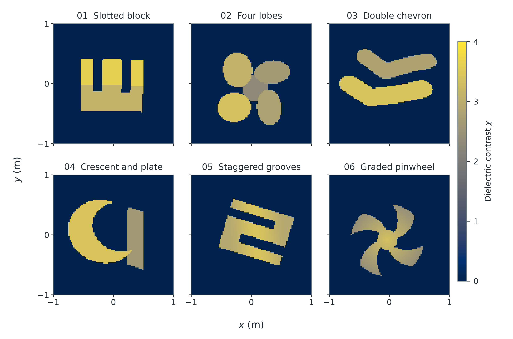
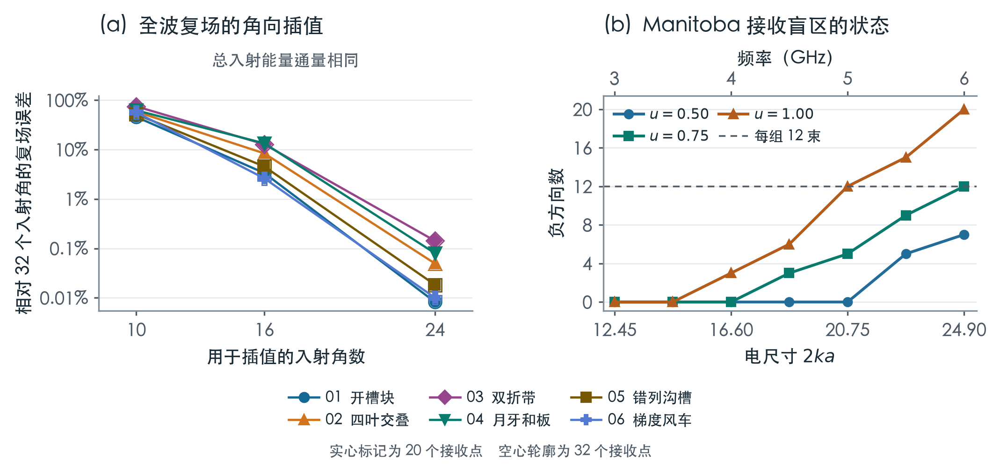
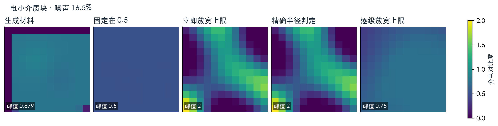

# 微波读数能告诉我们，物体内部的介电对比度至少有多高？

在 400 MHz、2 米见方的成像区域里，六件形状不同的物体都有 9,216 个可以独立变化的材料格点。我们只给算法天线位置、带噪复电场和允许的测量误差，然后问一个具体问题：**有没有可能把材料随意重新摆放，让每个格点的对比度都不超过 0.75，同时仍然解释这些读数？** 在相同的总入射能量和 2% 噪声下，用 10 个入射角和 20 个接收位置，可以对两件物体回答“没有”。用 24 个入射角，可以对五件回答“没有”。这里的对比度是相对介电常数减一，因此整个物体中必有一处的相对介电常数超过 1.75。这个结论在开始成像之前就成立。 [英文论文](manuscript_ip.pdf)

## 哪些物体能判定，哪些仍然不知道

| 同一组六件材料 | 10 个入射角 | 16 个 | 24 个 | 32 个 |
|---|---:|---:|---:|---:|
| 20 收，1% 噪声 | 3 | 5 | 5 | 5 |
| 20 收，2% 噪声 | 2 | 4 | 5 | 5 |
| 32 收，1% 噪声 | 3 | 5 | 5 | 5 |
| 32 收，2% 噪声 | 2 | 5 | 5 | 5 |

**开槽块、四叶体、双折线、月牙与平板、错列沟槽**在 24 个角度时都能判定。第六件**渐变风车**在所有布阵下都悬而未决。10 发 20 收、2% 噪声时，只有开槽块和错列沟槽通过。将门槛提高到 **1.0**，增到 32 发 32 收也没能排除任何一件。这里一共是六件独立材料、96 份配对观测。六件物体的参考材料都在对应误差球里，真实峰值在 3.35–3.63。这个差距说明目前能可靠给出的下界仍然偏低。 [逐件结果](../physical_revision/array/array_scan.csv) · [完整阵列比较](../physical_revision/array/ARRAY_SCAN_ZH.md)

## 为什么照明加到一定程度就没什么用了

**第一件事是角度够不够。** 物体对入射角的响应是平滑变化的。用 16 个方向算出的全波响应，预测 32 个方向的独立全波计算，误差为 2.63%–13.42%。用 24 个方向做同一件事，误差只剩 **0.0082%–0.1423%**，小于本实验的噪声。整个成像区域的电尺寸给出约 24 个有效角向自由度的估计。六件散射体各自占据的范围更小。这里的 24 是对当前尺寸、孔径和精度有意义的尺度，改变这些条件需要重新计算。 [角向误差逐件表](../physical_revision/electrical/angular_interpolation.csv)

**第二件事是已有角度还剩多少材料信息。** 有些内部电流在天线上几乎看不到，却能抵消由某几束照明提供的约束。我们用一个由 Green 算子与接收阵列组成的矩阵数出这样的负方向，再看其余照明中有多少场差确实留了下来。在 32 发 32 收、峰值门槛 1 的一个最强候选上，只有 13 个负方向，扣除它们以后仍有七个正的照明方向，但总的距离下界只有误差半径的 **0.301 倍**。仅靠“发射数大于负方向数”就预测成功，会在这里判断错误。 [为每个条件保存的照明谱](../physical_revision/array/source_spectra.csv)

对四个负方向进一步检查，其电流能量各有 **99.9931%–99.9943%** 落在接收器的零空间里。把这个四维空间里的任意单位电流代回均匀介质的无源方程，残差仍大于 1.084。六件仿真物体的全波电流落在该空间中的能量也只有 0.23%–1.60%。所以它们很好地解释了下界为什么变弱。把它们用作强散射体固有共振模式，目前缺少物理依据。 [电流幅相、辐射功率及与 FFT-TSOM 的比较](../physical_revision/modes/REPORT_ZH.md)

## 哪种改进真的是多束照明带来的

在开槽块与错列沟槽上，同一组 10 发 20 收读数、同样的 2% 误差，允许自由组合成一束相干照明，再在四个区域分别施加两条守恒律。即便加上对整类物理材料都必须成立的电流能量上限，这个单束松弛模型仍可做到**零残差**。保留多束照明共享同一材料的矩阵关系，得到的严格下界分别为 **0.16070 和 0.11061**，超过各自误差半径 **0.09097 和 0.08803**。将单束方法的空间约束细化到 16 区，两例又都能判定。这个对照界定了多源关系真正有用的范围，也解释了为什么把更多天线或更细分区当成单向度的优越性指标会出错。 [英文论文第 3、5.2 节](manuscript_ip.pdf)

## 什么情况下值得放弃线性成像

另一个实际决策是是否还值得尝试一阶 Born 近似。我们专门检验了**任意强度、任意布局的非负 Born 材料**。做法是先按天线位置给各个复读数定一组权重。如果任一像素放入正材料都只能把加权读数向一侧推动，实测读数却越过另一侧的全部误差，就能排除这一整类线性图像。

六件强散射物体的 **96/96 份**配对读数都排除了该线性模型，严格距离至少是实测场范数的 **40.23%–61.56%**。每种阵列事先用 0.2–0.82 秒获得权重，每份新数据的读数约 0.5 毫秒。峰值约百万分之一的弱椭圆则确有 Born 图像能进入噪声球。另一个峰值只有 0.04 的双圆盘，固定权重没有给出判断，按这份数据重新选择权重后，1% 和 2% 噪声下的距离下界分别达到 **5.35 和 2.75 个误差半径**。是否需要多次散射，应当连同电尺寸、仪器和噪声一起判断。 [不同生成方式的对照](../physical_revision/born/controls/RESULTS.md)

## 这能让成像更准吗

在八个有机会出现“残差接近噪声”的大物体条件上，我们用原生 96² 全波正演和伴随计算优化低峰材料。固定低峰的最小实得残差仍有噪声半径的 6.78–82.48 倍。普通残差就足以发现这些图像有问题，因此论文没有用它们演示算法优势。 [原始反演与运行费用](../physical_revision/inversion/RESULTS_ZH.md)

我们另外事先设计了一个边长为波长六分之一的材料区，物体真峰值为 0.879，四个噪声水平代表同一件物体。把重建峰值限在 0.5 时，最接近读数的实得图像有 **1.49–2.48 个误差半径**的残差。在允许误差附近观察，它很容易被当成一个还可以继续修形状的解。这里能证明，即使把所有像素重新排列，整类峰值不超过 0.5 的图像仍至少有 **1.44–2.42 个误差半径**的差距。

接下来怎么扩大材料范围，决定了成像质量。直接放宽到 2，未参与反演的天线预测误差从 **27.50%** 降到了 **1.32%–2.52%**，材料相对误差却从 **0.462 升到 0.721–0.943**。逐步放宽，首次进入噪声球时停在 0.75，材料误差降到 **0.322–0.355**。用全类下界可以跳过第一个上限，少算三次目标函数。但普通的严格残差续算得到了**逐像素完全相同**的图像，冷启动的下界计算也抵消了省下的时间。新能力是判断“改形状是否还有机会”，尚未表现为独立的重建精度或速度优势。 [同色标材料图与逐项指标](../physical_revision/inversion/RESULTS_ZH.md)

## 真实仪器和论文判断

加拿大 Manitoba 暗室，在 0.14 米视野内由 3 GHz 升至 6 GHz，归一化到同一规则的接收组在峰值门槛 1 时，负方向从 **0 增至 20**。该组只有 12 束照明。大尼龙柱在 3 GHz 仍能为额外的模型偏差留下 4.018% 的实测场余量。Fresnel 的三个物体、三个频率则都无法在既有空场误差标尺下排除全波峰值上限 0.5。两所实验室的非负 Born 比较在 25/28 与 3/9 个配对条件下超过各自两种经验误差尺度。未知物体装入仪器后的完整二维模型误差尚无统一上界，尼龙也有损耗，因此这些余量只能在声明的模型下解释。 [实际端口和逐个例外](../physical_revision/born/ports/REPORT_ZH.md)

**论文定位是有限孔径 Maxwell 逆问题的材料下界。** 最有分量的是在同一次物理采集上，同时证明联合照明能排除整个材料类、而受能量限制的四分区单束模型仍可精确拟合，以及给出该结论在 16 分区失去优势的反例。真实采样角度和噪声决定它的可用范围。该结果适合按理论与计算稿交由 *Inverse Problems* 评审。实验提供了预先判断模型的办法，尚未给出优于成熟反演的材料图像。 [匿名 LaTeX](https://github.com/migodam/b1-probabilistic-maxwell-imaging/releases/download/optical-inertia-ip-v3/IP_Anonymous_LaTeX.zip) · [给 ChatGPT 的研究交接](handoff.html) · [计算复现入口](../physical_revision/REPRODUCE.md)
