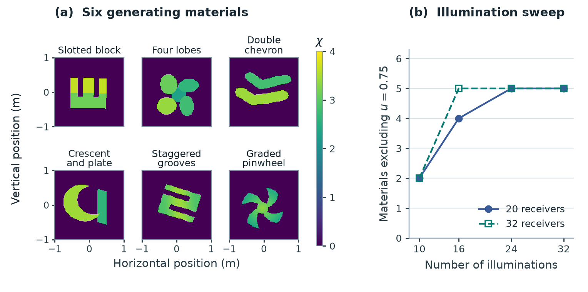
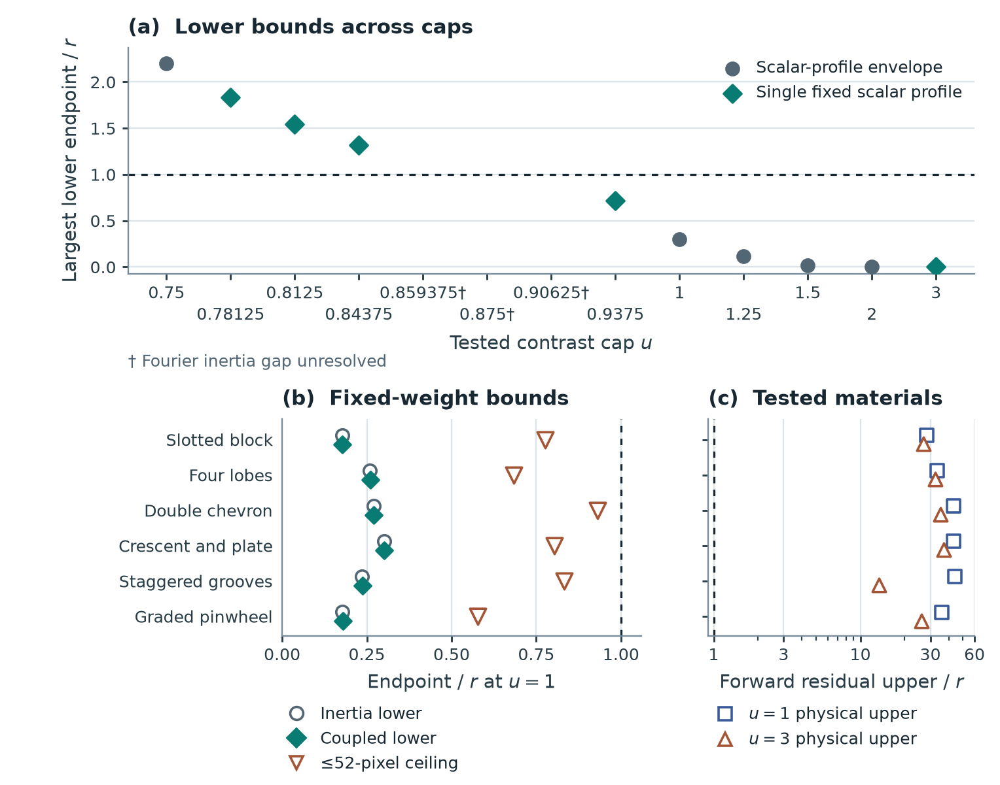
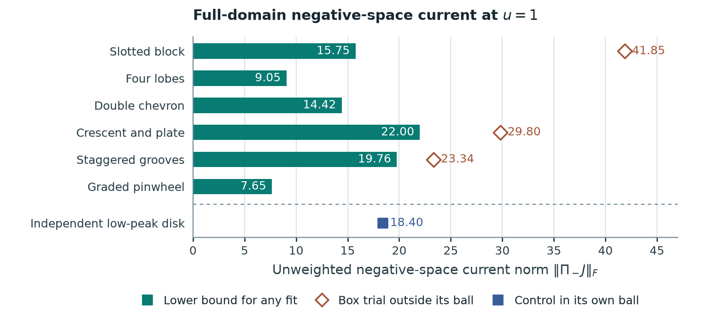
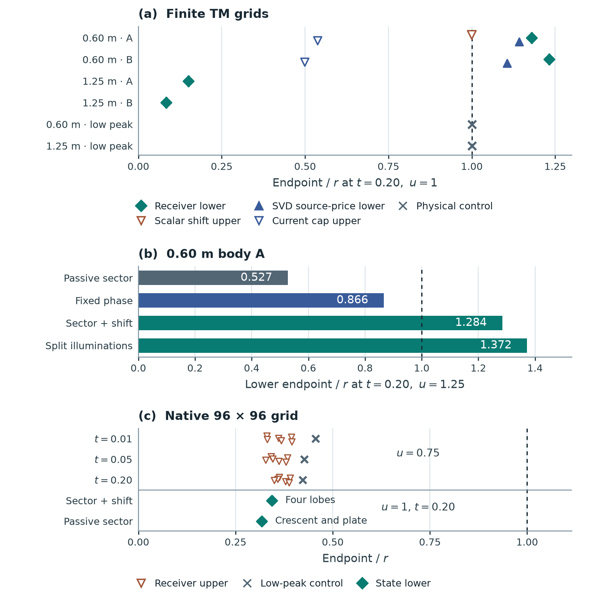

# 有限孔径散射数据能把材料峰值限定到哪里？

**在 400 MHz、2 米见方、96×96 个介电参数都未知的无损模型里，测到的场最远能证明一件物体的峰值对比度超过 0.84375。六件物体在上限 1 处全部未定。** 这个更细的数值来自对原下界在相邻上限的直接计算。新的局部本构公式提高了部分距离下界，幅度不足以改变这六件物体在上限 1 的判断。

不过，全波数据对这六件都强制给出了一条电流信息。如果确有某个峰值不超过 1 的材料能拟合读数，它必须在一组特定的 13 个电流方向上有可观的分量。各物体的最低需求从 7.65 到 22.00，单位是本实验固定发射能量下的离散电流幅值。把这组电流从反演空间完全删掉，会使六件物体都无法在这个材料盒内拟合到噪声以内。这个判断在不知道材料位置、也没有找到可行材料时仍能作出。

有损介质给出了另一项更干净的正结果。用相同有损全波数据、相同的耗散物理和噪声，整体给所有照明一个权重时，即使优化所有权重和相干源子空间，一件紧凑目标仍无法排除峰值不超过 1。允许不同相干照明各自取权重后，两件紧凑目标都能排除这个峰值上限。同样的方法回到 2 米大域时信息太少，严格找到了噪声以内的接收场外包点。

[英文论文](manuscript_ip.pdf) · [研究交接](handoff.html) · [可复现实验与原始数组](https://github.com/migodam/b1-probabilistic-maxwell-imaging/releases/tag/optical-inertia-unified)

## 一个材料假设如何被数据否定

对比度是相对介电常数减一。假设每个格点的对比度都在 0 到一个上限之间，让所有格点上的材料任意摆放。计算天线读数到这一整类材料所能产生的读数的最小距离。若严格下界大于联合噪声半径，至少有一个格点的对比度超过上限。判断不需要画出那一格的位置。

报告中用 \(d/r\) 表示距离下界除以噪声半径。这个比值超过 1 才能排除材料类。反方向有两种完全不同的证据。给出一份满足球内误差的合法材料，可以证明材料类确实可行。只找到一个能拟合的抽象电流或接收场，说明放宽后的物理约束允许这种解释；仍需检查它能否由某个材料产生。本文把这两种情况在表格中分开。

六件原生对象的 32 发 32 收观测以及误差半径均沿用已冻结的数据。发射按相同总入射能量归一，接收按相同角向积分归一；这六件都已在研究开发中见过。新有损试验则分别解复材料的完整散射问题，共享固定噪声方向，以每份读数自己对应的 2% 半径打分。四件新紧凑或中等大小的对象，以及六件已见实部形状，按材料计数；39 份有损读数包含三个配对低峰对照和三个损耗角。完整模型与噪声定义见[英文物理模型](model.tex)和[有损数据合同](numerics/loss/FREEZE.md)。

## 无损材料上限为什么卡在 1

对峰值上限和一组已知物理权重，取电流二次型 \(K\)。它有 \(\nu\) 个负方向时，原方法必须允许观测残差的源矩阵失去最大的 \(\nu\) 个特征值。局部材料律 \(j_i=x_i e_i\) 提供了进一步信息。要让某个负方向的电流真正存在，同一格的正方向电流也得配合，并且所有照明必须共享同一个实数 \(x_i\)。在缓解抵消时，还要把正、负电流相对于哪份测量决定的中心算进去。

这一思想在可精确求解的互易无源两单元例子中，将距离平方的下界从零提高到 \(127/48\)，相当于信号范数的 35.0802%。同一例子丢掉中心关联后仍然给零。这个例子证明公式有内容。在实际出射 Green 的 96² 下，我们用全盒约束单独检验它的作用。

| 同一原生读数，峰值上限 1 | 原固定权重距离下界 / 噪声 | 9,216 格本构修正后 | 任意至多 52 格方法所能给出的上限 | 已检查材料的残差上端 / 噪声 |
| --- | ---: | ---: | ---: | ---: |
| 开槽块 | 0.17833 | 0.17839 | 0.77551 | 28.330 |
| 四叶体 | 0.25949 | 0.25957 | 0.68392 | 33.363 |
| 双折角 | 0.27019 | 0.27035 | 0.93030 | 43.231 |
| 月牙与薄板 | 0.30105 | 0.30115 | 0.80274 | 43.154 |
| 错列沟槽 | 0.23632 | 0.23640 | 0.83274 | 44.094 |
| 渐变风车 | 0.17837 | 0.17850 | 0.57643 | 35.752 |

左边两栏需高于 1 才能排除物体。第三栏针对同一固定 \(K\)、非负逐格权重及任意符号的源中心矩阵，给出了这整族方法能做到的最好可能结果的严格上界。第四栏来自真实、合法、经全波正演复核的候选，其残差下端也在球外。球外候选的存在不能排除整个材料类。[完整补偿与谱](numerics/native/README.md) · [物理可行性实验](numerics/feasibility/README.md)

在该固定 \(K\) 下有 13 个负方向。逐格权重任取至多 29 格，一个负方向也不能在全材料盒上统一补回。任取至多 59 格最多补回一个。这里的格数依赖当前 96² 网格与固定物理权重。对选定的 208、416 格，可补回数的严格上界依次为三、四。若源中心只允许做非负扣减，即使扣减为零六件也分别至少需要补回七、五、五、五、五、七个。允许源中心正负兼有时，在 59 格仍可证明六件的所有上端都低于 0.97803 倍半径。对全部 9,216 格的对角框架，可补回至多八个。这个上界仍容许在更大的格点集合上找到有用的有符号中心。又从正空间中单列 2、4 或 8 个弱模，尝试放宽其余模式的功率限制。对本次划分与统一 Young 上包，最多只能补回 2、2、3 个负方向；非负中心扣减至少需要五个。表中观察到的是该方法族的能力边界，材料本身最低能有多弱仍未确定。

我们还试了一个直接使用全部格点的算法。先保留中心电流在每个格点违反实数材料定律的量，再逐个照明方向估计这些量留下的源响应。它对六件都给出严格的小幅提升；提高本构项的权重，又会带来更多负方向，抵消刚刚得到的收益。另一种低成本处理对不同合法权重留下的每个源谱分量分别取最大值。在上限 1，表现最好的月牙与薄板从单权重 0.301055 提高到 0.306046 左右，仍远低于 1。全像素修正和跨权重取源谱是两种不同计算。[原生全域计算](numerics/source/u100_best_strict_source.json) · [跨权重谱结果](numerics/source/spectral_envelope.json)

改动空间权重后，距离可以再提高一些。把正方形均分成十六块，只把外围十二块的实部权重提高到 1.5 或 2.5 倍，材料仍可在任一格自由取值。9,216 维算子的负方向从 13 个降到 11、8 个，六件中最强的严格距离下端分别达到 0.31134 和 0.32376 倍半径，仍未排除上限 1。沿用原来 13 维投影去算新权重，会在第二个权重下把八个方向错数成五个。即使用完整源矩阵，只替换成这个错误数目，也会在五件上算出越线。这解释了为什么直接截断原电流子空间会把结果判断反。[两组原生正负谱与六件距离](numerics/source/edge_symmetry_verified.json)

## 数据要求保留哪些电流

对 \(K\) 的负空间做正交投影，直接测量实际物理电流的投影幅值。它和接收器的零空间不同，也和“实际电流减去代数中心后的长度”不同。我们先只消去正电流，再根据测量误差反推必需的负空间电流。对每件有潜在可行材料的读数，得到如下条件结论。

| 开槽块 | 四叶体 | 双折角 | 月牙与薄板 | 错列沟槽 | 渐变风车 |
| ---: | ---: | ---: | ---: | ---: | ---: |
| >15.75 | >9.05 | >14.42 | >22.00 | >19.76 | >7.65 |

这给出了反演降维的一条可用判据。针对这些读数和上限 1，SOM、CIE 或其他反演程序若强制这部分电流为零，就排除了每一个潜在的合法解。它没有证明换一组电流基就能恢复正确图像。原生格上的独立低峰圆盘确实能在自己的噪声球里产生 18.39956 左右的这种电流；另有一份峰值不超过 1 的物理候选可产生超过 41.85 的幅值，虽然它拟合不了开槽块的测量。把所有材料的电流幅值统一截断在 22，已经会删掉合法材料。[条件电流界](numerics/native/required_currents.json) · [物理电流对照](numerics/feasibility/hidden_current.json)

## 最高能排除多大的峰值

- **2 米无损大域的六件 96² 对象。** 固定总入射能量、32 发 32 收、2% 噪声。在试过的上限里，0.78125 有五件，0.8125 有三件，0.84375 有一件（月牙与薄板）。0.84375 对应至少一处相对介电常数超过 1.84375。数值更细主要来自沿用原方法加密上限取样。部分中间值的谱隙未能包住，记录为未定。没有把相邻上限之间的插值当结论。[原生门槛扫描](numerics/source/cap_resolution_transition.json)
- **另一个电尺寸更小的 24² 环形问题。** 12 发 48 收、1% 噪声，原有方法能对七件中的五件证明峰值超过 5。另有一件明明有峰值 4.28 的合法材料可解释读数，正确结论就是保留它。把 5 搬到 2 米大域会给出错误印象。[历史原稿](../ip_submission_v3/manuscript_ip.pdf)
- **低估峰值的正演对照。** 我们对六件都尝试了 \(u=1,3\)，对两件另试了 1.25、1.5、2。共十八个材料与上限配对的入选候选都用原生算子和独立单侧误差核验，最小的候选残差上端仍为 13.408 倍半径。独立生成的低峰圆盘则以 0.999950 倍半径通过 \(u=0.75\) 的完整物理核验。两种算法输出相反结论时以各自实际证明的对象为准。[逐案数据](numerics/feasibility/upper_endpoints.csv)

## 相干照明为什么能在有损介质中起作用

已知每格材料 \(\chi=(1+\mathrm it)x\)，真空允许，\(0\le x\le u\) 时，活动格的耗散系数为 \(\operatorname{Im}\chi/|\chi|^2\)，下界是 \(t/[(1+t^2)u]\)。由功率平衡得到所有可能接收场的矩阵椭球。每个相干照明方向都要产生相容的场。压成一个公共权重，会丢掉不同方向需要不同惩罚强度的信息。可以直接求到椭球的距离，也可以先在数据的右奇异向量上确定方向，每个方向只解一个单调的一维方程。

| 同一读数与耗散信息 | 0.6 米第一件，上限 1，\(t=0.2\) | 0.6 米第二件，同合同 |
| --- | ---: | ---: |
| 接收椭球的距离下端 / 半径 | 1.17917 | 1.23174 |
| 直接在数据右奇异源方向分别取权重，下端 | 1.14159 | 1.10601 |
| 共同权重源矩阵的特征方向分别取权重，下端 | 1.16425 | 1.22075 |
| 所有共用一个权重、已优化相干源子空间的上端 | 0.99873 | 未作全参数上包 |

这项分离的价值在同合同对照。第一件的半径为 0.05609216。同一耗散等式推出的全部公共标量权重，即使挑选最有利的源子空间，也严格过不了线。右奇异基的数值提案在该例用 0.88 毫秒 CPU 时间，共用的物理算子准备和严格验算另计。加入另一条独立的实部材料约束还能提供额外信息，在这件物体上排除实部峰值不超过 1.25，距离超过 1.28439 倍半径；这已属于不同的约束组合。在较弱损耗 \(t=0.05\)、上限 0.75 的第一件上，92 段区间覆盖了所有公共权重，距离严格小于 0.80975 倍半径；逐照明权重大于 1.01323 倍，完整椭球大于 1.02003 倍。第二件同条件下连椭球距离的上端也低于 0.94901 倍。对包含无损活动单元的更广材料类，正耗散下界一般为零。[全部有损比较](numerics/loss/REPORT_ZH.md)

还可以同时使用两种物理信息。将十束照明换到一个正交相干基，在一组方向上分别计入耗散，在剩余方向上联合使用材料扇区和惯性。第一件紧凑物体在上限 1.25 时，椭球距离上端仅为 0.66362 倍半径，全源使用同一套材料扇区权重给出 1.28439 倍；按方向分工后下界为 1.37213 倍。再单独优化扇区权重，配对结果为 1.51977 和 1.59135 倍。到上限 1.5，第一件分组不如完整接收椭球，第二件优于两端，但两件都没过线。这次实算在十个相干方向上枚举子集，主计算与区间判定耗时 10.30 秒，独立复核正谱间隙另用 0.54 秒，共 10.84 秒墙钟、10.38 秒 CPU。照搬到 32 束会有指数代价。[严格配对数值](numerics/loss/source_partition.json)

大域上，最紧的 0.75 材料盒投影到接收空间后，六件读数在 \(t=0.01,0.05,0.2\) 时都存在不到 0.395 倍半径的椭球点。盒嵌套使这个反例覆盖本次所有更宽的上限。计算精度再高也不能让**仅靠这个椭球**的方法排除这些数据。材料是否可行仍需额外的点态本构信息。[原生接收场上端](numerics/loss/native_verified.json)

## 论文的主张、先例与边界

原稿的有限孔径漏辐射、同能量增加入射角、多照明比单一相干照明得到更强下界，与新的局部材料补偿、负空间所需电流以及有损耗散都回答同一个问题。所有工作在复接收场的同一误差度量里，只改变明确列出的材料类或测量条件。一套几何表给出电尺寸，三类物理计算共用同一个接收误差含义。区域定位、两频叠加、另外 22 件大域材料、7 件环形材料及两所微波暗室的结果都在正文的相应物理比较中出现。原稿和冻结数据保留供追溯。[上一版交接](../ip_submission_v3/handoff.html)

**原创性最强的部分**是能检验的严格分离和反例。给定真实 Green 和观测，既能算出局部材料约束能保住哪些源信息，又能证明全体某类局部选择在这些数据上均做不到目标；给定同一有损信息，能证明逐源权重和全部公共权重在排除同一材料盒上给出不同结论。源空间交错、压缩椭球、凸对偶和连续 Weyl 公式分别有成熟先例。本文用它们导出具体的物理判定；不主张发明这些数学工具。[命题级文献对照](PRIOR_ART.md)

**留在内部材料里的内容**包括失败的求解器、最初不正交的重根特征基、逐项耗时、更多浮点权重、全部中心与反例数组。重正交把错误投影修正后才采用该批行 Gram。22 件迁移、四分区单源比较与暗室是继承证据，新补偿、独立源权重、物理上端、电流必要量和对应反例是本轮实算。内部没有把独立物体数乘上频率、噪声、源数或拟合路径数。[实验与费用](numerics/COSTS.md) · [复现入口](REPRODUCE.md)

**投稿判断。** 这篇工作有足够明确的数学问题、证明、物理全波分离例和能推翻更强主张的反例，值得向 *Inverse Problems* 投稿，定位为材料可辨识性与物理方法能力界。作为高维成像算法，仍缺少恢复准确度和成本均有独立收益的证据。作为连续体定量结果，Weyl 渐近要求区域、频率和紧扰动固定，有限网格排除还缺对整类连续材料通用的正演误差界。Fresnel 的九个实测视图在 0.5 上都未越过独立空场误差口径；Manitoba 尼龙圆柱在 3 GHz、被动扇区上限 1 留出 4.018% 的进一步模型误差空间。实际加载时的误差能否小到这个程度，两个暗室的数据都没有证明。[科学交接](NEXT_PRO_HANDOFF.md) · [独立意见及回应](reviews/RESPONSE_ZH.md)

