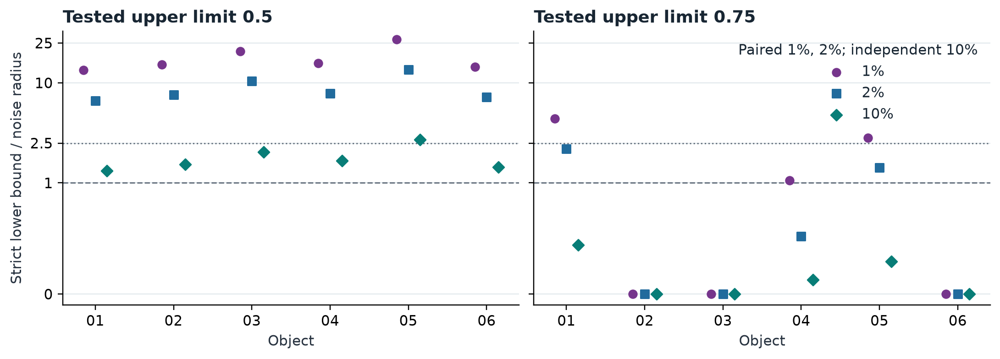
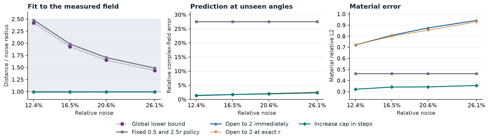
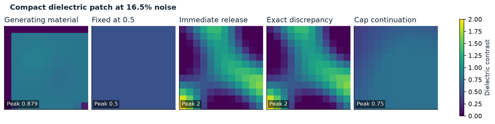

# What ruling out low contrast changes in an inversion

**The original full-ring data rule out contrast at or below 0.5 on all six objects before inversion.** On the cases where the lower bound still permits a near-noise low-cap image, our bounded full-wave fits remain too far from the data to test a subtle failure. A prospective electrically compact simulation supplies that missing example. It shows that ruling out the whole low-contrast class changes the action of a lenient residual rule. It also shows that releasing the contrast cap broadly can improve unseen-field predictions while making the material image worse.

## Full ring before inversion

The tested class is every real material with 0 ≤ χᵢ ≤ u on the 96 × 96 grid. If the lower bound dᵤ on the minimum full-wave residual exceeds the data error radius r, the complex measurements rule out every material in the class. This evaluation needs only geometry, complex data, and the radius. A zero lower bound leaves the class undecided. A bound above 2.5r also rules out a physically consistent low-cap image with residual in [r, 2.5r].

The original 400 MHz, 2 m square has 10 plane waves and 20 receivers on a 3.75 m full ring. The 2% and independent 10% readings are the original acquisitions. The paired 1% reading halves the original 2% increment in the complex field. The six independent objects contribute 18 field readings under these paired conditions. The original padded radii and original 2% complex arrays match the saved values exactly.

| Upper limit | At 1% | At 2% | At independent 10% |
|---|---:|---:|---:|
| 0.50 | 6/6, lower bound 13.40–27.07r | 6/6, 6.62–13.57r | 6/6, 1.32–2.71r |
| 0.75 | 3/6, objects 01, 04, 05 | 2/6, objects 01, 05 | 0/6 |

Both the shared six-profile reapplication and the strongest archived outward bounds give these exclusion counts. The cap-0.5 excluded class is also ruled out by a single optimal coherent combination computed from the same multi-illumination data in these 18 readings. The result at cap 0.75 is the joint test over all original illuminations. The selected strongest lower bound sometimes comes from an archived data-specific weight. [Exact inputs, profiles, lower bounds, and timing](original_gate.json)



The measurements enter only a small source-space interval calculation once the state proof and the stationary response to fixed receiver and incident bases are available. On Apple M4, the per-profile median was 0.906–1.061 ms and the median for all six was 5.894 ms per reading. Rebuilding stationary responses shared across readings cost 57.54 s across six profiles, with profile times of 9.08–10.53 s. Recovering the measured negative gaps for the three indefinite profiles cost another 3.84 s in total. The full shared replay ran in 61.64 s including source checks. The earlier outward state proofs associated with these profiles took 1.33–34.75 s per profile on the recorded runs. Those historical costs are separate from the present replay, and some include work beyond the state gap. The millisecond number describes a loaded cache. [Component timings and arithmetic work](original_gate.json)

The conclusion is about the full-wave map F(χ) on a specified material class. Fitting the distinct Born map S diag(χ) B is a separate inference problem. An independent comparison at the six reference materials gives a Born versus full-wave field mismatch of 4.07–6.61 times the full-wave clean field norm. The reference-matched test measures the error of the Born approximation at those materials. A best-fit claim over a full Born class requires a separate fit or bound.

## Looking for a low-cap fit near the original noise balls

Fifteen of the 23 strict object–noise–cap exclusions already give dᵤ > 2.5r. The remaining eight passed the predeclared search eligibility rule. Each strategy starts from zero, uses bilinear material fields with 16, 32, and 48 update nodes per side, and evaluates every gradient and accepted candidate through the original 96 × 96 full-wave and adjoint equations. The three fixed-stage budgets are 20, 30, and 44 objective calls with the same spatial penalty. The predictor chooses fitted maps with complex data and the public conditions. All eight final low-cap fits stay beyond 2.5r. Searching less restricted representations or additional initializations could improve those results. [Search protocol and frozen selection](PROTOCOL.md)

| Object and noise | Cap | Strict lower bound / r | Fixed low / r | Release before inversion / r | Release after first stage / r |
|---|---:|---:|---:|---:|---:|
| 01, 2% | .75 | 2.200 | 31.196 | 28.733 | 28.731 |
| 04, 1% | .75 | 1.061 | 82.477 | 74.093 | 70.615 |
| 05, 2% | .75 | 1.417 | 46.016 | 45.186 | 40.751 |
| 01, 10% | .50 | 1.325 | 6.778 | 5.808 | 5.807 |
| 02, 10% | .50 | 1.527 | 7.375 | 5.951 | 5.824 |
| 03, 10% | .50 | 2.043 | 9.338 | 7.048 | 7.088 |
| 04, 10% | .50 | 1.663 | 8.758 | 7.041 | 7.004 |
| 06, 10% | .50 | 1.436 | 8.544 | 5.843 | 6.703 |

Independent numerical state re-solves used a per-source relative state tolerance of 10⁻¹⁰. The ordinary first-stage residual exceeded 2.5r on all eight cases, so rules at r and 2.5r took the identical delayed release branch. Starting with the broad cap and releasing it before the first objective call produce the identical immediate branch. Both use cap 4. All branches spent 94 objective calls, with different Krylov and FFT costs because the trial materials differed. Across original cases, each distinct branch spent 20.6–68.6 wall-seconds under concurrent workloads, with 18,526–50,958 FFT columns. Use the per-branch process CPU and operations for more detailed comparisons. [Raw physical paths](original_fits/) · [Material and held-out scores](original_offline_scores.json)

In these failed inversions, opening the cap reduces prediction error on simulated held-out transmit and receive angles in all eight comparisons against fixed low. Only one of eight immediate paths improves material relative L2. The whole-column relative L2 errors remain 0.89–1.02. The residual identifies a poor fit long before the end of these runs.

## A controlled compact target yields a near-noise false image

We generated one new rounded dielectric patch in a (lambda/6) square, with ka = 0.7405, using the same 400 MHz scalar-TM convention and 10×20 ring sampling. Its mean contrast is 0.654 and its peak 0.879. The receiver radius is 0.375 m and the stored physical model has 144 freely varying cells. The design uses the noiseless field difference from a uniform square at contrast 0.5 as its noise scale. This known material landmark and the random noise direction were fixed before any inversion. The four radii give 12.38%, 16.50%, 20.63% and 26.13% relative noise. The continuation and main solver see just the public measurements, geometry and their declared radii. These are four conditions on one constructed object. [Prospective design](SYNTHETIC_DESIGN.md) · [Generation and reference audit](compact_synthetic/offline_truth/generation.json)

| Noise | Global lower bound / r | Fixed 0.5 / 2.5r rule | Release to 2 before inversion | Release to 2 at first-stage r | Bounded continuation |
|---|---:|---:|---:|---:|---:|
| 12.38% | 2.4221 | 2.4809 | .9906 | .9906 | .9965 |
| 16.50% | 1.9304 | 1.9850 | .9913 | .9913 | .9962 |
| 20.63% | 1.6529 | 1.7052 | .9918 | .9919 | .9958 |
| 26.13% | 1.4372 | 1.4868 | .9924 | .9924 | .9958 |

The last four columns report the actual full-wave residual divided by r with outward verification. The fixed low fit settles at the legal uniform square, which the 2.5r rule keeps. The global lower bound is only 0.050–0.059r below these particular fit residuals. It establishes that no arbitrary rearrangement within the full low class can enter the ball. All four cases also cross r with the best coherent direction under the tested weights. The example demonstrates the decision value of a global exclusion under the stated lenient tolerance and finite model. [Lower-bound trials](compact_synthetic/gate.json) · [Independent point checks and scores](compact_synthetic/offline_scores.json)



An immediate broad release fits strictly within r on all four conditions. Held-out complex-field error drops from 27.50% to 1.32–2.52%. The material result moves in the other direction. Relative L2 rises from 0.462 to 0.721–0.943. Interior relative L2 rises from 0.368 to 0.571–0.755 and background RMS rises from 0.500 to 0.788–1.013. The reconstruction peaks at 1.85–2.00. The observed field constrains the dominant spatial response more strongly than fine material variation in this compact target. The leading singular mode of the realified Born map carries 83.7% of its squared singular-value energy, a linear diagnostic consistent with this explanation. [Stored linear spectrum](compact_synthetic/offline_truth/linear_diagnostic.json)

Both primary arms had the same 94-call budget. The fixed-low solver converged after six calls. At the same six-call checkpoint, the released path already reached 1.000–1.022r with peak 0.862–0.865, lower material error 0.315–0.317 and held-out error 3.69–4.17%. Only the largest-noise reading is strictly within r at that checkpoint. The additional broad-cap work improves the field fit while increasing material error on this object. A replay using exactly r releases all four first-stage low maps and reaches almost the same held-out and material errors as immediate broad release. The class test changes the timing of release relative to exact discrepancy and proves a statement about the entire material class.



## Incremental release on the exposed compact object

The diagnostic continuation tests caps 0.50, 0.60, 0.75, 1, 1.25, and 2 with the same 9 × 9 update grid, spatial penalty, total budget and exact point-discrepancy test. The data-based version skips 0.50. Both first enter the ball at 0.75 and give bitwise identical 144-cell maps. They use 19 and 22 objective calls respectively. Fits at 0.60 reach 1.119–1.437r. The least feasible cap found by this path is 0.75. The 0.60 branch gives a point residual and leaves the minimum over that class unresolved. [Replay design](COMPACT_FOLLOWUP.md) · [Sealed map scores](compact_synthetic/exposed_followup/offline_scores.json)

At cap 0.75 the material relative L2 is 0.322–0.355 and interior relative L2 is 0.170–0.175. Compared with the fixed cap, held-out error improves to 1.42–2.32% and the peak is closer to the generating value. Background RMS spans 0.489–0.554, improving on one condition and worsening on three. The class-guided and ordinary continuation paths yield the same material improvement. Cold six-weight interval computation costs 0.70–0.74 s per reading in this compact implementation. The ordinary continuation costs 0.33–0.40 s, and the guided path excluding the class calculation costs 0.24–0.27 s, all including interval point audits. Skipping the first cap saves three objective calls and one point audit. Charging the cold class test erases the measured time saving on the compact problem.

## Reproduction

From the Inv_SLAM root use Python with NumPy, SciPy, python-flint, threadpoolctl, and Matplotlib. The first three commands replay the original fields and predictions. The next three work on the separately designed compact object and plots. The trusted inputs are the stored native synthetic acquisition and the archived profile receipts. Numerical fit receipts include all attempted objective calls and stopping reasons.

```sh
py=.artifacts/z_alg_diag_python/bin/python
work=research/z_alg_optical_inertia/physical_revision/inversion
"$py" -B "$work/gate.py"
"$py" -B "$work/fit.py"
"$py" -B "$work/score_original.py"
"$py" -B "$work/compact.py"
"$py" -B "$work/compact_followup.py"
"$py" -B "$work/plot.py"
```
