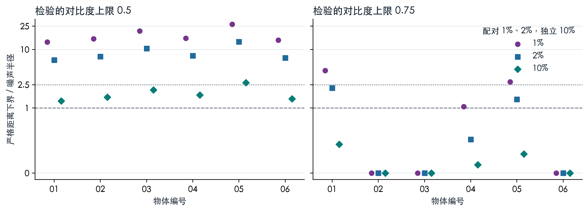
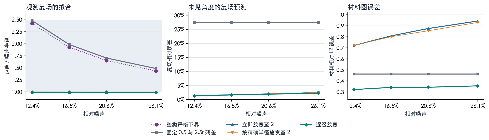
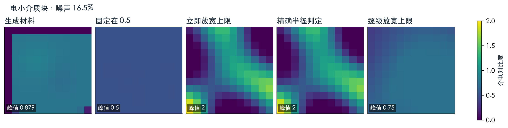

# 带噪数据排除低对比度后，反演会怎样变

**原始全环六件物体的观测在反演前都排除了峰值不超过 0.5 的材料。** 有八个原始条件的严格下界没有超过 2.5 倍噪声半径，可以尝试寻找残差接近噪声球的低峰值图。八条原生反演都没有找到。另行冻结的一件电小介质模拟目标确实给出了四个边界例子。数据排除整个低峰值类后，直接大幅放宽上限能改善未见端口预测，却让材料图变差。逐级放宽改善了两者，按精确残差半径逐级放宽也找到了同一组图。

## 原始全环数据给出的反演前判决

给定 96 × 96 无损标量 TM 模型，检验域内所有像素均满足 0 ≤ χ ≤ u 的材料类。令 r 为已声明的复数据误差半径，dᵤ 为此类材料到观测数据的全波距离下界。只要 dᵤ > r，就排除了所有同样低峰值的形状。正下界超过 2.5r 时，该类也不可能出现残差位于 r 到 2.5r 的自洽图。这个判决只需要已知算子、复数据与半径。

| 检验上限 | 1% 配对观测 | 2% 原始观测 | 10% 独立原始观测 |
|---|---:|---:|---:|
| 0.50 | 6/6，最强下界为 13.40–27.07r | 6/6，6.62–13.57r | 6/6，1.32–2.71r |
| 0.75 | 3/6，01、04、05 | 2/6，01、05 | 0/6 |

400 MHz、2 m 方域、10 束平面波，20 个接收点在半径 3.75 m 的全环上。各噪声档沿用原包络半径，1% 复场由已存 2% 噪声增量减半得到。2% 复场逐值等于原样本。统计单位是六件独立材料，同一材料的三档噪声为配对条件。复用六套固定参数的当轮复算与旧稿挑选出的更强下界给出相同过线个数。0.50 上的 18 个判决在同一多照明输入上也可由一份选出的相干组合给出。 [固定参数与原始读数复算](original_gate.json)

M4 上共享状态资料载入后，每套权重的在线区间源检验中位数为 0.906–1.061 毫秒。六套全查每份读数中位数为 5.894 毫秒。重建可复用的驻点响应需要 57.54 秒，三套不定权重另花 3.84 秒核定负谱间隔。全批约 61.64 秒。各权重既有的状态证明回执另计，各为 1.33–34.75 秒，部分回执还包括状态证明之外的工作。毫秒计时从已有缓存后的复数据检验开始。 [分步计时与实际工作量](original_gate.json)

全波峰值方盒和 Born 线性类需要独立检验，两者使用不同的前向映射。在六件原始物体的生成材料上，原生 Born 单次散射场相对全波干净场的误差为 4.07–6.61 倍。这个数回答已知材料上单次散射造成多大误差。另一个材料能否在线性模型下拟合这批数据，要用其对应材料类的下界或拟合来回答。 [生成材料与全波复算](original_offline_scores.json)

## 原始八个边界候选仍属于明显欠拟合

36 个物体、噪声档、检验上限的组合中有 23 个严格排除，其中 15 个的严格下界已高于 2.5r。余下八个配对条件全做了有界优化。更新图在 16、32、48 边长的双线性节点上逐步细化，任何试探点和梯度都用原生 96² 的全波和伴随状态，三阶段分别给 20、30、44 次目标调用。不使用真值、已知支撑或留出端口来选图。终点从零重新求解全波状态，逐源相对状态缺陷小于 10⁻¹⁰。 [预定比较条件](PROTOCOL.md)

| 物体、噪声 | 上限 | 严格下界/r | 固定低上限残差/r | 立即放宽残差/r | 首阶段后放宽残差/r |
|---|---:|---:|---:|---:|---:|
| 01，2% | 0.75 | 2.200 | 31.196 | 28.733 | 28.731 |
| 04，1% | 0.75 | 1.061 | 82.477 | 74.093 | 70.615 |
| 05，2% | 0.75 | 1.417 | 46.016 | 45.186 | 40.751 |
| 01，10% | 0.50 | 1.325 | 6.778 | 5.808 | 5.807 |
| 02，10% | 0.50 | 1.527 | 7.375 | 5.951 | 5.824 |
| 03，10% | 0.50 | 2.043 | 9.338 | 7.048 | 7.088 |
| 04，10% | 0.50 | 1.663 | 8.758 | 7.041 | 7.004 |
| 06，10% | 0.50 | 1.436 | 8.544 | 5.843 | 6.703 |

首阶段的最小残差全超过 2.5r。常规残差采用 r 或 2.5r，均触发相同的延后放宽路径。一开始就用广上限 4 的路径，与数据排除后立即放宽至 4 逐步相同。以上分支均用了 94 次目标调用。不同图的状态求解需要 18,526–50,958 个 FFT 列，分支实付约 20.6–68.6 秒，含并行运行时竞争。立即放宽在八个条件都降低了未用方向端口的复场误差，材料全图误差仅一项下降。固定低上限时，没有得到符合本轮残差窗口的图。这个结果只界定这次有限搜索的表现。 [每步数值、停机及费用](original_fits/) · [真值与新模拟的留出方向评分](original_offline_scores.json)

## 电小目标可以产生残差近球、峰值错误的图

另定义一件带薄空气边缘和小幅内部起伏的介质片。400 MHz 下方域边长为波长的 1/6，包围圆电尺寸 ka = 0.7405。真实平均对比度 0.654，峰值 0.879。全波模型有 144 个可独立取值的材料单元。训练仍为全环 10 发 20 收，另将收发角各错开半个角间距作为留出。设计时先计算生成材料与全域均匀 0.5 材料之间的干净复场差，把其 45%、60%、75%、95% 作为四次预定噪声强度，方向在拟合前固定。这个受控构造使用生成材料设定噪声标度。优化器只读公开数据、算子和半径。四次属于同一仿真目标的配对条件。 [冻结设计](SYNTHETIC_DESIGN.md) · [噪声和全波生成回执](compact_synthetic/offline_truth/generation.json)

| 相对噪声 | 整类严格下界/r | 固定 0.5／2.5r 判定 | 立即放宽至 2 | 按 r 放宽至 2 | 逐级放宽 |
|---|---:|---:|---:|---:|---:|
| 12.38% | 2.4221 | 2.4809 | 0.9906 | 0.9906 | 0.9965 |
| 16.50% | 1.9304 | 1.9850 | 0.9913 | 0.9913 | 0.9962 |
| 20.63% | 1.6529 | 1.7052 | 0.9918 | 0.9919 | 0.9958 |
| 26.13% | 1.4372 | 1.4868 | 0.9924 | 0.9924 | 0.9958 |

表中后四列为逐图复核后的实际全波残差除以半径。固定低上限收敛到峰值 0.5 的均匀图，四次残差均在 1–2.5r 内，采用 2.5r 的试验规则会保留它。每个严格下界都超过 r，距离当前图的残差只差 0.050–0.059r。因此原方域内怎么重排这一上限的材料都进不了噪声球。该四档在选出的相干照明组合上也过线。按精确 r 判定的常规残差规则四次都会释放。 [整类下界](compact_synthetic/gate.json) · [逐图全波区间复核](compact_synthetic/offline_scores.json)

立即放宽到 2 后，留出复场误差从 27.50% 降到 1.32–2.52%，材料相对 L2 由 0.462 升至 0.721–0.943。内部相对 L2 由 0.368 升到 0.571–0.755，背景均方根误差由 0.500 升到 0.788–1.013，预测峰值 1.85–2.00。直接放宽会给弱约束的空间变化留下很大自由。作为线性诊断，实数化 Born 矩阵的第一奇异值占平方奇异值总和 83.7%。同样按 94 次调用封顶，固定低上限六次便结束。只看立即放宽的前六次，实际残差 1.000–1.022r，峰值 0.862–0.865，材料误差 0.315–0.317，留出误差 3.69–4.17%，只有最高噪声档已严格进球。继续把广上限路径跑到终点会继续减小复场误差，同时增加材料误差。 [主比较与等调用数复算](compact_synthetic/exposed_followup/offline_scores.json) · [线性矩阵谱](compact_synthetic/offline_truth/linear_diagnostic.json)

## 曝光后诊断显示逐级放宽的作用

逐级试 0.50、0.60、0.75、1、1.25、2，沿用同一 9 × 9 更新图、空间正则、每级 16 次与总计 96 次目标调用上限。数据排除的版本跳过 0.50，常规版本先在 0.50 拟合并核对实际残差。两种路径在 0.75 首次进球，四档逐像素得到相同的材料图，分别共用 19 和 22 次目标调用。0.60 的已算材料停在 1.119–1.437r，整个 0.60 材料类的最小距离仍未确定。 [冻结回放与比较判定](COMPACT_FOLLOWUP.md) · [逐例封存评分](compact_synthetic/exposed_followup/offline_scores.json)

相对固定上限图，逐级法的全图 L2 降到 0.322–0.355，内部 L2 降到 0.170–0.175，留出复场误差降到 1.42–2.32%，峰值 0.75 比 0.50 更接近真实的 0.879。背景误差一项降低，三项提高，范围 0.489–0.554。材料改善在两种逐级路径上完全重合。严格排除省掉 0.50 处的三次目标调用和一次逐图核验。冷态的六权重类排除每档约 0.70–0.74 秒，超过此小问题的常规逐级全流程 0.33–0.40 秒。这一受控算例证明了类排除与残差容忍带的区别，并给出一次可核实的阶段跳过，未显示净加速或独立的材料恢复收益。

[英文报告与复算命令](RESULTS_EN.md)
