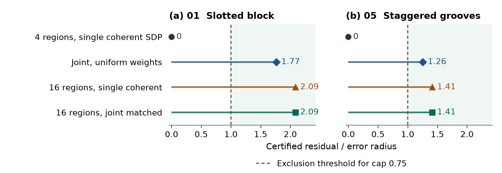
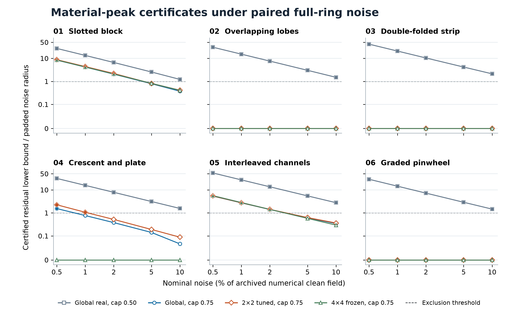

# 从散射读数能证明材料有多强？

**同一组微波读数，即使还画不出可靠的材料图，也能证明“至少有一个位置的介电对比度超过 0.75”。** 对比度是相对介电常数减一。在开槽块和错列沟槽两件物体上，用十束照明一起计算，可以排除所有峰值不超过 0.75 的材料。如果先把读数合成一束，在整个成像区、甚至在四个分区内分别施加物理约束，单束检验仍能找到零残差的解释。细分到十六区，单束检验也排除了这两件物体的低峰值解释。两种方法的差别由此有了明确的边界。

[英文论文 PDF](manuscript_ip.pdf) · [给 ChatGPT 的研究交接](NEXT_PRO_HANDOFF.md) · [LaTeX 源包](https://github.com/migodam/b1-probabilistic-maxwell-imaging/releases/download/z-alg-optical-inertia-submission-20261122/Z_ALG_Optical_Inertia_LaTeX_2026-11-22.zip) · [完整科研附件](https://github.com/migodam/b1-probabilistic-maxwell-imaging/releases/download/z-alg-optical-inertia-submission-20261122/Z_ALG_Optical_Inertia_Submission_2026-11-22.zip)

## 单束与多束，究竟差在哪？

发射十束已知的平面波，每束在二十个接收位置测复散射场，得到 200 个复数。如果只取其中一束相干组合，接收器看不见的内部电流可以改变材料与波之间的能量交换，同时把接收读数完全保留下来。对于相同材料，十次实验中的电流又必须共同满足材料定律。单独为每束寻找解释，可能得到十个互不相容的解释。这给了联合检验排除整个低对比材料范围的机会。

本次所有比较都用同一套 96 × 96 完整二维 TM 算子、同一份含噪场和同一个误差球，全部 9,216 个材料格点均可独立变化。“单束”允许先看这 200 个复数，再选它们的任意单位复系数组合。因此本研究比较的是已有测量能怎样被利用，曝光数始终相同。

| 全环，2% 噪声，检验峰值 0.75 | 01 开槽块 | 05 错列沟槽 |
|---|---:|---:|
| 数据允许的误差半径 | 0.090968 | 0.088026 |
| 单束、全域两条物理律同时施加，最小残差 | 严格等于 0 | 严格等于 0 |
| 单束、四区各自施加两条约束，半定松弛最小残差 | 严格等于 0 | 严格等于 0 |
| 十束联合、同一组全局常权，严格残差下界 | 0.160698 | 0.110607 |
| 单束、十六区独立权重，严格残差下界 | 0.189674 | 0.124521 |
| 十束联合、沿用上一行同一组权重 | 与单束相等 | 与单束相等 |

当严格下界高于误差半径，允许范围内的任何材料排列都解释不了这份读数。全域单束零残差还有一个更强的证明。对每个相干照明，可以显式构造**同一个电流**，同时满足全局实部约束和精确光学定理，并保持端口读数完全相同。英文正文 §3 给出了这个构造，也在两条约束同时施加的凸问题中直接验证了 Slater 条件。四区的零残差证明用到了电流的二阶矩，其对应的单一确定电流是否存在仍然开放。十六区两次通过所用权重分别只有一个正的照明方向。对这些权重，原来十束照明各自的检验值均为零，合成照明才取得图中的正值。[单束严格对照、区间结果及计时](single/REPORT_ZH.md)

常权十束联合的同一个 645 阶区间证明可以给两件物体复用，固定权重的这部分花了 **6.61 秒**。十六区单束两件分别验证 1,478 阶矩阵，需要 **69.44 秒**；计入权重搜索和原生网格筛选是 **91.93 秒**；再计入此前未能让 05 过线的对称权重试算，合计 **158.22 秒**。旧全局搜索花 64.44 秒，覆盖 2,832 项，不能把这笔共享搜索成本全算给或全免给两件物体。0.75 这个材料结论两条路线都能得到。本次没有求出所有十六区权重上的全局最优值。[计算费用明细](single/REPORT_ZH.md)

## 这六件物体在五档噪声下，界能推多高？

沿用上轮固定的六件物体，分别缩放各自原来的全环 2% 噪声方向。每一档都用独立的全波区间计算确认真材料处在误差球内。五档是同一批材料的配对条件，独立物体总数为六。下表为原生 96² 全环的严格结果。

| 噪声 | 能证明峰值 > 0.5 | 能证明峰值 > 0.75 | 通过 0.75 的物体 | 能证明峰值 > 1、1.25、1.5 |
|---:|---:|---:|---|---:|
| 0.5% | 6/6 | 3/6 | 01 开槽块、04 月牙与板、05 错列沟槽 | 各 0/6 |
| 1% | 6/6 | 3/6 | 01、04、05 | 各 0/6 |
| 2% | 6/6 | 2/6 | 01、05 | 各 0/6 |
| 5% | 6/6 | 0/6 | 无 | 各 0/6 |
| 10% | 6/6 | 0/6 | 无 | 各 0/6 |

真正扩展了物体范围的是 **04 月牙与板**。1% 噪声下，误差半径为 **0.04786783**。8,987 个全局乘子提案中，数值表现最佳的那一组经严格复算，最多给到 **0.03667033**。把光学守恒分到四个象限后，原生算子仍有四个负方向，却得到严格下界 **0.05077102**，高出半径约 **6.1%**。同一观测上，任意单束相干组合都能同时通过全域两条物理约束。三个不同材料、八个配对条件至此都有“联合成功、全局单束失效”的证明。05 和 01 的十六区权重交叉用于全部 30 份读数，没有再增添通过的物体；02 四叶交叠、03 双折带、06 梯度风车在全环五档中都未通过 0.75。[逐物体曲线和 150 格明细](curve/README_ZH.md)

六件物体的真实峰值约为 **3.35–3.63**。把检验上限提高到 1，结果便停住了。我们在完整接收器零空间中找到十个独立方向。对两类连续变化的四区权重、任意正的总乘子尺度，以及整个 \(1\le u\le1.5\)，这十个方向的二次型都严格为负，已经用尽十束照明。哪怕把噪声降到零，这些权重的联合残差下界也只能给零。两套在 0.75 获胜的十六区权重，在三个更高上限也各有严格的十负方向见证。对更宽的一类权重，尝试的共同见证失败；本文没有排除所有可能的权重，更没有证明材料本身不能被辨识。[连续参数范围、未通过的更宽范围及原始区间结果](highcaps/REPORT.md)

## 不做重建，能替使用者判断什么？

对已有 576 格环形物体，从均匀背景启动常规正则化 Gauss–Newton。第七步按预定规则终止，重建峰值 **4.75615**。将这幅图代回全波方程，残差 **0.93414**，已经超过 **0.01052** 的误差半径。峰值证书又多回答了一个问题：**即使把环改成完全不同的形状，只要所有像素都不超过 5，残差仍至少为 0.01469495，一定过不了这份测量。** 这个判断只用复读数、误差上限和模型。真材料是在独立评分时读取，峰值为 12。

同样的优化规则用在原生 96² 半环的开槽块上，前两步的峰值是 0.228 和 0.370，都低于已经被排除的 0.5；第三步超过 0.5，最终停在 0.802。这一件只说明证书能检查中间结果。两个例子都没有显示证书提高了成像精度。[两条完整迭代轨迹与正演复核](diagnostic/RESULTS_EN.md)

## 半环、局部定位和暗室实测留下的限制

- **光学定理何时有用。** 在存档半环算子上，我们从同一个严格不可见的电流得到辐射算子在接收零空间中的范数 **大于 1.93、小于 10**。两份密集全环存档的上界则约为 \(7.55\times10^{-15}\) 与 \(3.03\times10^{-10}\)。原六件物体的半环 2% 噪声下，能证明峰值大于 0.5 的件数从纯实部测试的 **0/6** 升至加光学定理后的 **6/6**，10% 下全局光学权为 **2/6**，加入空间分块后为 **3/6**。接收点数和几何必须一并说明，稀疏全环与密集全环仍有区别。[原孔径对照](../EXPERIMENTAL_RESULTS.md)
- **能否指出哪一块有缺陷。** 原有七份视图共 112 个区域，两个背景上限均为 **0/112**。严格证明显示，在被检验的背景权重范围内，区域外的负方向就已用尽全部照明。全域峰值成立，不能据此画出缺陷位置。[区域障碍定理与范围](../roi/REPORT_ZH.md)
- **真实 Fresnel 2005 数据。** 三个目标、4/6/8 GHz 的九个条件均未在 0.5 上超过空场误差尺度。双介质目标 4 GHz、0.25 上限的实部证书给出 **28.515%** 的相对距离。若加性误差上限取 **8.884%**、增益误差上限取 **10.41%**，还留 **6.98%** 给物理模型误差。现有空场留出误差是经验 RMS，没有给出装入目标后的确定误差上限。论文保留这个条件余量。[实测误差账本](../fresnel/REPORT_ZH.md)
- **双频。** 原 400/500 MHz 半环对照用相同的两频读数。2% 噪声时，逐频求界再合并在原逆网格过 3/6，测试的跨频混合权过 0/6。计入各物体粗网代理的模型差异后两者均为零。它没有提供新的细网或连续介质正例。[双频对照](../multifrequency/REPORT_ZH.md)

## 投稿判断

**可以按有限测量下的材料峰值认证，向 *Inverse Problems* 投稿。实验线已封存。** 正文给出两种可相互核对的结论：在什么条件下每个单束解释都存在，而它们无法共同对应同一种低对比材料；以及空间约束给到什么程度，强单束方法在实测的计算成本下能追平。前人的散射功率约束、空间分区、共享激励及矩阵惯性均在论文中逐项归属。论文没有给出连续介质的统一离散误差界，也没有建立图像恢复优势。英文稿采用匿名审稿格式，作者信息、署名与投稿声明由作者定稿。[研究交接](NEXT_PRO_HANDOFF.md) · [论文与数据复现入口](REPRODUCE.md)
