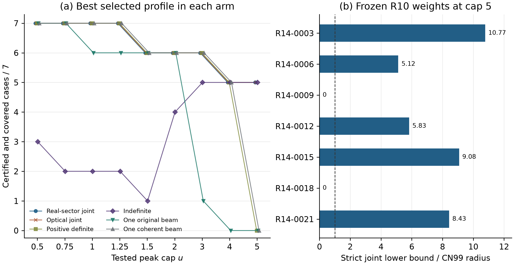

# 旧 R10 固定权重在七件 R14 材料中排除五次上限 5

原 R10 环形对象已用固定权重 \(u=5,\mu=10^{-3},\lambda=0\) 排除峰值不超过 5。这里保持这组权重，换成七件已有的 R14 材料及各自的带噪复读数。已发表 R10 与七份 R14 的保存 \(G,B,S\) **逐元素完全相同**，因此这是同一算子上的材料与噪声实现迁移。它和此前的 96²、10 发 20 收平面波全环是不同采集算子。**5/7** 件严格排除上限 5，且 **7/7** 件离线真材料均在各自的原 CN99 球内。 [逐案数据、噪声合同](public_provenance.json) · [严格证书](verified.json) · [真材料覆盖标量](offline_scalar_scores.json)

图左使用各臂在同一预定权重表中找到的已验证结果。图右只用旧 R10 的一组权重。条值是残差证书下界除以该材料的原 CN99 半径，超过 1 排除上限。 [PDF 图](max_struct_transfer.pdf)

## 完全固定上刊权重

统一采用纯实部扇区 \(\lambda=0\)。在实际 576 个状态变量上，独立确认 \(K\) 恰有 4 个负方向，距零谱隙下界为 \(3.23247356\times10^{-5}\)。十二束照明有八个候选源方向可以保留。任何单个原照明或单位相干源使用该具体权重时，单源惯性界均为零。每件的实际数据进入同一几何预处理后的源矩阵。下表的值为便于阅读的近似，逐项区间为最终判据。

| R14 观测 | 原 CN99 半径 | 固定权重多源下界 | 比半径 | 真材料全波残差／半径 | 离线真峰值 |
|---|---:|---:|---:|---:|---:|
| 0003 | 0.00801549 | 0.08632233 | 10.77 | 0.95449 | 14.6954 |
| 0006 | 0.00870199 | 0.04459510 | 5.12 | 0.93721 | 16.1063 |
| 0009 | 0.00843445 | 0 | 0 | 0.95350 | 16.2539 |
| 0012 | 0.00940336 | 0.05484872 | 5.83 | 0.95439 | 17.0036 |
| 0015 | 0.00660796 | 0.05997307 | 9.08 | 0.92999 | 15.8433 |
| 0018 | 0.00663469 | 0 | 0 | 0.98828 | 4.2819 |
| 0021 | 0.00875946 | 0.07382779 | 8.43 | 0.95238 | 16.0991 |

0009 的真峰值为 16.25，但扩大到完整权重网格仍只证到 3。0018 的真峰值为 4.28，阈值 5 本来就不应被排除，而这次最高只证到 1.25。可行性最接近球边界的是 0018，严格余量至少 \(7.77\times10^{-5}\)。对七件真材料重新求解的完整复端口与历史保存的干净场相差至多 \(3.57\times10^{-15}\)。整个比较沿用原半径，无重新估噪或加宽。

## 预定网格中的多源和单束比较

使用 9 个上限、11 个实部尺度和 13 个有正有负的光学比值。全组共用相同的 1,287 个几何与权重配置。读数用于对照表内的择权，真值最后才打开。表中计数为已有严格区间过线的材料数，且真材料也在该误差球内。

| 上限 | 纯实部多源 | 非零光学多源 | 正定多源 | 不定多源 | 最强原发射单束 | 最强相干单束 |
|---:|---:|---:|---:|---:|---:|---:|
| 0.5 | 7 | 7 | 7 | 3 | 7 | 7 |
| 0.75 | 7 | 7 | 7 | 2 | 7 | 7 |
| 1 | 7 | 7 | 7 | 2 | 6 | 7 |
| 1.25 | 7 | 7 | 7 | 2 | 6 | 7 |
| 1.5 | 6 | 6 | 6 | 1 | 6 | 6 |
| 2 | 6 | 6 | 6 | 4 | 6 | 6 |
| 3 | 6 | 6 | 6 | 5 | 1 | 6 |
| 4 | 5 | 5 | 5 | 5 | 0 | 5 |
| 5 | 5 | 5 | 0 | 5 | 0 | 0 |

非零光学权在这批数据上提高了部分残差余量，通过数与纯实部相同。上限 4 时，单独取某一原发射没有过线案例，允许在 12 份同一数据中挑最强相干组合则有 5 件过线。上限 5 时预定权重表上的最小数值负惯性为 4，五件通过全部来自不定证书。单源未过线仅描述已扫权重与共同噪声球，未覆盖其他权重、空间分块或其他单源松弛。 [全部 378 个配对项目](paired_results.csv) · [数值权重全表](numerical_grid.json) · [汇总及费用](summary.json)

单束的最坏误差半径一律用原联合 δ，因为任意单位复组合 \(a\) 都满足 \(\|Ea\|_2\le\|E\|_F\)。原发射比较取证书最大的原列。相干比较允许用全部已存端口选择相干组合。R14 合同的 1% 是相对干净复场的 RMS 噪声尺度，CN99 球的半径以原独立圆复高斯模型计算。7/7 是本批实现的离线覆盖核对，适用范围限于本有限离散传播模型。

## 成本与复跑

Apple M4 单线程。整批数值扫描 **21.93 s 墙钟 / 21.60 s CPU**，计 1,287 次共享 LDL、108,108 个复右端和 9,009 次十二阶源谱。严格验证 **238.54 s / 227.74 s**，计 127 次独立共用几何分解及区间检查、371 次成功源谱核对和 4,452 个区间验证的提案右端。固定 R10 权重的一次共享几何核查耗时 1.21 s，七份源谱均在其上复用。另用 **17.32 s / 17.09 s** 独立核对七件生成材料的全波端口。公开包含七份保存复读数、共用几何和离线标量，不含历史封存材料。 [复现步骤](REPRODUCE.md) · [在线封存时点](online_seal.json)

[已有研究与英文论文](https://migodam.github.io/b1-probabilistic-maxwell-imaging/research/z_alg_optical_inertia/submission/)
