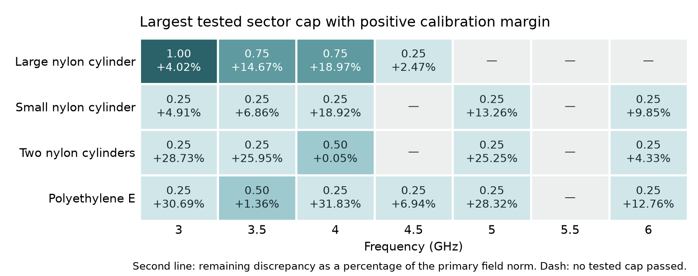

# 换一根参考柱以后，材料结论还剩多少余量？

同一次测量，用两根不同的金属柱来校准，得到的介质散射场相差 **17.78%–62.57%**。用同一根柱，改用测量前或测量后的空场重新校准，相差 **0.64%–5.94%**。这里的百分数都相对该目标、该频率的主校准场。哪根参考柱代表加载介质时的天线响应，实验并未提供答案。四种固定处理方式足以量化结论对此选择的敏感度。 [原始采集论文](https://doi.org/10.1109/MAP.2011.6138442) · [28 份误差记录](four_calibrations.json)

## 一个可实际计算的余量

固定金属柱及空场得到四个复场 $Y_j$。用大柱和第一次空场得到主校准 $Y_0$。令 $\mathcal F_u$ 为给定材料上限的全体离散预测场。前一节区间计算给出 $d_0\le \operatorname{dist}(Y_0,\mathcal F_u)$。只需用同一通道、同一单位计算

$$
R=\max_j\|Y_j-Y_0\|_F, \qquad b_{\mathrm{left}}=d_0-R .
$$

若真实可比较场落在这四个场的凸包之外至多 $b$，对任何材料预测 $F\in\mathcal F_u$，三角不等式给出残差下界 $d_0-R-b$。因此 $b<b_{\mathrm{left}}$ 足以排除上限。证明在整个凸包上成立，因为到 $Y_0$ 的距离在凸组合上至多是四个端点距离的最大值。仅对四个端点各验一次不能控制它们之间的观测。所有 $R$ 均针对数值模型保存的复场逐通道用向外舍入求上界；$d_0$ 取已严格核对、在该材料合同下允许的最强结果。

以被动材料允许的实部或非负光学乘子计算，四种校准的凸包上，在 0.25、0.50、0.75 和 1.00 四个材料上限分别有 **20、5、3 和 1 份观测**留下正余量。它们分别来自 4、3、1、1 件物体。若只算“换参考柱”及“空场漂移加留出金属残差”两个经验标尺，则会得到不同数字。这两项标尺和四校准凸包是不同的误差集合。 [逐项余量](transfer_margins.csv) · [分子与分母](summary.json) · [经验标尺对照](../manitoba/REPORT_ZH.md)

图中上行是四个已测试上限中可以排除的最大值。下行是仍可容纳的其他误差，占主校准场范数的比例。横线表示本次上限均未得到正余量。3.5 GHz 的 E 形体在上限 0.50 只留下 **1.358%**；4 GHz 的双尼龙柱只留下 **0.0525%**。对相同指标，大尼龙柱在 3 GHz 排除到上限 1 后还有 **4.018%**。在 5.5 GHz，四件均未留下正余量。 [PDF 图](calibration_headroom.pdf)

## 把收发互换，能识别多少误差？

在接收与发射的物理模式采用互易归一化、端口集合允许转置时，任何互易散射场 $F$ 满足 $F=F^T$。这里是普通转置，保留传播相位。对校准后的成对测量写 $Y_s=(Y+Y^T)/2$、$Y_a=(Y-Y^T)/2$。对称与反对称矩阵在 Frobenius 内积下正交，因此

$$
\|Y-F\|_F^2=\|Y_s-F\|_F^2+\|Y_a\|_F^2 .
$$

$\|Y_a\|_F$ 是同一份校准读数偏离任何互易端口场都必须付出的误差，完全不需要初始图像或介质名义值。一个宣称小于这项误差的总半径将使所有互易预测都不可行，不能据此推出物体一定含有高介电材料。互易的天线误差或三维散射差异仍可留在 $Y_s$ 里。

选定 288 个端口按收发互换成对保留。28 份读数的反对称分量占主场 **0.619%–5.981%**，其中 9 份大于同单位下两次空场的固定增益漂移，最大为其 1.77 倍。我们将 $Y_s$ 直接送回同一个 40² 算子，用原来选中的乘子重新验证。每个校准端点也作相同的对称投影，再对四个端点的凸包核算。两次实验在全部四上限下留下正余量的具体目标和频率一致。这说明这些通过项目经得起去除反对称误差的检验。它不能校准仍满足互易性的模型差异。 [逐项对称场余量](symmetric_margins.csv) · [固定乘子独立回放](../manitoba/reciprocal_verified.json)

## 有损材料怎样解释峰值

对无损实材料，上限 $u$ 直接限制对比度 $\chi=\epsilon_r-1$。对有损的被动标量材料，设 $\chi=x+iy$、$x>0$。实扇区假设是 $|\chi|^2\le ux$，限制 $x+y^2/x$；允许的非负光学乘子可以配合这条不等式。若另有独立证据表明所有非零材料满足 $|y|\le\kappa x$，就能将扇区峰值大于 $u$ 换成实对比度峰值大于 $u/(1+\kappa^2)$。没有该条件时，小 $x$ 与显著的 $y$ 就可给出很大的扇区量。按介电常数定义的常规损耗角正切约束 $|y|\le t(1+x)$ 本身也不控制 $|y|/x$，尤其是接近背景时。四校准余量以明示的材料合同为准。即使用完全无损的等式，4 GHz E 形体新增的通过项也还需要独立控制介质加载时的失配。 [实测参数和容许范围](../manitoba/REPORT_ZH.md)

原始数据由 Manitoba 提供。原处理选项、符号和通道均沿用预先确定的规则。对称投影和四校准凸包属于针对实测结果做的敏感性检验。 [区间计算](calibration_hull.py) · [余量计算](margins.py) · [作图](plot.py) · [研究顾问与作者回应](../advisor/RESPONSE_ZH.md)
