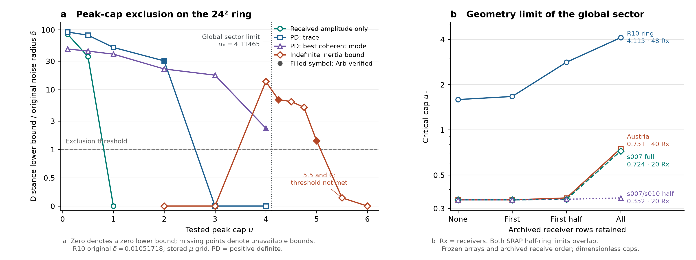
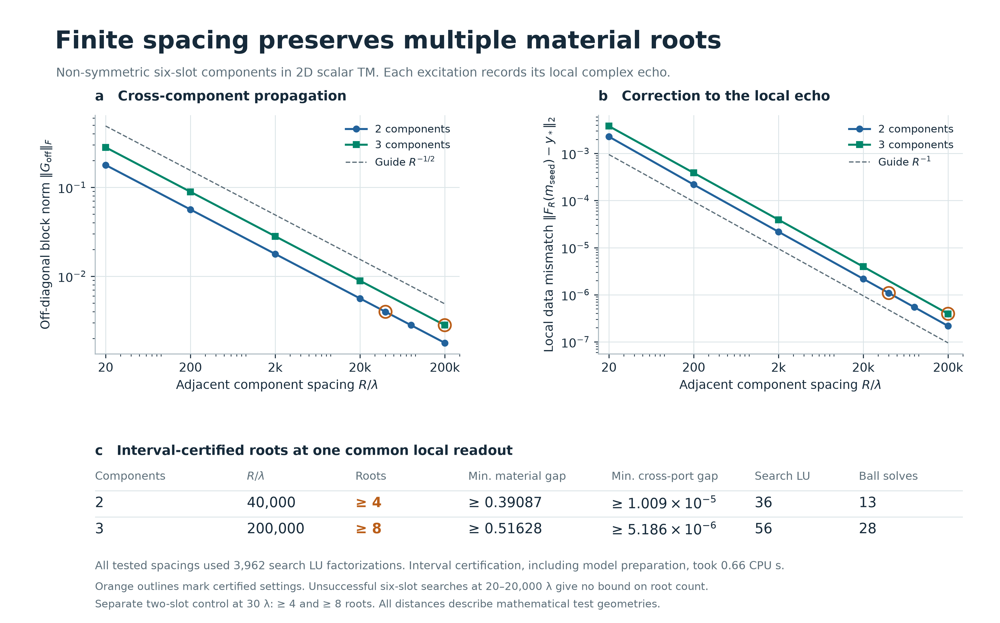
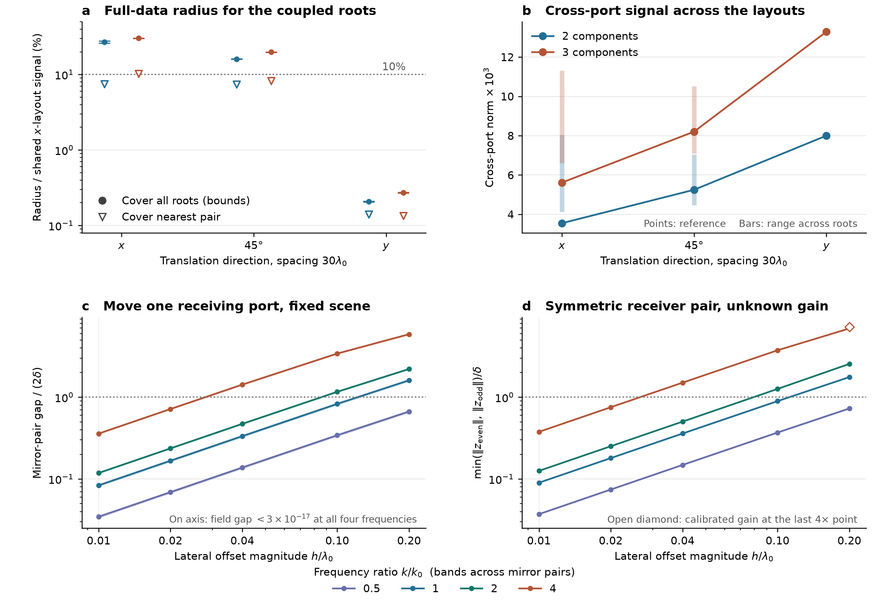
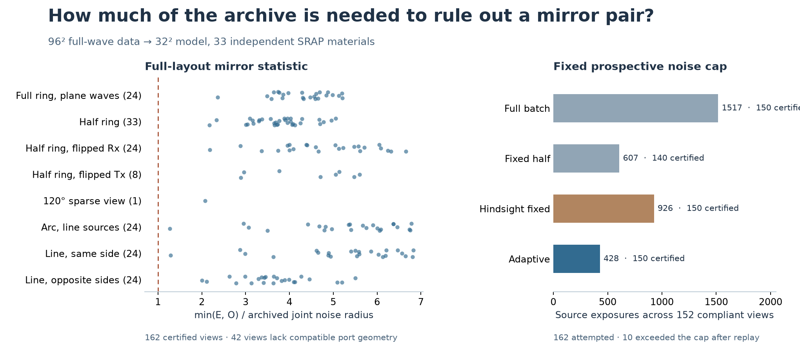
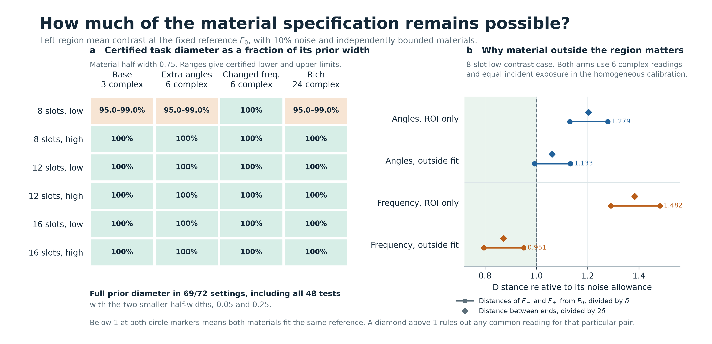
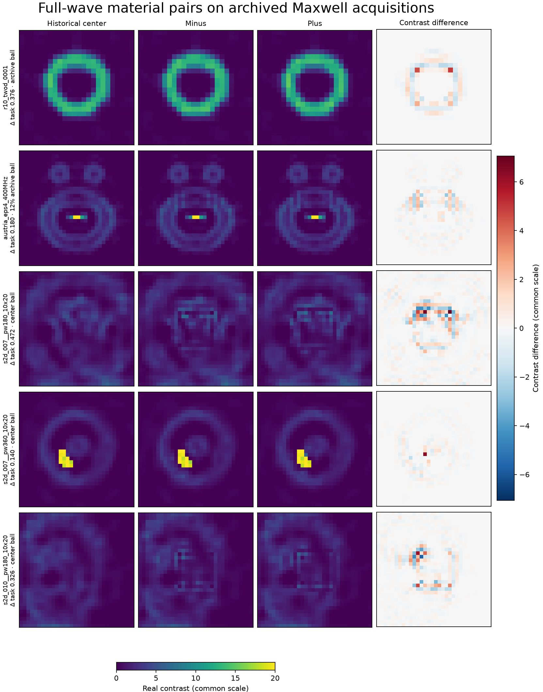

# 不重建整张图，Maxwell 读数能确定哪些材料信息？

**在 576 个像素各自独立变化的环形样本上，旧读数已经足以证明，至少一个像素的介电对比度大于 5。** 对比度指相对介电常数减一。发射 12 次，每次有 48 处接收。把所有像素都限制在 0 到 5，则任何材料的复电场与已记录数据之间，距离的严格下界约为 **0.014695**，原噪声半径约为 **0.010517**。两者按相同的全阵列单位计算。这个结论使用有噪声的合成复场和原离散物理，不需要图像初值、材料真值，也不定位峰值在哪个像素。[严格数值证书](highdim/sector_inertia/certificate_u5.json)

**另一个可以边测边判断的问题是镜像歧义。** 如果阵列左右成对，可以直接判断，还有没有一份材料和它的镜像同时符合数据。在满足预设噪声上限的 152 份历史合成观测里，逐组读到足够就停，用 **428 次发射**得到 150 份肯定判断。读完整批需要 **1,517 次**，也得到 150 份。即使看过结果再替每种阵列选同一顺序下最省的固定发射组数，也要 **926 次**。这项节省只对应镜像判定。整张材料图的恢复误差尚未见到同样收益。[逐份观测、失效条件与发射次数](highdim/reflection/README_ZH.md)

在二维全波散射中，一组装置可以有两份正则的材料解释。把这样的装置放在同一介质中，两个组件可保留四份解释，三个可保留八份。 所有组件始终相互散射。只读同组件的收发通道时，这些材料给出完全相同的复数读数。打开跨组件接收，结果取决于信号和误差。在两槽三组件、间距 30 个波长的离散例子中，10% 联合误差下八份材料两两可分；在另一套六槽组件、间距 20 万波长的装置中，即使接收全部通道，不到 **0.00312%** 的联合误差就能让八份材料同时解释同一份读数。

| 你关心的问题 | 本轮得到的答案 |
|---|---|
| 两材料能推广多远？ | 两点公式和在对称布设上的成对排除适用于任意个材料参数。对本文构造的采集族，每个有限组件数 $L$ 都有一个有限间距，使至少 $2^L$ 个不同的正则材料解产生相同本地读数。另有连续二维标量 TM 的存在性证明。 |
| 高维时哪里会贵，哪里可以省？ | 逐根列举的输出可以按指数增长。检验一个材料峰值门槛时，每个试探乘子只需分解一个电流空间矩阵，再对一个照明数大小的小矩阵计数。在对称阵列上排除指定镜像或旋转，只需遍历已测复数一次。这两种节省都有明确的失效条件。 |
| 哪个结构值得写？ | 最值得写的是接收不到的电流能遮住多少信息。一条隐藏电流足以让总能量检验对任意观测失效；要求多个照明共享材料后，每个可抵消的方向至多遮住一个独立的照明方向。环形样本在总能量检验已经必然失效的范围内，仍给出了峰值证书。 |
| 它能怎样帮助 GN、CIE 或实际测量？ | 发射过程中可以判断某类歧义是否已经消除，达到要求就能省下后续发射。也可对同一份读数给出任何重建器都无法突破的区域均值误差。在一例等能量对照上，增加接收角比换频至少多排除了先验宽度的 1%，结论对标定敏感。 |
| 找回了更多正确材料吗？ | 对实际保存的数据，取得了新的材料峰值下限，也量化了哪些区域均值仍可能差很远。相同计算预算下，普通任务约束 GN 在 24² 环上与弱方向法持平，在 Austria 的原始噪声下找到了更宽的可行范围。没有建立整图恢复优势。 |
| 能投强 *Inverse Problems* 吗？ | 可以围绕“接收盲区与多源材料界”写理论与计算稿。决定性的高门槛结果目前来自一个已经研究过的离散材料。固定实际孔径下独立重复、模型公差及与多照明光子学先例的精确区分，仍是强刊差距。 |

## 怎样从 12 次照射中读出一个绕不开的材料峰值

Neon 从光子器件的设计极限提出了一个方向纠正。与其逐个猜像素，不如先假设“每个像素的对比度都不超过 $u$”，问这种材料能否产生已经收到的复电场。每个格子的电流都等于该格子的材料对比度乘以总电场。把入射波换为两个源的相干叠加，在同一件物体上，对比度仍是原来的数。这样得到的必要条件同时约束各次照明和它们之间的关系。即便没有材料候选，它也能排除整个 576 维材料盒。[数学 §9–10](MATHEMATICAL_THEORY.md)

在环的旧观测中，只用总接收幅值的物理对照，在预设门槛中最多排到 $u=0.5$。将每个发射源的电流约束加总后，排到 $u=2$。用所有已经测到的复电场选一个相干组合，严格排到 $u=4$。Austria 和 SRAP 壳核全环这两份 1,024 像素的存档数据也能排到 $u=0.5$。这些门槛用**一个**合适的相干组合就过得去。累加其他组合增加了余量。半环两份读数仅在较弱的 $u=0.1$ 门槛取得数值排除。[各方法、噪声单位和计算费用](highdim/sector/README_ZH.md)

然后出现了一个可以反证的解释。环的接收器看不见某些内部电流，沿这样的方向增大电流，预测读数完全不动。我们严格算出，在 $u>4.114651$ 时，**对每个照明单独使用上述总能量条件，可以为任何端口读数编出相容的电流**。这些电流并不一定对应真实材料。调优化器或增加单源初值都无法补回在这一步丢掉的信息。[隐藏电流及最小反例](highdim/sector_geometry/README_ZH.md)

要求 12 次照明共享同一份材料，结果变了。在 $u=5$、固定乘子 $0.001$ 处，场方程中用来估计误差的矩阵恰有四个负方向。它们最多抵消四个相互独立的照明差异。去掉最强的四个后，第五个方向留下的差异仍使整体残差至少达到噪声上限的 **1.397 倍**。这一结论同时验证了负方向数、剩余差异和原噪声半径。$u=5$ 是看到前一组结果后，在同一个环上追加的机制实验。$u=5.5$、$6$ 均未过线。在原先五份读数的共同门槛网格上，保留负方向只增强了余量，没有新增排除。对另两份归档材料的峰值也没有找到同等强度的增益。[严格证书与全部失败](highdim/sector_inertia/README_ZH.md)

环的旧数据确实有别的全波材料候选落在允许误差内，所以这里排除 $[0,5]^{576}$ 给出了有内容的材料信息。Austria 的细网和反演网格不同；三份 SRAP 存档更没有找到原误差球内的完整材料候选。对这些例子，证明的意思是“在指定离散物理中，任何可能的解释必须满足该门槛”。要把结论交给一台仪器使用，还需保证真实物体和系统误差确在这份合同内。

峰值 5 的证书还剩 **0.004178** 的绝对数据误差余量。把原噪声半径、相位和幅值标定都算入，在模型准确、其余条件相同时，新增公共复增益误差小于约 **0.41%** 仍足以排除该盒。网格误差和仪器误差共用这笔余量，不能分别花两次。较低的材料门槛有更大的余量。[不同门槛与标定公式](MATHEMATICAL_THEORY.md)

接收器摆放还可以在测前比较。固定发射与初始四分之一阵列，从剩余位置补四个接收器。我们试了均匀补角、紧邻补点、固定种子的随机选点和一条物理规则：每次选最能接到当前隐藏电流的位置。只由几何得到的临界对比度在五个视图都高于均匀补角，环上从 2.9312 升到 3.7402。但把实际存档读数交给两套阵列，五次都没有提高可以排除的最高预设材料门槛。环上两种方法都只排到 2。事前知道某种接收布置容许更好的界，与它真的给出更强的材料判断，之间仍有距离。[开测前选定的位置、普通均匀基线与实际读数](highdim/sector_geometry/DESIGN_ZH.md)

## 为什么把接收器接在哪里，会改变问题的答案

想象一块有两个待标定介质槽的部件。在发射器和接收器都位于对称轴时，左右材料交换会留下相同读数。把接收器横移 0.013 个波长，直接交换立即能测出差别。但允许两槽介电常数各自调一点，仍能找到第二份材料。离散全波模型中，两份材料分别为 $(2,8)$ 和约 $(7.92675,2.38896)$。每一份周围的材料导数都可逆。假如已知道真实材料在哪一支，附近的小变化可从读数反推；单凭这份读数仍无法选支。

接下来沿直线放置多个这样的部件。每个发射器逐次工作，先记录同一部件旁接收器测出的散射场。用同一次发射去读其他接收器，则不用再照一次。两种数据都由同一套全波正演产生。在二维背景中，一次跨部件传播的振幅随间距 $R$ 按 $R^{-1/2}$ 衰减。本地读数要受远处部件影响，场必须过去并返回，误差为 $O_L(R^{-1})$。单组件的两份解只要各自在材料盒内部且导数可逆，这个较小的物理扰动便能由两支各自附近的材料变化补偿。每个组件的两个选择组合起来，得到不同的完整材料。常数依赖组件数、种子的条件和收发几何。[推导与条件](MATHEMATICAL_THEORY.md)

先用历史非对称六槽种子做这件事。它离折叠很近，单组件材料导数最小奇异值只有约 $7\times10^{-6}$。在预定的 20 至 20,000 波长四个距离上，迭代未能找齐分支。两个组件在补测的 40,000 波长、三个组件在 200,000 波长取得完整小盒证书。这里分别有 **12 和 18 个独立未知材料**以及 72 和 108 个电磁状态。随后专门质疑“大间距是否为该机制固有”，固定上述偏置两槽种子和 3、10、30、100 波长四种间距。两组件分别找到 0、2、4、4 个不同数值根，三组件为 0、0、8、8 个。在 30 波长处为四根和八根逐一完成严格认证。这个对照同时改变了局部材料和收发方式，不能据此把间距改善全部归因于导数。[六槽原始实验](multiplicity/README.md) · [两槽条件对照](multiplicity/conditioning/README.md)

再把每个圆盘内的单一电流近似换成**连续介质圆柱的界面解**，分别匹配电场和法向导数。这是独立的 Fourier–Bessel 多重散射计算。九个截断阶都在 30 波长处重现四份和八份材料。最高两阶之间的材料变化小于 $10^{-14}$，最高阶直接验算的最大相对边界跳差为 $2.8\times10^{-14}$。连续界面模型的单组件场与原圆盘近似相差 0.001486，两套物理使用各自的精确目标读数。这个对照支持分支机制可延续到连续几何。无限级数截断尾项还缺经证明的界，所以严格的数值根证书止于离散物理。[连续圆柱的方程、数值根与误差](multiplicity/continuum/README.md)

## 听所有接收器，有时足够，有时仍差几个数量级

对每组已认证材料，计算每次发射在**每个**接收器上的复散射场。下表问一个可以证伪的问题：同一份完整读数若允许有限误差，能同时容纳整组材料吗？半径按同一组固定参考散射矩阵的 Frobenius 范数归一化。每个通道和每次实际曝光均入账，表内为确定性联合误差。下界来自最远两根距离的一半，上界来自实际构造的一份共同读数。

| 独立材料、一组内的已认证根 | 相邻组件间距 | 容纳全组所需的最小相对半径，向外取整 | 在 10% 半径下 |
|---|---:|---:|---|
| 12 材料，4 根；六槽组件 | 40,000 λ | 0.004725%–0.004742% | 4 份材料都能解释同一份完整读数 |
| 18 材料，8 根；六槽组件 | 200,000 λ | 0.003115%–0.003117% | 8 份材料都能解释同一份完整读数 |
| 4 材料，4 根；两槽组件 | 30 λ | 27.06%–29.16% | 全组排除，最接近的两份仍能解释同一份读数 |
| 6 材料，8 根；两槽组件 | 30 λ | 31.33%–31.69% | 最近两份也须至少 10.6378% 才能相容，八根两两可分 |

这澄清了“多接一个接收器”的收益来源。30 波长三组件的例子在同一发射预算下获得了真实的材料分支辨别能力。表的最后一行只对找到的八根保证分离；材料盒里还可能有其他解释。极远六槽阵列在无噪声下也有非零跨端口差，但其量级远小于参考信号。定理给出了开通全部跨端口后的联合噪声上界，并明确了为此付出的孔径、源数和先验代价。[全矩阵、共同读数与半径证据](multiplicity/full_ports/README.md)

## 同样的 30 个波长，方向为何比总信号强弱更重要

Neon 在隔离工作区读取原始代码和数组后，提出改变组件排列方向。我们用独立的连续界面求解器重算。三个组件横向排列时，全端口误差球容纳所有八根需要约 **30.21%–30.44%** 的参考信号。沿源与接收器所在轴纵向排列，同样的间距只需 **0.249%–0.256%**。纵向的跨组件散射范数反而约为横向的 2.37 倍。能不能辨别材料，取决于两种材料的**场之差**落在哪里；把总信号做强可以同时把两种材料都照亮。[完整方位对照](multiplicity/aperture/README.md)

再固定材料、组件和发射器，只改变接收位置。在严格镜面对称的背景和照射下，两个左右相反的材料在对称轴上对任意频率都给出同一个复数。两侧各放一个接收器，横向偏移 0.10λ 时，基频下给定的 10% 联合误差仍盖得住差异；偏移 0.20λ 时，所有预先指定的镜像对都超过阈值。这是构造的连续数值例，噪声合同按报告中的信号范数定义。轴上增频与侧移接收的结论来自不同的物理对称条件，不是对宽带成像一般价值的判断。[四频、相同曝光和逐对余量](multiplicity/aperture/results.json)

这给了一个可推广到任意材料维数的问题。设整份复数据为 $y$，将每个发射器和接收器换到它的镜像位置，相应重排后的数据记为 $Uy$。把两者相加再除二得到“镜面两侧相同的成分”，两者相减再除二得到“左右不同的成分”。若**这两种成分的范数都超过仪器的联合误差半径**，则整片先验材料域里都找不到一对能同时解释这份读数的镜像材料。每个候选甚至允许拟合自己的未知公共复增益。已经校准绝对相位时，左右不同的成分过阈值就足够。判据由数据直接计算，没有利用生成材料。[证明、反例和模型误差余量](MATHEMATICAL_THEORY.md)

## 在 1,024 个材料未知量的旧观测上，可以提前多久停测？

我们直接读了三个档案的收发坐标、入射和接收矩阵、带噪复电场以及原误差半径，共 58 份不同材料、229 个观测视图。SRAP 档案用 96² 细网格生成数据，32² 网格表示待反演材料。其 33 份材料产生 204 个视图，其中 162 个的收、发两端都能按同一镜面配对。按档案自带的整批误差半径，162 个全部足以排除先验域里任意一份材料与其镜像同时解释当前读数。最弱的一份也高出阈值 27.27%。另外 42 份没有所需的成对几何。Austria 用独立的 150² 网格生成，判据能排除上下镜像，对左右镜像则判不出。旧 R10 的 24 份材料所用收发环能够作四分之一圈旋转，三个非平凡旋转分别在 24 份读数上全部通过。一个视图可以检验几个方向，它们共享同一份材料。[逐视图区间结果和几何](highdim/reflection/results/field_results.json)

档案里的实际噪声大小在实际开机前通常未知。为此另做了一次回放。发射顺序按收发几何固定，先登记整批误差的绝对上限，每收完一组才根据已有数据决定是否停。上限参考了三份此前看过的场值。162 次几何适用的尝试中，事后能确认 152 份符合这个约定。其余 10 份实际噪声超额，在线无法察觉，也不能把它们算作可靠成功。全部 162 次尝试的真实回放花费是逐组 450 次发射、固定整批 1,617 次。下表给出满足误差约定的同一批结果。

| 何时停止发射 | 能排除镜像歧义的观测 | 发射总次数 |
|---|---:|---:|
| 读完整批 | 150 / 152 | 1,517 |
| 固定约半批，保留完整的镜面组 | 140 / 152 | 607 |
| 看过全部结果后，给每种阵列选能复现全部成功的最短固定前缀 | 150 / 152 | 926 |
| 每收完一组就判断，足够即停 | 150 / 152 | **428** |

相对于事后最有利的**同顺序固定前缀**，逐组停止少用 53.8% 的发射。两份仍然判不出来的观测来自同一个材料在两种线源布置下的读数。把同样的几何、误差和停止规则交给经典的最佳秩一拟合，判断与发射次数完全相同。收益来自成对测量已经含有足够证据时及时停下。这里计数的是原采集中实际有记录的发射，用它们模拟提前停测；没有进行新的设备实验。对另一批 90 个单源视图，只用一个离轴口和旧整批误差上限，逐口保证为 0/90。多端数据的相干比较、标定范围和噪声上限都影响结论。[曝光明细、失败和同成本基线](highdim/reflection/README_ZH.md)

若每台接收器单独有未知复增益，但同一接收器读不同照明时保持相干，可以按接收器分别检验。也可互换收发两端。用同一批符合预设误差上限的 152 份完整读数，两种放宽都使 150 份通过变为 149 份。那份新失败来自线源同侧布置。只用一个发射源、每台接收器又能独立改幅度和相位时，每个接收口只给一个可任意缩放的数，判据自然失去作用。[逐端口增益的证明和实数余量](highdim/reflection/PORT_GAINS_ZH.md)

## 只求一个区域均值，能否绕过找齐全部材料？

在另一组已知非均匀宿主中，30 个宿主单元已知，另有 8、12 或 16 个独立未知材料槽。要估计左侧一组槽位的平均介电对比度 $\chi=\epsilon_r-1$。左侧取值不同、外围也随之变化时，各处的复散射会在接收器处相互抵消。保持两材料**与同一份既定读数**都相容，才能给实际任务下界。

先在旧采集的材料导数零空间选一个能改变左区均值的方向，再利用固定 Green 的精确两点关系校正两端。18 组预定幅度中 16 组认证了同读数材料对。12 槽高对比的一对均值竟相差 **9.56891**，但其共同读数偏离指定参考达 **1.34475 个噪声半径**，不能拿它给这份参考读数作下界。换成 16 槽高对比的一对，差 **5.30261**，共同读数只偏离 **0.84934 个半径**。对这份参考读数，任何单值估计都必有一种合法解释使它至少错 **2.65130**。这种下界无需选择哪份材料是真值。[指定材料与全波认证](cert/README.md)

再给每个槽独立的制造容差。若能找到两份都与读数相容的材料，其中一份让任务达到先验上端，另一份达到下端，那么整个合法域内的任务直径就**精确等于先验宽度**。这个推理本身属于经典最坏误差分析。物理计算的用处在于验证这两个极值确实能同时解释测量。六个参考材料、四种收发方案、三个容差共 72 个配对条件，其中 **69 个**得到全宽结论。65 个只动左区已足够。另 4 个固定外围时两端相距超过两倍噪声，调整外围后两端同时落入原读数球。整套实验只有六个参考材料；这些参考读数用于设计机制实验，高维带噪归档另行检验。[材料两端与读数余量](faces/results.json)

在 8 槽低对比、每槽容差 ±0.75 的例子，先验均值宽度是 1.500。加角与换频各四次曝光、六个复读数、相同真空发射能量及联合误差。**加角的直径在 [1.42550, 1.485]，换频的直径等于 1.500**。这第一次在本轮相同测量预算下用整盒上下界严格分出了两种设计。基线也有 1.485 的上界，故实验没有证明加角优于旧数据。所有结果都按各自的校准参考读数计算。另一份丰富接收配置中，共用同一个偏离标称约 **0.77%** 的复增益已足以推翻 1.485 上界。换言之，这个至少 1% 先验宽度的差值真实存在于声明的模型，但不能直接变成仪器规格。[整域排除与反例](bounds/REFINED_CAPS_ZH.md) · [共同增益试验](bounds/gain_pressure.json)

## 同一想法放进真正的高维重建

沿用 MAX-STRUCT 和 SRAP 的存盘合成观测。候选生成只读测量、已有求解结果、物理模型和任务区域，固定后再离线评分。四个不同材料共五个视图，含一个同网格对照、150²→32² 和 96²→32² 的独立正演。预先决定的任务是中央方区平均对比度。材料其余像素继续独立。

| 现有读数 | 同一份旧带噪读数支持的材料，及失败原因 |
|---|---|
| 24² 高对比环，576 个材料 | 从历史 G19 端点出发，找到两张中央均值相差 0.37646 的材料，各自都在原噪声球内。任意中央均值估计至少对其中一张错 0.18823。历史 CIE 起点在该球外。 |
| Austria，150² 生成、32² 反演，原 10% 复噪声 | 首批两张合格材料的中央均值相差 0.08998。两个方法随后共用起点、一次完整 Jacobian、七次物理分解，普通任务约束 GN 找到 0.13125 的跨度，弱方向法为 0.08750。 |
| 偏心壳核半环及全环、双环半环，96²→32² | 三个视图均无原始读数球内见证。保存的端点距原读数在 3.62–4.22 个半径之间，粗化真值再正演也超出原噪声预算。只比较两张图预测彼此接近会给错误结论。 |

同一份 Austria 数据在历史较宽的 12% 读数容差下改了排序；既有 CIE 和 GlobalDual 的两张已保存端点已有 0.81388 的跨度。没有依据把弱方向更新加入 CIE、GN 或 FFT-TSOM 后宣称恢复更好。它当前的用途，是复核已有重建的某一材料量有没有被**这份数据**限制到所声称的精度。[逐案例、费用与强基线](highdim/REPORT_ZH.md) · [公开数据独立复算](highdim/REPLAY_ZH.md)

## 研究取舍与论文判断

单点 Jacobian 或一个电流子空间不足以覆盖任意有限材料变化，原因可直接从两点式看出：两端的接收传播和入射总场都依赖材料，局部看不见的方向走远后会出现奇次、偶次散射和边界效应。空间、频率各自只排除了旧 16 对中的一对，而且排除的对象不同。因此选择用有限端口下的**可辨识边界**作为主线，用中尺度整盒证明和高维旧数据去检验其实际解释力。有限集合分类、指定读数的最坏误差、GN 收敛和正确材料恢复，四种结论在本文各自有独立的证据。

我会把 *Inverse Problems* 稿聚焦在**接收器看不见的电流，究竟能掩盖多少材料信息**。由松弛为什么失效推出多照明检验，再用同一份高维带噪读数证明它确实越过单源的极限，这条论证与原任务最接近。指数多个合法解的构造给出另一侧的理论边界，可单独成文。光子学早已有多源电流交叉约束，标准谱交错也足以解释矩阵公式。更有希望的增量是固定端口、可算的失效界、带噪正结论，以及各自的严格反例。现有材料不足以宣布全球首创。[命题级先例对照](PRIOR_ART.md)

无噪声条件下的方向计数还有一个很直接的先例。将 Tian 2013 年论文式 (4.38) 里的两个矩阵取为单位矩阵，就得到本文配方后的计数公式。这个通用代数定理应当引用。我们可以争取的贡献，是从实际 Green 和接收阵列算出它在什么材料区间起作用，再用有噪声的数据给出严格的材料结论。[原定理及逐项对应](PRIOR_ART.md)

离强刊最关键的差距，是能否在固定孔径、已校准的实际误差内，**提前**预报哪种新增接收对一个材料任务有效。目前能用已收数据判断何时可以停，能给某些安排下的严格反例；尚缺代表性材料类的测前定量保证。连续圆柱的谱尾、几何公差与端口标定也需要同一份误差账。以往的成对双基地对称性检测和秩一拟合已解释相当一部分算法，不能把它们重新作为首创。期刊尚未投稿。[完整数学](MATHEMATICAL_THEORY.md) · [实验与复现](EXPERIMENTAL_RESULTS.md) · [Neon 的方向建议与 Astra 的取舍](reviews/RESPONSE_ZH.md) · [下一轮 Pro 交接](NEXT_PRO_HANDOFF.md)
