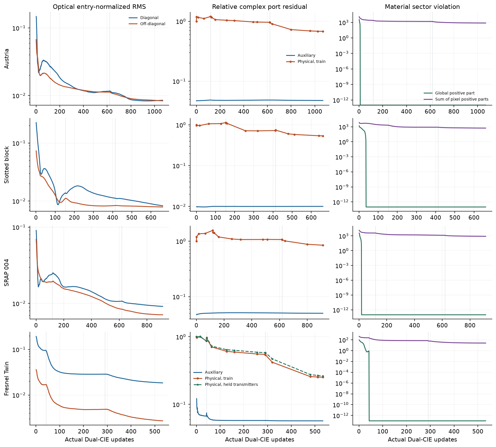
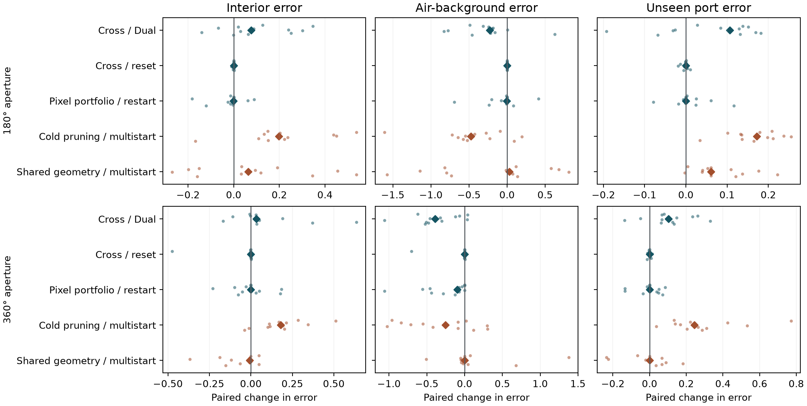
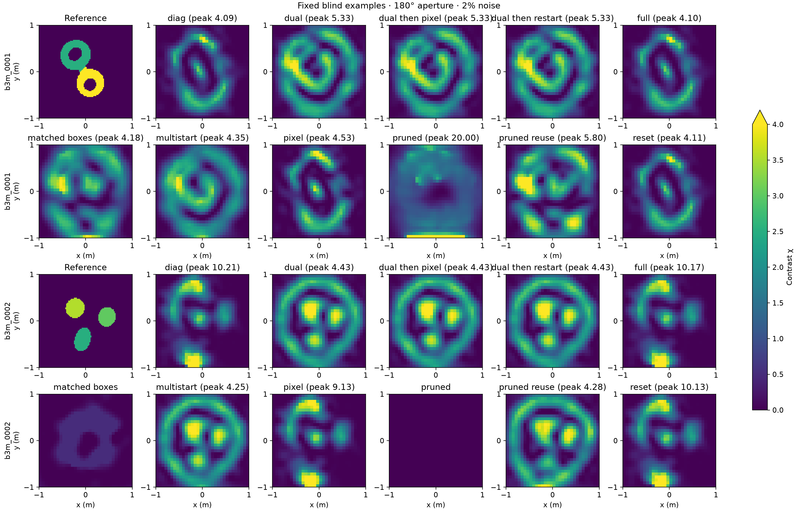
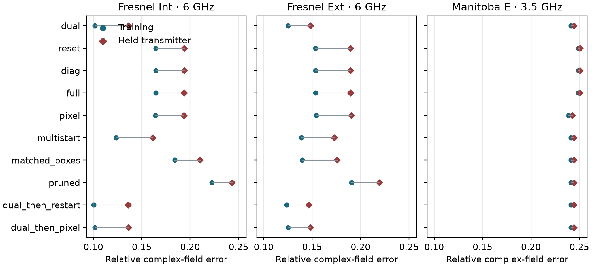
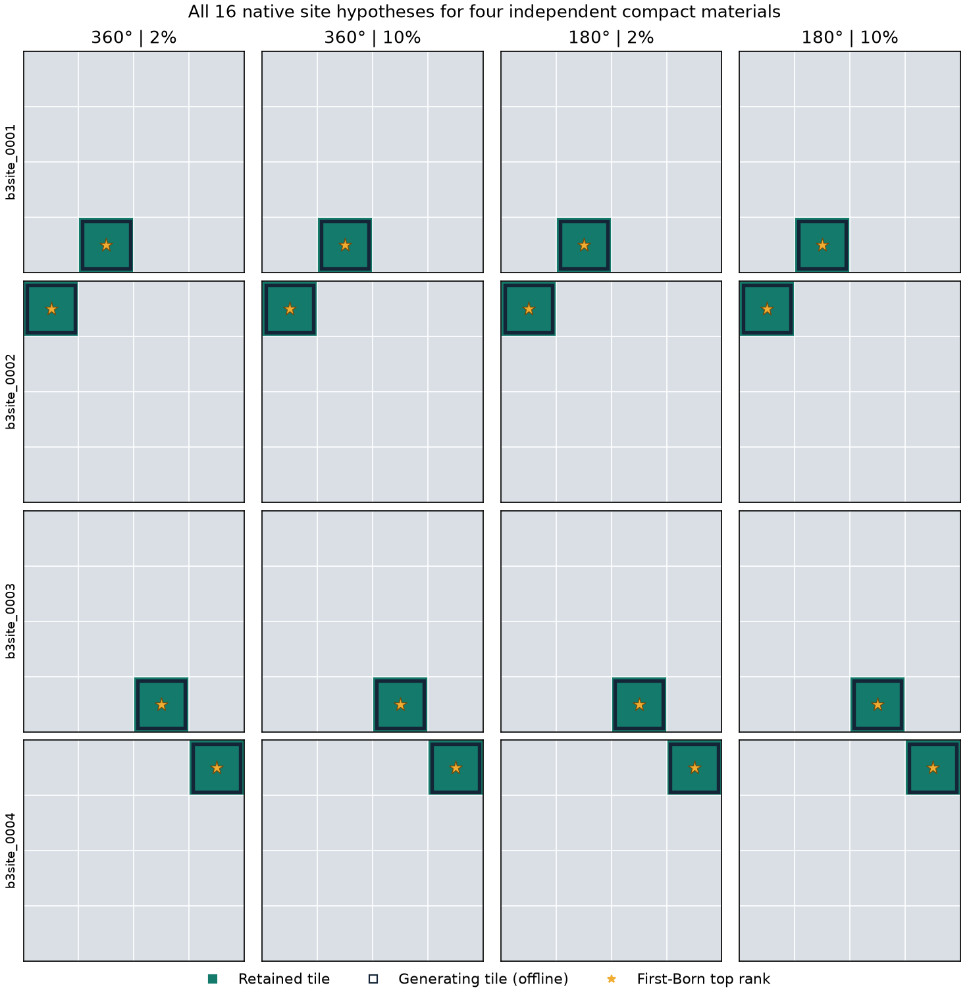

# 电流守恒能帮我们重建材料，还是能帮我们排除错误解释？

**目前最有用的结果是位置排除。** 如果一件缺陷肯定位于 16 个已知位置之一，区外为空气，即使区内 576 格材料都未知，也能直接用收发读数证明某些位置不可能。在四件全新缺陷的 16 组配对观测中，完整方法每次都只剩正确位置。普通一阶 Born 匹配也每次都猜对。前者额外回答了一个问题：其他位置即使换成任意合法的非均匀材料，还能不能解释这批数据？ [位置盲测及全部候选](pruning/site_control/RESULTS_ZH.md)

**峰值也能被读数约束，但数据允许真有不同的材料。** 七件历史高对比材料，每一件都找到了两份通过同一噪声球、峰值相差 1.07–2.03 的材料。在更难的 96² 原生观测上，六件物体中有两件在 2% 噪声下得到类似见证，峰值分别可以降低 4.73% 和 4.99%。这个差距就算优化器求到全局最优也无法由现有读数消除。[七件存档材料](minpeak_maxstruct/REPORT_ZH.md) · [六件原生材料](minpeak_native/REPORT_ZH.md)

**对通用成像，两条路线都未达到验收条件。** 十二件独立复杂物体上，完整跨源修正在半环的全图误差降了，材料内部与背景同时改善只有 3/12；两件 Fresnel 的未见发射预测也变差。复用阵列后，剪枝几乎减半了正演右端数量，但半环相对普通三初值，内外同时改善为 0/12。逐像素修正在全环有小范围收益，追加四件独立材料后，普通共享实材料拟合也得到了相近收益。具体收益、失败物体和耗时均可逐件查看。[逐件结果](results.html)

## 给 Dual-CIE 加一条守恒律，会改变什么？

Dual-CIE 交替更新两样东西，一是每次照明在物体里产生的电流，二是解释这些电流的材料图。迭代到一半，两者通常对不上。我们逐步保存了原算法的电流，随后从同一步的材料重新求解 Maxwell 方程，比较它们各自预测的端口读数。

| 开发对象 | 完整更新次数 | 输出材料的训练复场相对误差 | 逐元素跨源违背与对角违背的中位强度比 |
|---|---:|---:|---:|
| 半环 Austria，150² 生成、32² 反演 | 1,068 | 67.68% | 0.986 |
| 半环开槽块，96² 生成、32² 反演 | 661 | 53.62% | 0.749 |
| 半环偏心壳 004，96² 生成、32² 反演 | 913 | 84.41% | 0.856 |
| Fresnel 双介质柱，8 GHz，60² | 533 | 25.19%（未见发射为 26.30%） | 0.168 |

这些电流本身的端口误差只有约 1%–5.71%。跨照明守恒违背大时，重算的端口往往也差，沿四条轨迹的秩相关为 +0.825 至 +0.974。但在三件合成材料上，它与图像误差的相关却都是负的。只看守恒项的下降就选图，在这些实例上会把物理预测和材料准确度混淆。统计的单位是同一物体不同迭代点。[逐轮电流、功率图和物理复算](diagnosis/REPORT_ZH.md)

**为什么物理上正确的罚项可能帮不到成像？** 对一个区域，把所有发射的电流写成矩阵 $J$，总场为 $E=B+GJ$，区域权重为 $P$。对于任意实对角材料估计 $\widehat M$，
$$
Q_P=\operatorname{Im}_H(J^*PE)=\operatorname{Im}_H[(J-\widehat M E)^*PE].
$$
因此，任何一张真实材料图配上它自己的真实电流，都通过这项守恒。惩罚它可以纠正迭代中的辅助电流，却无法凭空区分两张自洽的材料图。空间还会相消，四个病例第 64 步全局矩阵的范数只相当于逐格范数和的 10.6%–13.2%。缩到单格，归一化罚项又与解析求得的最小共享实材料本构残差等价到两倍以内。我们给出了精确等式、暗场例外和可复算的 FFT 梯度。[电流与材料的推导](CURRENT_THEORY.md) · [实测的空间相消](current_physics/CANCELLATION_ZH.md)

在同一电流表示上分别试了逐源、完整跨源、局部逐格三种修正。材料在体素空间更新，傅里叶子空间用于电流更新。对照增加了“相同频率重启共轭梯度，但不开守恒修正”这一项。它解释了一个原本很容易误判的改善：壳核 004 的全图误差从约 1.385 降至 0.937，仅重启也能达到约 0.937。对实测 Twin，仅重启就把未见端口误差从 26.30% 抬到 51.71%。这次逐源修正没有一次被接受。由此又做了一组配对试验，两组均保留原 Dual-CIE，第二条搜索路径分别用普通第二初值或逐格守恒，并且只在修正被接受时重启。这个补充在读取独立评分之前冻结。[开发消融和运行费用](cross_cie/REPORT_ZH.md) · [补充冻结记录](benchmark/PORTFOLIO_FREEZE.json)

## 复杂物体上的独立成像比较

每种方法看同一份复数读数，使用同一物理代价选图。12 件独立材料来自八类结构，其中六个已有形状族产生八件新样本，另四件为两类新设计的穿孔结构，全环和 180° 半环分别配 2% 与 10% 噪声，得到 48 份观测。每份原生算子为 96²、10 发 20 收。反演使用 32²；将选出的材料提升到原生网格，再用完整方程检查训练端口。独立的另一批发射和接收端口留到最后评分。每个方法每份合成观测给 30 秒，暗室给 48 秒。证书、选图正演和未成功的候选都计入。两个噪声条件先在同一物体内配对，全环与半环各只有十二个统计单位。[冻结输入、选择方式和计时](benchmark/FREEZE.json) · [数据生成与独立正演](holdout/README.md)

| 孔径 | 方法 | 全图误差 | 目标内误差 | 空气误差 | 半峰 IoU | 未见复场误差 | 实际墙钟秒 |
|---|---|---:|---:|---:|---:|---:|---:|
| 180° | 原 Dual-CIE | 1.268 | 0.635 | 1.090 | 0.153 | 0.848 | 20.13 |
| 180° | 仅重启 | 1.135 | 0.687 | 0.861 | 0.129 | 0.914 | 9.04 |
| 180° | 完整跨源 | 1.139 | 0.685 | 0.861 | 0.131 | 0.911 | 9.15 |
| 180° | 逐像素 | 1.148 | 0.699 | 0.909 | 0.139 | 0.906 | 10.18 |
| 180° | 普通三初值 | 1.298 | 0.602 | 1.156 | 0.145 | 0.842 | 30.00 |
| 180° | 带剪枝、复用阵列 | 1.246 | 0.669 | 0.964 | 0.098 | 0.978 | 26.13 |
| 360° | 原 Dual-CIE | 1.055 | 0.435 | 0.871 | 0.378 | 0.577 | 14.23 |
| 360° | 仅重启 | 0.825 | 0.608 | 0.515 | 0.238 | 0.724 | 5.07 |
| 360° | 完整跨源 | 0.775 | 0.553 | 0.504 | 0.299 | 0.718 | 5.11 |
| 360° | 逐像素 | 0.685 | 0.491 | 0.483 | 0.459 | 0.669 | 7.77 |
| 360° | 普通三初值 | 1.177 | 0.613 | 0.939 | 0.226 | 0.582 | 28.85 |
| 360° | 带剪枝、复用阵列 | 1.244 | 0.479 | 1.135 | 0.328 | 0.635 | 20.47 |

每列先对同一物体的两档噪声取平均，再取十二件的中位数。内部与背景的误差都以全图真材料的范数归一。下面所说的“差值”先逐件相减再取中位数，因此通常与表中两列中位数之差不同。半峰阈值对两张图都固定为真材料峰值的一半。[分孔径、分噪声全部方法](benchmark/by_aperture_noise.csv) · [每件材料上的变化](benchmark/object_pairs.csv)

**半环全图误差下降的原因。** 完整跨源修正和原 Dual-CIE 相比，12 件中 10 件全图误差较小，背景误差的配对中位变化为 −0.230。但内部误差为 +0.076，半峰 IoU 为 −0.061，未见复场误差为 +0.106。内外同时变好的只有 **3/12**。在 0001 的 2% 半环上，背景误差从 1.322 降至 0.797，但目标内从 0.675 升至 0.798，IoU 从 0.106 降至 0.055。仅重启与完整跨源产生几乎同样的配对中位变化。全环下，完整跨源相对原 Dual-CIE 内外同时改善为 4/12，未见场只在 2/12 改善。这样一份图适合用来提示欠拟合，无法据此宣称材料恢复进步。[独立配对结果及逐件原数](benchmark/paired_differences.csv)

**一个真实的局部正结果。** 全环上，逐像素修正相对仅重启，11/12 件全图误差更低、10/12 件内外均改善，9/12 件改善未见场。半环上内外同时改善降至 4/12。保留原 Dual 作为第一条路径、仅在被接受时重启的补充实验，相对普通第二初值在全环 9 件全图误差更低、3 件相同；半环为 8 件更低、3 件相同、1 件更高。两种孔径分别只有 5/12 件内外同时改善，未见场配对变化中位数均为零。加入这个控制后，可以保留一项有条件的电流更新收益，成像与实测的整体标准仍然没有满足。[补充对照的参数](benchmark/PORTFOLIO_FREEZE.json) · [独立材料配对表](benchmark/paired_differences.csv)

### 新加四件材料，单独检验光学相位项

十二件中的全环结果留下了两种解释。逐像素更新可能得益于光学关系中特有的相位惩罚，也可能只要让不同照明尽量符合同一种实材料就有相同效果。为区分这两种解释，我们在生成另外四件材料之前冻结了算法、种子和预算。两种方法使用相同的总场权重、步长、梯度重启和傅里叶电流更新，只去掉 $ (\Im c)^2/[2(b+\delta)] $ 这一项。第三种方法只重启。四件覆盖壳、分层核心、三孔板和带孔联通双块，每件都有全环、半环的 2% 观测。[独立冻结合同](mechanism/FREEZE.json) · [两种损失为何只差一项](CURRENT_THEORY.md)

相对仅重启，全环的全图误差配对中位变化，完整逐格光学为 **−0.01037**，共享实材料拟合为 **−0.00985**。半环分别为 −0.02032 和 −0.01876。两种方法相对仅重启都在 8/8 份观测降低未见复场误差，内外同时改善都只有全环 2/4、半环 1/4。单独去掉相位罚后，全环四件的未见端口反而全部略好，中位改善 0.00267；半环只有一件更好，中位变化为变差 0.00210。四件样本无法建立两种方法在总体上等效，但足以说明，**这次可重复的小幅收益无需额外相位罚也能取得**。光学、共享实材料拟合、仅重启三者的单次墙钟中位数分别为 6.50、6.26、6.13 秒；更新次数中位数为 275.5、250.5、177，全部由原阶段停止规则退出。相同时间上限下，校正本身也会改变更新次数。24 个估计经完整原生正演均处于 2% 误差球外，8 个生成材料观测都经 Arb 证实在球内。[新增四件逐件结果、差分检验及费用](mechanism/REPORT_ZH.md)

**支撑剪枝的真实代价。** 对 48 组复杂物体读数，三初值普通搜索完成 1,119 次反演网格候选审计、125 次原生正演尝试。复用阵列的剪枝是 527 次和 130 次，正演右端总计从 12,480 降至 6,570，单次任务实际墙钟的中位数从 29.77 秒降至 23.92 秒。阵列准备全环 22.22 秒、半环 23.44 秒，已经分别摊入各阵列实际使用的 24 个任务。全环相对“同样材料盒、每一支都算”的对照，10/12 件的全图结果持平，另两件改善。半环相对普通三初值，12 件中 **0 件**内外同时改善，只有 1 件改善未见场，误差配对中位变化为 +0.061。单件从头准备时，9/48 组的选图退回空气；普通三初值为 4/48。节省了部分计算，未能在这些困难材料上维持同等的内外和端口质量。[按方法计费和剪除数量](benchmark/cohort_cost_and_exclusions.json)

冷启动在实际 30 秒预算内剪除了 11 个全域低峰盒、两个局部盒。复用几何后，分别剪除 39 个低峰盒、48 个当前选取的小区及 48 个平移小区。独立开标签后发现，两个窄盒在 48 项读数中都未覆盖任何一件真实复杂物体。开放材料盒包含全部 12 件，48/48 均保留；事前定义的宽盒包含 11 件，在 44 项真实包含中零误剪；按真实支撑事后构造的对照包含全部 12 件，48 项也全部保留。它们都没有排除任何一个同类宽假设。另用不计入在线选择的单侧消融回放 96 个局部盒，双侧弱方向直接排除 89 个、仅接收 77 个、仅照明为零。安全性评分另付 96.79 CPU 秒。只有下面独立的“四个未知位置”对照真正把正确而不平凡的小区与竞争小区放在同一候选菜单里。[剪枝及宽支撑对照](pruning/REPORT_ZH.md) · [逐条真实包含与判定](pruning/holdout_offline_safety.json)

所有 528 张合成输出均在各自原生噪声球外。原生区间验收同时证实 48 份生成材料全部在球内，因此这项失败属于当前 32² 表示、求解和 30 秒选图预算的组合；仅凭本实验无法把它分摊到某一个因素。它也说明严谨的支撑排除可以与物理上未拟合成功的最终重建同时发生。最好的 2% 和 10% 条件下输出训练相对误差分别为 22.28% 和 24.84%。合成在线共费 7,764.95 CPU 秒；三件暗室的 30 项共费 469.70 CPU 秒。合成离线复算另付 719.39 CPU 秒，含 381 次非零原生物理评分、16 份空气解析评分、131 次同一读数上完全相同材料的复用；实测离线评分另付 2.81 CPU 秒。独立评分与在线记录的最大相对训练残差绝对差，合成为 $3.59\times10^{-6}$ 以下，实测为 $9.1\times10^{-9}$ 以下。[所有选图封存](benchmark/ONLINE_SEAL.json) · [逐个候选、正演与费用](results.html)

### 32² 网格本身损失了多少细节？

标签开启后，将每张 96² 真图按 3×3 求平均，再放回 96²。这是所有 32² 块常数图中全图平方误差最小的一张，由正交投影直接保证。十二件的相对材料误差下限为 **24.80%–40.65%**，中位 31.20%。即便直接知道真图再做最佳材料投影，原生训练端口也在全部 48 个噪声球外，未见端口相对误差为 7.64%–16.18%。最接近的是 0007 的半环 10%，投影的原生残差 0.68794，半径 0.56913，经区间复核仍在球外。这量化了解剖图上的分辨率损失；端口拟合可能由另一张块常数材料实现。[逐件网格误差与原生端口](holdout/projection/README.md)

进一步固定匿名编号最小的 0001、半环、10%，只做离线可表示性检验。从上面的块均值作一次原生 Gauss–Newton 更新，仍然只允许 32² 个实材料变量，取同一个 0–20 盒。原投影的严格原生残差为 0.936868，单步所得材料的残差上界为 **0.610912**，已低于同一读数的半径 **0.683021**。这一步有 22 个粗网格单元超过生成材料的上限 4。直接把它们截到 4，再用原验证器计算，残差上界仍只有 **0.673259**，还留有 0.0097627 的严格余量。至少这一个测试中，32² 在较紧的 0–4 盒内就能拟合读数，冻结的在线方法没有找到它。这个计算使用已揭晓的参考材料做初始点，不能作为在线算法的恢复成绩；其作用是把网格误差与求解失败分清。[具体 32² 材料与原生区间证明](holdout/projection/strict_witness.json)

## 两个实验室的仪器对哪种结果更满意？

三个确认实物沿用原始接收掩码，用训练发射端选图，再预测未参与选图的发射端。没有重新拟合留出数据的增益。下表为未见发射的复场相对误差，越低越好。Fresnel 两件分别有 964 个留出复读数，Manitoba 有 276 个。

| 物体和频率 | 原 Dual-CIE | 仅重启 | 完整跨源修正 | 原 Dual 加普通第二初值 | 原 Dual 加逐格第二路径 | 剪枝分支搜索 |
|---|---:|---:|---:|---:|---:|---:|
| 内含介质柱，Fresnel 6 GHz | 13.65% | 19.38% | 19.38% | 13.61% | 13.65% | 24.32% |
| 外置介质柱，Fresnel 6 GHz | 14.82% | 18.95% | 18.95% | 14.64% | 14.82% | 21.93% |
| E 形介质，Manitoba 3.5 GHz | 24.43% | 25.03% | 25.05% | 24.43% | 24.43% | 24.42% |

两件 Fresnel 上，逐源和完整跨源臂都复现了仅重启的端口误差。保留成熟搜索路径后，逐格组合回到原方法的水平，普通第二初值在两件上还略好。Manitoba 单独的逐格臂将留出误差从 24.43% 降至 24.26%，但按标称材料参考，内部相对误差从 0.758 抬到 0.779，支持 IoU 从 0.205 降到 0.200。这个单例无法支持实际材料恢复改进。

合成样本有逐格真值；暗室只有公开标称截面和材料值，注册误差、损耗及三维效应仍在。报告给出标称全图、内部、空气及支持的对照，判断实物以未见复场为主。Fresnel 15% 和 Manitoba 约 26.95% 的模型与标定误差尺度来自经验，未证实能包住全部合法材料；两室的支撑假设均保留，未作无条件实物排除。[全部实测误差和标称图指标](benchmark/laboratory_all.csv) · [原始采集与端口选择](chambers/README.md)

## 已知候选位置时，哪些错误解释可以彻底排除？

假设一个候选方块 $H$ 内允许任意实对比度 0–4，区外为空气。对同一几何的每种照明，局部守恒在原生网格上给出
$$
\|J_H a\|_2\le C_H\|B_H a\|_2 .
$$
在同一物理频率上，16 个平移方块共用同一个 Green 子矩阵，严格正谱地板为 0.008999999999975347。先选取在该位置入射场弱的发射组合 $W$，再选对该位置电流不敏感的接收组合 $V$。若 $\|V^*YW\|$ 仍然大到超出任何这类材料的最大响应加测量误差，这个位置就可以排除。所有结论都在实际 96² 的有限卷积算子和原误差半径下向外复核。暗室数据还需要覆盖增益、标定和模型转移误差。[证明和两种单侧消融](pruning/THEOREM.md)

四个新缺陷的位置和真材料都对算法隐藏，测试前规定物体必须完整落入某一个方块。每个方块内仍有 24×24 个可独立取值的单元。位置编号从 0 开始，四件的真位置依次为 (3,1)、(0,0)、(3,2)、(0,3)。整体结果如下，240 个错误候选来自这四件材料在不同观测下的重复检验。

| 方法 | 错误候选得到严格排除 | 仅剩正确位置的读数 |
|---|---:|---:|
| 只利用接收弱方向 | 164/240 | 0/16 |
| 只利用发射弱方向 | 0/240 | 0/16 |
| 发射与接收一起用 | 191/240 | 其余位置交给原状态算子 |
| 加入原状态算子后 | **240/240** | **16/16** |
| 普通一阶 Born 匹配、拟合一个复增益 | 输出位置排名 | 正确位置排第一 16/16 |

首次严格比较用了 166.47 CPU 秒，普通 Born 模板建立加全部排名约 0.004 CPU 秒。每个错误位置的排除证明覆盖了该方块中 576 个单元的全部合法取值。若只要求把一个位置排第一，这四件上 Born 已经做到了。[逐件位置和原始证据](pruning/site_control/RESULTS_ZH.md)

**追查剩余的 49 个错误位置。** 这些位置通过了较便宜的双侧能量检验，却被原状态算子排除。我们把每对收发方向各自的超额响应相加，再对仅有 30 行的收发矩阵检验半正定性。便宜的严格排除数由 191 变为 196，再到 197；加原状态复核仍全部排除。这次完整回放用了 138.69 CPU 秒，另有一次被修正的区间导出尝试花了 19.07 CPU 秒。它是在知道第一次结果后所做的机制实验。[逐项证明与计时](pruning/entrywise_exposed.json)

更重要的是，在上述 49 个错误位置里，我们为 **39 个**构造出能拟合原读数、又满足同一能量上限的线性传递算子。其中 **38 个**还能要求传递矩阵复对称，符合互易性。每一项都重新验证范数与拟合半径。这给出明确的反例：单靠这个标量能量上限和互易性，这 38 个位置无法排除。那些矩阵没有满足共享对角材料律的保证；同一位置上的真实材料已经被严格排除了。将这 38 个能拟合数据的具体电流逐格投到最佳共享实材料后，仍有 69.69%–87.08% 的相对本构误差，中位 80.28%。对所有可能拟合数据的电流，我们另证明了较弱但严格为正的误差下界。其余未找到传递矩阵的算例保持未决。[电流与材料究竟差多少](pruning/CONSTITUTIVE_MARGIN.md)[能量见证](pruning/contraction_control.json) · [互易见证与推导](pruning/RECIPROCITY.md)

这条定位结论对背景先验很敏感。四个开发假设如果允许区外也有最高 0.05 的未知对比度，只有一个被较昂贵的全域证书排除。便宜能量公式能证明四个区外电流均非零，但转回材料时只保证约 $1.4\times10^{-6}$ 至 $2.4\times10^{-6}$ 的峰值。它给出了这个方法失效的量级。12 件复杂形状另有宽支撑对照，允许中央大范围有材料的 48 项均未能排除；受测算子含 49 或 54 个负方向，已经超过十束照明的数量。[区外对比度的定量界](pruning/OUTSIDE_CONTRAST.md) · [宽支撑对照](pruning/holdout_public_broad.json)

## 峰值和面积能保证多少？

设 $p_*$ 为数据噪声球内所有材料的最小峰值。证书给出下端 $L<p_*$；只要构造出一张在原生全波上通过严格验收的材料，就有 $p_*\le U$。因此 $(L,U]$ 是最小可行峰值尚未确定的范围，里面同时包含证书松弛与求解器未找到更低可行图的空间。生成材料与已验可行图之间的峰差，则确实是这些观测容许的物理差异。对两图峰差 $\Delta$，只输入这组数据的任何峰值估计，至少在一图上误差达到 $\Delta/2$。[峰值和面积推导](MINIMUM_PEAK_THEORY.md)

- 原生 96² 的六件全环对象共有十二个读数。在线找到 5 个严格可行上界，另 7 个在本预算内未决。只有开槽块和错列槽的 2% 结果比各自的生成材料峰值更低，它们的最小可行峰值分别位于 $(0.75,3.459978125]$ 和 $(0.75,3.23833890625]$。所有生成材料也是经独立验证的可行参照。这个搜索花了约 3,857 已完成进程 CPU 秒，另付约 202 秒中断工作和 53 秒严格复核。[逐件图、上下界与失败](minpeak_native/REPORT_ZH.md)
- MAX-STRUCT 七件 24²、12 发 48 收的存档材料全部得到严格两端。最窄的是 0018 的 $(1.25,2.39759]$，最宽的是 0009 的 $(3.50,14.34557]$。已展示的峰值估计最坏误差逐件至少为 0.536–1.014。这些是原匹配网格、原噪声约定下的结论。[七件结果、对照和计费](minpeak_maxstruct/REPORT_ZH.md)
- 面积方面，一个超阈值单元对多源扇区的正部最多贡献一个秩。用原噪声球严格得到历史环形件至少 2/576 格对比度大于 4，开槽块至少 3/9,216 格大于 0.5，对应面积为 0.3472% 和 0.03255%。十束照明的这条秩不等式最多能证明十格，96² 上要达到 0.5% 必须证明至少 47 格。这个限制在增加数值精度后仍在。[原生证明与真实高值区面积对照](area/README.md)

## 论文判断与可复核的边界

Paper 1 已单独定稿。其两件原生 96² 对照说明，即使给四分区单源松弛加上对整个材料盒有效的统一电流能量帽，它仍能将最优残差压为零；同一读数的联合多源下界超过误差半径。逐像素的两条 Gram 约束对未松弛电流精确给出共享实材料律。论文排除了对照中具体的统一标量能量解释；更精细的、依赖源或数据的能量限制可构成另一类对照。[英文稿与证据](../z_alg_optical_inertia/ip_submission_v2/)

Track B 的原始文献已经包含光学功率限制、收发子空间、共享支撑成像与单调性方法。此处可独立检查的新增结果，是有限孔径、带界噪声下整类材料的支撑排除，以及用同一批读数严格指出能量与互易性松弛还漏掉哪些物理约束。它只在声明的离散 TM 模型内成立。**Cross-OT-CIE 作为通用成像算法的裁决为 NO-GO，Pruned-CIE 作为同预算通用恢复算法也为 NO-GO。已知候选位置、已知区外为空气的严格排除可有条件保留。** 扩展至非零未知背景、一般形状和标定误差有严格界的实测仍有实质缺口。这个结果可支撑一篇聚焦的理论研究，目前不足以作为优于成熟 CIE 的通用成像论文。[物理先例及文献边界](PHYSICS_AND_SOURCES.md) · [外部研究建议与实测回应](NEON_GUIDANCE_ZH.md)

[逐件结果和未见端口](results.html) · [ChatGPT 科研交接](handoff.html) · [复算入口](REPRODUCE.md) · [完整公开研究包](archive.html)
