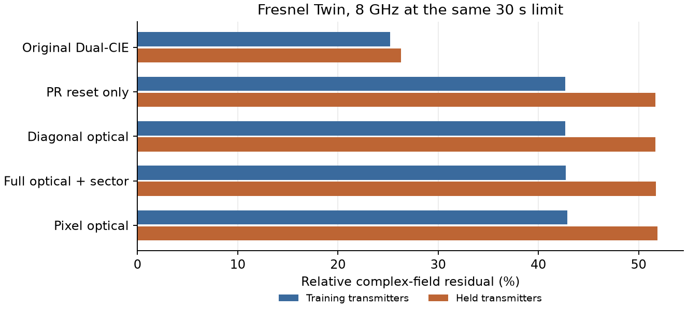

# 原 Fourier 电流空间内的光学修正开发结果

**当前冻结版本未通过开发病例的综合判据。** 004 的改善大部分可由仅重启 PR 的对照复现。开槽例的目标内部及端口预测回退。Fresnel Twin 的留出残差由成熟 Dual-CIE 的 26.30% 增至三种修正的 51.71%–51.87%，仅重启也达到 51.71%。

修正只使用原 DPCS 与 Fourier 电流空间。在每 16 步的检查点以统一实步长降低原状态及端口项与归一光学项的合成损失，材料固定到下一次原读出。匹配重启试验让修正臂和仅重启臂都在相同检查点清空 PR 历史。提前结束阶段时，修正臂还检查光学步的实际系数位移。原阶段迭代上限、总墙钟和实际物理审计照旧。

## 三件合成开发对象

同一 15 秒上限内，按实际物理训练目标择优。表中每格依次是全图材料相对 L2 和完整重算的端口相对残差。

| 对象 | 原 Dual-CIE | 仅重启 | 对角光学 | 全矩阵及扇区 | 逐格光学 |
|---|---:|---:|---:|---:|---:|
| Austria | 1.311 / 0.677 | 1.061 / 0.718 | 1.062 / 0.718 | 1.062 / 0.719 | 1.076 / 0.686 |
| 开槽 01 | 0.988 / 0.536 | 0.996 / 0.809 | 0.996 / 0.775 | 0.984 / 0.818 | 1.011 / 0.710 |
| 壳核 004 | 1.385 / 0.844 | 0.937 / 0.727 | 0.936 / 0.729 | 0.937 / 0.728 | 0.991 / 0.720 |

004 的仅重启、对角和全矩阵三臂通过同样的 225 次更新收束，半峰 IoU 均为 0.272。开槽 01 的全矩阵臂把背景 RMSE 从 1.211 降到 0.889，目标内相对误差从 0.613 增到 0.804，半峰 IoU 从 0.163 降到 0.136。逐格臂在该例走到 769 次更新，超过原法的 661 次，端口残差仍为 0.710。把阶段提前退出与局部功率抵消一并处理，仍未消除该回退。

保留了无阶段附加检查的早期试验、无扇区的全光学消融、四区与十六区对照。按匹配重启的十六区检查，三案全图 L2 分别为 1.068、0.980、0.969，物理训练残差为 0.701、0.739、0.721。其强制保留区域功率的机制没有在开发三案给出统一改善。

## Fresnel Twin 8 GHz

用原九个入射源训练，按每源有效接收掩码评分。另九个入射源的 2,169 个有效复数端口只用于离线计算。全部臂共享 30 秒上限，允许原阶段停止条件结束运行。光学修正使用被动符号的一侧违背。

| 方法 | 训练残差 | 未用源残差 | 实际更新 | 接受修正 | 墙钟秒 |
|---|---:|---:|---:|---:|---:|---:|
| 原 Dual-CIE | 0.25195 | 0.26301 | 533 | 0 | 24.04 |
| 仅重启 | 0.42696 | 0.51706 | 209 | 0 | 9.16 |
| 对角光学 | 0.42696 | 0.51706 | 209 | 0 | 9.34 |
| 全矩阵及扇区 | 0.42718 | 0.51728 | 209 | 3 | 10.72 |
| 逐格光学 | 0.42881 | 0.51874 | 209 | 16 | 8.55 |

对角臂没有接受任何修正，其两个端口误差与仅重启相同。全矩阵与逐格臂接受了变化，两者仍在 209 次正常更新后离开末阶段。三个修正臂比成熟基线更早结束，释放出的墙钟时间没有转化为同等的物理预测。

## 仅在接受修正后重启的备选分支

两个组合共用同一条成熟 Dual-CIE 空气初值轨迹。第二支分别是修正强度 0.25 的逐格臂和均匀 0.65 初值的成熟 Dual-CIE。逐格臂沿用原阶段退出，每次实际接受修正后才重启；实测采用被动光学正部。实验给每支相同限额，合成为 15 秒，实测为 24 秒。仅按原训练物理目标择优，然后才计算粗格材料或留出场。这个开发对照在反演模型审计，独立试验的原网格候选复核另有费用。

| 对象 | 逐格分支组合所选 | 训练残差 | 0.65 分支组合所选 | 训练残差 |
|---|---|---:|---|---:|
| Austria | 原空气支 | 0.67681 | 均匀 0.65 支 | 0.59719 |
| 开槽 01 | 原空气支 | 0.53620 | 原空气支 | 0.53620 |
| 壳核 004 | 逐格支 | 0.72219 | 均匀 0.65 支 | 0.81445 |
| Fresnel Twin | 原空气支 | 0.25209 | 原空气支 | 0.25209 |

004 的逐格组合全图相对误差为 0.966，均匀初值组合为 1.545。Austria 相反，均匀初值组合的物理预测更好。Twin 的两个次支均触及 24 秒限额，逐格支接受了八次修正，两个次支的训练残差均高于原空气支。最终两个组合都选第 531 步，离线留出残差同为 0.26336。此例的留出持平来自同一候选择优。

[组合择优记录](portfolio_selections.json) · [开发配对与实际费用](portfolio_scores.json)

## 源码检查与范围

六个源空间及逐格梯度用保存的实际电流及总场检验。实方向导数的最大相对误差为 8.81e−10，线搜索多项式与直接计算的最大绝对差为 5.56e−17。四案的前 32 次更新，关闭修正后逐值复现原 $m,J,E$ 及全部算子计数。含零上限像素的空间盒测试走过 32 次更新与四次修正，最大越界为零。

这些结果来自开发案例。冻结的代码和参数供独立阶段决定是否复现此诊断。两套计费保留在线择优所用的全波审计和另计的留出端口正演。

[成熟电流诊断](../diagnosis/REPORT_ZH.md) · [公式与复现](THEORY_AND_REPRODUCE.md) · [冻结参数](FROZEN.json) · [合成配对](development_refinement_scores.json) · [Fresnel 端口](development_twin_scores.json)
