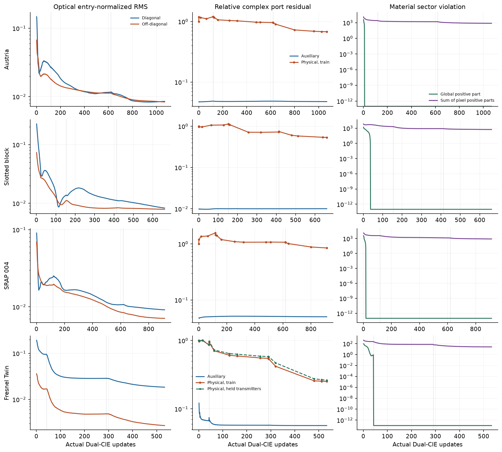
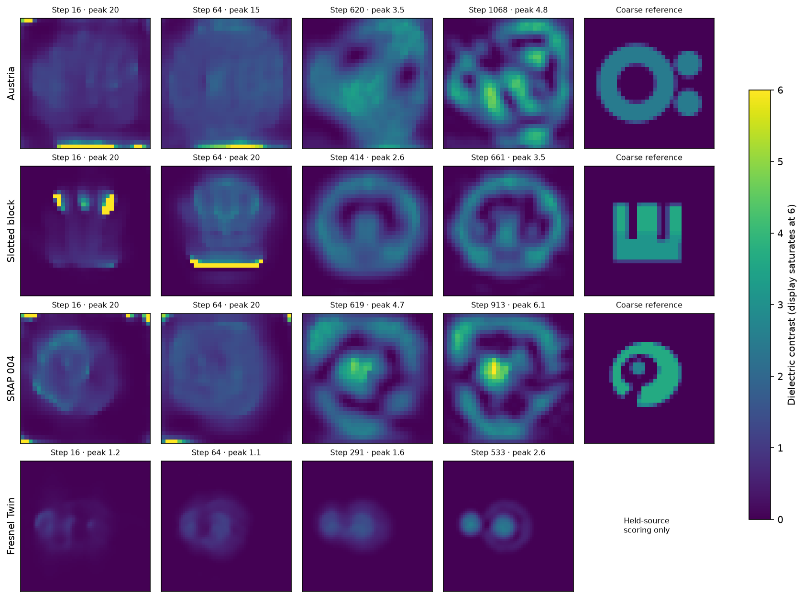
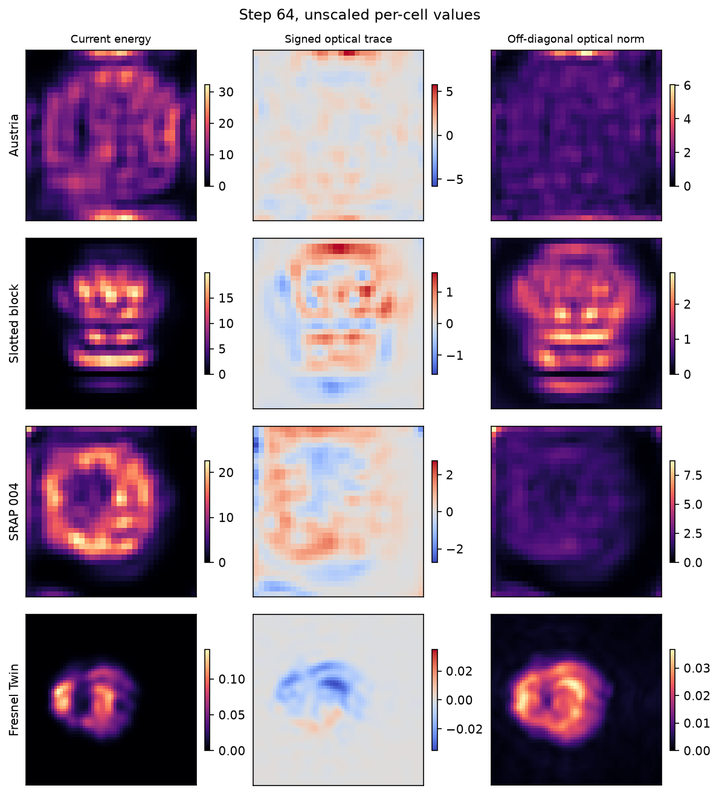

# 四条原 Dual-CIE 轨迹的电流诊断

三个合成实例的辅助电流可以把端口残差维持在 1.0%–5.0%，而由同一步材料完整求解的终点端口残差为 53.6%–84.4%。Fresnel Twin 的辅助残差为 5.71%，实际重算训练端口为25.19%，未用的九个入射源为 26.30%。这两个残差由各自的实测有效通道计算。

| 对象 | 真实更新数 | 跨源/对角原始矩阵范数中位比 | 每元素成对归一 RMS 中位比 | 物理训练残差 | 未用入射残差 |
|---|---:|---:|---:|---:|---:|
| Austria | 1068 | 2.630 | 0.986 | 0.67681 | — |
| Slotted block | 661 | 2.267 | 0.749 | 0.53620 | — |
| SRAP 004 | 913 | 2.376 | 0.856 | 0.84414 | — |
| Fresnel Twin | 533 | 0.484 | 0.168 | 0.25195 | 0.26301 |

合成场的非对角元素共有 90 项，对角有 10 项。把平方和摊到每个元素，并按照两列电流与总场的能量归一，合成非对角强度与对角接近，实测中则明显更低。原始范数反映全矩阵中累计违背的强度；两个比值分别回答不同问题。

| 合成对象 | 终点全图相对 L2 | 目标内相对 L2 | 背景 RMSE | 半峰 IoU |
|---|---:|---:|---:|---:|
| Austria | 1.311 | 0.628 | 1.784 | 0.310 |
| Slotted block | 0.988 | 0.613 | 1.211 | 0.163 |
| SRAP 004 | 1.385 | 0.814 | 1.632 | 0.067 |

非对角成对归一 RMS 对全图材料误差的 Spearman 相关依次为 -0.635、-0.247、-0.680。它与实际训练端口残差的相关则为 +0.955、+0.825、+0.903、+0.974。各轨迹共审计了 18、15、16、14 个非初值步骤。同一物体内的更新彼此相关，材料与端口结果的方向差异限制了这些统计量的单独解释。

## 模型、复核和费用

Austria 对应 150→32 交叉网格观测，开槽和 004 对应不同的 96→32 带噪读数。所有合成正演审计使用各自原反演网格与同一端口。Fresnel 在 60² 离散模型上使用各源原有效接收索引，另以原保存的九个保留入射源和 2,169 个有限复数读数评分。生成参考仅在所有线上轨迹封存后打开。

测量用成熟源逐束更新，保持各自 DPCS、Fourier 模式和材料读出。每步从不改写的生成器读取实时 J、E、材料和阶段，记录带符号的逐源光学对角、Gram 光谱、局部和全局扇区的正部、辅助电流端口残差与本构缺陷。原合同的 b 取倒数得到公式中的 β；当前 PR 用首阶段的 b，材料读出使用各阶段的 b。终点的归一光学矩阵在四案分别有 10、10、10、9 个非零方向。完整物理电流的归一非对角光学违背最大为合成 3.23e−16、实测 4.26e−9。

实际更新耗时与指标计算、快照保存和全波审计分开。四案成熟引擎墙钟分别为 4.12、2.53、3.96、17.55 秒。每案的 receipt.json 给出模型装载、本机总费用、复右端与 Green 作用次数。所有三段均走完。光学矩阵的每个元素和空间功率可用快照直接复算。早期历史迭代交叉核对见回执；跨机末段轨迹仍可能积累小的数值差异。

[逐案机器可读评分](scores.json) · [在线封存](online_seal.json) · [轨迹、快照和费用](trajectories/) · [复算入口](REPRODUCE.md)
