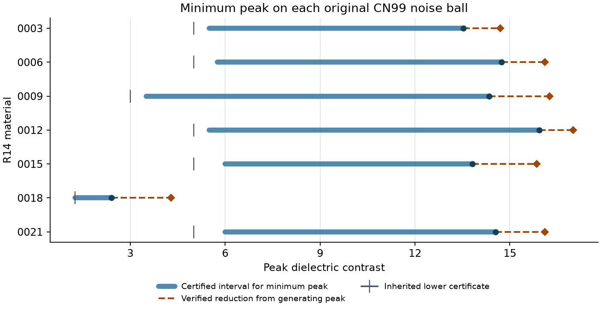
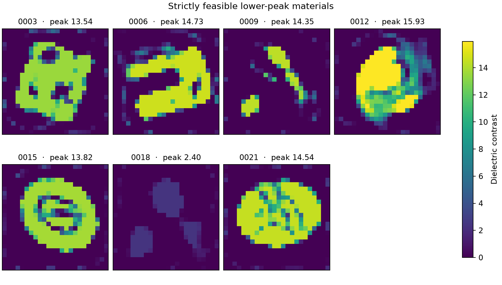

# 七件 R14 对象的最小峰值：证书下界与可行上界

对于每份原始带噪端口数据，我们寻找在同一误差球内能达到的最低介电峰值。严格证书排除峰值不超过下端的任意材料，完整全波验证则给出达到上端的一张可行材料图。两端之间是仍未确定的最小峰值范围。

| 对象 | 原 CN99 半径 | 历史严格下界 | 同批标量下界 | 64 块搜索后下界 | 全波可行峰值 | 全波残差/半径 | 生成峰值 | 已证实的降峰幅度 |
|---|---:|---:|---:|---:|---:|---:|---:|---:|
| 0003 | 0.00801549 | 5.00 | 5.25 | 5.50 | 13.53525 | 0.9999706 | 14.69541 | 1.16016 |
| 0006 | 0.00870199 | 5.00 | 5.75 | 5.75 | 14.73419 | 0.9999867 | 16.10634 | 1.37215 |
| 0009 | 0.00843445 | 3.00 | 3.25 | 3.50 | 14.34557 | 0.9999913 | 16.25388 | 1.90830 |
| 0012 | 0.00940336 | 5.00 | 5.25 | 5.50 | 15.93248 | 0.9987471 | 17.00362 | 1.07114 |
| 0015 | 0.00660796 | 5.00 | 6.00 | 6.00 | 13.81550 | 0.9999364 | 15.84332 | 2.02783 |
| 0018 | 0.00663469 | 1.25 | 1.25 | 1.25 | 2.39759 | 0.9999306 | 4.28189 | 1.88430 |
| 0021 | 0.00875946 | 5.00 | 5.75 | 6.00 | 14.54231 | 0.9999587 | 16.09911 | 1.55680 |

**7/7 获得严格可行上界，7/7 获得可验证的降峰。** 在线搜索较已发表下界提高 6/7 件，高于同批被检验标量方案的有 4/7 件。同批标量对照来自本轮记录的候选，覆盖范围由搜索轨迹明示。
0009 的区间最宽，为 (3.50,14.34557]。0018 的区间最窄，为 (1.25,2.39759]。

## 完整物理口径

七件都是 R14 已公开的 24→24、12 发 48 收全环观测，使用原盘脉冲离散标量 TM 算子。观测包的 G、B、S、Y 和各自半径均与原数组逐项相同。各源共用 48 个已测接收位置，一次使用全部 576 个复端口。半径沿用原 1% 复 RMS、CN99 噪声合同，本匹配网格没有额外模型失配补偿。原材料先验为 [0.02,20]。排除下界覆盖 [0,u]，输出见证落在原先验内，因此区间对两种下限均成立。

上界搜索只读取合法的历史重建及原始读数。按全波残差和材料峰值选历史初值，用精确切向的带盒 Gauss–Newton 降低峰值，逐次用全波端口接受下降。最后对保存候选独立执行区间求解，验证整个原离散状态方程与端口残差。某个峰值下的局部迭代未进噪声球，只意味着本次找不到该上界。

下界复用已发表的同算子证书。64 块按每组 3×3 原生单元划分，在存档标量权重种子上分别更新实部扇区与光学权。每件的在线择权在约一秒内结束。入选后重新用 128 位区间核对惯性与下界；区间复核独立计时。本轮线上计算未读取原材料。封存后才读取同一观测的原区间计分标量，原生成材料的全波残差区间上端为各自半径的 93.00% 至 98.83%。 [原存档的离线区间评分](../../z_alg_optical_inertia/validation/max_struct/offline_scalar_scores.json)

表中最后一列比较已验证的可行材料与生成峰值。如果该差为正，同一批数据至少允许这一幅度的峰值降低。上下界之间仍包含证书松弛和搜索未解决的部分，无法用这两端分别定量归因，也无法推出精确的最小峰值。

## 费用

- Apple M4 上，新上界搜索及严格审计共 26.69 秒墙钟，26.49 秒 CPU。在线求解使用 866 次原生全波分解、10392 个源右端和 32640 个接收右端。独立区间审计另用 4032 个近似逆右端、84 个源右端、336 个接收右端。
- 64 块数值择权合计 5.59 秒墙钟，单件最高 0.960 秒。同一观测的严格证书证明与标量复核分别计费，各为 10.61 秒及 12.83 秒墙钟。
- 供筛选的 77 个已计费历史端点原共付 8784.84 秒 CPU，其中七个最终选作初值的端点为 845.16 秒。历史费用与本机回放费用分别记账。初期对两种归档回执及 JSON 序列化的修复见本地失败日志。

[机器可读区间](summary.json) · [逐例 CSV](brackets.csv) · [在线封存记录](online_seal.json) · [上界证据和可行数组](online/) · [下界证书](lower_certificates.json) · [标量复核](matched_scalar_controls.json) · [复现入口](REPRODUCE.md)
